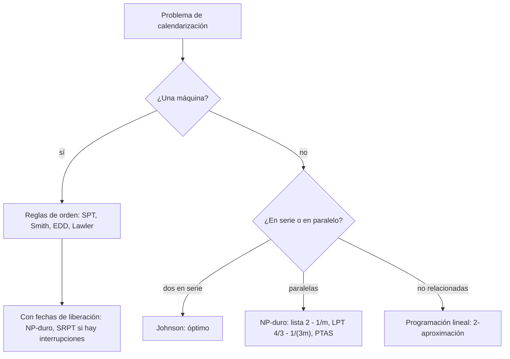

# Análisis de Algoritmos - Temas selectos

## 5.5 Calendarización.

---

La **calendarización** (_scheduling_) decide cuándo y en qué recurso se ejecuta cada tarea: procesos en un sistema operativo, trabajos en las máquinas de una fábrica, vuelos en las pistas de un aeropuerto. Es una de las áreas donde mejor se ve la frontera entre lo fácil y lo difícil: algunos problemas se resuelven con una regla de ordenamiento demostrada por intercambio, otros con algoritmos polinomiales ingeniosos, y variantes aparentemente pequeñas son NP-duras y requieren aproximación. Este tema presenta la notación de tres campos de Graham, las reglas óptimas para una máquina (SPT, Smith, EDD, Lawler), el problema de dos máquinas en serie (Johnson) y las máquinas paralelas con la aproximación LPT.

### Notación

Hay $n$ trabajos; el trabajo $j$ tiene tiempo de proceso $p_j$ y, según el problema, una fecha de liberación $r_j$ (no puede empezar antes), una fecha de entrega $d_j$ y un peso $w_j.$ En un calendario, $C_j$ es el instante en que termina $j.$ Medidas de costo frecuentes: el **tiempo total** $C_{\max} = \max_j C_j$ (_makespan_), la **suma de terminaciones** $\sum C_j,$ o su versión ponderada $\sum w_j C_j,$ y el **retraso máximo** $L_{\max} = \max_j (C_j - d_j).$

La **notación de Graham** $\alpha \mid \beta \mid \gamma$ describe el problema. El campo $\alpha$ es el ambiente de máquinas: 1 para una máquina, $P$ para idénticas en paralelo, $Q$ con velocidades, $R$ no relacionadas, $F$ en serie o _flow shop_ y $J$ para _job shop_. El campo $\beta$ lista las restricciones, como $r_j,$ $prec$ o $pmtn,$ esta última para permitir interrupciones. El campo $\gamma$ es el objetivo. Por ejemplo, $1 \mid prec \mid L_{\max}$ es minimizar el retraso máximo en una máquina con precedencias, y $P \,\|\, C_{\max}$ es minimizar el tiempo total en máquinas idénticas sin restricciones.

### Una máquina

- $1 \,\|\, \sum C_j:$ **SPT** (_shortest processing time_), en orden creciente de $p_j,$ es óptimo (ejercicio 1).
- $1 \,\|\, \sum w_j C_j:$ **regla de Smith** (1956), en orden creciente de $p_j / w_j.$ Se demuestra con el mismo intercambio.
- $1 \,\|\, L_{\max}:$ **EDD** (_earliest due date_), en orden creciente de $d_j$ (Jackson, 1955). Si dos trabajos adyacentes están invertidos respecto a sus fechas, intercambiarlos no aumenta el retraso máximo.
- $1 \mid prec \mid f_{\max},$ con $f_j$ funciones de costo no decrecientes en $C_j:$ **Lawler** (1973), construyendo el calendario de atrás hacia adelante (ejercicio 2). Generaliza a EDD.
- $1 \mid r_j \mid \sum C_j$ es **NP-duro** (Lenstra, Rinnooy Kan y Brucker, 1977), pero con interrupciones, $1 \mid r_j, pmtn \mid \sum C_j,$ la regla **SRPT** (_shortest remaining processing time_) es óptima (ejercicio 4).

**Demostración de SPT.** Sea $\sigma$ un calendario óptimo con dos trabajos adyacentes $i$ antes de $j$ y $p_i > p_j.$ Intercambiarlos no cambia la terminación de los demás; si $t$ es el instante en que empieza $i,$ antes terminaban en $t + p_i$ y $t + p_i + p_j,$ y después en $t + p_j$ y $t + p_j + p_i.$ La suma baja en $p_i - p_j > 0,$ contradicción con la optimalidad. Así, en un óptimo no hay inversiones, y está en orden SPT; todos los órdenes SPT tienen el mismo costo. $\blacksquare$ Equivalentemente, $\sum C_j = \sum_k (n - k + 1) \, p_{\sigma(k)},$ y la suma se minimiza dando los coeficientes más grandes a los trabajos más cortos.

### Máquinas en serie: Johnson

En $F2 \,\|\, C_{\max}$ cada trabajo pasa primero por la máquina 1, con tiempo $a_j,$ y luego por la 2, con tiempo $b_j.$ La **regla de Johnson** (1954), primer resultado de la teoría de calendarización, es óptima: poner primero los trabajos con $a_j \leq b_j$ en orden creciente de $a_j,$ y después los demás en orden decreciente de $b_j.$ Intuitivamente, conviene empezar con trabajos que liberen pronto la máquina 1 y terminar con los que ocupen poco la máquina 2 (ejercicio 5). Con tres máquinas, $F3 \,\|\, C_{\max}$ ya es NP-duro.

### Máquinas paralelas

$P \,\|\, C_{\max}$ es NP-duro incluso con $m = 2$ (es el problema de partición). Dos cotas inferiores del óptimo:

$$\text{OPT} \geq \frac{1}{m} \sum_j p_j, \qquad \text{OPT} \geq \max_j p_j.$$

- **Calendarización por lista** (Graham, 1966): asignar cada trabajo, en cualquier orden, a la máquina menos cargada. Si el trabajo $\ell$ termina último y empezó en $S_\ell,$ todas las máquinas estaban ocupadas hasta $S_\ell,$ así que $S_\ell \leq \frac{1}{m} \sum p_j$ y $C_{\max} = S_\ell + p_\ell \leq 2 \, \text{OPT}.$ Un cálculo más fino da la razón $2 - 1/m.$
- **LPT** (_longest processing time_): lo mismo, pero en orden decreciente de $p_j.$ Razón $\frac{4}{3} - \frac{1}{3m}$ (ejercicio 3).
- Existe un PTAS (Hochbaum y Shmoys, 1987), pero no un FPTAS si $\text{P} \neq \text{NP},$ porque el problema es fuertemente NP-duro.

Con máquinas **no relacionadas**, $R \,\|\, C_{\max},$ el tiempo $p_{ij}$ depende de la máquina $i:$ hay una 2-aproximación por programación lineal y redondeo, y ninguna mejor que $3/2$ si $\text{P} \neq \text{NP}$ (Lenstra, Shmoys y Tardos, 1990).



### Implementación en Python

El programa comprueba contra fuerza bruta (todas las permutaciones o todas las asignaciones) la optimalidad de SPT (ejercicio 1), de Lawler con precedencias y retraso ponderado (ejercicio 2) y de Johnson (ejercicio 5); construye las instancias en las que LPT alcanza exactamente su razón $\frac{4}{3} - \frac{1}{3m}$ (ejercicio 3); compara una heurística sin interrupciones con SRPT para $1 \mid r_j \mid \sum C_j$ (ejercicio 4) y dos reglas voraces para máquinas no relacionadas (ejercicio 6).

```python
import heapq, random
from itertools import permutations, product

random.seed(55)

# --- Ejercicio 1: SPT para 1||sum C_j ---
def suma_terminaciones(p, orden):
    t = tot = 0
    for j in orden:
        t += p[j]; tot += t
    return tot

ok = True
for _ in range(300):
    p = [random.randint(1, 20) for _ in range(random.randint(1, 7))]
    spt = sorted(range(len(p)), key=lambda j: p[j])
    ok &= suma_terminaciones(p, spt) == min(suma_terminaciones(p, o) for o in permutations(range(len(p))))
p = [3, 1, 4, 2]
print("ejercicio 1: SPT óptimo en 300 instancias:", ok, "| p = [3, 1, 4, 2]: SPT", sorted(range(4), key=lambda j: p[j]),
      "suma", suma_terminaciones(p, sorted(range(4), key=lambda j: p[j])), "| orden dado", suma_terminaciones(p, range(4)))

# ponderado: regla de Smith (p_j / w_j creciente)
w = [2, 1, 5, 1]
smith = sorted(range(4), key=lambda j: p[j] / w[j])
print("   ponderado, regla de Smith", smith, "suma ponderada",
      sum(w[j] * c for j, c in zip(smith, [sum(p[k] for k in smith[:i + 1]) for i in range(4)])))

# --- Ejercicio 2: Lawler para 1|prec|f_max ---
def lawler(p, f, prec):
    """prec: pares (a, b), a debe ir antes que b. Se construye de atrás hacia adelante."""
    n, restantes, T = len(p), set(range(len(p))), sum(p)
    sucesores = {j: {b for a, b in prec if a == j} for j in range(n)}
    orden = []
    while restantes:
        sin_suc = [j for j in restantes if not (sucesores[j] & restantes)]
        j = min(sin_suc, key=lambda j: (f[j](T), j))   # el de menor costo si termina al final
        orden.append(j); restantes.remove(j); T -= p[j]
    return orden[::-1]

def fmax(p, f, orden):
    t, m = 0, 0
    for j in orden:
        t += p[j]; m = max(m, f[j](t))
    return m

def respeta(orden, prec):
    pos = {j: i for i, j in enumerate(orden)}
    return all(pos[a] < pos[b] for a, b in prec)

ok = True
for _ in range(300):
    n = random.randint(1, 6)
    p = [random.randint(1, 9) for _ in range(n)]
    d = [random.randint(1, 30) for _ in range(n)]
    wt = [random.randint(1, 4) for _ in range(n)]
    f = [(lambda t, j=j: wt[j] * max(0, t - d[j])) for j in range(n)]   # retraso ponderado
    prec = [(a, b) for a in range(n) for b in range(a + 1, n) if random.random() < 0.25]
    o = lawler(p, f, prec)
    mejor = min(fmax(p, f, q) for q in permutations(range(n)) if respeta(q, prec))
    ok &= respeta(o, prec) and fmax(p, f, o) == mejor
print("ejercicio 2: Lawler óptimo para el máximo retraso ponderado con precedencias en 300 instancias:", ok)

# --- Ejercicio 3: LPT para P||C_max ---
def lpt(p, m):
    H = [(0, i) for i in range(m)]
    for x in sorted(p, reverse=True):
        c, i = heapq.heappop(H); heapq.heappush(H, (c + x, i))
    return max(c for c, _ in H)

def cmax_optimo(p, m):
    mejor = sum(p)
    def rec(i, cargas):
        nonlocal mejor
        if max(cargas) >= mejor: return
        if i == len(p):
            mejor = max(cargas); return
        vistos = set()
        for k in range(m):
            if cargas[k] in vistos: continue
            vistos.add(cargas[k])
            cargas[k] += p[i]; rec(i + 1, cargas); cargas[k] -= p[i]
    rec(0, [0] * m)
    return mejor

print("ejercicio 3: instancias justas para LPT")
for m in (2, 3, 4, 5):
    p = sorted([k for k in range(m + 1, 2 * m)] * 2 + [m] * 3, reverse=True)
    a, o = lpt(p, m), cmax_optimo(p, m)
    print(f"   m = {m}: trabajos {p}: LPT {a}, óptimo {o}, razón {a / o:.4f} = 4/3 - 1/(3m) = {4 / 3 - 1 / (3 * m):.4f}")
peor = 0
for _ in range(300):
    m = random.randint(2, 4)
    p = [random.randint(1, 20) for _ in range(random.randint(m, 9))]
    peor = max(peor, lpt(p, m) / cmax_optimo(p, m))
print(f"   peor razón en 300 instancias aleatorias: {peor:.4f}")

# --- Ejercicio 4: 1|r_j|sum C_j ---
def suma_con_liberacion(p, r, orden):
    t = tot = 0
    for j in orden:
        t = max(t, r[j]) + p[j]; tot += t
    return tot

def srpt(p, r):
    """Con interrupciones: el de menor tiempo restante. Óptimo para 1|r_j,pmtn|sum C_j."""
    n, t, tot = len(p), 0, 0
    rest, eventos, listos, i = p[:], sorted(range(n), key=lambda j: r[j]), [], 0
    hechos = 0
    while hechos < n:
        while i < n and r[eventos[i]] <= t:
            heapq.heappush(listos, (rest[eventos[i]], eventos[i])); i += 1
        if not listos:
            t = r[eventos[i]]; continue
        q, j = heapq.heappop(listos)
        sig = r[eventos[i]] if i < n else float("inf")
        corre = min(q, sig - t)
        t += corre; q -= corre
        if q == 0:
            tot += t; hechos += 1
        else:
            heapq.heappush(listos, (q, j))
    return tot

def spt_disponible(p, r):
    """Heurística sin interrupciones: al quedar libre, el más corto ya liberado."""
    n, t, orden, pend = len(p), 0, [], set(range(len(p)))
    while pend:
        listos = [j for j in pend if r[j] <= t]
        if not listos:
            t = min(r[j] for j in pend); continue
        j = min(listos, key=lambda j: (p[j], j))
        orden.append(j); pend.remove(j); t += p[j]
    return orden

p, r = [10, 1, 1], [0, 1, 1]
print("ejercicio 4: p =", p, "r =", r, "| SPT disponible", suma_con_liberacion(p, r, spt_disponible(p, r)),
      "| óptimo", min(suma_con_liberacion(p, r, o) for o in permutations(range(3))), "| SRPT con interrupciones", srpt(p, r))
peor = 0
for _ in range(300):
    n = random.randint(2, 7)
    p = [random.randint(1, 15) for _ in range(n)]; r = [random.randint(0, 25) for _ in range(n)]
    opt = min(suma_con_liberacion(p, r, o) for o in permutations(range(n)))
    assert srpt(p, r) <= opt
    peor = max(peor, suma_con_liberacion(p, r, spt_disponible(p, r)) / opt)
print(f"   300 instancias: SRPT siempre <= óptimo sin interrupciones; peor razón de SPT disponible {peor:.3f}")

# --- Ejercicio 5: regla de Johnson para F2||C_max ---
def cmax_flujo(a, b, orden):
    t1 = t2 = 0
    for j in orden:
        t1 += a[j]; t2 = max(t2, t1) + b[j]
    return t2

def johnson(a, b):
    I = sorted([j for j in range(len(a)) if a[j] <= b[j]], key=lambda j: a[j])
    D = sorted([j for j in range(len(a)) if a[j] > b[j]], key=lambda j: -b[j])
    return I + D

a, b = [3, 5, 1, 6, 7], [6, 2, 2, 6, 5]
o = johnson(a, b)
print("ejercicio 5: a =", a, "b =", b, "| Johnson", o, "C_max", cmax_flujo(a, b, o),
      "| óptimo", min(cmax_flujo(a, b, q) for q in permutations(range(5))))
ok = True
for _ in range(300):
    n = random.randint(1, 7)
    a = [random.randint(1, 15) for _ in range(n)]; b = [random.randint(1, 15) for _ in range(n)]
    ok &= cmax_flujo(a, b, johnson(a, b)) == min(cmax_flujo(a, b, q) for q in permutations(range(n)))
print("   Johnson óptimo en 300 instancias:", ok)

# --- Ejercicio 6: R||C_max ---
def r_optimo(P):
    m, n = len(P), len(P[0])
    return min(max(sum(P[i][j] for j in range(n) if asig[j] == i) for i in range(m))
               for asig in product(range(m), repeat=n))

def r_voraz_minimo(P):
    """Cada trabajo a la máquina donde es más rápido."""
    m, n = len(P), len(P[0]); carga = [0] * m
    for j in range(n):
        i = min(range(m), key=lambda i: P[i][j]); carga[i] += P[i][j]
    return max(carga)

def r_voraz_carga(P):
    """Cada trabajo a la máquina donde terminaría antes (lista)."""
    m, n = len(P), len(P[0]); carga = [0] * m
    for j in range(n):
        i = min(range(m), key=lambda i: carga[i] + P[i][j]); carga[i] += P[i][j]
    return max(carga)

P = [[1] * 6, [1.1] * 6]          # la máquina 0 es la más rápida para todos
print(f"ejercicio 6: dos máquinas casi iguales, 6 trabajos: voraz por mínimo {r_voraz_minimo(P)},"
      f" voraz por carga {r_voraz_carga(P):.1f}, óptimo {r_optimo(P):.1f}")
peor1 = peor2 = 0
for _ in range(200):
    m, n = random.randint(2, 3), random.randint(2, 7)
    P = [[random.randint(1, 20) for _ in range(n)] for _ in range(m)]
    o = r_optimo(P)
    peor1, peor2 = max(peor1, r_voraz_minimo(P) / o), max(peor2, r_voraz_carga(P) / o)
print(f"   200 instancias: peor razón voraz por mínimo {peor1:.2f}, voraz por carga {peor2:.2f}")
```

Salida:

```text
ejercicio 1: SPT óptimo en 300 instancias: True | p = [3, 1, 4, 2]: SPT [1, 3, 0, 2] suma 20 | orden dado 25
   ponderado, regla de Smith [2, 1, 0, 3] suma ponderada 51
ejercicio 2: Lawler óptimo para el máximo retraso ponderado con precedencias en 300 instancias: True
ejercicio 3: instancias justas para LPT
   m = 2: trabajos [3, 3, 2, 2, 2]: LPT 7, óptimo 6, razón 1.1667 = 4/3 - 1/(3m) = 1.1667
   m = 3: trabajos [5, 5, 4, 4, 3, 3, 3]: LPT 11, óptimo 9, razón 1.2222 = 4/3 - 1/(3m) = 1.2222
   m = 4: trabajos [7, 7, 6, 6, 5, 5, 4, 4, 4]: LPT 15, óptimo 12, razón 1.2500 = 4/3 - 1/(3m) = 1.2500
   m = 5: trabajos [9, 9, 8, 8, 7, 7, 6, 6, 5, 5, 5]: LPT 19, óptimo 15, razón 1.2667 = 4/3 - 1/(3m) = 1.2667
   peor razón en 300 instancias aleatorias: 1.1081
ejercicio 4: p = [10, 1, 1] r = [0, 1, 1] | SPT disponible 33 | óptimo 18 | SRPT con interrupciones 17
   300 instancias: SRPT siempre <= óptimo sin interrupciones; peor razón de SPT disponible 1.260
ejercicio 5: a = [3, 5, 1, 6, 7] b = [6, 2, 2, 6, 5] | Johnson [2, 0, 3, 4, 1] C_max 24 | óptimo 24
   Johnson óptimo en 300 instancias: True
ejercicio 6: dos máquinas casi iguales, 6 trabajos: voraz por mínimo 6, voraz por carga 3.3, óptimo 3.3
   200 instancias: peor razón voraz por mínimo 1.91, voraz por carga 2.00
```

### Ejercicios Propuestos

1. **SPT.** Demuestra que SPT es óptimo para $1 \,\|\, \sum C_j.$

2. **Lawler.** Implementa el algoritmo de Lawler para $1 \mid prec \mid f_{\max}$ y analiza su complejidad.

3. **LPT.** Para $P \,\|\, C_{\max},$ demuestra que la razón de LPT es $\frac{4}{3} - \frac{1}{3m}.$

4. **Fechas de liberación.** Diseña un algoritmo para $1 \mid r_j \mid \sum C_j$ y analiza su optimalidad.

5. **Johnson.** Estudia $F2 \,\|\, C_{\max}$ e implementa el algoritmo de Johnson.

6. **No relacionadas.** Analiza la complejidad de $R \,\|\, C_{\max}.$

### Soluciones

**Ejercicio 1.** Es la demostración por intercambio de la sección de una máquina. Con $p = [3, 1, 4, 2],$ SPT da el orden $1, 3, 0, 2,$ con terminaciones 1, 3, 6 y 10, que suman 20, contra 25 del orden dado.

**Ejercicio 2.** **Algoritmo:** sea $J$ el conjunto de trabajos sin calendarizar y $T = \sum_{j \in J} p_j.$ Entre los trabajos de $J$ que no tienen sucesores en $J,$ elegir el $j$ con menor $f_j(T)$ y ponerlo **al final**; quitarlo de $J$ y repetir. **Corrección:** el último trabajo termina en $T$ sin importar el orden, y debe ser uno sin sucesores pendientes; elegir el de menor costo en $T$ no empeora el óptimo, por un argumento de intercambio: si un calendario óptimo pone al final otro trabajo $k,$ mover $j$ al final adelanta a los trabajos que estaban detrás de $j,$ cuyos costos no aumentan porque las $f$ son no decrecientes, y el costo de $j$ en $T$ es a lo sumo el de $k$ en $T.$ **Complejidad:** $n$ pasos, cada uno revisando a lo sumo $n$ candidatos, con las precedencias en listas de sucesores: $O(n^2).$ El programa lo verifica con el retraso ponderado $f_j(C) = w_j \max(0, C - d_j).$

**Ejercicio 3.** Sea $\ell$ el trabajo que termina último. Si $p_\ell \leq \text{OPT}/3,$ el argumento de la calendarización por lista da $C_{\max} \leq \frac{1}{m}\sum_{j \neq \ell} p_j + p_\ell \leq \text{OPT} + \left(1 - \frac{1}{m}\right) p_\ell \leq \left(\frac{4}{3} - \frac{1}{3m}\right) \text{OPT}.$ Si $p_\ell > \text{OPT}/3,$ se puede suponer que $\ell$ es el último trabajo en el orden, quitando los posteriores, que no afectan a $C_{\max};$ entonces todos los trabajos miden más de $\text{OPT}/3,$ cada máquina del óptimo tiene a lo sumo 2, y hay a lo sumo $2m.$ En ese caso se demuestra que LPT es óptimo: empareja el trabajo $i$ con el $2m + 1 - i,$ que es la mejor forma de repartir dos trabajos por máquina. $\blacksquare$ La cota es justa: con $2m + 1$ trabajos de tamaños $2m - 1,$ $2m - 1,$ $2m - 2,$ $2m - 2,$ $\ldots,$ $m + 1,$ $m + 1,$ $m,$ $m,$ $m,$ el óptimo es $3m$ y LPT obtiene $4m - 1,$ como muestran los casos $m = 2$ a 5 del programa.

**Ejercicio 4.** El problema es NP-duro, así que no hay que esperar un algoritmo polinomial óptimo. Lo que se puede hacer:

- **Heurística SPT disponible:** cuando la máquina queda libre, ejecutar el trabajo más corto ya liberado. No es óptima: con $p = [10, 1, 1]$ y $r = [0, 1, 1],$ empieza el trabajo largo en 0 y obtiene 33, mientras que esperar una unidad da 18. En el programa, su razón llega a 1.26.
- **SRPT con interrupciones** es óptimo para $1 \mid r_j, pmtn \mid \sum C_j,$ por un intercambio sobre intervalos de tiempo, y es una **cota inferior** del problema sin interrupciones: 17 en el ejemplo. Convertir el calendario SRPT en uno sin interrupciones, en el orden en que terminan, da una 2-aproximación (Phillips, Stein y Wein, 1998).
- Para instancias pequeñas, ramificación y acotamiento usando SRPT como cota.

**Ejercicio 5.** Es `johnson` del programa, que coincide con el óptimo de las permutaciones en todas las instancias. **Demostración (idea):** si en un calendario dos trabajos adyacentes $i, j$ cumplen $\min(a_j, b_i) \lt \min(a_i, b_j),$ intercambiarlos no aumenta $C_{\max};$ la regla de Johnson produce exactamente un orden sin tales pares. **Complejidad:** $O(n \log n)$ por los ordenamientos. En el ejemplo, el orden es $2, 0, 3, 4, 1$ con $C_{\max} = 24,$ igual al óptimo.

**Ejercicio 6.** $R \,\|\, C_{\max}$ generaliza a $P \,\|\, C_{\max},$ que es el caso $p_{ij} = p_j,$ así que es NP-duro incluso con dos máquinas, y fuertemente NP-duro con $m$ variable. Con $m$ fijo tiene un FPTAS. Con $m$ variable:

- Ninguna aproximación polinomial con razón menor que $3/2$ si $\text{P} \neq \text{NP}.$
- Lenstra, Shmoys y Tardos: resolver la relajación lineal de la asignación con un valor objetivo $T$ adivinado por búsqueda binaria, y redondear la solución básica, en la que a lo sumo $m$ trabajos quedan fraccionarios, asignándolos con un apareamiento: una 2-aproximación.

Las reglas voraces simples fallan: asignar cada trabajo a su máquina más rápida pone todo en la máquina 0 cuando la otra es apenas más lenta, con razón cercana a $m;$ asignar a la que terminaría antes se comporta mejor, pero sin garantía constante en general, y en el programa llega a 2.

### Referencias

1. Pinedo, M. L., _Scheduling: Theory, Algorithms, and Systems_. Springer, 2016. Capítulos 3 a 6.
2. Graham, R. L., Bounds on multiprocessing timing anomalies. _SIAM Journal on Applied Mathematics_ 17(2), 1969.
3. Lawler, E. L., Optimal sequencing of a single machine subject to precedence constraints. _Management Science_ 19(5), 1973.
4. Lenstra, J. K., Shmoys, D. B., and Tardos, É., Approximation algorithms for scheduling unrelated parallel machines. _Mathematical Programming_ 46, 1990.
