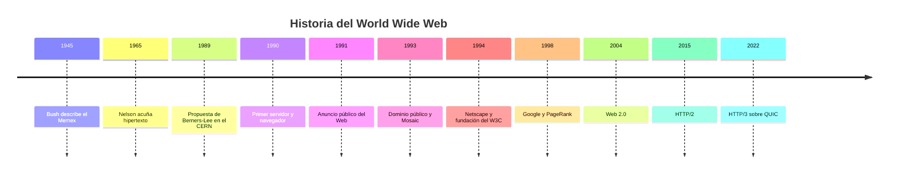

# Computación Distribuida - Redes complejas y el Web

## 1.1 Historia del World Wide Web.

---

El **World Wide Web** es un sistema de documentos y recursos enlazados por **hipervínculos**, identificados por **URL** y transferidos con el protocolo **HTTP** sobre Internet. No es lo mismo que Internet: Internet es la red de redes que transporta paquetes (desde ARPANET, 1969, y TCP/IP, 1983), y el Web es una aplicación que corre encima, como el correo electrónico. Desde el punto de vista de este curso, el Web es dos cosas a la vez: un **sistema distribuido** de escala planetaria, sin coordinación central, y una **red compleja** de miles de millones de páginas cuya estructura de enlaces tiene propiedades estadísticas sorprendentes (tema 1.2). Este tema recorre su historia, explica las tres piezas técnicas que lo definen y muestra cómo la red de enlaces se convierte en un objeto matemático.

### Antecedentes: el hipertexto

- **1945.** Vannevar Bush publica "As We May Think" en _The Atlantic_ y describe el **Memex**, un escritorio mecánico que almacenaría documentos en microfilm y permitiría unirlos con "rastros" asociativos.
- **1963 a 1965.** Ted Nelson acuña los términos **hipertexto** e hipermedia e inicia el proyecto Xanadu, con enlaces bidireccionales y versiones.
- **1968.** Douglas Engelbart presenta el sistema NLS en "la madre de todas las demostraciones": ratón, ventanas, edición colaborativa e hipervínculos.
- **1987.** Apple publica HyperCard, que populariza el hipertexto local.

### Nacimiento en el CERN

- **1980.** Tim Berners-Lee, consultor en el CERN, escribe ENQUIRE, un programa para registrar relaciones entre personas y proyectos.
- **Marzo de 1989.** Berners-Lee entrega "Information Management: A Proposal", que su jefe califica de "vaga pero emocionante". En 1990, con Robert Cailliau, la reformula y le da el nombre **WorldWideWeb**.
- **Finales de 1990.** En una computadora NeXT funcionan el primer servidor (`info.cern.ch`) y el primer navegador y editor, también llamado WorldWideWeb, junto con las primeras versiones de **HTML**, **HTTP** y las **URL**.
- **6 de agosto de 1991.** Berners-Lee anuncia el proyecto en el grupo de noticias `alt.hypertext`; el Web se abre al mundo.
- **30 de abril de 1993.** El CERN pone el software del Web en el **dominio público**, sin regalías, decisión clave para su adopción frente a sistemas como Gopher.

### Expansión y estandarización

- **1993.** NCSA Mosaic, de Marc Andreessen y Eric Bina, muestra imágenes junto al texto y lleva el Web al público.
- **1994.** Nace Netscape Navigator, y en octubre Berners-Lee funda el **World Wide Web Consortium** (W3C) en el MIT para estandarizar el Web.
- **1995 a 2000.** Guerra de navegadores entre Netscape e Internet Explorer; JavaScript (1995) y CSS (1996); nacen los grandes buscadores (AltaVista en 1995, Google en 1998 con PageRank, tema 7.1).
- **Después de 2004.** El término **Web 2.0** describe un Web de contenido generado por los usuarios, redes sociales y aplicaciones interactivas (AJAX). La **Web semántica** propone datos enlazados con significado formal (RDF, OWL). Desde 2004 el WHATWG desarrolla HTML como **estándar vivo**.



### Las tres piezas

**URL** (_Uniform Resource Locator_): nombra un recurso y dice cómo obtenerlo. En `https://www.ejemplo.org:443/docs/a.html?q=web#seccion2` se distinguen el **esquema** (`https`), el **anfitrión** (`www.ejemplo.org`, que DNS traduce a una dirección IP), el **puerto**, la **ruta**, la **consulta** y el **fragmento**.

**HTTP** (_HyperText Transfer Protocol_): protocolo de petición y respuesta, **sin estado**, entre un cliente (el navegador) y un servidor. Una petición tiene un **método** (`GET` para obtener, `POST` para enviar datos, `PUT`, `DELETE`), una ruta y cabeceras; la respuesta tiene un **código de estado** (200 éxito, 301 redirección, 404 no encontrado, 500 error del servidor), cabeceras como `Content-Type` y el cuerpo. Versiones: HTTP/0.9 (1991, solo `GET`), HTTP/1.0 (RFC 1945, 1996), HTTP/1.1 (1997, conexiones persistentes y el anfitrión obligatorio, que permite varios sitios en un servidor), HTTP/2 (2015, multiplexación binaria) y HTTP/3 (2022, sobre QUIC y UDP). El estado entre peticiones se mantiene con **cookies**.

**HTML** (_HyperText Markup Language_): lenguaje de marcado de los documentos. El elemento `<a href="...">` es el **hipervínculo**: lo que convierte al conjunto de documentos en una red.

Una propiedad decisiva del diseño es que los enlaces son **unidireccionales** y no requieren permiso del destino: cualquiera puede enlazar a cualquier página, y un enlace puede quedar roto. Esa falta de coordinación, que Xanadu sí exigía, es la que permitió crecer sin control central, y la que hace que la red de enlaces sea un objeto que hay que **medir**, no diseñar.

### El Web como gráfica

El Web se modela como una gráfica dirigida $G = (V, E)$ en la que $V$ son las páginas y hay una arista $(u, v)$ si $u$ enlaza a $v.$ Con $n$ páginas, la **matriz de adyacencia** $A$ tiene $A_{uv} = 1$ si existe el enlace. El **grado de salida** de $u$ es el número de enlaces que contiene y el **grado de entrada** el número de páginas que la enlazan, una medida rudimentaria de su importancia. Una **componente fuertemente conexa** es un conjunto maximal de páginas en el que de cada una se llega a todas las demás siguiendo enlaces.

Un **navegante aleatorio** que en cada paso sigue un enlace elegido al azar define una **cadena de Markov** con matriz de transición $P_{uv} = A_{uv} / \text{salida}(u);$ la fracción del tiempo que pasa en cada página a la larga es la **distribución estacionaria** $\pi = \pi P.$ Si además salta a una página cualquiera con probabilidad $1 - \alpha,$ esa distribución es el **PageRank** (temas 1.2 y 7.1). La **intermediación** de una página mide en cuántos caminos más cortos entre otras páginas aparece.

### Implementación en Python

El programa levanta un servidor HTTP local, le envía peticiones HTTP/1.0 escritas a mano y muestra la línea de estado y las cabeceras de las respuestas. Después analiza la mini-web del ejercicio 1: matriz de adyacencia, grados y componentes fuertemente conexas con el algoritmo de Tarjan; simula un navegante aleatorio y compara la frecuencia de visitas con la distribución estacionaria (ejercicio 2), y calcula las centralidades de grado, la intermediación con el algoritmo de Brandes y el PageRank (ejercicio 3).

```python
import random, socket, threading
from collections import deque
from http.server import HTTPServer, BaseHTTPRequestHandler

random.seed(11)

# --- El protocolo: una petición HTTP/1.0 a mano ---
class Manejador(BaseHTTPRequestHandler):
    def do_GET(self):
        cuerpo = b'<html><body><a href="/b.html">B</a> <a href="/c.html">C</a></body></html>'
        self.send_response(200 if self.path == "/a.html" else 404)
        self.send_header("Content-Type", "text/html")
        self.send_header("Content-Length", str(len(cuerpo)))
        self.end_headers()
        self.wfile.write(cuerpo)
    def log_message(self, *args):
        pass

servidor = HTTPServer(("127.0.0.1", 0), Manejador)
threading.Thread(target=servidor.serve_forever, daemon=True).start()
puerto = servidor.server_address[1]

def peticion(ruta):
    s = socket.create_connection(("127.0.0.1", puerto))
    s.sendall(f"GET {ruta} HTTP/1.0\r\nHost: localhost\r\n\r\n".encode())
    datos = b""
    while (trozo := s.recv(4096)):
        datos += trozo
    s.close()
    cabecera, _, cuerpo = datos.partition(b"\r\n\r\n")
    lineas = cabecera.decode().split("\r\n")
    utiles = [l for l in lineas[1:] if l.split(":")[0] in ("Content-Type", "Content-Length")]
    return lineas[0], utiles, cuerpo.decode()

for ruta in ("/a.html", "/x.html"):
    estado, cab, cuerpo = peticion(ruta)
    print(f"GET {ruta} -> {estado} | {cab}")
print("   cuerpo:", cuerpo)
servidor.shutdown()

# --- Ejercicio 1: la mini-web ---
nodos = "ABCD"
enlaces = {"A": "BC", "B": "C", "C": "A", "D": "C"}
idx = {v: i for i, v in enumerate(nodos)}
M = [[1 if w in enlaces[v] else 0 for w in nodos] for v in nodos]
print("ejercicio 1: matriz de adyacencia (fila enlaza a columna)")
for v, fila in zip(nodos, M):
    print("  ", v, fila)
print("   grado de salida:", {v: sum(M[idx[v]]) for v in nodos},
      "| de entrada:", {v: sum(M[i][idx[v]] for i in range(4)) for v in nodos})

def tarjan(nodos, enlaces):
    indice, bajo, pila, en_pila, comps, cont = {}, {}, [], set(), [], [0]
    def visita(v):
        indice[v] = bajo[v] = cont[0]; cont[0] += 1
        pila.append(v); en_pila.add(v)
        for w in enlaces.get(v, ""):
            if w not in indice:
                visita(w); bajo[v] = min(bajo[v], bajo[w])
            elif w in en_pila:
                bajo[v] = min(bajo[v], indice[w])
        if bajo[v] == indice[v]:
            c = []
            while True:
                w = pila.pop(); en_pila.discard(w); c.append(w)
                if w == v: break
            comps.append("".join(sorted(c)))
    for v in nodos:
        if v not in indice:
            visita(v)
    return comps

print("   componentes fuertemente conexas:", tarjan(nodos, enlaces))

# --- Ejercicio 2: navegación como cadena de Markov ---
def paseo(enlaces, pasos, salto=0.0):
    v, visitas = "A", {u: 0 for u in nodos}
    for _ in range(pasos):
        if random.random() < salto or not enlaces[v]:
            v = random.choice(nodos)
        else:
            v = random.choice(enlaces[v])
        visitas[v] += 1
    return {u: round(c / pasos, 4) for u, c in visitas.items()}

def estacionaria(P, iter=200):
    n = len(P); x = [1 / n] * n
    for _ in range(iter):
        x = [sum(x[i] * P[i][j] for i in range(n)) for j in range(n)]
    return x

P = [[M[i][j] / sum(M[i]) for j in range(4)] for i in range(4)]
pi = estacionaria(P)
print("ejercicio 2: navegante sin saltos, 10^6 pasos:", paseo(enlaces, 10**6))
print("   distribución estacionaria de P:", {v: round(p, 4) for v, p in zip(nodos, pi)})

# --- Ejercicio 3: centralidades ---
def intermediacion(nodos, enlaces):
    """Brandes para gráficas dirigidas sin pesos."""
    C = {v: 0.0 for v in nodos}
    for s in nodos:
        pila, pred = [], {v: [] for v in nodos}
        sigma = {v: 0 for v in nodos}; sigma[s] = 1
        dist = {v: -1 for v in nodos}; dist[s] = 0
        cola = deque([s])
        while cola:
            v = cola.popleft(); pila.append(v)
            for w in enlaces[v]:
                if dist[w] < 0:
                    dist[w] = dist[v] + 1; cola.append(w)
                if dist[w] == dist[v] + 1:
                    sigma[w] += sigma[v]; pred[w].append(v)
        delta = {v: 0.0 for v in nodos}
        while pila:
            w = pila.pop()
            for v in pred[w]:
                delta[v] += sigma[v] / sigma[w] * (1 + delta[w])
            if w != s:
                C[w] += delta[w]
    return C

def pagerank(nodos, enlaces, alfa=0.85, iter=100):
    n = len(nodos); r = {v: 1 / n for v in nodos}
    for _ in range(iter):
        nuevo = {v: (1 - alfa) / n for v in nodos}
        for v in nodos:
            destinos = enlaces[v] or nodos         # nodo colgante: reparte a todos
            for w in destinos:
                nuevo[w] += alfa * r[v] / len(destinos)
        r = nuevo
    return r

n = len(nodos)
print("ejercicio 3: centralidad de grado (entrada + salida) / (2(n-1)):",
      {v: round((sum(M[idx[v]]) + sum(M[i][idx[v]] for i in range(n))) / (2 * (n - 1)), 3) for v in nodos})
print("   intermediación:", intermediacion(nodos, enlaces))
pr = pagerank(nodos, enlaces)
print("   PageRank (alfa = 0.85):", {v: round(x, 4) for v, x in pr.items()}, "suma", round(sum(pr.values()), 6))
print("   navegante con saltos al 15%, 10^6 pasos:", paseo(enlaces, 10**6, salto=0.15))
```

Salida:

```text
GET /a.html -> HTTP/1.0 200 OK | ['Content-Type: text/html', 'Content-Length: 73']
GET /x.html -> HTTP/1.0 404 Not Found | ['Content-Type: text/html', 'Content-Length: 73']
   cuerpo: <html><body><a href="/b.html">B</a> <a href="/c.html">C</a></body></html>
ejercicio 1: matriz de adyacencia (fila enlaza a columna)
   A [0, 1, 1, 0]
   B [0, 0, 1, 0]
   C [1, 0, 0, 0]
   D [0, 0, 1, 0]
   grado de salida: {'A': 2, 'B': 1, 'C': 1, 'D': 1} | de entrada: {'A': 1, 'B': 1, 'C': 3, 'D': 0}
   componentes fuertemente conexas: ['ABC', 'D']
ejercicio 2: navegante sin saltos, 10^6 pasos: {'A': 0.4, 'B': 0.1999, 'C': 0.4, 'D': 0.0}
   distribución estacionaria de P: {'A': 0.4, 'B': 0.2, 'C': 0.4, 'D': 0.0}
ejercicio 3: centralidad de grado (entrada + salida) / (2(n-1)): {'A': 0.5, 'B': 0.333, 'C': 0.667, 'D': 0.167}
   intermediación: {'A': 2.0, 'B': 0.0, 'C': 3.0, 'D': 0.0}
   PageRank (alfa = 0.85): {'A': 0.3725, 'B': 0.1958, 'C': 0.3941, 'D': 0.0375} suma 1.0
   navegante con saltos al 15%, 10^6 pasos: {'A': 0.3727, 'B': 0.1955, 'C': 0.3943, 'D': 0.0375}
```

### Ejercicios Propuestos

1. **Mini-web.** Las páginas A, B, C y D tienen los enlaces A a B y a C, B a C, C a A, y D a C. Construye la matriz de adyacencia, calcula los grados de entrada y salida, e identifica las componentes fuertemente conexas.

2. **Navegación.** Simula la navegación como una cadena de Markov en la que, desde cada página, se sigue uno de sus enlaces con la misma probabilidad.

3. **Centralidad.** Para la gráfica del ejercicio 1, calcula la centralidad de grado, la de intermediación y el PageRank con factor de amortiguación $\alpha = 0.85.$

### Soluciones

**Ejercicio 1.** La matriz es la que imprime el programa, con la fila como origen del enlace. Grados de salida: A 2, B 1, C 1, D 1. Grados de entrada: A 1, B 1, C 3, D 0. Componentes fuertemente conexas: $\{A, B, C\},$ porque $A \to B \to C \to A,$ y $\{D\},$ porque nada llega a D. D es una página "de entrada": desde ella se llega al núcleo, pero no se puede volver.

**Ejercicio 2.** La matriz de transición tiene $P_{AB} = P_{AC} = 1/2,$ $P_{BC} = 1,$ $P_{CA} = 1$ y $P_{DC} = 1.$ Resolviendo $\pi = \pi P$ con $\pi_D = 0,$ porque nadie llega a D: $\pi_A = \pi_C,$ $\pi_B = \pi_A/2$ y $\pi_C = \pi_A/2 + \pi_B,$ de donde $\pi = (0.4, 0.2, 0.4, 0).$ La simulación de un millón de pasos coincide en tres decimales. Si el navegante empieza en D, lo abandona en el primer paso y nunca regresa.

**Ejercicio 3.**

- **Grado:** sumando entrada y salida y normalizando por $2(n - 1) = 6:$ C 0.667, A 0.5, B 0.333, D 0.167.
- **Intermediación:** C está en los caminos más cortos de B a A, de D a A y de D a B: vale 3. A está en los de C a B y de D a B: vale 2. B y D no son intermediarios de nadie.
- **PageRank** con $\alpha = 0.85:$ $r = (1 - \alpha)/n + \alpha \sum_{u \to v} r_u / \text{salida}(u).$ D no recibe enlaces y queda con el mínimo, $0.15/4 = 0.0375;$ el resto es aproximadamente C 0.394, A 0.373 y B 0.196. Comparado con la distribución estacionaria sin saltos, los saltos dan a D una probabilidad positiva y suavizan las diferencias. El navegante simulado con saltos coincide con el cálculo.

### Referencias

1. Berners-Lee, T., and Fischetti, M., _Weaving the Web_. HarperCollins, 1999.
2. Bush, V., As we may think. _The Atlantic Monthly_ 176(1), 1945.
3. Easley, D., and Kleinberg, J., _Networks, Crowds, and Markets_. Cambridge University Press, 2010. Capítulo 13.
4. Fielding, R., Nottingham, M., and Reschke, J., _HTTP Semantics_. RFC 9110, IETF, 2022.
