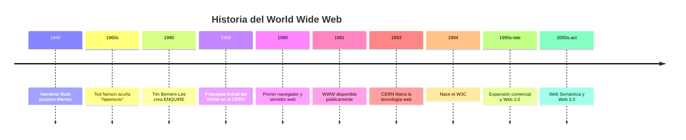
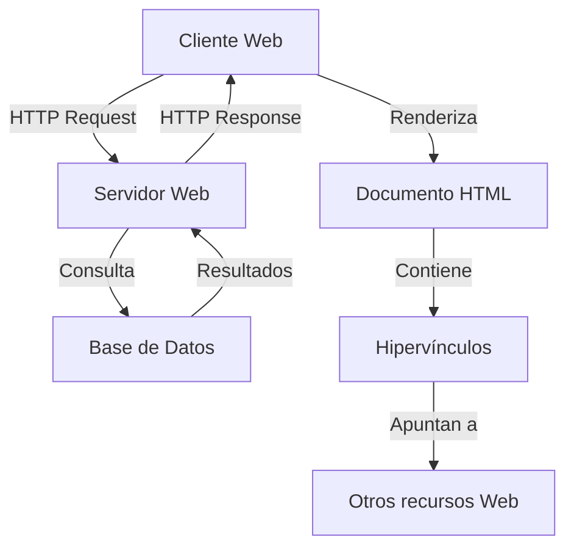

# Computación Distribuida - Redes complejas y el Web

## 1.1 Historia del World Wide Web.

---

El World Wide Web (WWW) es un sistema de distribución de información basado en hipertexto que se ejecuta sobre Internet. Su creación revolucionó la forma en que accedemos, compartimos y creamos información, constituyendo una de las redes complejas más grandes y dinámicas creadas por la humanidad. Desde una perspectiva de computación distribuida, el Web es un sistema masivamente distribuido, descentralizado y de escala global.

### Conceptos Fundamentales

#### Hipertexto

Sistema de organización de información donde los documentos contienen enlaces (hyperlinks) que permiten a los usuarios navegar entre diferentes piezas de contenido relacionado.

#### World Wide Web (WWW)

Sistema de información global donde los documentos y otros recursos web son identificados por Localizadores Uniformes de Recursos (URLs), interconectados mediante hipervínculos y accesibles through Internet.

#### Protocolo HTTP (HyperText Transfer Protocol)

Protocolo de aplicación para sistemas de información hipermedia distribuidos y colaborativos. Es la base para la comunicación de datos en la Web.

#### HTML (HyperText Markup Language)

Lenguaje de marcado utilizado para crear páginas web. Permite la inclusión de texto, imágenes, videos y otros medios, así como la creación de hipervínculos.

### Historia Cronológica del World Wide Web



#### Antecedentes Conceptuales (1945-1980)

**1945**: Vannevar Bush publica "As We May Think" donde describe el concepto de "Memex", un dispositivo teórico que almacenaría libros, registros y comunicaciones, con la capacidad de crear trails de información asociativa.

**1960s**: Ted Nelson acuña el término "hipertexto" y desarrolla el proyecto Xanadu, visionando un sistema global de documentos interconectados.

#### Desarrollo del WWW (1980-1991)

**1980**: Tim Berners-Lee, mientras trabajaba como consultor en el CERN, crea ENQUIRE, un programa precursor basado en hipertexto.

**1989**: Berners-Lee presenta la propuesta "Information Management: A Proposal" al CERN, describiendo un sistema de gestión de información basado en hipertexto.

**1990**: Con la ayuda de Robert Cailliau, Berners-Lee desarrolla:

- El primer navegador web (WorldWideWeb)
- El primer servidor web (info.cern.ch)
- Las primeras especificaciones de HTTP, HTML y URLs

**1991**: El WWW se hace disponible públicamente fuera del CERN.

#### Expansión y Estándarización (1991-1995)

**1993**: El CERN libera la tecnología web al dominio público, acelerando su adopción global.

**1994**: Se funda el World Wide Web Consortium (W3C) para estandarizar los protocolos web.

**1994-1995**: Nacen navegadores comerciales como Netscape Navigator, facilitando el acceso al público general.

### Arquitectura Técnica del Web Temprano

#### Componentes Fundamentales



#### Modelo Cliente-Servidor

El Web se basa en una arquitectura cliente-servidor donde:

- Los clientes (navegadores) solicitan recursos
- Los servidores responden con los recursos solicitados

#### Protocolo HTTP Básico

El protocolo HTTP inicial utilizaba métodos simples:

```
GET /index.html HTTP/1.0
Host: www.example.com
```

Respuesta del servidor:

```
HTTP/1.0 200 OK
Content-Type: text/html

<html>...</html>
```

### El Web como Red Compleja

#### Estructura de Grafo del Web

El Web puede modelarse como un grafo dirigido $G = (V, E)$ donde:

- $V$ es el conjunto de páginas web (vértices/nodos)
- $E$ es el conjunto de hipervínculos (aristas dirigidas)

#### Métricas de Redes Aplicadas al Web

**Grado de entrada (in-degree)**: Número de enlaces que apuntan a una página:

$$deg_{in}(v) = |\{u | (u, v) \in E\}|$$

**Grado de salida (out-degree)**: Número de enlaces que salen de una página:

$$deg_{out}(v) = |\{w | (v, w) \in E\}|$$

**Distancia promedio**: Longitud promedio del camino más corto entre nodos:

$$L = \frac{1}{n(n-1)} \sum_{i \neq j} d(v_i, v_j)$$

donde $d(v_i, v_j)$ es la distancia más corta entre los nodos $i$ y $j$.

#### Leyes de Potencia en el Web

La distribución de grados en el Web sigue una ley de potencia:

$$P(k) \sim k^{-\gamma}$$

donde $P(k)$ es la probabilidad de que un nodo tenga grado $k$, y $\gamma$ es el exponente característico (usualmente entre 2-3 para el Web).

### Ejercicios Propuestos

#### Ejercicio 1: Análisis de Redes Web

Dado el siguiente conjunto de páginas y sus enlaces:

- Página A enlaza a B y C
- Página B enlaza a C
- Página C enlaza a A
- Página D enlaza a C

1. Construye la matriz de adyacencia del grafo
2. Calcula los grados de entrada y salida de cada nodo
3. Identifica si existen nodos fuertemente conectados

#### Ejercicio 2: Simulación de Navegación

Implementa una simulación simple de navegación web usando una cadena de Markov, donde la probabilidad de transición de una página a otra es proporcional al número de enlaces salientes.

#### Ejercicio 3: Cálculo de Centralidad

Para el grafo del ejercicio 1, calcula:

1. Centralidad de grado para cada nodo
2. Centralidad de intermediación (betweenness)
3. PageRank básico (usando un factor de amortiguación α = 0.85)

### Implementación de PageRank Básico

```python
import numpy as np

def simple_pagerank(adj_matrix, damping=0.85, max_iter=100, tol=1e-6):
    """
    Calcula PageRank para un grafo representado por una matriz de adyacencia

    Args:
        adj_matrix: Matriz de adyacencia n x n
        damping: Factor de amortiguación (default: 0.85)
        max_iter: Máximo número de iteraciones
        tol: Tolerancia para convergencia

    Returns:
        Vector de PageRank de longitud n
    """
    n = adj_matrix.shape[0]

    # Normalizar la matriz de adyacencia
    out_degree = adj_matrix.sum(axis=1)
    transition_matrix = np.zeros((n, n))

    for i in range(n):
        if out_degree[i] > 0:
            transition_matrix[i] = adj_matrix[i] / out_degree[i]
        else:
            # Manejar páginas sin enlaces salientes (dangling nodes)
            transition_matrix[i] = np.ones(n) / n

    # Vector de PageRank inicial (distribución uniforme)
    pagerank = np.ones(n) / n

    for iteration in range(max_iter):
        new_pagerank = (damping * np.dot(transition_matrix.T, pagerank) +
                       (1 - damping) * np.ones(n) / n)

        # Verificar convergencia
        if np.linalg.norm(new_pagerank - pagerank, 1) < tol:
            print(f"Convergió en {iteration} iteraciones")
            break

        pagerank = new_pagerank

    return pagerank

# Ejemplo de uso
adj_matrix = np.array([
    [0, 1, 1, 0],  # A -> B, C
    [0, 0, 1, 0],  # B -> C
    [1, 0, 0, 0],  # C -> A
    [0, 0, 1, 0]   # D -> C
])

pagerank_scores = simple_pagerank(adj_matrix)
print("Scores de PageRank:", pagerank_scores)
```

### Impacto y Evolución

#### Web 1.0 (1991-2004)

- Web estática, principalmente de solo lectura
- Contenido creado por pocos, consumido por muchos
- Énfasis en la presencia web básica

#### Web 2.0 (2004-presente)

- Web social y participativa
- Contenido generado por usuarios
- Aplicaciones web ricas (AJAX, APIs)
- Redes sociales, blogs, wikis

#### Web Semántica y Web 3.0

- Datos interconectados y machine-readable
- Ontologías y metadatos estructurados
- Inteligencia artificial integrada
- Descentralización (blockchain, Web3)

### Referencias

#### Bibliografía Básica

1. Easley, D., & Kleinberg, J. (2010). Networks, Crowds, and Markets: Reasoning about a Highly Connected World. Cambridge University Press.
2. Attiya, H., & Welch, J. (2004). Distributed Computing: Fundamentals, Simulations, and Advanced Topics. Wiley Series on Parallel and Distributed Computing.

#### Bibliografía Complementaria

1. Lynch, N. (1996). Distributed Algorithms. Morgan Kaufman.
2. Tel, G. (2001). Introduction to Distributed Algorithms. Cambridge University Press.
3. Bush, V. (1945). As We May Think. Atlantic Monthly.
4. World Wide Web Consortium. A Little History of the World Wide Web, 1945-1995.
5. Broder, A., et al. (2000). Graph structure in the web. 9th International World Wide Web Conference.

#### Recursos Adicionales

- [The First Website](http://info.cern.ch/)
- [W3C History](https://www.w3.org/History.html)
- [Internet Archive Wayback Machine](https://archive.org/web/)
