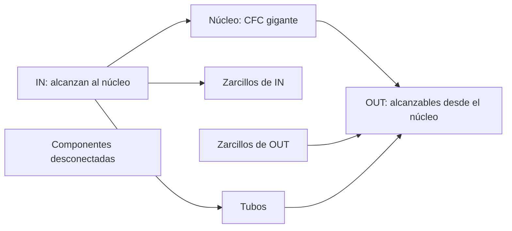

# Computación Distribuida - Redes complejas y el Web

## 1.2 Estructura gráfica del Web.

---

Nadie diseñó la red de enlaces del Web: cada autor decide a qué páginas enlaza, sin coordinarse con nadie. Aun así, cuando a finales de los noventa se recorrieron cientos de millones de páginas, la gráfica resultante mostró regularidades muy marcadas: una distribución de grados con **cola pesada** que sigue aproximadamente una **ley de potencia**, una organización global en forma de **moño** (_bow-tie_) y distancias cortas entre la mayoría de las páginas. Este tema presenta esas mediciones, los modelos que las explican, en especial el **apego preferencial** de Barabási y Albert, y los algoritmos de análisis de enlaces que aprovechan la estructura: PageRank y HITS.

### El Web como gráfica dirigida

Como en el tema 1.1, las páginas son vértices y los enlaces aristas dirigidas. Las medidas básicas son los grados de entrada y salida, las **componentes fuertemente conexas** (CFC), en las que todo vértice alcanza a todos los demás, y las **distancias**: el número mínimo de enlaces para ir de una página a otra. Para estudiarlo se usan **rastreadores** (_crawlers_), programas que descargan páginas y siguen sus enlaces; el recorrido es necesariamente parcial y sesgado hacia las páginas bien enlazadas.

### Leyes de potencia

La fracción de páginas con grado de entrada $k$ decae aproximadamente como

$$P(k) \propto k^{-\gamma},$$

con $\gamma \approx 2.1$ para el grado de entrada y $\gamma \approx 2.7$ para el de salida (Broder y otros, 2000). En escala log-log es una recta de pendiente $-\gamma.$ La diferencia con una gráfica aleatoria es enorme: en el modelo de **Erdős y Rényi**, con aristas independientes, los grados siguen una distribución de Poisson concentrada en la media, y la probabilidad de un grado muy alto decae más rápido que exponencialmente. En una ley de potencia hay **concentradores** (_hubs_) con grados miles de veces mayores que la media, y con $\gamma \leq 3$ la varianza de los grados diverge. Las mismas colas pesadas aparecen en las citas científicas, la red de rutas aéreas, las redes de proteínas y las redes sociales: por eso se llaman **redes libres de escala**.

**Precaución estadística.** Ajustar una recta al histograma en escala log-log da estimaciones sesgadas del exponente; el método recomendado es la máxima verosimilitud sobre la cola, $\hat\gamma = 1 + N \left(\sum_i \ln \frac{k_i}{k_{\min} - 1/2}\right)^{-1}$ (Clauset, Shalizi y Newman, 2009), y muchas redes que se dicen libres de escala se describen igual de bien con otras distribuciones de cola pesada, como la lognormal.

### El modelo de Barabási y Albert

**Crecimiento con apego preferencial** (1999): se empieza con unos pocos vértices y, en cada paso, llega un vértice nuevo que se une a $m$ vértices existentes, eligiendo cada uno con probabilidad proporcional a su grado. "El rico se hace más rico": las páginas ya muy enlazadas son las más visibles y reciben más enlaces nuevos.

**Resultado.** La distribución de grados converge a

$$P(k) = \frac{2m(m + 1)}{k(k + 1)(k + 2)} \sim 2m^2 k^{-3}, \qquad k \geq m.$$

**Idea de la demostración (campo medio).** Sea $k_i(t)$ el grado del vértice $i$ en el instante $t,$ con $2mt$ extremos de aristas en total. El vértice nuevo elige a $i$ con probabilidad $k_i / 2mt$ en cada una de sus $m$ aristas, así que $\frac{dk_i}{dt} = \frac{k_i}{2t},$ con solución $k_i(t) = m \sqrt{t / t_i}$ para un vértice que llegó en $t_i.$ Entonces $k_i(t) \lt k$ si y solo si $t_i > m^2 t / k^2,$ y como los tiempos de llegada son uniformes, $P(\text{grado} \lt k) = 1 - m^2/k^2.$ Derivando, $P(k) = 2m^2 / k^3.$ $\blacksquare$ El exponente es 3 sin importar $m;$ variantes con atractivo inicial o envejecimiento producen otros exponentes, como el 2.1 observado.

### La estructura de moño

Broder y otros (2000) analizaron 203 millones de páginas y 1500 millones de enlaces de AltaVista y encontraron que el Web se organiza en:

| Parte | Definición | Proporción |
| --- | --- | --- |
| **núcleo** (CFC gigante) | todas se alcanzan mutuamente | 28% |
| **IN** | alcanzan al núcleo, pero no son alcanzables desde él | 21% |
| **OUT** | alcanzables desde el núcleo, pero no lo alcanzan | 21% |
| **zarcillos** y tubos | cuelgan de IN o de OUT, o los unen sin pasar por el núcleo | 22% |
| **desconectadas** | sin relación con el núcleo | 8% |

Las páginas de IN suelen ser nuevas que aún nadie enlaza; las de OUT, sitios corporativos o documentos que solo enlazan dentro de sí. La distancia dirigida media entre dos páginas conectadas era de unos 16 enlaces, pero de un par al azar solo el 24% está conectado por un camino dirigido. Albert, Jeong y Barabási (1999) estimaron "19 grados de separación" extrapolando a todo el Web: distancias que crecen como $\log n,$ el fenómeno de mundo pequeño (tema 3.1).

### Análisis de enlaces

- **PageRank** (Brin y Page, 1998): la distribución estacionaria del navegante aleatorio que sigue un enlace con probabilidad $\alpha$ y salta a una página al azar con probabilidad $1 - \alpha:$ $r_v = \frac{1 - \alpha}{n} + \alpha \sum_{u \to v} \frac{r_u}{\text{salida}(u)}.$ Se calcula por iteración de potencias (tema 7.1).
- **HITS** (Kleinberg, 1999): cada página tiene un puntaje de **autoridad** $a$ (buen contenido, enlazada por buenos concentradores) y uno de **concentrador** $h$ (buena lista de enlaces, apunta a buenas autoridades). Se iteran $a \leftarrow A^\top h$ y $h \leftarrow A a,$ normalizando: convergen a los vectores propios principales de $A^\top A$ y $A A^\top.$



### Implementación en Python

El programa encuentra las componentes fuertemente conexas y la estructura de moño de la mini-web del ejercicio 1 y calcula sus primeras iteraciones de PageRank; genera una red de Barabási y Albert y una de Erdős y Rényi con 50 000 vértices y el mismo número de aristas, y compara sus distribuciones de grados con las fórmulas teóricas (ejercicio 2), y ejecuta HITS sobre la mini-web (ejercicio 3).

```python
import math, random
from collections import Counter, deque

random.seed(12)

# --- Ejercicio 1: mini-web y moño ---
nodos = "ABCDE"
enlaces = {"A": "BC", "B": "C", "C": "AD", "D": "E", "E": "D"}

def alcanzables(origen, ady):
    vistos, cola = {origen}, deque([origen])
    while cola:
        u = cola.popleft()
        for v in ady.get(u, ""):
            if v not in vistos:
                vistos.add(v); cola.append(v)
    return vistos

inverso = {v: "".join(u for u in nodos if v in enlaces[u]) for v in nodos}

def scc(v):
    return alcanzables(v, enlaces) & alcanzables(v, inverso)

componentes = {frozenset(scc(v)) for v in nodos}
nucleo = max(componentes, key=len)
x = next(iter(nucleo))
salida = alcanzables(x, enlaces) - nucleo
entrada = alcanzables(x, inverso) - nucleo
resto = set(nodos) - nucleo - salida - entrada
print("ejercicio 1: componentes", sorted("".join(sorted(c)) for c in componentes))
print("   moño: núcleo", sorted(nucleo), "IN", sorted(entrada), "OUT", sorted(salida), "otros", sorted(resto))
print("   salida:", {v: len(enlaces[v]) for v in nodos}, "entrada:", {v: len(inverso[v]) for v in nodos})

def pagerank_iter(alfa, k):
    n = len(nodos); r = {v: 1 / n for v in nodos}; hist = [r]
    for _ in range(k):
        nuevo = {v: (1 - alfa) / n for v in nodos}
        for u in nodos:
            for v in enlaces[u]:
                nuevo[v] += alfa * r[u] / len(enlaces[u])
        r = nuevo; hist.append(r)
    return hist

h = pagerank_iter(0.85, 60)
for k in (0, 1, 2, 60):
    print(f"   PageRank iteración {k:2}:", {v: round(x, 4) for v, x in h[k].items()})

# --- Ejercicio 2: Barabási-Albert frente a Erdős-Rényi ---
def barabasi_albert(n, m):
    extremos = []                       # cada vértice aparece tantas veces como su grado
    aristas = set()
    for i in range(m + 1):              # núcleo completo de m + 1 vértices
        for j in range(i):
            aristas.add((j, i)); extremos += [i, j]
    for v in range(m + 1, n):
        objetivos = set()
        while len(objetivos) < m:
            objetivos.add(random.choice(extremos))   # proporcional al grado
        for u in objetivos:
            aristas.add((u, v)); extremos += [u, v]
    return aristas

def erdos_renyi(n, m_total):
    aristas = set()
    while len(aristas) < m_total:
        u, v = random.sample(range(n), 2)
        aristas.add((min(u, v), max(u, v)))
    return aristas

def grados(n, aristas):
    g = [0] * n
    for u, v in aristas:
        g[u] += 1; g[v] += 1
    return g

def exponente_mle(g, kmin):
    """Estimador de máxima verosimilitud discreto aproximado (Clauset, Shalizi y Newman)."""
    x = [k for k in g if k >= kmin]
    return 1 + len(x) / sum(math.log(k / (kmin - 0.5)) for k in x)

n, m = 50000, 3
BA = barabasi_albert(n, m)
ER = erdos_renyi(n, len(BA))
gBA, gER = grados(n, BA), grados(n, ER)
print(f"ejercicio 2: n = {n}, {len(BA)} aristas, grado medio {2 * len(BA) / n:.2f}")
for nombre, g in (("Barabási-Albert", gBA), ("Erdős-Rényi", gER)):
    c = Counter(g)
    print(f"   {nombre:16} máximo {max(g):5}  P(k >= 20) = {sum(1 for k in g if k >= 20) / n:.4f}"
          f"  P(k >= 50) = {sum(1 for k in g if k >= 50) / n:.5f}")
print(f"   exponente estimado de la cola de BA (k >= 10): {exponente_mle(gBA, 10):.2f} (teórico 3)")
lam = 2 * len(BA) / n
for k in (2, 6, 10, 20):
    poisson = math.exp(-lam) * lam ** k / math.factorial(k)
    print(f"   P(k = {k:2}): BA {Counter(gBA)[k] / n:.5f}  ER {Counter(gER)[k] / n:.5f}  Poisson {poisson:.5f}"
          f"  BA teórico 2m(m+1)/(k(k+1)(k+2)) = {2 * m * (m + 1) / (k * (k + 1) * (k + 2)) if k >= m else 0:.5f}")

# --- Ejercicio 3: HITS ---
def hits(nodos, enlaces, k):
    a = {v: 1.0 for v in nodos}; h = {v: 1.0 for v in nodos}
    for i in range(1, k + 1):
        a = {v: sum(h[u] for u in nodos if v in enlaces[u]) for v in nodos}
        h = {u: sum(a[v] for v in enlaces[u]) for u in nodos}
        na, nh = math.sqrt(sum(x * x for x in a.values())), math.sqrt(sum(x * x for x in h.values()))
        a = {v: x / na for v, x in a.items()}; h = {v: x / nh for v, x in h.items()}
        if i <= 3 or i == k:
            print(f"   iteración {i:2}: autoridades", {v: round(x, 3) for v, x in a.items()},
                  "| concentradores", {v: round(x, 3) for v, x in h.items()})

print("ejercicio 3: HITS en la mini-web del ejercicio 1")
hits(nodos, enlaces, 50)
```

Salida:

```text
ejercicio 1: componentes ['ABC', 'DE']
   moño: núcleo ['A', 'B', 'C'] IN [] OUT ['D', 'E'] otros []
   salida: {'A': 2, 'B': 1, 'C': 2, 'D': 1, 'E': 1} entrada: {'A': 1, 'B': 1, 'C': 2, 'D': 2, 'E': 1}
   PageRank iteración  0: {'A': 0.2, 'B': 0.2, 'C': 0.2, 'D': 0.2, 'E': 0.2}
   PageRank iteración  1: {'A': 0.115, 'B': 0.115, 'C': 0.285, 'D': 0.285, 'E': 0.2}
   PageRank iteración  2: {'A': 0.1511, 'B': 0.0789, 'C': 0.1766, 'D': 0.3211, 'E': 0.2723}
   PageRank iteración 60: {'A': 0.0805, 'B': 0.0642, 'C': 0.1188, 'D': 0.3819, 'E': 0.3546}
ejercicio 2: n = 50000, 149994 aristas, grado medio 6.00
   Barabási-Albert  máximo   774  P(k >= 20) = 0.0289  P(k >= 50) = 0.00516
   Erdős-Rényi      máximo    20  P(k >= 20) = 0.0000  P(k >= 50) = 0.00000
   exponente estimado de la cola de BA (k >= 10): 2.85 (teórico 3)
   P(k =  2): BA 0.00000  ER 0.04428  Poisson 0.04462  BA teórico 2m(m+1)/(k(k+1)(k+2)) = 0.00000
   P(k =  6): BA 0.07224  ER 0.15962  Poisson 0.16062  BA teórico 2m(m+1)/(k(k+1)(k+2)) = 0.07143
   P(k = 10): BA 0.01832  ER 0.04066  Poisson 0.04130  BA teórico 2m(m+1)/(k(k+1)(k+2)) = 0.01818
   P(k = 20): BA 0.00234  ER 0.00002  Poisson 0.00000  BA teórico 2m(m+1)/(k(k+1)(k+2)) = 0.00260
ejercicio 3: HITS en la mini-web del ejercicio 1
   iteración  1: autoridades {'A': 0.302, 'B': 0.302, 'C': 0.603, 'D': 0.603, 'E': 0.302} | concentradores {'A': 0.577, 'B': 0.385, 'C': 0.577, 'D': 0.192, 'E': 0.385}
   iteración  2: autoridades {'A': 0.361, 'B': 0.361, 'C': 0.602, 'D': 0.602, 'E': 0.12} | concentradores {'A': 0.598, 'B': 0.374, 'C': 0.598, 'D': 0.075, 'E': 0.374}
   iteración  3: autoridades {'A': 0.37, 'B': 0.37, 'C': 0.602, 'D': 0.602, 'E': 0.046} | concentradores {'A': 0.601, 'B': 0.372, 'C': 0.601, 'D': 0.029, 'E': 0.372}
   iteración 50: autoridades {'A': 0.372, 'B': 0.372, 'C': 0.602, 'D': 0.602, 'E': 0.0} | concentradores {'A': 0.602, 'B': 0.372, 'C': 0.602, 'D': 0.0, 'E': 0.372}
```

### Ejercicios Propuestos

1. **Mini-web.** Las páginas A a E tienen los enlaces A a B y a C, B a C, C a A y a D, D a E y E a D. Construye la matriz de adyacencia, calcula los grados, identifica la estructura de moño y calcula a mano las dos primeras iteraciones de PageRank.

2. **Distribución de grados.** Implementa un generador de gráficas libres de escala con el modelo de Barabási y Albert y compara su distribución de grados con la de una gráfica aleatoria de Erdős y Rényi.

3. **HITS.** Ejecuta 3 iteraciones de HITS en la gráfica del ejercicio 1 para calcular los puntajes de concentrador y de autoridad.

### Soluciones

**Ejercicio 1.** Matriz (fila a columna): A $(0, 1, 1, 0, 0),$ B $(0, 0, 1, 0, 0),$ C $(1, 0, 0, 1, 0),$ D $(0, 0, 0, 0, 1),$ E $(0, 0, 0, 1, 0).$ Grados de salida 2, 1, 2, 1, 1 y de entrada 1, 1, 2, 2, 1. Las CFC son $\{A, B, C\}$ y $\{D, E\}.$ Tomando la mayor como núcleo, $\{D, E\}$ es **OUT:** se llega a ella por $C \to D,$ pero no se puede volver; IN está vacío.

**PageRank** con $\alpha = 0.85$ y $r^{(0)} = 0.2$ para todos, con $0.15/5 = 0.03$ de salto:

- $r_A^{(1)} = 0.03 + 0.85 \cdot \frac{0.2}{2} = 0.115$ (de C, que tiene 2 enlaces); $r_B^{(1)} = 0.03 + 0.85 \cdot \frac{0.2}{2} = 0.115$ (de A); $r_C^{(1)} = 0.03 + 0.85 \left(\frac{0.2}{2} + 0.2\right) = 0.285$ (de A y de B); $r_D^{(1)} = 0.03 + 0.85 \left(\frac{0.2}{2} + 0.2\right) = 0.285$ (de C y de E); $r_E^{(1)} = 0.03 + 0.85 \cdot 0.2 = 0.2$ (de D).
- La segunda iteración, con el mismo cálculo, da $(0.151, 0.079, 0.177, 0.321, 0.272).$

A la larga, D y E concentran más del 70% del PageRank: el componente OUT es una **trampa** de la que el navegante solo sale saltando. Por eso PageRank necesita el salto aleatorio.

**Ejercicio 2.** Con 50 000 vértices y unas 150 000 aristas en ambas, el grado medio es 6 en las dos, pero la red de Barabási y Albert tiene un vértice de grado 774, mientras que en la de Erdős y Rényi el máximo es 20. Las frecuencias de la primera coinciden con $2m(m + 1)/(k(k + 1)(k + 2))$ y no tiene vértices de grado menor que $m = 3;$ las de la segunda siguen la distribución de Poisson de media 6. El estimador de máxima verosimilitud da un exponente de 2.85 para la cola, cerca del 3 teórico.

**Ejercicio 3.** Partiendo de $a = h = 1$ en todos los vértices, la primera actualización da a cada página una autoridad igual a su grado de entrada, $(1, 1, 2, 2, 1),$ que normalizada es $(0.302, 0.302, 0.603, 0.603, 0.302).$ Tras tres iteraciones, C y D son las mejores autoridades, con 0.602, porque las enlazan A y C, los mejores concentradores. E pierde su autoridad (0.046), porque solo la enlaza D, que es un mal concentrador. En el límite, E y D tienen autoridad y concentración nulas respectivamente: HITS, a diferencia de PageRank, refuerza el núcleo mutuamente enlazado.

### Referencias

1. Broder, A., Kumar, R., Maghoul, F., et al., Graph structure in the Web. _Computer Networks_ 33(1), 2000.
2. Barabási, A.-L., and Albert, R., Emergence of scaling in random networks. _Science_ 286(5439), 1999.
3. Easley, D., and Kleinberg, J., _Networks, Crowds, and Markets_. Cambridge University Press, 2010. Capítulos 13, 14 y 18.
4. Clauset, A., Shalizi, C. R., and Newman, M. E. J., Power-law distributions in empirical data. _SIAM Review_ 51(4), 2009.
