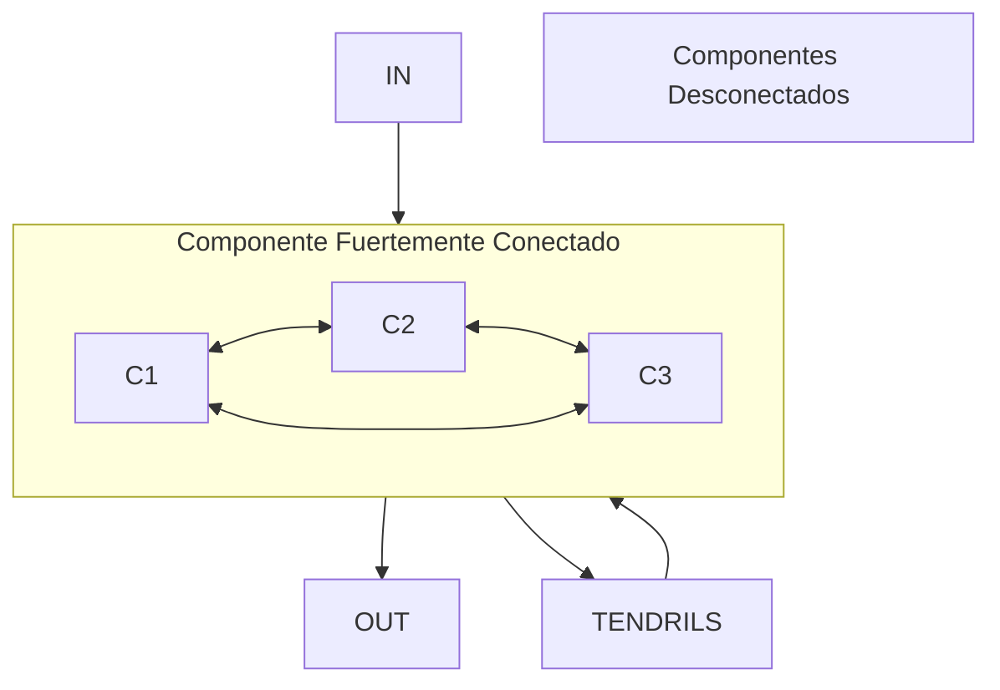

# Computación Distribuida - Redes complejas y el Web

## 1.2 Estructura gráfica del Web.

---

La estructura gráfica del Web es fundamental para entender cómo la información se organiza y conecta en Internet. Desde la perspectiva de la computación distribuida, el Web representa una de las redes complejas más grandes creadas por la humanidad, con propiedades emergentes que surgen de las interconexiones distribuidas entre sus componentes.

### Conceptos Fundamentales

#### Grafo Web

El World Wide Web puede modelarse como un grafo dirigido $G = (V, E)$ donde:

- $V$ representa el conjunto de páginas web (vértices/nodos)
- $E$ representa el conjunto de hipervínculos (aristas dirigidas)

#### Propiedades de la Red Web

- **Direccionalidad**: Los enlaces tienen dirección (de la página origen a la página destino)
- **Distribución libre de escala**: La conectividad sigue una distribución de ley de potencia
- **Small-world property**: Paths cortos conectan la mayoría de los nodos
- **Estructura comunitaria**: Agrupaciones naturales de páginas temáticamente relacionadas

### Modelado Matemático del Grafo Web

#### Matriz de Adyacencia

Para un grafo web con $n$ páginas, definimos la matriz de adyacencia $A$ donde:

$$ A_{ij} = \begin{cases} 1 & \text{si existe un enlace de la página } i \text{ a la página } j \\\ 0 & \text{en caso contrario} \end{cases}$$

#### Grados de los Nodos
- **Grado de salida (out-degree)**: Número de enlaces que salen de una página

  $$deg_{out}(v_i) = \sum_{j=1}^{n} A_{ij}$$

- **Grado de entrada (in-degree)**: Número de enlaces que apuntan a una página

  $$deg_{in}(v_j) = \sum_{i=1}^{n} A_{ij}$$

#### Distribución de Grados
La distribución de grados en el Web sigue una ley de potencia:

$$P(k) \sim k^{-\gamma}$$

donde $P(k)$ es la probabilidad de que un nodo tenga grado $k$ y $\gamma$ es el exponente característico (típicamente entre 2-3).

### Estructura en Bow-Tie del Web



La investigación de Broder et al. (2000) reveló que el Web tiene una estructura característica en "lazo de corbata" (bow-tie) compuesta por:

1. **Núcleo Fuertemente Conectado (SCC)**: Páginas mutuamente alcanzables
2. **Componente de Entrada (IN)**: Páginas que pueden llegar al SCC pero no son alcanzables desde él
3. **Componente de Salida (OUT)**: Páginas alcanzables desde el SCC pero que no pueden llegar a él
4. **Tendrils**: Páginas conectadas a IN o OUT pero no al SCC
5. **Tubos**: Conexiones directas entre IN y OUT que evitan el SCC
6. **Componentes Desconectados**: Páginas aisladas del resto del grafo

### Algoritmos para Analizar la Estructura Web

#### PageRank
Algoritmo fundamental de Google para medir la importancia de páginas web:

$$PR(p_i) = \frac{1-d}{n} + d \sum_{p_j \in M(p_i)} \frac{PR(p_j)}{L(p_j)}$$

donde:
- $PR(p_i)$ es el PageRank de la página $i$
- $d$ es el factor de amortiguación (usualmente 0.85)
- $n$ es el número total de páginas
- $M(p_i)$ son las páginas que enlazan a $p_i$
- $L(p_j)$ es el número de enlaces salientes de $p_j$

#### Algoritmo HITS (Hyperlink-Induced Topic Search)
Identifica dos tipos de páginas:
- **Hubs**: Páginas que enlazan a buenas autoridades
- **Authorities**: Páginas con muchos enlaces entrantes de buenos hubs

$$\text{Auth}(p) = \sum_{\text{hubs que enlazan a p}} \text{Hub-score}(q)$$
$$\text{Hub}(p) = \sum_{\text{autoridades enlazadas por p}} \text{Auth-score}(q)$$

### Implementación de Algoritmos de Análisis Web

```python
import numpy as np
import networkx as nx
from scipy.sparse import csr_matrix

class WebGraphAnalyzer:
    def __init__(self, adjacency_matrix):
        self.n = adjacency_matrix.shape[0]
        self.adj_matrix = adjacency_matrix
        self.graph = nx.DiGraph(adjacency_matrix)

    def calculate_pagerank(self, damping=0.85, max_iter=100, tol=1e-6):
        """Calcula PageRank para el grafo web"""
        # Vector de PageRank inicial (distribución uniforme)
        pagerank = np.ones(self.n) / self.n

        # Matriz de transición
        out_degree = self.adj_matrix.sum(axis=1)
        transition_matrix = np.zeros((self.n, self.n))

        for i in range(self.n):
            if out_degree[i] > 0:
                transition_matrix[i] = self.adj_matrix[i] / out_degree[i]
            else:
                # Manejar páginas sin enlaces salientes
                transition_matrix[i] = np.ones(self.n) / self.n

        # Iteración de PageRank
        for iteration in range(max_iter):
            new_pagerank = (damping * np.dot(transition_matrix.T, pagerank) +
                           (1 - damping) * np.ones(self.n) / self.n)

            if np.linalg.norm(new_pagerank - pagerank, 1) < tol:
                break

            pagerank = new_pagerank

        return pagerank

    def identify_bowtie_components(self):
        """Identifica los componentes de la estructura bow-tie"""
        # Componente fuertemente conectado
        scc = max(nx.strongly_connected_components(self.graph), key=len)

        # Nodos que pueden llegar al SCC
        in_component = set()
        for node in self.graph.nodes():
            if node not in scc:
                for scc_node in scc:
                    if nx.has_path(self.graph, node, scc_node):
                        in_component.add(node)
                        break

        # Nodos alcanzables desde el SCC
        out_component = set()
        for node in self.graph.nodes():
            if node not in scc:
                for scc_node in scc:
                    if nx.has_path(self.graph, scc_node, node):
                        out_component.add(node)
                        break

        # Tendrils y tubos
        tendrils = set()
        tubes = set()

        return {
            'scc': scc,
            'in_component': in_component,
            'out_component': out_component,
            'tendrils_tubes': tendrils | tubes,
            'disconnected': set(self.graph.nodes()) - scc - in_component - out_component
        }

    def degree_distribution(self):
        """Calcula la distribución de grados"""
        in_degrees = [deg for _, deg in self.graph.in_degree()]
        out_degrees = [deg for _, deg in self.graph.out_degree()]

        return in_degrees, out_degrees

# Ejemplo de uso
adj_matrix = np.array([
    [0, 1, 1, 0, 0],
    [0, 0, 1, 0, 0],
    [1, 0, 0, 1, 0],
    [0, 0, 0, 0, 1],
    [0, 0, 0, 1, 0]
])

analyzer = WebGraphAnalyzer(adj_matrix)
pagerank = analyzer.calculate_pagerank()
bowtie = analyzer.identify_bowtie_components()
in_degrees, out_degrees = analyzer.degree_distribution()
```

### Ejercicios Propuestos

#### Ejercicio 1: Análisis de Mini-Web
Dado el siguiente conjunto de páginas y enlaces:
- Página A enlaza a B y C
- Página B enlaza a C
- Página C enlaza a A y D
- Página D enlaza a E
- Página E enlaza a D

1. Construye la matriz de adyacencia
2. Calcula los grados de entrada y salida de cada nodo
3. Identifica la estructura bow-tie
4. Calcula manualmente las dos primeras iteraciones de PageRank

#### Ejercicio 2: Simulación de Distribución de Grados
Implementa un generador de grafos scale-free usando el modelo Barabási-Albert y compara la distribución de grados con la de un grafo aleatorio Erdős-Rényi.

#### Ejercicio 3: Algoritmo HITS
Implementa el algoritmo HITS para el grafo del ejercicio 1 y ejecuta 3 iteraciones para calcular los scores de hubs y authorities.

### Aplicaciones en Computación Distribuida

#### Crawling Distribuido
La estructura del grafo web influye en el diseño de crawlers distribuidos:
- Estrategias de politeness para evitar sobrecargar sitios
- Distribución de URLs entre múltiples crawlers
- Detección de contenido duplicado y espejos

#### Almacenamiento Distribuido
- Fragmentación de índices invertidos basada en la estructura del grafo
- Replicación de páginas importantes (alto PageRank)
- Almacenamiento en caché distribuido de contenido popular

#### Búsqueda Distribuida
- Routing de consultas basado en la estructura temática
- Federación de motores de búsqueda especializados
- Agregación distribuida de resultados

### Referencias

#### Bibliografía Básica
1. Easley, D., & Kleinberg, J. (2010). *Networks, Crowds, and Markets: Reasoning about a Highly Connected World*. Capítulo 14: "Link Analysis and Web Search".
2. Attiya, H., & Welch, J. (2004). *Distributed Computing: Fundamentals, Simulations, and Advanced Topics*. Sección 7.3: "Web Algorithmics".

#### Bibliografía Complementaria
1. Broder, A., et al. (2000). "Graph structure in the web". *9th International World Wide Web Conference*.
2. Kleinberg, J. M. (1999). "Authoritative sources in a hyperlinked environment". *Journal of the ACM*.
3. Page, L., Brin, S., Motwani, R., & Winograd, T. (1999). "The PageRank citation ranking: Bringing order to the web".

#### Recursos Adicionales
- [WebGraph Framework](https://webgraph.di.unimi.it/) - Para análisis de grafos web a gran escala
- [Common Crawl](https://commoncrawl.org/) - Datos reales de la web para investigación
- [SNAP Web Graphs](https://snap.stanford.edu/data/#web) - Datasets de grafos web de Stanford
