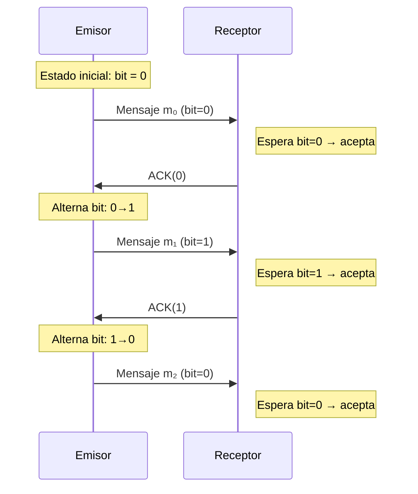

# Computación Distribuida - Algoritmos distribuidos

## 2.1 Protocolos en línea (bit alternante).

---

Los protocolos en línea, específicamente el protocolo de bit alternante, son fundamentales en la computación distribuida para lograr la coordinación y sincronización entre procesos. Este protocolo garantiza la entrega ordenada de mensajes y la exclusión mutua en sistemas distribuidos.

### Definición del Protocolo de Bit Alternante

El **protocolo de bit alternante** es un algoritmo de comunicación que asegura la entrega ordenada de mensajes entre dos procesos en un sistema distribuido. Utiliza un bit que alterna su valor (0 y 1) para etiquetar los mensajes, permitiendo al receptor detectar pérdidas, duplicaciones o desórdenes.

#### Formulación Matemática

Sea $P_s$ el proceso emisor y $P_r$ el proceso receptor. Cada mensaje $m_i$ lleva un bit $b_i \in \{0, 1\}$.

- **Estado inicial**: $b_0 = 0$
- **Regla de transmisión**: Para el k-ésimo mensaje, $b_k = (b_{k-1} + 1) \mod 2$
- **Regla de aceptación**: $P_r$ acepta $m_i$ si $b_i = (b_{\text{last}} + 1) \mod 2$, donde $b_{\text{last}}$ es el bit del último mensaje aceptado.

### Funcionamiento del Protocolo

#### Diagrama de Secuencia



#### Implementación Básica en Pseudocódigo

```
// Proceso Emisor
bit = 0
while hay_mensajes:
    enviar(mensaje, bit)
    esperar_ack(bit)
    bit = 1 - bit  // Alternar el bit

// Proceso Receptor
bit_esperado = 0
while True:
    recibir(mensaje, bit_recibido)
    if bit_recibido == bit_esperado:
        procesar(mensaje)
        enviar_ack(bit_esperado)
        bit_esperado = 1 - bit_esperado
    else:
        descartar(mensaje)
        enviar_ack(1 - bit_recibido)  // ACK del último bit correcto
```

### Propiedades y Garantías

1. **Entrega ordenada**: Los mensajes se entregan en el orden de envío.
2. **Detección de pérdidas**: Si un ACK no llega, el emisor retransmite.
3. **Prevención de duplicados**: Los bits alternantes detectan mensajes duplicados.

La eficiencia del protocolo se puede medir mediante el ancho de banda utilizado:

$$ E = \frac{\text{mensajes útiles}}{\text{mensajes totales}} = \frac{1}{2} \text{ en el peor caso} $$

### Ejemplo Práctico

**Escenario**: Comunicación entre un cliente y un servidor usando bit alternante.

1. Cliente envía: "GET /" (bit=0)
2. Servidor responde: ACK(0) + "200 OK"
3. Cliente alterna bit a 1, envía: "GET /img" (bit=1)
4. Servidor responde: ACK(1) + "404 Not Found"

Si el ACK(1) se pierde, el cliente retransmitirá "GET /img" con bit=1. El servidor, al recibir un mensaje con bit=1 (cuando espera 0), enviará ACK(0) pero descartará el mensaje duplicado.

### Ejercicios Propuestos

1. **Análisis de eficiencia**: Calcule la eficiencia del protocolo cuando la tasa de pérdida de paquetes es $p$. Exprese el resultado como fórmula en KaTeX.

2. **Extensión a múltiples bits**: Diseñe una versión que use 2 bits en lugar de 1. ¿Qué ventajas ofrece?

3. **Simulación de fallos**: Implemente el protocolo en Python y simule:
   - Pérdida del 10% de los mensajes
   - Duplicación del 5% de los mensajes
   - Retrasos aleatorios

4. **Demostración formal**: Demuestre que el protocolo garantiza la entrega ordenada usando inducción matemática.

### Solución al Ejercicio 1

La eficiencia $E$ considerando una tasa de pérdida $p$:

$$ E = \frac{1}{2} \times (1 - p) + \frac{1}{4} \times p(1 - p) + \frac{1}{6} \times p^2(1 - p) + \cdots = \sum_{k=0}^{\infty} \frac{1 - p}{2(k + 1)} p^k $$

Esta serie converge a:

$$ E = \frac{1 - p}{2p} \ln\left(\frac{1}{1 - p}\right) $$

### Referencias

1. Attiya, H., & Welch, J. (2004). _Distributed Computing: Fundamentals, Simulations, and Advanced Topics_. Wiley. (Capítulo 2: Protocols for Mutual Exclusion)
2. Lynch, N. (1996). _Distributed Algorithms_. Morgan Kaufman. (Capítulo 2: Modelling II: Asynchronous System Model)
3. Tel, G. (2001). _Introduction to Distributed Algorithms_. Cambridge University Press. (Capítulo 4: Communication Protocols)

### Recursos Adicionales

- [Simulador de protocolos distribuidos](https://github.com/distributed-systems/simulator)
- [Visualización interactiva del bit alternante](https://www.distributed-systems.net/visualization/)
