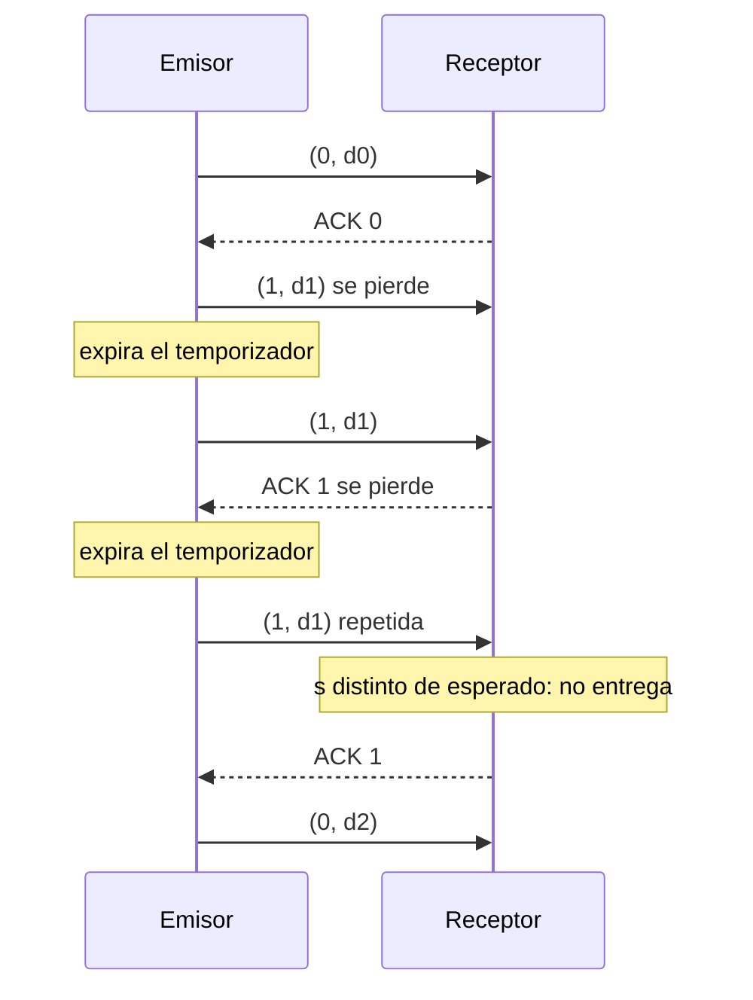

# Computación Distribuida - Algoritmos distribuidos

## 2.1 Protocolos en línea (bit alternante).

---

En un sistema distribuido, los procesos solo se comunican por mensajes, y los canales reales pierden, duplican y retrasan mensajes. El problema más básico es transmitir una secuencia de datos de un emisor a un receptor de modo que el receptor entregue **exactamente** la secuencia original, sin huecos, repeticiones ni desorden, sobre un canal no confiable. El **protocolo de bit alternante** (Bartlett, Scantlebury y Wilkinson, 1969) lo resuelve con un solo bit de número de secuencia y es el ejemplo clásico de protocolo cuya corrección hay que **demostrar**: casi todos los protocolos ingenuos fallan en alguna intercalación de eventos. Este tema lo define, demuestra su corrección con invariantes, analiza su eficiencia y lo generaliza a ventanas deslizantes.

### El modelo

- Un **emisor** recibe datos $d_0, d_1, \ldots$ de la aplicación y un **receptor** debe **entregarlos** en ese orden.
- Dos canales, de ida y de vuelta. Cada canal puede **perder** un mensaje, **duplicarlo** o **retrasarlo** un tiempo arbitrario, pero es **FIFO:** no reordena. Además, si se envía un mensaje infinitas veces, llega infinitas veces (equidad).
- El emisor tiene un **temporizador** para retransmitir.

**Especificación.** Seguridad: la secuencia entregada es siempre un prefijo de $d_0, d_1, \ldots$ Vivacidad: todo dato termina entregándose.

### El protocolo

Cada trama de datos lleva un bit de secuencia $b,$ y cada acuse (ACK) el bit de la trama que confirma.

```
EMISOR                                    RECEPTOR
b ← 0                                     esperado ← 0
para cada dato d:                         al recibir (s, d):
    repetir                                   si s = esperado
        enviar (b, d); iniciar temporizador        entregar d
        esperar ACK(b) o expiración               esperado ← 1 − esperado
    hasta recibir ACK(b)                      enviar ACK(s)
    b ← 1 − b
```

Los acuses con el bit equivocado y las tramas repetidas se reconocen por el bit y se descartan; el receptor confirma de nuevo una trama repetida, porque su ACK anterior pudo perderse.



### Corrección

**Invariante.** Sea $i$ el índice del dato que el emisor intenta enviar, con bit $b = i \bmod 2,$ y $j$ el número de datos entregados, con $\text{esperado} = j \bmod 2.$ En todo momento:

1. $j = i$ o $j = i + 1;$
2. si $j = i,$ el canal de ida contiene, en este orden, copias viejas de $(1 - b, d_{i-1}),$ quizá ninguna, y luego copias de $(b, d_i),$ y el canal de vuelta solo contiene $\text{ACK}(1 - b);$
3. si $j = i + 1,$ el canal de ida solo contiene copias de $(b, d_i),$ y el de vuelta, copias de $\text{ACK}(1 - b)$ seguidas de copias de $\text{ACK}(b).$

**Demostración por inducción sobre el número de eventos.** Al inicio $i = j = 0$ y los canales están vacíos. Se revisa cada evento: un envío o reenvío del emisor agrega $(b, d_i),$ compatible con 2 y 3; una pérdida o duplicación no cambia el tipo de mensajes; si el receptor recibe $(b, d_i)$ con $j = i,$ entrega $d_i,$ que es el correcto porque $j = i,$ pasa a $j = i + 1$ y envía $\text{ACK}(b):$ caso 3. Si recibe una trama con el bit distinto del esperado, es una copia vieja; no entrega y reenvía su ACK, del tipo ya presente. Si el emisor recibe $\text{ACK}(b),$ por 2 debe ser $j = i + 1,$ porque en el caso $j = i$ solo hay $\text{ACK}(1 - b);$ entonces avanza a $i + 1 = j,$ y lo que queda en los canales son copias del dato anterior: caso 2 con el nuevo $i.$ La propiedad FIFO es la que garantiza que las copias viejas van **antes** que las nuevas, y por tanto que el bit basta para distinguirlas. $\blacksquare$

**Seguridad:** el receptor solo entrega $d_i$ cuando $j = i,$ así que la secuencia entregada es $d_0, \ldots, d_{j-1}.$ **Vivacidad:** por equidad, la trama $(b, d_i)$ llega alguna vez, y luego su ACK.

**Sin FIFO, falla.** Si el canal reordena, una copia vieja de $(0, d_0)$ puede llegar después de que el receptor ya espera de nuevo el bit 0, para $d_2,$ y se entregaría $d_0$ en lugar de $d_2.$ Con números de secuencia acotados, ningún protocolo es correcto en canales que reordenan sin límite de tiempo; por eso TCP usa números de 32 bits y supone una vida máxima de los segmentos.

### Eficiencia

Sea $t_f$ el tiempo de transmitir una trama, $t_p$ el de propagación y $a = t_p / t_f.$ Sin errores, cada dato ocupa un ciclo de $t_f + 2t_p$ (ignorando el ACK), así que la **utilización** del canal es $U = \frac{1}{1 + 2a}.$ Si cada mensaje se pierde con probabilidad $p$ de forma independiente, un ciclo tiene éxito con probabilidad $(1 - p)^2$ (trama y ACK), el número esperado de ciclos por dato es $1/(1 - p)^2,$ y con un temporizador igual al tiempo de ida y vuelta

$$U = \frac{(1 - p)^2}{1 + 2a}.$$

El factor $1/(1 + 2a)$ es el defecto de **parada y espera:** si la propagación es larga, como en un enlace satelital, el canal pasa casi todo el tiempo vacío. Lo resuelven las **ventanas deslizantes:** con números de secuencia de $k$ bits, el emisor puede tener hasta $W$ tramas sin confirmar, con $W \leq 2^k - 1$ en **retroceso N** (_go-back-N_) y $W \leq 2^{k-1}$ en **repetición selectiva**. El bit alternante es el caso $k = 1,$ $W = 1.$

### Implementación en Python

El programa es una simulación de eventos discretos: canales que pierden, duplican y retrasan mensajes, con o sin orden FIFO, y un temporizador de retransmisión. Envía 2000 datos con el bit alternante con distintas tasas de fallo y comprueba la entrega exacta y el número de envíos (ejercicio 3); muestra que con retrasos largos solo funciona si el canal es FIFO; implementa retroceso N con números de 2 bits y distintas ventanas (ejercicio 2), y tabula la utilización del ejercicio 1.

```python
import heapq, random

class Canal:
    """Canal con pérdida, duplicación y retraso aleatorio; FIFO si fifo=True."""
    def __init__(self, sim, perdida, duplica, fifo=True, retraso=(1, 3)):
        self.sim, self.perdida, self.duplica, self.fifo = sim, perdida, duplica, fifo
        self.retraso = retraso
        self.ultimo = 0.0
    def envia(self, msg, destino):
        if self.sim.rng.random() < self.perdida:
            return
        copias = 2 if self.sim.rng.random() < self.duplica else 1
        for _ in range(copias):
            t = self.sim.t + self.sim.rng.uniform(*self.retraso)
            if self.fifo:
                t = max(t, self.ultimo + 1e-9); self.ultimo = t
            self.sim.programa(t, destino, msg)

class Simulacion:
    def __init__(self, semilla):
        self.t, self.cola, self.rng, self.n = 0.0, [], random.Random(semilla), 0
    def programa(self, t, destino, msg):
        self.n += 1; heapq.heappush(self.cola, (t, self.n, destino, msg))
    def corre(self, limite=10**6):
        while self.cola and self.t < limite:
            self.t, _, destino, msg = heapq.heappop(self.cola)
            destino(msg)

def bit_alternante(datos, perdida=0.0, duplica=0.0, fifo=True, bits=1, semilla=1, espera=8.0, retraso=(1, 3)):
    sim = Simulacion(semilla)
    modulo = 2 ** bits
    ida = Canal(sim, perdida, duplica, fifo, retraso); vuelta = Canal(sim, perdida, duplica, fifo, retraso)
    estado = {"i": 0, "sec": 0, "esperado": 0, "envios": 0, "entregados": [], "tic": 0}

    def transmite():
        if estado["i"] < len(datos):
            estado["envios"] += 1
            ida.envia((estado["sec"], datos[estado["i"]]), receptor)
            estado["tic"] += 1
            tic = estado["tic"]
            sim.programa(sim.t + espera, lambda _: tic == estado["tic"] and transmite(), None)

    def receptor(msg):
        sec, x = msg
        if sec == estado["esperado"]:
            estado["entregados"].append(x)
            estado["esperado"] = (estado["esperado"] + 1) % modulo
        vuelta.envia(sec, emisor)                 # confirma lo recibido, nuevo o repetido

    def emisor(ack):
        if ack == estado["sec"]:
            estado["i"] += 1
            estado["sec"] = (estado["sec"] + 1) % modulo
            estado["tic"] += 1                    # cancela el temporizador
            transmite()

    transmite()
    sim.corre()
    return estado["entregados"], estado["envios"], sim.t

datos = list(range(2000))
print("ejercicio 3: canal FIFO con fallos")
for p, d in [(0.0, 0.0), (0.1, 0.0), (0.0, 0.05), (0.1, 0.05), (0.3, 0.05)]:
    rec, envios, t = bit_alternante(datos, p, d)
    print(f"   pérdida {p:.0%}, duplicación {d:.0%}: entrega correcta {rec == datos},"
          f" envíos por dato {envios / len(datos):.3f}, 1/(1-p)^2 = {1 / (1 - p) ** 2:.3f}")

# --- canal que reordena ---
for fifo in (True, False):
    fallos = 0
    for semilla in range(50):
        rec, _, _ = bit_alternante(list(range(300)), 0.1, 0.05, fifo=fifo, semilla=semilla, retraso=(1, 20))
        fallos += rec != list(range(300))
    print(f"   retrasos de 1 a 20 con espera de 8, {'FIFO' if fifo else 'reordenando'}:"
          f" entrega incorrecta en {fallos} de 50 corridas")

# --- Ejercicio 2: dos bits, ventana deslizante (retroceso N) ---
def retroceso_n(datos, ventana, bits=2, perdida=0.0, duplica=0.0, semilla=1, espera=8.0):
    sim = Simulacion(semilla); modulo = 2 ** bits
    ida = Canal(sim, perdida, duplica); vuelta = Canal(sim, perdida, duplica)
    e = {"base": 0, "sig": 0, "esperado": 0, "entregados": [], "tic": 0, "envios": 0}

    def temporizador():
        e["tic"] += 1; tic = e["tic"]
        sim.programa(sim.t + espera, lambda _: tic == e["tic"] and reenvia(), None)

    def envia(i):
        e["envios"] += 1
        ida.envia((i % modulo, datos[i]), receptor)

    def llena():
        while e["sig"] < len(datos) and e["sig"] < e["base"] + ventana:
            envia(e["sig"])
            if e["sig"] == e["base"]: temporizador()
            e["sig"] += 1

    def reenvia():                              # retrocede: reenvía toda la ventana
        if e["base"] < len(datos):
            for i in range(e["base"], e["sig"]): envia(i)
            temporizador()

    def receptor(msg):
        sec, x = msg
        if sec == e["esperado"]:
            e["entregados"].append(x); e["esperado"] = (e["esperado"] + 1) % modulo
        vuelta.envia((e["esperado"] - 1) % modulo, emisor)   # acuse acumulativo

    def emisor(ack):
        for i in range(e["base"], e["sig"]):    # la trama de la ventana con ese número
            if i % modulo == ack:
                e["base"] = i + 1
                if e["base"] == e["sig"]: e["tic"] += 1
                else: temporizador()
                llena(); return

    llena(); sim.corre()
    return e["entregados"], e["envios"], sim.t

_, _, t1 = bit_alternante(datos, 0.1, 0.05)
print("ejercicio 2: 2000 datos, pérdida 10%, duplicación 5%")
print(f"   bit alternante (1 bit): tiempo {t1:8.0f}")
for w in (1, 2, 3, 4):
    rec, envios, t = retroceso_n(datos, w, perdida=0.1, duplica=0.05)
    print(f"   2 bits, ventana {w}: entrega correcta {rec == datos}, tiempo {t:8.0f}, envíos por dato {envios / len(datos):.2f}")

# --- Ejercicio 1: eficiencia de parada y espera ---
print("ejercicio 1: utilización U = (1 - p)^2 / (1 + 2a) con a = propagación / transmisión")
for a in (0.01, 0.5, 5):
    print(f"   a = {a:4}:", "  ".join(f"p = {p}: {(1 - p) ** 2 / (1 + 2 * a):.3f}" for p in (0, 0.1, 0.3)))
```

Salida:

```text
ejercicio 3: canal FIFO con fallos
   pérdida 0%, duplicación 0%: entrega correcta True, envíos por dato 1.000, 1/(1-p)^2 = 1.000
   pérdida 10%, duplicación 0%: entrega correcta True, envíos por dato 1.267, 1/(1-p)^2 = 1.235
   pérdida 0%, duplicación 5%: entrega correcta True, envíos por dato 1.000, 1/(1-p)^2 = 1.000
   pérdida 10%, duplicación 5%: entrega correcta True, envíos por dato 1.244, 1/(1-p)^2 = 1.235
   pérdida 30%, duplicación 5%: entrega correcta True, envíos por dato 2.046, 1/(1-p)^2 = 2.041
   retrasos de 1 a 20 con espera de 8, FIFO: entrega incorrecta en 0 de 50 corridas
   retrasos de 1 a 20 con espera de 8, reordenando: entrega incorrecta en 50 de 50 corridas
ejercicio 2: 2000 datos, pérdida 10%, duplicación 5%
   bit alternante (1 bit): tiempo    11885
   2 bits, ventana 1: entrega correcta True, tiempo    11885, envíos por dato 1.24
   2 bits, ventana 2: entrega correcta True, tiempo     6602, envíos por dato 1.25
   2 bits, ventana 3: entrega correcta True, tiempo     5059, envíos por dato 1.33
   2 bits, ventana 4: entrega correcta False, tiempo       82, envíos por dato 1.00
ejercicio 1: utilización U = (1 - p)^2 / (1 + 2a) con a = propagación / transmisión
   a = 0.01: p = 0: 0.980  p = 0.1: 0.794  p = 0.3: 0.480
   a =  0.5: p = 0: 0.500  p = 0.1: 0.405  p = 0.3: 0.245
   a =    5: p = 0: 0.091  p = 0.1: 0.074  p = 0.3: 0.045
```

### Ejercicios Propuestos

1. **Eficiencia.** Calcula la eficiencia del protocolo cuando cada mensaje se pierde con probabilidad $p.$

2. **Dos bits.** Diseña una versión que use 2 bits de secuencia. ¿Qué ventajas ofrece?

3. **Simulación.** Implementa el protocolo y simula la pérdida del 10% de los mensajes, la duplicación del 5% y retrasos aleatorios.

4. **Demostración.** Demuestra por inducción que el protocolo entrega los datos en orden.

### Soluciones

**Ejercicio 1.** Es la fórmula de la sección de eficiencia, $U = (1 - p)^2 / (1 + 2a):$ un dato necesita en promedio $1/(1 - p)^2$ intentos, y cada intento ocupa el canal $1 + 2a$ unidades de tiempo de trama. Con $p = 0.1$ son $1.235$ intentos por dato, y la simulación mide $1.267$ porque los retrasos aleatorios a veces superan la espera y producen retransmisiones innecesarias. La solución que traía la versión anterior de este documento, con una serie logarítmica, no era correcta.

**Ejercicio 2.** Con 2 bits, los números de secuencia van de 0 a 3. **En parada y espera no ganan nada:** el bit alternante ya es correcto. La ventaja es que permiten una **ventana**: con retroceso N, el emisor envía hasta $W = 3$ tramas antes de recibir acuses, y el receptor acepta solo la siguiente en orden y confirma acumulativamente. En la simulación, el tiempo para enviar 2000 datos baja de 11 885 a 5059 unidades con $W = 3.$ Con $W = 4$ el protocolo **falla:** si se pierden los 4 acuses, el receptor espera de nuevo el número 0 y aceptaría como nueva la retransmisión de la trama 0 vieja; además, el acuse inicial, con número 3, se confunde con el de la cuarta trama. Por eso $W \leq 2^k - 1.$

**Ejercicio 3.** Ver la salida: en todos los casos con canal FIFO la entrega es exacta, y el número de envíos por dato sigue $1/(1 - p)^2.$ Con retrasos de hasta 20 unidades y una espera de 8, el emisor retransmite antes de tiempo y hay muchas copias en vuelo: si el canal es FIFO sigue siendo correcto, y si reordena, falla en las 50 corridas.

**Ejercicio 4.** Es la demostración de la sección de corrección. Su forma general, un **invariante** sobre el estado de los procesos y el contenido de los canales que se verifica para cada transición posible, es el método estándar para protocolos; herramientas como TLA+ o SPIN lo automatizan explorando todos los estados.

### Referencias

1. Bartlett, K. A., Scantlebury, R. A., and Wilkinson, P. T., A note on reliable full-duplex transmission over half-duplex links. _Communications of the ACM_ 12(5), 1969.
2. Lynch, N. A., _Distributed Algorithms_. Morgan Kaufmann, 1996. Capítulo 22.
3. Tanenbaum, A. S., and Wetherall, D. J., _Computer Networks_. Pearson, 2011. Capítulo 3.
4. Halpern, J. Y., and Zuck, L. D., A little knowledge goes a long way: knowledge-based derivations and correctness proofs for a family of protocols. _Journal of the ACM_ 39(3), 1992.
