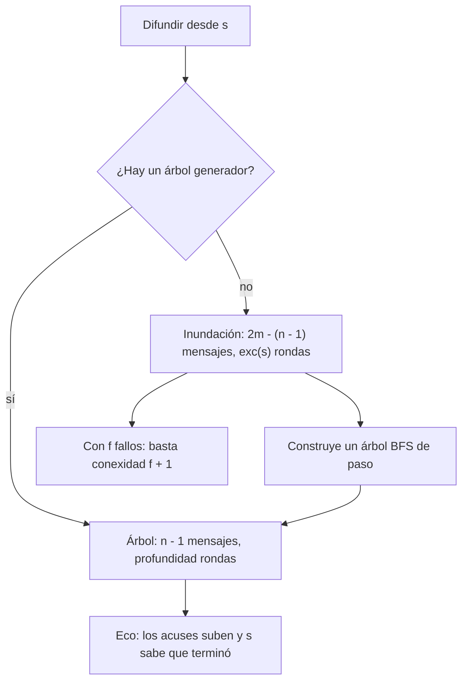

# Computación Distribuida - Algoritmos distribuidos

## 2.2 Difusión de información en una red.

---

La **difusión** (_broadcast_) es el problema de hacer llegar un mensaje desde un nodo, la **fuente**, a todos los nodos de una red en la que cada nodo solo conoce a sus vecinos y solo se comunica con ellos. Es la primitiva sobre la que se construyen casi todos los algoritmos distribuidos: la elección de líder, la construcción de árboles, la sincronización, la actualización de tablas de enrutamiento y la propagación de bloques en una cadena de bloques. Este tema define el modelo y las medidas de complejidad, analiza la **inundación** y la difusión sobre un **árbol generador**, la difusión con retroalimentación (**eco**) y la tolerancia a fallos.

### El modelo

La red es una gráfica no dirigida conexa $G = (V, E)$ con $n$ nodos y $m$ aristas; cada nodo es un proceso que conoce a sus vecinos, y cada arista un canal confiable. Se consideran dos modelos de tiempo:

- **Síncrono:** el cómputo avanza en **rondas**; en cada una, cada nodo envía mensajes a sus vecinos, los recibe y calcula.
- **Asíncrono:** los mensajes llegan tras un retraso finito pero arbitrario; el tiempo se mide suponiendo un retraso máximo de una unidad.

Las medidas son la **complejidad de mensajes** (total enviados) y la **complejidad de tiempo** (rondas). Dos cotas inferiores para cualquier difusión desde $s:$ al menos $n - 1$ mensajes, porque cada nodo distinto de $s$ debe recibir uno, y al menos $\text{exc}(s)$ rondas, la **excentricidad** de $s,$ la distancia al nodo más lejano. En el peor caso sobre la fuente, el **diámetro** $D.$

### Inundación

Cuando un nodo recibe el mensaje por primera vez, lo reenvía a todos sus vecinos excepto a aquel de quien lo recibió; las copias posteriores se ignoran.

**Teorema.** En el modelo síncrono, la inundación informa a todos los nodos en exactamente $\text{exc}(s)$ rondas, con $2m - (n - 1)$ mensajes.

**Demostración.** **Tiempo:** por inducción sobre $d,$ en la ronda $d$ se informan exactamente los nodos a distancia $d$ de $s:$ un nodo a distancia $d$ tiene un vecino a distancia $d - 1,$ informado en la ronda anterior, que se lo envía; y no puede recibirlo antes, porque cada ronda avanza una arista. **Mensajes:** la fuente envía $\deg(s)$ mensajes y cualquier otro nodo $v,$ $\deg(v) - 1;$ el total es $\sum_v \deg(v) - (n - 1) = 2m - (n - 1).$ $\blacksquare$

La inundación es óptima en tiempo y no requiere ningún conocimiento previo de la red, pero gasta $\Theta(m)$ mensajes, que en una gráfica densa son $\Theta(n^2).$ En el modelo asíncrono sigue usando $2m - (n - 1)$ mensajes y tarda a lo sumo $D$ unidades, aunque las aristas por las que llega primero el mensaje ya no forman necesariamente un árbol BFS.

### Difusión sobre un árbol generador

Si ya existe un árbol generador $T$ con raíz $s$ (tema 2.3), basta que cada nodo reenvíe el mensaje a sus **hijos**: $n - 1$ mensajes, el óptimo, en un tiempo igual a la **profundidad** de $T.$ Con un árbol BFS, la profundidad es $\text{exc}(s)$ y se obtienen a la vez los óptimos de mensajes y de tiempo. El costo es construir el árbol una vez, con una inundación, y que la fuente sea siempre la misma o que el árbol tenga poca profundidad desde cualquier nodo.

### Difusión con retroalimentación: eco

Muchas veces la fuente necesita saber **cuándo** terminó la difusión, o reunir información de todos los nodos (un conteo, un máximo). En la **propagación de información con retroalimentación** (PIF), cada hoja, al recibir el mensaje, responde a su padre, y cada nodo interno responde cuando han respondido todos sus hijos. Sobre un árbol cuesta $2(n - 1)$ mensajes y el doble de la profundidad en tiempo. El **algoritmo de eco** de Chang (1982) lo hace sin árbol previo: una inundación construye el árbol en el camino de ida, y cada nodo responde cuando ha recibido mensajes de todos sus vecinos; usa $2m$ mensajes.

### Topologías

| Red | $n$ | Mensajes de inundación | Rondas |
| --- | --- | --- | --- |
| anillo | $n$ | $n + 1$ | $\lfloor n/2 \rfloor$ |
| completa $K_n$ | $n$ | $(n - 1)^2$ | 1 |
| malla $k \times k$ | $k^2$ | $3k^2 - 4k + 1$ | de $2 \lfloor k/2 \rfloor$ a $2(k - 1)$ |
| árbol | $n$ | $n - 1$ | altura |
| hipercubo $Q_d$ | $2^d$ | $d \, 2^d - 2^d + 1$ | $d$ |

### Tolerancia a fallos

Si hasta $f$ nodos pueden **detenerse** (fallo por caída), la inundación sigue informando a todos los nodos vivos si y solo si la red sin los nodos caídos sigue siendo conexa para todos ellos. Esto se garantiza para cualquier conjunto de $f$ fallos si la **conexidad** de la gráfica, el mínimo número de nodos cuya eliminación la desconecta, es al menos $f + 1:$ por el teorema de Menger, entre cada par de nodos hay $f + 1$ caminos sin nodos internos en común, y $f$ fallos no pueden cortarlos todos. Los fallos **bizantinos**, en los que un nodo puede mentir, requieren $2f + 1$ caminos disjuntos y que cada nodo acepte un mensaje solo si llega igual por $f + 1$ de ellos.



### Implementación en Python

El programa simula el modelo síncrono por rondas. Mide los mensajes y las rondas de la inundación en varias topologías y los compara con $2m - (n - 1);$ difunde sobre árboles binarios completos con y sin eco (ejercicio 1); compara la inundación de la malla con una difusión por columna y filas (ejercicio 2); prueba la inundación en un hipercubo de dimensión 6 con nodos caídos al azar y con un corte elegido (ejercicio 3), y compara los mensajes de tres variantes con el mismo tiempo (ejercicio 4).

```python
import random
from collections import deque

random.seed(22)

def inundacion(ady, raiz, caidos=frozenset(), evita_remitente=True):
    """Modelo síncrono: en cada ronda los nodos que recibieron por primera vez
    reenvían a todos sus vecinos (menos al que se los envió)."""
    informado = {raiz: 0}
    frontera, mensajes, ronda = [(raiz, None)], 0, 0
    while frontera:
        ronda += 1
        nueva = []
        for u, de in frontera:
            for v in ady[u]:
                if evita_remitente and v == de:
                    continue
                mensajes += 1
                if v in caidos:
                    continue
                if v not in informado:
                    informado[v] = ronda; nueva.append((v, u))
        frontera = nueva
    return informado, mensajes, max(informado.values())

def arbol_bfs(ady, raiz):
    padre, cola = {raiz: None}, deque([raiz])
    while cola:
        u = cola.popleft()
        for v in ady[u]:
            if v not in padre:
                padre[v] = u; cola.append(v)
    hijos = {u: [] for u in ady}
    for v, p in padre.items():
        if p is not None: hijos[p].append(v)
    return hijos

def difusion_arbol(hijos, raiz):
    prof, cola, msgs = {raiz: 0}, deque([raiz]), 0
    while cola:
        u = cola.popleft()
        for v in hijos[u]:
            msgs += 1; prof[v] = prof[u] + 1; cola.append(v)
    return msgs, max(prof.values())

def eco(hijos, raiz):
    """Propagación con retroalimentación: baja el mensaje y suben los acuses."""
    msgs_baja, prof = difusion_arbol(hijos, raiz)
    return 2 * msgs_baja, 2 * prof

# gráficas
def anillo(n): return {i: [(i - 1) % n, (i + 1) % n] for i in range(n)}
def completa(n): return {i: [j for j in range(n) if j != i] for i in range(n)}
def malla(k): return {(i, j): [(a, b) for a, b in ((i-1, j), (i+1, j), (i, j-1), (i, j+1)) if 0 <= a < k and 0 <= b < k]
                       for i in range(k) for j in range(k)}
def arbol_binario(n): return {i: [x for x in ((i - 1) // 2 if i else None, 2 * i + 1, 2 * i + 2) if x is not None and x < n] for i in range(n)}
def hipercubo(d): return {i: [i ^ (1 << b) for b in range(d)] for i in range(2 ** d)}

print("inundación: mensajes, rondas  |  2m - (n - 1)")
for nombre, G, r in [("anillo 16", anillo(16), 0), ("completa 16", completa(16), 0),
                     ("malla 8x8 desde una esquina", malla(8), (0, 0)), ("malla 8x8 desde el centro", malla(8), (3, 3)),
                     ("árbol binario 31", arbol_binario(31), 0), ("hipercubo de dimensión 5", hipercubo(5), 0)]:
    inf, msgs, rondas = inundacion(G, r)
    n, m = len(G), sum(map(len, G.values())) // 2
    assert len(inf) == n
    print(f"   {nombre:28} {msgs:4} mensajes, {rondas:2} rondas | {2 * m - (n - 1)}")

# --- Ejercicio 1: árbol binario completo ---
print("ejercicio 1: árbol binario completo, difusión desde la raíz")
for h in (3, 5, 10):
    n = 2 ** (h + 1) - 1
    G = arbol_binario(n)
    msgs, t = difusion_arbol(arbol_bfs(G, 0), 0)
    print(f"   n = {n:5}: {msgs:5} mensajes = n - 1, {t:2} rondas = lg(n + 1) - 1; con eco {eco(arbol_bfs(G, 0), 0)}")

# --- Ejercicio 2: malla k x k ---
def difusion_malla_filas(k, r):
    """La fuente difunde por su columna y cada nodo de la columna por su fila."""
    i0, j0 = r
    msgs = (k - 1) + k * (k - 1)
    rondas = max(i0, k - 1 - i0) + max(j0, k - 1 - j0)
    return msgs, rondas

print("ejercicio 2: malla k x k")
for k in (4, 8, 16):
    for r in ((0, 0), (k // 2, k // 2)):
        _, mi, ti = inundacion(malla(k), r)
        mf, tf = difusion_malla_filas(k, r)
        print(f"   k = {k:2}, fuente {str(r):8}: inundación {mi:4} mensajes {ti:2} rondas;"
              f" columna y filas {mf:4} mensajes {tf:2} rondas (n - 1 = {k * k - 1})")

# --- Ejercicio 3: fallos ---
print("ejercicio 3: hipercubo de dimensión 6 (6-conexo), f nodos caídos al azar, 300 pruebas")
G = hipercubo(6)
for f in (1, 3, 5, 6, 10, 20):
    exitos = 0
    for _ in range(300):
        caidos = frozenset(random.sample(range(1, 64), f))
        inf, _, _ = inundacion(G, 0, caidos)
        exitos += len(inf) == 64 - f
    print(f"   f = {f:2}: todos los vivos informados en {exitos}/300")
caidos = frozenset(G[63])                  # los 6 vecinos de 63
inf, _, _ = inundacion(G, 0, caidos)
print(f"   f = 6 elegidos (los vecinos de 63): 63 informado: {63 in inf}")

# --- Ejercicio 4: menos mensajes, mismo tiempo ---
G = malla(16)
_, msgs_ingenua, t = inundacion(G, (0, 0), evita_remitente=False)
_, msgs_inund, t2 = inundacion(G, (0, 0))
msgs_arbol, t3 = difusion_arbol(arbol_bfs(G, (0, 0)), (0, 0))
print(f"ejercicio 4: malla 16x16: inundación ingenua {msgs_ingenua} msgs / {t} rondas;"
      f" sin devolver al remitente {msgs_inund} / {t2}; árbol BFS {msgs_arbol} / {t3}")
```

Salida:

```text
inundación: mensajes, rondas  |  2m - (n - 1)
   anillo 16                      17 mensajes,  8 rondas | 17
   completa 16                   225 mensajes,  1 rondas | 225
   malla 8x8 desde una esquina   161 mensajes, 14 rondas | 161
   malla 8x8 desde el centro     161 mensajes,  8 rondas | 161
   árbol binario 31               30 mensajes,  4 rondas | 30
   hipercubo de dimensión 5      129 mensajes,  5 rondas | 129
ejercicio 1: árbol binario completo, difusión desde la raíz
   n =    15:    14 mensajes = n - 1,  3 rondas = lg(n + 1) - 1; con eco (28, 6)
   n =    63:    62 mensajes = n - 1,  5 rondas = lg(n + 1) - 1; con eco (124, 10)
   n =  2047:  2046 mensajes = n - 1, 10 rondas = lg(n + 1) - 1; con eco (4092, 20)
ejercicio 2: malla k x k
   k =  4, fuente (0, 0)  : inundación   33 mensajes  6 rondas; columna y filas   15 mensajes  6 rondas (n - 1 = 15)
   k =  4, fuente (2, 2)  : inundación   33 mensajes  4 rondas; columna y filas   15 mensajes  4 rondas (n - 1 = 15)
   k =  8, fuente (0, 0)  : inundación  161 mensajes 14 rondas; columna y filas   63 mensajes 14 rondas (n - 1 = 63)
   k =  8, fuente (4, 4)  : inundación  161 mensajes  8 rondas; columna y filas   63 mensajes  8 rondas (n - 1 = 63)
   k = 16, fuente (0, 0)  : inundación  705 mensajes 30 rondas; columna y filas  255 mensajes 30 rondas (n - 1 = 255)
   k = 16, fuente (8, 8)  : inundación  705 mensajes 16 rondas; columna y filas  255 mensajes 16 rondas (n - 1 = 255)
ejercicio 3: hipercubo de dimensión 6 (6-conexo), f nodos caídos al azar, 300 pruebas
   f =  1: todos los vivos informados en 300/300
   f =  3: todos los vivos informados en 300/300
   f =  5: todos los vivos informados en 300/300
   f =  6: todos los vivos informados en 300/300
   f = 10: todos los vivos informados en 300/300
   f = 20: todos los vivos informados en 295/300
   f = 6 elegidos (los vecinos de 63): 63 informado: False
ejercicio 4: malla 16x16: inundación ingenua 960 msgs / 30 rondas; sin devolver al remitente 705 / 30; árbol BFS 255 / 30
```

### Ejercicios Propuestos

1. **Árbol binario.** En una red con forma de árbol binario completo de $n$ nodos, calcula el tiempo de difusión desde la raíz y el número total de mensajes.

2. **Malla.** Diseña un algoritmo de difusión para una malla de $k \times k$ nodos que minimice el tiempo y el número de mensajes.

3. **Fallos.** Modifica la inundación para tolerar hasta $f$ nodos caídos. ¿Cómo afecta esto a la complejidad?

4. **Menos mensajes.** Propón una técnica para reducir los mensajes de la inundación manteniendo el mismo tiempo.

### Soluciones

**Ejercicio 1.** Un árbol binario completo con $n = 2^{h+1} - 1$ nodos tiene altura $h = \log_2 (n + 1) - 1.$ Como la red **es** un árbol, la inundación y la difusión sobre el árbol coinciden: $n - 1$ mensajes, porque cada nodo distinto de la raíz recibe exactamente uno, y $h = \Theta(\log n)$ rondas. Con eco, para que la raíz sepa que terminó, $2(n - 1)$ mensajes y $2h$ rondas. Si la fuente fuera una hoja, el tiempo sería el diámetro, $2h.$

**Ejercicio 2.** La inundación usa $2m - (n - 1)$ mensajes, con $m = 2k(k - 1):$ $3k^2 - 4k + 1,$ unas 3 veces el óptimo. **Columna y filas:** la fuente envía el mensaje por su columna, hacia arriba y hacia abajo, y cada nodo de la columna lo envía por su fila, a ambos lados. Cada nodo recibe el mensaje exactamente una vez: $k^2 - 1$ mensajes, el óptimo. El tiempo es la distancia vertical máxima más la horizontal máxima desde la fuente, que es su excentricidad en la malla: también óptimo, $k - 1$ desde el centro (con $k$ impar) y $2(k - 1)$ desde una esquina. El programa confirma que iguala el tiempo de la inundación con un tercio de los mensajes.

**Ejercicio 3.** La inundación **no necesita modificarse** para fallos por caída: un nodo caído simplemente no reenvía, y el mensaje sigue por los otros caminos. La garantía depende de la red: si su conexidad es al menos $f + 1,$ cualquier conjunto de $f$ caídas deja conectados a los vivos (Menger). El hipercubo $Q_6$ es 6-conexo: con hasta 5 fallos, cualquier elección deja todo conectado; con 6, al azar casi siempre funciona, pero si caen justo los 6 vecinos de un nodo, ese nodo queda aislado. La complejidad no cambia; lo que cambia es el requisito sobre la red. Las técnicas basadas en árboles sí se rompen con un fallo, porque un nodo interno caído desconecta su subárbol: por eso se usan varios árboles con caminos disjuntos.

**Ejercicio 4.** Tres mejoras con el mismo tiempo, $\text{exc}(s):$ no devolver el mensaje al remitente, que es la inundación estándar, con $2m - (n - 1)$ mensajes en lugar de $2m;$ recordar qué vecinos ya enviaron una copia y no enviarles otra, lo que ayuda en el modelo asíncrono, y, si hay varias difusiones desde la misma fuente, construir **una vez** un árbol BFS con la primera inundación y usar después solo sus aristas: $n - 1$ mensajes por difusión con el mismo tiempo. En la malla de 16 por 16, de 960 mensajes con la inundación ingenua se baja a 705 sin devolver al remitente y a 255 con el árbol, siempre en 30 rondas.

### Referencias

1. Attiya, H., and Welch, J., _Distributed Computing: Fundamentals, Simulations, and Advanced Topics_. Wiley, 2004. Capítulo 2.
2. Lynch, N. A., _Distributed Algorithms_. Morgan Kaufmann, 1996. Capítulo 4.
3. Peleg, D., _Distributed Computing: A Locality-Sensitive Approach_. SIAM, 2000. Capítulos 3 y 4.
4. Chang, E. J. H., Echo algorithms: depth parallel operations on general graphs. _IEEE Transactions on Software Engineering_ 8(4), 1982.
