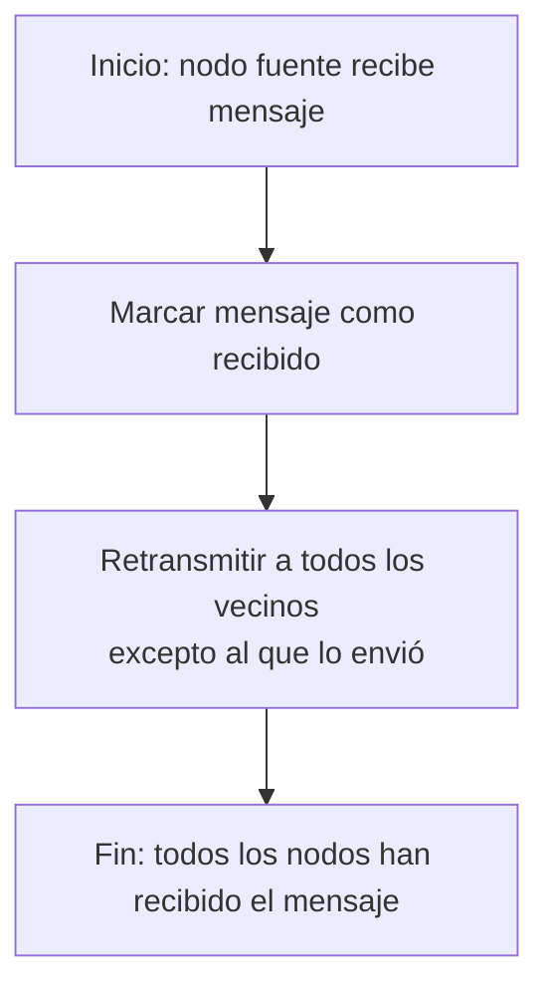
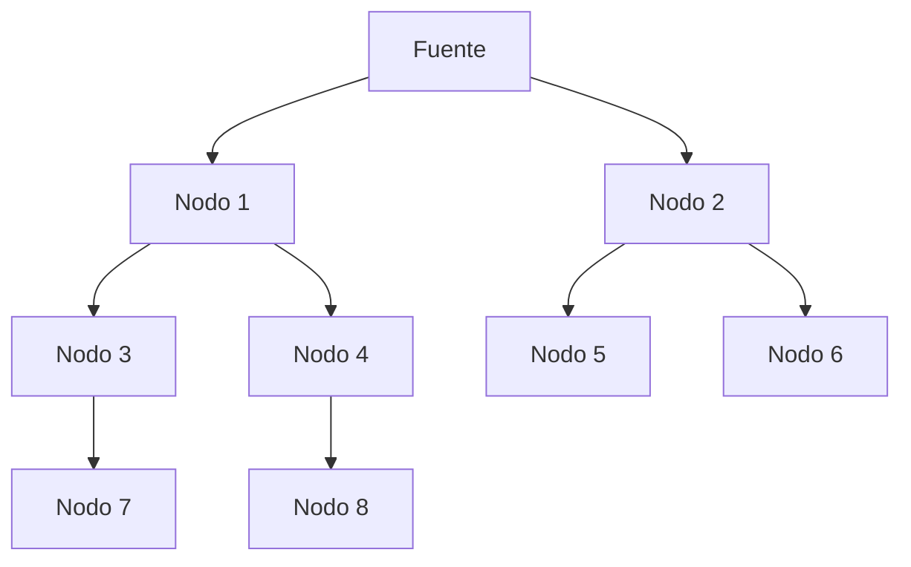

# Computación Distribuida - Algoritmos distribuidos

## 2.2 Difusión de información en una red.

---

La difusión de información (broadcast) es uno de los problemas fundamentales en sistemas distribuidos. Consiste en distribuir un mensaje desde un proceso origen a todos los demás procesos de la red de manera eficiente y confiable.

### Definición Formal

En una red representada como un grafo $G = (V, E)$, donde $V$ es el conjunto de nodos y $E$ el conjunto de enlaces, el problema de difusión requiere que un mensaje $m$ desde un nodo fuente $s \in V$ llegue a todos los nodos $v \in V$.

#### Complejidad de la Difusión

La eficiencia de los algoritmos de difusión se mide mediante:

- **Complejidad de tiempo**: Número de rondas de comunicación necesarias
- **Complejidad de mensajes**: Número total de mensajes enviados

Para una red con $n$ nodos y diámetro $D$, los límites fundamentales son:

- Tiempo mínimo: $\Omega(D)$
- Mensajes mínimos: $\Omega(n)$

### Algoritmos de Difusión

#### Difusión por Inundación (Flooding)

El algoritmo más básico donde cada nodo retransmite el mensaje a todos sus vecinos.



**Pseudocódigo**:

```
Algoritmo Flooding:
  Upon receiving message m from neighbor j:
    if this is the first reception of m:
      mark m as received
      for each neighbor k ≠ j:
        send m to k
```

**Complejidad**:

- Tiempo: $O(D)$
- Mensajes: $O(|E|)$

#### Difusión en Anillo


**Complejidad**:

- Tiempo: $O(n)$
- Mensajes: $O(n)$

#### Difusión en Árbol de Expansión

Uso de un árbol de expansión mínimo para optimizar la difusión:

$$ \text{Mensajes} = O(n) $$

$$ \text{Tiempo} = O(\text{altura del árbol}) $$

### Protocolos de Difusión Confiables

#### Difusión con ACK (Acuse de Recibo)

Cada nodo confirma la recepción a su predecesor.

**Fórmula de overhead de mensajes**:

$$ M_{\text{total}} = M_{\text{difusión}} + M_{\text{ack}} = O(n) + O(n) = O(n) $$

#### Difusión en Malla

Para redes con topología de malla de $k$ dimensiones:

$$ \text{Tiempo} = O(k \cdot n^{1/k}) $$

### Ejemplo: Difusión en Red de 8 Nodos



**Secuencia temporal**:

- Ronda 1: Fuente → N1, N2
- Ronda 2: N1 → N3, N4; N2 → N5, N6
- Ronda 3: N3 → N7; N4 → N8

Tiempo total: 3 rondas
Mensajes totales: 8

### Ejercicios Propuestos

1. **Análisis de complejidad**: Para una red en forma de árbol binario completo con $n$ nodos, calcule:
   - El tiempo de difusión
   - El número total de mensajes
   - Exprese los resultados usando notación O Grande

2. **Diseño de algoritmo**: Diseñe un algoritmo de difusión para una red en malla 2D de $k × k$ nodos que minimice tanto el tiempo como el número de mensajes.

3. **Simulación de fallos**: Modifique el algoritmo de inundación para tolerar fallos de hasta $f$ nodos. ¿Cómo afecta esto a la complejidad?

4. **Optimización**: Proponga una técnica para reducir el número de mensajes en la difusión por inundación manteniendo el mismo tiempo de ejecución.

### Solución al Ejercicio 1

Para un árbol binario completo con $n$ nodos:

- Altura $h = \lfloor \log_2 n \rfloor$
- Tiempo de difusión: $O(h) = O(\log n)$
- Número de mensajes: Cada nodo excepto la raíz recibe exactamente un mensaje, por lo tanto:
  
  $$ M = n - 1 = O(n) $$

### Aplicaciones en el Mundo Real

1. **Actualizaciones de rutas**: En protocolos de enrutamiento como OSPF y BGP
2. **Sistemas de bases de datos distribuidas**: Para mantener la consistencia
3. **Blockchain**: Propagación de transacciones y bloques
4. **Redes sociales**: Difusión de publicaciones en tiempo real

### Referencias

1. Attiya, H., & Welch, J. (2004). _Distributed Computing: Fundamentals, Simulations, and Advanced Topics_. Wiley. (Capítulo 3: Broadcast and Multicast)
2. Lynch, N. (1996). _Distributed Algorithms_. Morgan Kaufman. (Capítulo 8: Broadcast and Multicast)
3. Tel, G. (2001). _Introduction to Distributed Algorithms_. Cambridge University Press. (Capítulo 4: Communication Protocols)

### Recursos Adicionales

- [Simulador de algoritmos de difusión](https://github.com/distributed-systems/broadcast-simulator)
- [Visualización interactiva de difusión en redes](https://www.cs.princeton.edu/~mfreed/broadcast-visualization/)
