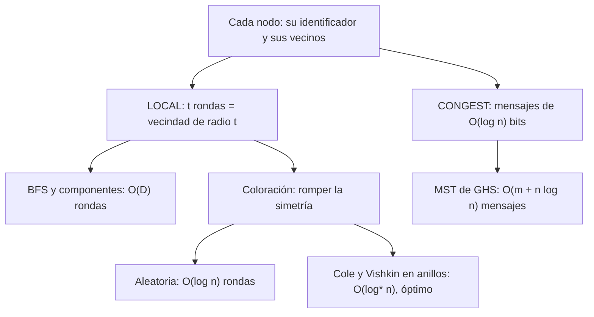

# Computación Distribuida - Algoritmos distribuidos

## 2.3 Algoritmos distribuidos en gráficas.

---

En un **algoritmo distribuido en gráficas**, la gráfica no es un dato que un programa recorre, sino la red misma: cada vértice es un procesador que solo conoce a sus vecinos y se comunica con ellos por mensajes. El objetivo es que cada nodo calcule su parte de una estructura global (su distancia a una fuente, su componente, su color, sus aristas del árbol generador mínimo) con pocas rondas y pocos mensajes. Este tema presenta los modelos LOCAL y CONGEST, y los algoritmos distribuidos para BFS, componentes conexas, coloración (incluido el notable algoritmo de Cole y Vishkin, que colorea un anillo en $O(\log^* n)$ rondas) y el árbol generador mínimo de Gallager, Humblet y Spira.

### Modelos

Cada nodo tiene un **identificador** único de $O(\log n)$ bits y conoce a sus vecinos. Se trabaja en el modelo síncrono por rondas (tema 2.2):

- **LOCAL:** los mensajes pueden ser de cualquier tamaño. Mide solo la **localidad**: en $t$ rondas, un nodo puede conocer exactamente su vecindad de radio $t,$ y nada más. Todo problema se resuelve en $O(D)$ rondas, con $D$ el diámetro, reuniendo toda la gráfica en un nodo; la pregunta interesante es qué se puede hacer en mucho menos.
- **CONGEST:** los mensajes tienen $O(\log n)$ bits, unos cuantos identificadores o números. Mide también la **congestión**.

Las medidas son el número de **rondas** y el de **mensajes**.

### BFS y distancias

**BFS síncrono:** la fuente envía "nivel 0" a sus vecinos; un nodo que recibe por primera vez un nivel $\ell$ toma $\ell + 1$ como su distancia, elige como padre a quien se lo envió y lo propaga. Por el mismo argumento que la inundación, termina en $\text{exc}(s)$ rondas con $O(m)$ mensajes y construye un árbol BFS. En el modelo **asíncrono** los mensajes por caminos largos pueden llegar primero, y hay que corregir: el algoritmo tipo **Bellman y Ford** actualiza la distancia cada vez que llega una menor y la propaga, con tiempo $O(D)$ pero hasta $O(nm)$ mensajes; los algoritmos por capas, que esperan a que cada nivel termine antes de iniciar el siguiente, usan $O(D^2)$ tiempo y $O(m + nD)$ mensajes.

**Varias fuentes:** iniciar el BFS desde todas las fuentes en la misma ronda calcula para cada nodo la distancia a la fuente **más cercana** y cuál es, con el mismo costo que un solo BFS (ejercicio 4). Es la base de las particiones de Voronoi en gráficas.

### Componentes conexas

Cada nodo empieza con su identificador como etiqueta y, en cada ronda, adopta la menor etiqueta entre la suya y las de sus vecinos. Tras un número de rondas igual al diámetro de su componente, todos los nodos de la componente tienen el mínimo identificador de ella; una ronda más sin cambios lo confirma localmente. Cuesta $O(D)$ rondas y $O(m)$ mensajes por ronda (ejercicio 2). Para que los nodos **sepan** que terminó, hace falta un mecanismo de detección de terminación, como un eco sobre el árbol de cada componente.

### Coloración

Una coloración propia asigna colores distintos a vecinos. Todo nodo de grado a lo sumo $\Delta$ puede recibir uno de $\Delta + 1$ colores sin conflicto con sus vecinos, pero hacerlo de forma distribuida exige **romper la simetría**: dos vecinos que deciden a la vez pueden elegir el mismo color.

- **Por identificadores:** un nodo elige el menor color libre cuando todos sus vecinos de identificador menor ya eligieron. Correcto, pero puede tardar $n$ rondas en una cadena de identificadores crecientes.
- **Aleatoria:** en cada ronda, cada nodo sin color propone un color al azar entre los que no usan sus vecinos ya coloreados y se lo queda si ningún vecino propuso el mismo. Cada nodo tiene éxito con probabilidad constante en cada ronda, así que todos terminan en $O(\log n)$ rondas con alta probabilidad.
- **Cole y Vishkin** (1986), en un anillo orientado: cada nodo compara su color $c$ con el de su sucesor $c',$ encuentra el índice $k$ del primer bit en que difieren, y toma como nuevo color $2k + c_k,$ donde $c_k$ es su bit $k.$ Vecinos siguen distintos: si dos vecinos eligieran el mismo $k,$ sus bits $k$ serían distintos. Y un color de $b$ bits pasa a tener $\lceil \log_2 b \rceil + 1:$ con identificadores de $O(\log n)$ bits, en $O(\log^* n)$ rondas quedan 6 colores, y 3 rondas más bajan a 3. **Linial** (1992) demostró que $\Omega(\log^* n)$ rondas son necesarias: Cole y Vishkin es óptimo.

### Árbol generador mínimo: GHS

El algoritmo de **Gallager, Humblet y Spira** (1983) construye el MST (tema 4.2) con pesos distintos. Mantiene un bosque de **fragmentos**, cada uno un subárbol del MST con un nivel; cada fragmento encuentra en paralelo su **arista de salida de peso mínimo**, segura por la propiedad del corte, y se fusiona con el fragmento del otro lado. Las reglas de fusión por nivel garantizan que el nivel de un nodo, que es a lo sumo $\log_2 n,$ crece cada vez que su fragmento al menos duplica su tamaño. Resultado: $O(m + n \log n)$ mensajes, que es óptimo, y $O(n \log n)$ tiempo. Algoritmos posteriores bajan el tiempo a $O(D + \sqrt{n} \log^* n)$ en CONGEST, cerca de la cota inferior $\tilde\Omega(D + \sqrt{n}).$



### Implementación en Python

El programa simula el modelo síncrono. Analiza la gráfica completa (ejercicio 1) y verifica el MST por fases contra Kruskal; ejecuta el BFS distribuido en una gráfica aleatoria y lo compara con el centralizado; calcula las componentes conexas por propagación del mínimo (ejercicio 2); colorea con el algoritmo aleatorio y con Cole y Vishkin en anillos de hasta 100 000 nodos (ejercicio 3), y ejecuta el BFS desde varias fuentes (ejercicio 4).

```python
import math, random
from collections import deque

random.seed(23)

def gráfica_aleatoria(n, p):
    ady = {i: set() for i in range(n)}
    for i in range(n):
        for j in range(i + 1, n):
            if random.random() < p:
                ady[i].add(j); ady[j].add(i)
    return ady

def completa(n):
    return {i: set(range(n)) - {i} for i in range(n)}

# --- BFS distribuido síncrono (desde una o varias fuentes) ---
def bfs_distribuido(ady, fuentes):
    dist = {s: 0 for s in fuentes}
    origen = {s: s for s in fuentes}
    frontera, rondas, msgs = list(fuentes), 0, 0
    while frontera:
        rondas += 1; nueva = []
        for u in frontera:
            for v in ady[u]:
                msgs += 1                       # mensaje "nivel = dist[u] + 1"
                if v not in dist:
                    dist[v] = dist[u] + 1; origen[v] = origen[u]; nueva.append(v)
        frontera = nueva
    return dist, origen, rondas - 1, msgs

def bfs_central(ady, s):
    d, q = {s: 0}, deque([s])
    while q:
        u = q.popleft()
        for v in ady[u]:
            if v not in d: d[v] = d[u] + 1; q.append(v)
    return d

# --- componentes conexas por propagación del mínimo identificador ---
def componentes(ady):
    etiqueta = {v: v for v in ady}
    rondas = msgs = 0
    cambio = True
    while cambio:
        rondas += 1; cambio = False
        nueva = dict(etiqueta)
        for u in ady:
            for v in ady[u]:
                msgs += 1
                if etiqueta[u] < nueva[v]:
                    nueva[v] = etiqueta[u]; cambio = True
        etiqueta = nueva
    return etiqueta, rondas, msgs

# --- coloración aleatoria con Delta + 1 colores ---
def coloracion_aleatoria(ady):
    delta = max(map(len, ady.values()))
    color, rondas = {}, 0
    while len(color) < len(ady):
        rondas += 1
        propuesta = {}
        for v in ady:
            if v not in color:
                usados = {color[u] for u in ady[v] if u in color}
                propuesta[v] = random.choice([c for c in range(delta + 1) if c not in usados])
        for v, c in propuesta.items():          # se queda si ningún vecino propuso lo mismo
            if all(propuesta.get(u) != c for u in ady[v]):
                color[v] = c
    assert all(color[u] != color[v] for u in ady for v in ady[u])
    return color, rondas, delta + 1

# --- Cole y Vishkin en un anillo orientado ---
def cole_vishkin(ids):
    n = len(ids)
    color, rondas = list(ids), 0
    while max(color) >= 6:
        rondas += 1
        nuevo = []
        for i in range(n):
            c, s = color[i], color[(i + 1) % n]        # sucesor
            x = c ^ s
            k = (x & -x).bit_length() - 1              # primer bit en que difieren
            nuevo.append(2 * k + ((c >> k) & 1))
        color = nuevo
        assert all(color[i] != color[(i + 1) % n] for i in range(n))
    for c in (5, 4, 3):                                # de 6 a 3 colores: 3 rondas
        rondas += 1
        color = [min({0, 1, 2} - {color[i - 1], color[(i + 1) % n]}) if color[i] == c else color[i]
                 for i in range(n)]
    assert all(color[i] != color[(i + 1) % n] for i in range(n)) and max(color) <= 2
    return color, rondas

def log_estrella(x):
    k = 0
    while x > 1: x, k = math.log2(x), k + 1
    return k

# --- MST por fases de Borůvka (la estructura de GHS) ---
def mst_fases(n, aristas):
    fragmento = list(range(n)); fases = 0; T = set()
    while len(set(fragmento)) > 1:
        fases += 1
        mejor = {}
        for (u, v, w) in aristas:                       # cada fragmento busca su arista mínima de salida
            fu, fv = fragmento[u], fragmento[v]
            if fu != fv:
                for f in (fu, fv):
                    if f not in mejor or (w, u, v) < mejor[f]:
                        mejor[f] = (w, u, v)
        for w, u, v in mejor.values():
            T.add((u, v, w))
        cambio = True                                   # fusionar fragmentos
        while cambio:
            cambio = False
            for (u, v, w) in T:
                a, b = fragmento[u], fragmento[v]
                if a != b:
                    m = min(a, b)
                    fragmento = [m if f in (a, b) else f for f in fragmento]; cambio = True
    return T, fases

def kruskal(n, aristas):
    p = list(range(n))
    def r(x):
        while p[x] != x: p[x] = p[p[x]]; x = p[x]
        return x
    T = 0
    for u, v, w in sorted(aristas, key=lambda e: e[2]):
        if r(u) != r(v): p[r(u)] = r(v); T += w
    return T

# --- Ejercicio 1: K_n ---
print("ejercicio 1: gráfica completa")
for n in (8, 64):
    K = completa(n)
    _, _, t, m = bfs_distribuido(K, [0])
    pesos = random.sample(range(1, 10 * n * n), n * (n - 1) // 2)
    A = [(u, v, pesos.pop()) for u in range(n) for v in range(u + 1, n)]
    T, fases = mst_fases(n, A)
    assert sum(w for _, _, w in T) == kruskal(n, A)
    print(f"   n = {n:2}: BFS {t} ronda, {m} mensajes = n(n-1); coloración por rango de identificadores"
          f" 1 ronda con {n * (n - 1)} mensajes y {n} colores; MST en {fases} fases (lg n = {math.log2(n):.0f})")

# --- BFS y componentes en una gráfica aleatoria ---
G = gráfica_aleatoria(400, 0.006)
d, _, t, m = bfs_distribuido(G, [0])
assert d == bfs_central(G, 0)
print(f"BFS distribuido en G(400, 0.006): {len(d)} alcanzados, {t} rondas = excentricidad, {m} mensajes = 2m de la componente")

# --- Ejercicio 2: componentes conexas ---
et, rondas, msgs = componentes(G)
grupos = {}
for v, e in et.items(): grupos.setdefault(e, []).append(v)
tam = sorted(map(len, grupos.values()), reverse=True)
vistos, esperadas = set(), 0
for v in G:
    if v not in vistos:
        esperadas += 1; vistos |= set(bfs_central(G, v))
print(f"ejercicio 2: {len(grupos)} componentes (centralizado: {esperadas}); mayores {tam[:4]};"
      f" {rondas} rondas, {msgs} mensajes")

# --- Ejercicio 3: coloración ---
for n, p in [(300, 0.02), (300, 0.1)]:
    H = gráfica_aleatoria(n, p)
    color, r, cols = coloracion_aleatoria(H)
    print(f"ejercicio 3: G({n}, {p}): Delta + 1 = {cols} colores disponibles, usados {len(set(color.values()))},"
          f" {r} rondas (lg n = {math.log2(n):.1f})")
for n in (16, 1000, 10**5):
    ids = random.sample(range(10 ** 9), n)
    c, r = cole_vishkin(ids)
    print(f"   Cole y Vishkin, anillo de {n:6} con identificadores de 30 bits: 3 colores en {r} rondas"
          f" (lg* 10^9 = {log_estrella(10 ** 9)})")

# --- Ejercicio 4: BFS desde varias fuentes ---
fuentes = [0, 100, 200, 300]
d, origen, t, m = bfs_distribuido(G, fuentes)
ok = all(d[v] == min(bfs_central(G, s).get(v, math.inf) for s in fuentes) for v in d)
print(f"ejercicio 4: fuentes {fuentes}: distancias correctas {ok}, {t} rondas, {m} mensajes;"
      f" nodos por fuente más cercana {[sum(1 for v in origen if origen[v] == s) for s in fuentes]}")
```

Salida:

```text
ejercicio 1: gráfica completa
   n =  8: BFS 1 ronda, 56 mensajes = n(n-1); coloración por rango de identificadores 1 ronda con 56 mensajes y 8 colores; MST en 2 fases (lg n = 3)
   n = 64: BFS 1 ronda, 4032 mensajes = n(n-1); coloración por rango de identificadores 1 ronda con 4032 mensajes y 64 colores; MST en 3 fases (lg n = 6)
BFS distribuido en G(400, 0.006): 355 alcanzados, 14 rondas = excentricidad, 914 mensajes = 2m de la componente
ejercicio 2: 39 componentes (centralizado: 39); mayores [355, 2, 2, 2]; 15 rondas, 13920 mensajes
ejercicio 3: G(300, 0.02): Delta + 1 = 16 colores disponibles, usados 16, 4 rondas (lg n = 8.2)
ejercicio 3: G(300, 0.1): Delta + 1 = 47 colores disponibles, usados 47, 4 rondas (lg n = 8.2)
   Cole y Vishkin, anillo de     16 con identificadores de 30 bits: 3 colores en 5 rondas (lg* 10^9 = 5)
   Cole y Vishkin, anillo de   1000 con identificadores de 30 bits: 3 colores en 7 rondas (lg* 10^9 = 5)
   Cole y Vishkin, anillo de 100000 con identificadores de 30 bits: 3 colores en 7 rondas (lg* 10^9 = 5)
ejercicio 4: fuentes [0, 100, 200, 300]: distancias correctas True, 12 rondas, 914 mensajes; nodos por fuente más cercana [120, 36, 129, 70]
```

El algoritmo de Cole y Vishkin tarda prácticamente lo mismo con 16 que con 100 000 nodos: su tiempo depende del tamaño de los identificadores, no del número de nodos, y $\log^*$ de cualquier número físicamente concebible es a lo sumo 5.

### Ejercicios Propuestos

1. **Gráfica completa.** Para $K_n,$ analiza la complejidad del BFS distribuido, de la coloración y de la construcción del MST.

2. **Componentes.** Diseña un algoritmo distribuido que encuentre las componentes conexas de una gráfica y analiza su complejidad.

3. **Coloración.** Propón una técnica para reducir el número de colores o de rondas de la coloración.

4. **Varias fuentes.** Modifica el BFS para calcular las distancias desde varias fuentes a la vez.

### Soluciones

**Ejercicio 1.**

- **BFS:** $D = 1,$ así que 1 ronda; la fuente envía $n - 1$ mensajes, y si los demás también reenvían, $n(n - 1),$ es decir $\Theta(n^2) = \Theta(m)$ mensajes.
- **Coloración:** $K_n$ necesita $n$ colores, pero eso no implica $n$ rondas: en una ronda, cada nodo envía su identificador a todos, y cada uno toma como color el **rango** de su identificador. Una ronda, $n(n - 1)$ mensajes. La versión anterior de este documento daba $O(n)$ rondas, que es lo que tardaría el algoritmo secuencial por identificadores.
- **MST:** con GHS, $O(m + n \log n) = O(n^2)$ mensajes (la cota $O(n^2 \log n)$ que daba la versión anterior es mayor que la real) y $O(n \log n)$ tiempo. En el programa, las fases de tipo Borůvka bastan con 2 o 3 en $K_n,$ menos que $\log_2 n.$ En el modelo LOCAL bastaría 1 ronda, porque cada nodo conoce entonces toda la gráfica; en CONGEST, el MST de $K_n$ se calcula en $O(1)$ rondas (Jurdziński y Nowicki, 2018).

**Ejercicio 2.** Es la propagación del mínimo: $O(D_{\max})$ rondas, con $D_{\max}$ el mayor diámetro de una componente, y $O(m)$ mensajes por ronda, en total $O(m D_{\max}).$ Para reducir los mensajes, un nodo solo reenvía cuando su etiqueta cambia, y entonces cada nodo envía a lo sumo tantas veces como cambie su etiqueta. En la gráfica aleatoria del programa hay 39 componentes: una gigante de 355 nodos, que fija el número de rondas, y muchas pequeñas.

**Ejercicio 3.** Para **menos rondas:** la coloración aleatoria termina en $O(\log n)$ rondas con alta probabilidad, en lugar de las $O(n)$ del algoritmo por identificadores; en el programa bastan 4 rondas. En anillos y árboles, Cole y Vishkin da 3 colores en $O(\log^* n).$ Para **menos colores:** después de colorear con $\Delta + 1,$ se eliminan colores uno por uno: todos los nodos del color más alto, que no son vecinos entre sí, se recolorean a la vez con el menor color libre, un color por ronda. Con $\Delta$ colores, si la gráfica no es completa ni un ciclo impar, existe una coloración (Brooks), pero encontrarla distribuidamente es más difícil. Reducir a $\chi(G),$ el número cromático, es NP-duro incluso de forma centralizada.

**Ejercicio 4.** Basta iniciar el BFS en todas las fuentes en la ronda 0 con distancia 0 y propagar, junto con el nivel, el identificador de la fuente. Cada nodo recibe primero el mensaje de su fuente más cercana, con desempates por identificador si llegan dos en la misma ronda. El tiempo es la máxima distancia de un nodo a su fuente más cercana, menor o igual que para una sola fuente, y los mensajes siguen siendo $O(m).$ Para tener las distancias a **todas** las fuentes por separado se ejecutan $k$ BFS intercalados, y en CONGEST se logra en $O(k + D)$ rondas con colas en cada arista.

### Referencias

1. Peleg, D., _Distributed Computing: A Locality-Sensitive Approach_. SIAM, 2000. Capítulos 5, 7 y 10.
2. Gallager, R. G., Humblet, P. A., and Spira, P. M., A distributed algorithm for minimum-weight spanning trees. _ACM Transactions on Programming Languages and Systems_ 5(1), 1983.
3. Cole, R., and Vishkin, U., Deterministic coin tossing with applications to optimal parallel list ranking. _Information and Control_ 70(1), 1986.
4. Linial, N., Locality in distributed graph algorithms. _SIAM Journal on Computing_ 21(1), 1992.
