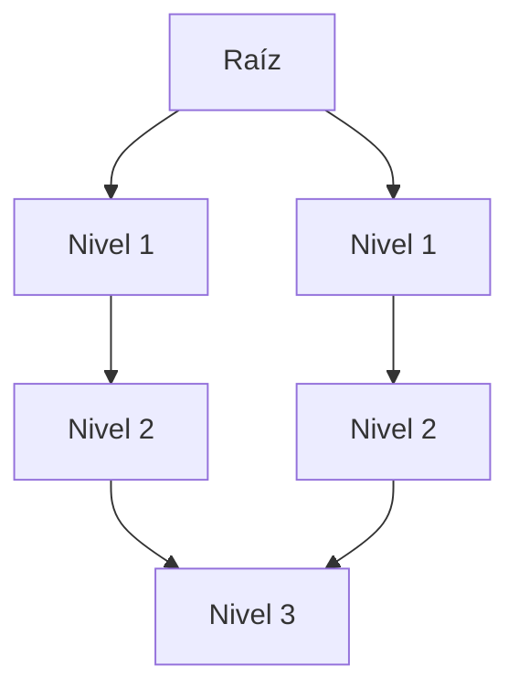
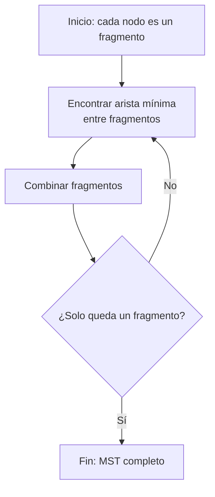
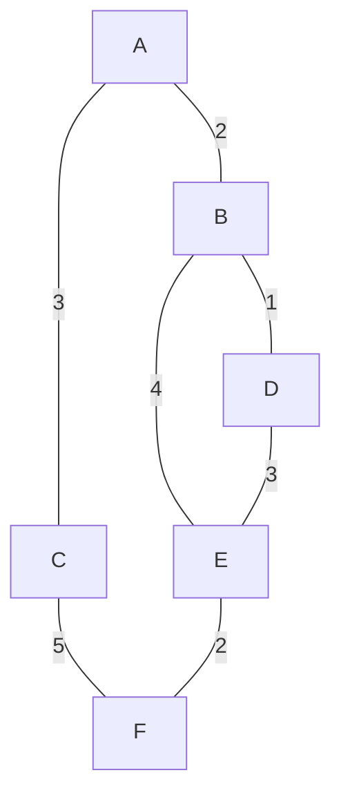

# Computación Distribuida - Algoritmos distribuidos

## 2.3 Algoritmos distribuidos en gráficas.

---

Los algoritmos distribuidos en gráficas son fundamentales para resolver problemas en redes donde los nodos deben colaborar sin un control centralizado. Estos algoritmos operan sobre una representación distribuida de una gráfica $G = (V, E)$, donde cada nodo conoce sólo a sus vecinos directos.

### Conceptos Fundamentales

#### Representación Distribuida de Gráficas

En un sistema distribuido, una gráfica se representa de manera implícita:

- Cada proceso corresponde a un nodo $v \in V$
- Cada canal de comunicación corresponde a una arista $e \in E$
- Cada nodo conoce únicamente su identificador y el conjunto de sus vecinos $N(v)$

#### Complejidad en Algoritmos Distribuidos

Se evalúa mediante dos métricas principales:

- **Complejidad de tiempo**: Número de rondas de comunicación
- **Complejidad de mensajes**: Número total de mensajes enviados

Para una gráfica con $n$ nodos y diámetro $D$:

$$ T_{\text{time}} \geq \Omega(D) \quad \text{y} \quad T_{\text{messages}} \geq \Omega(n) $$

### Algoritmos Básicos en Gráficas

#### Búsqueda en Amplitud Distribuida (BFS)

Construye un árbol de búsqueda en amplitud desde un nodo raíz.



**Pseudocódigo**:

```
Algoritmo BFS Distribuido:
  Inicialización:
    Raíz: depth = 0, parent = ⊥
    Otros: depth = ∞, parent = ⊥

  Para raíz en ronda 1:
    enviar MSG(depth=0) a todos los vecinos

  Para nodo v al recibir MSG(d) de u:
    si d + 1 < depth:
      depth = d + 1
      parent = u
      enviar MSG(depth) a todos los vecinos excepto u
```

**Complejidad**:

- Tiempo: $O(D)$
- Mensajes: $O(|E|)$

#### Algoritmo de Sincronización

Para coordinar rondas en redes asíncronas:

$$
\text{Ronda}_k \text{ comienza cuando todos los mensajes de } \text{Ronda}_{k-1} \text{ han sido recibidos}
$$

### Algoritmos Avanzados

#### Coloreado de Gráficas

Asignar colores a nodos tal que nodos adyacentes tengan colores diferentes.

**Algoritmo greedy distribuido**:

```
Para cada nodo v en paralelo:
  Sea C = {1, 2, 3, ...}
  Para cada vecino u ∈ N(v):
    Si u tiene color c y u < v:  // Orden total en nodos
      C = C - {c}
  v elige el color mínimo en C
```

**Complejidad**: $O(\Delta)$ rondas donde $\Delta$ es el grado máximo

#### Árbol de Expansión Mínima (MST)

Algoritmo de GHS (Gallager-Humblet-Spira):



**Complejidad**:

- Tiempo: $O(n \log n)$
- Mensajes: $O(|E| + n \log n)$

### Algoritmos para Problemas Específicos

#### Recorrido de Euler

Conversión de un árbol a un recorrido Euleriano para procesamiento:

$$
\text{Longitud del recorrido} = 2(n - 1)
$$

#### Dijkstra Distribuido

Para caminos más cortos desde una fuente:

$$
\text{Complejidad: } O(n) \text{ rondas, } O(n|E|) \text{ mensajes}
$$

### Ejemplo: MST en Gráfica de 6 Nodos



**Proceso del algoritmo MST**:

1. Fragmentos iniciales: {A}, {B}, {C}, {D}, {E}, {F}
2. Unir aristas de peso mínimo: B-D(1), A-B(2), E-F(2)
3. Continuar hasta formar MST completo

### Ejercicios Propuestos

1. **Análisis de complejidad**: Para una gráfica completa $K_n$ con $n$ nodos, analice la complejidad de:
   - BFS distribuido
   - Algoritmo de coloreado
   - Construcción de MST

2. **Diseño de algoritmo**: Diseñe un algoritmo distribuido para encontrar los componentes conexos de una gráfica. Analice su complejidad.

3. **Optimización**: Para el algoritmo de coloreado, proponga una técnica para reducir el número de colores necesarios.

4. **Extensión**: Modifique el algoritmo BFS para calcular las distancias desde múltiples fuentes simultáneamente.

### Solución al Ejercicio 1

Para $K_n$ (gráfica completa):

- BFS distribuido:
  - Tiempo: $O(1)$ (diámetro = 1)
  - Mensajes: $O(n^2)$ (cada nodo se comunica con todos)
- Coloreado:
  - Tiempo: $O(n)$ (se necesitan n colores)
  - Mensajes: $O(n^2)$
- MST:
  - Tiempo: $O(n \log n)$
  - Mensajes: $O(n^2 \log n)$

### Aplicaciones Prácticas

1. **Redes de comunicación**: Enrutamiento en Internet
2. **Redes de sensores**: Agregación de datos y eficiencia energética
3. **Sistemas distribuidos**: Consenso y coordinación
4. **Procesamiento de gráficas a gran escala**: Análisis de redes sociales

### Referencias

1. Attiya, H., & Welch, J. (2004). _Distributed Computing: Fundamentals, Simulations, and Advanced Topics_. Wiley. (Capítulos 4-6: Graph Algorithms)
2. Lynch, N. (1996). _Distributed Algorithms_. Morgan Kaufman. (Capítulo 5: Distributed Graph Algorithms)
3. Tel, G. (2001). _Introduction to Distributed Algorithms_. Cambridge University Press. (Capítulo 7: Network Algorithms)

### Recursos Adicionales

- [Simulador de algoritmos distribuidos en gráficas](https://github.com/distributed-systems/graph-algorithms-simulator)
- [Visualización interactiva de MST distribuido](https://www.cs.princeton.edu/~mfreed/distributed-mst-visualization/)
- [Biblioteca de algoritmos distribuidos](https://github.com/distributed-systems-library)
