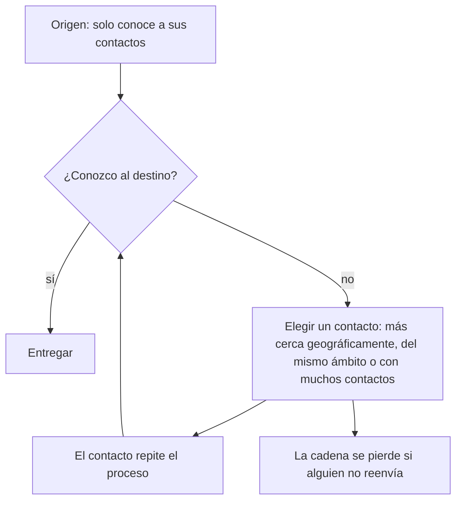

# Computación Distribuida - Propiedades de mundos pequeños en redes

## 3.2 Seis grados de separación.

---

"Seis grados de separación" es la idea de que cualquier persona del mundo está a una cadena de unos seis conocidos de cualquier otra. Más que una frase popular, es una afirmación cuantitativa que se ha medido varias veces, desde las cartas del experimento de Stanley Milgram en los años sesenta hasta la red completa de Facebook en 2011, con resultados notablemente consistentes. Este tema revisa esos experimentos y lo que realmente midieron, explica por qué las distancias crecen como el logaritmo del tamaño de la red, o incluso más despacio en las redes libres de escala, y separa dos preguntas distintas: que **existan** caminos cortos y que se puedan **encontrar** con información local.

### El experimento de Milgram

En 1967, Stanley Milgram pidió a personas de Omaha (Nebraska) y Wichita (Kansas) que hicieran llegar una carpeta a un corredor de bolsa de Boston, con una regla: solo podían enviarla a alguien que conocieran **por su nombre de pila**, quien haría lo mismo. En el estudio publicado con Travers (1969), de 296 cadenas iniciadas, 64 (22%) llegaron al destinatario, con una media de **5.2 intermediarios**, es decir, unos seis pasos.

**Críticas.** La mayoría de las cadenas se perdieron, y las largas tienen más probabilidad de perderse, así que la media observada subestima la real; muchos participantes fueron reclutados por ser socialmente activos; y casi la mitad de las cadenas exitosas pasaron por unos pocos "conectores". Aun así, el resultado esencial, que las cadenas exitosas eran sorprendentemente cortas, se ha confirmado.

### Mediciones modernas

| Estudio | Red | Resultado |
| --- | --- | --- |
| Dodds, Muhamad y Watts (2003) | correo electrónico, 18 destinatarios en 13 países | 384 de 24 163 cadenas completadas; mediana estimada de 5 a 7 pasos |
| Leskovec y Horvitz (2008) | MSN Messenger, 180 millones de usuarios | distancia media 6.6 |
| Backstrom y otros (2012) | Facebook, 721 millones de usuarios | distancia media 4.74 |
| Bhagat y otros (2016) | Facebook, 1600 millones | distancia media 3.57 |

Estas mediciones ya no dependen de que las personas reenvíen cartas: calculan distancias exactas, o muy bien aproximadas con algoritmos como HyperANF, sobre la gráfica completa.

### Por qué las distancias son cortas

**Redes aleatorias.** Si cada nodo tiene en promedio $\langle k \rangle$ vecinos y la red es localmente parecida a un árbol, a distancia $d$ hay unos $\langle k \rangle^d$ nodos, y toda la red de $N$ nodos se alcanza cuando $\langle k \rangle^d \approx N:$

$$\langle d \rangle \approx \frac{\ln N}{\ln \langle k \rangle}.$$

Con $N = 7 \times 10^9$ personas y unos 150 conocidos cada una (el número de Dunbar), da $\langle d \rangle \approx 4.5.$ El agrupamiento hace que muchos vecinos de mis vecinos ya sean vecinos míos, y aumenta un poco la distancia, pero no cambia su crecimiento logarítmico.

**Redes libres de escala.** Si $P(k) \sim k^{-\gamma}$ con $2 \lt \gamma \lt 3,$ los concentradores acortan todavía más los caminos: Cohen y Havlin (2003) mostraron que $\langle d \rangle \sim \ln \ln N,$ un **mundo ultrapequeño**, con $\langle d \rangle \approx \frac{2 \ln \ln N}{|\ln(\gamma - 2)|}$ en el modelo de configuración. Con $\gamma = 3$ (Barabási y Albert), $\langle d \rangle \sim \ln N / \ln \ln N;$ con $\gamma > 3,$ de nuevo $\ln N.$

### Existir no es encontrar

Que haya un camino de 6 pasos no explica que los participantes de Milgram lo **encontraran** sin conocer la red: cada uno solo sabía a quién conocía. En una red aleatoria, sin información sobre dónde está el destino, una búsqueda local necesita explorar una fracción grande de la red. Los participantes usaron la **geografía** y la **ocupación**: enviaban a alguien más cercano a Boston o al mundo de las finanzas. Kleinberg (2000) demostró que esto solo funciona si los atajos de la red tienen una distribución muy particular respecto a la distancia (tema 3.3). En redes libres de escala, ir siempre al vecino de mayor grado aprovecha los concentradores, y si cada nodo conoce también a los vecinos de sus vecinos, la búsqueda se vuelve muy eficiente (Adamic y otros, 2001).



### Implementación en Python

El programa simula el experimento de Milgram en una red de Barabási y Albert de 1000 nodos con 100 pares al azar y tres estrategias locales: un paseo aleatorio, ir al vecino nuevo de mayor grado y lo mismo pero con vista de dos saltos; compara las longitudes de las cadenas con los caminos más cortos (ejercicio 1). Después mide la distancia media en redes de Barabási y Albert y de Erdős y Rényi de tamaño creciente y evalúa las fórmulas para la población mundial (ejercicio 2), y calcula la distribución de distancias de tres redes reales pequeñas (ejercicio 4).

```python
import math, random
from collections import Counter
import networkx as nx

random.seed(32)

# --- Ejercicio 1: el experimento de Milgram en una red libre de escala ---
G = nx.barabasi_albert_graph(1000, 2, seed=32)
nodos = list(G)
pares = [tuple(random.sample(nodos, 2)) for _ in range(100)]

def enruta(G, s, t, estrategia, limite=1000):
    """Solo información local: los vecinos del nodo actual (y, con vista2, los vecinos de estos)."""
    actual, camino, visitados = s, [s], {s}
    while actual != t and len(camino) <= limite:
        vec = list(G[actual])
        if t in vec:
            actual = t
        elif estrategia == "vista2" and any(t in G[v] for v in vec):
            actual = next(v for v in vec if t in G[v])
        else:
            nuevos = [v for v in vec if v not in visitados] or vec
            if estrategia == "azar":
                actual = random.choice(vec)
            else:                                     # grado y vista2: al vecino nuevo de mayor grado
                actual = max(nuevos, key=lambda v: (G.degree(v), -v))
        camino.append(actual); visitados.add(actual)
    return len(camino) - 1 if actual == t else None

optimo = [nx.shortest_path_length(G, s, t) for s, t in pares]
print("ejercicio 1: red de Barabási y Albert, 1000 nodos, 100 pares origen-destino")
print(f"   camino más corto: media {sum(optimo) / 100:.2f}, distribución {sorted(Counter(optimo).items())}")
for est in ("azar", "grado", "vista2"):
    L = [enruta(G, s, t, est) for s, t in pares]
    ok = [x for x in L if x is not None]
    print(f"   {est:7}: completadas {len(ok):3}/100, longitud media {sum(ok) / len(ok):6.1f},"
          f" mediana {sorted(ok)[len(ok) // 2]:4}")

# --- Ejercicio 2: distancias en redes libres de escala ---
print("ejercicio 2: distancia media")
for n in (1000, 4000, 16000):
    ba = nx.barabasi_albert_graph(n, 3, seed=n)
    er = nx.gnm_random_graph(n, ba.number_of_edges(), seed=n)
    er = er.subgraph(max(nx.connected_components(er), key=len))
    muestra = random.sample(list(ba), 60)
    dba = sum(sum(nx.single_source_shortest_path_length(ba, s).values()) / (n - 1) for s in muestra) / 60
    m2 = random.sample(list(er), 60)
    der = sum(sum(nx.single_source_shortest_path_length(er, s).values()) / (len(er) - 1) for s in m2) / 60
    print(f"   n = {n:5}, <k> = 6: BA {dba:.2f}, ER {der:.2f}; ln n / ln <k> = {math.log(n) / math.log(6):.2f};"
          f" ln n / ln ln n = {math.log(n) / math.log(math.log(n)):.2f}")
N = 7e9
print(f"   N = 7 mil millones: ln N / ln 150 = {math.log(N) / math.log(150):.2f};"
      f" gamma = 2.1: 2 ln ln N / |ln(gamma - 2)| = {2 * math.log(math.log(N)) / abs(math.log(0.1)):.2f}")

# --- Ejercicio 4: distribución de distancias en redes reales ---
print("ejercicio 4: distribución de distancias")
for nombre, R in [("karate", nx.karate_club_graph()), ("Los miserables", nx.les_miserables_graph()),
                  ("mujeres del sur de Davis", nx.davis_southern_women_graph())]:
    d = Counter(l for s, dist in nx.all_pairs_shortest_path_length(R) for t, l in dist.items() if s < t)
    tot = sum(d.values())
    print(f"   {nombre:25} diámetro {max(d)}, media {sum(k * c for k, c in d.items()) / tot:.2f},"
          f" fracción a distancia <= 3: {sum(c for k, c in d.items() if k <= 3) / tot:.2f}")
```

Salida:

```text
ejercicio 1: red de Barabási y Albert, 1000 nodos, 100 pares origen-destino
   camino más corto: media 4.17, distribución [(2, 4), (3, 16), (4, 44), (5, 32), (6, 3), (7, 1)]
   azar   : completadas  91/100, longitud media  172.2, mediana  108
   grado  : completadas 100/100, longitud media  106.8, mediana   29
   vista2 : completadas 100/100, longitud media    9.6, mediana    5
ejercicio 2: distancia media
   n =  1000, <k> = 6: BA 3.44, ER 4.11; ln n / ln <k> = 3.86; ln n / ln ln n = 3.57
   n =  4000, <k> = 6: BA 3.94, ER 4.81; ln n / ln <k> = 4.63; ln n / ln ln n = 3.92
   n = 16000, <k> = 6: BA 4.45, ER 5.68; ln n / ln <k> = 5.40; ln n / ln ln n = 4.26
   N = 7 mil millones: ln N / ln 150 = 4.52; gamma = 2.1: 2 ln ln N / |ln(gamma - 2)| = 2.71
ejercicio 4: distribución de distancias
   karate                    diámetro 5, media 2.41, fracción a distancia <= 3: 0.86
   Los miserables            diámetro 5, media 2.64, fracción a distancia <= 3: 0.85
   mujeres del sur de Davis  diámetro 4, media 2.31, fracción a distancia <= 3: 0.92
```

Los caminos más cortos miden 4 en promedio, pero un paseo aleatorio tarda más de cien pasos. Saber el grado de los vecinos reduce la mediana a 29; saber además a quién conocen ellos la reduce a 5, cerca del óptimo.

### Ejercicios Propuestos

1. **Simulación de Milgram.** Genera una red libre de escala de 1000 nodos, elige 100 pares al azar, enruta con información local y calcula la distribución de las longitudes de las cadenas.

2. **Análisis teórico.** Explica cómo escala la distancia media en una red con $P(k) \sim k^{-\gamma}$ y estima su valor para la población mundial con $\gamma = 2.1.$

3. **Búsqueda.** Diseña un algoritmo que reduzca el número de saltos usando información local: el grado de los vecinos, medidas de centralidad aproximadas o aprendizaje.

4. **Redes reales.** Calcula la distribución de distancias de una red social real y compárala con las predicciones.

### Soluciones

**Ejercicio 1.** Ver la salida. Con información puramente local la búsqueda es mucho más larga que el camino más corto: el paseo aleatorio no completa 9 de las 100 cadenas en 1000 pasos, el equivalente a las cartas perdidas de Milgram, y las que completa son muy largas. Ir al vecino de mayor grado lleva rápido a los concentradores, pero desde ahí la búsqueda no sabe hacia dónde ir; la vista de dos saltos resuelve justamente eso.

**Ejercicio 2.** La fórmula $\ln N / \ln \langle k \rangle$ de la versión anterior de este documento vale para redes aleatorias con grados de varianza finita, no para leyes de potencia con $\gamma \lt 3.$ Para $2 \lt \gamma \lt 3,$ la distancia es **ultrapequeña**, del orden de $\ln \ln N.$ Con $N = 7 \times 10^9,$ es decir siete mil millones, no "siete billones", que en español serían $7 \times 10^{12},$ y con $\gamma = 2.1,$ la aproximación de Cohen y Havlin da $2 \ln \ln N / |\ln 0.1| \approx 2.7,$ y la fórmula aleatoria con $\langle k \rangle = 150$ da 4.5. Las mediciones reales, entre 3.6 y 6.6, quedan entre ambas, porque las redes sociales no son libres de escala puras y tienen mucho agrupamiento. El programa muestra que en tamaños moderados la red de Barabási y Albert ya tiene distancias menores que la aleatoria con el mismo grado medio, y que su crecimiento sigue mejor a $\ln n / \ln \ln n.$

**Ejercicio 3.** La estrategia `vista2` del programa combina dos ideas: ir hacia el vecino de mayor grado, una aproximación local a la centralidad, y comprobar si el destino está entre los vecinos de los vecinos. Otras mejoras: evitar nodos ya visitados, que la estrategia de grado ya hace; usar atributos del destino, como ubicación o intereses, para medir la cercanía (tema 3.3), y, con aprendizaje por refuerzo, que cada nodo estime con la experiencia de búsquedas anteriores el número de pasos hasta cada región de la red a través de cada vecino. Es la idea de los protocolos de enrutamiento por vector de distancias.

**Ejercicio 4.** Sin acceso a Internet, el programa usa tres redes reales incluidas en `networkx`; en todas, más del 85% de los pares está a distancia 3 o menos y el diámetro es 4 o 5. Para redes grandes, como las de SNAP de Stanford, el cálculo exacto de todas las distancias es demasiado costoso, y se estiman con muestreo de fuentes o con contadores probabilísticos como HyperANF.

### Referencias

1. Travers, J., and Milgram, S., An experimental study of the small world problem. _Sociometry_ 32(4), 1969.
2. Dodds, P. S., Muhamad, R., and Watts, D. J., An experimental study of search in global social networks. _Science_ 301(5634), 2003.
3. Backstrom, L., Boldi, P., Rosa, M., Ugander, J., and Vigna, S., Four degrees of separation. _Proceedings of ACM Web Science_, 2012.
4. Cohen, R., and Havlin, S., Scale-free networks are ultrasmall. _Physical Review Letters_ 90(5), 2003.
