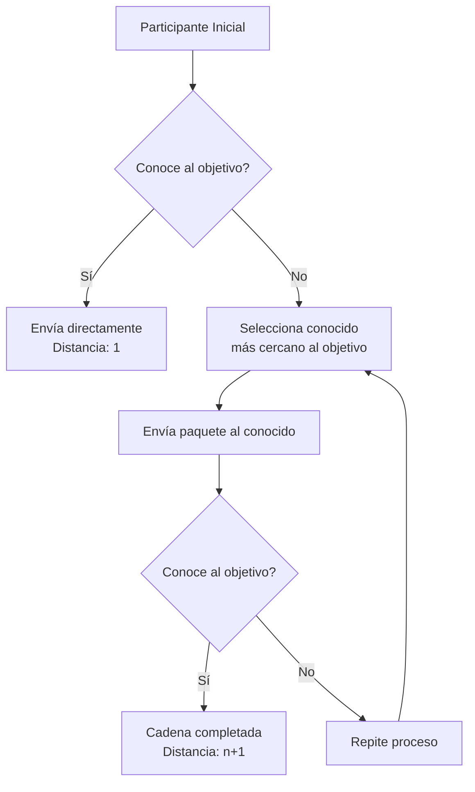

# Computación Distribuida - Propiedades de mundos pequeños en redes

## 3.2 Seis grados de separación.

---

El concepto de "seis grados de separación" postula que cualquier persona en la Tierra está conectada con cualquier otra a través de una cadena de no más de cinco intermediarios, resultando en seis conexiones en total. Esta idea, popularizada por el experimento de Stanley Milgram en 1967, tiene profundas implicaciones en el estudio de redes distribuidas.

### Definición Formal

En términos de teoría de grafos, los seis grados de separación implican que para una red social con $n$ nodos (personas), el diámetro de la red $D(G)$ satisface:

$$D(G) \leq 6$$

donde el diámetro se define como la máxima distancia entre cualquier par de nodos:

$$D(G) = \max_{u,v \in V} d(u,v)$$

### Experimentos Fundacionales

#### Experimento de Milgram (1967)

Milgram solicitó a participantes en Nebraska que enviaran un paquete a un objetivo en Massachusetts usando solo conocidos personales. Los resultados mostraron que:

- La cadena promedio tenía una longitud de 5.2 intermediarios
- Solo el 25% de las cadenas se completaron
- La distribución seguía un patrón de ley de potencias

#### Estructura Matemática

La distancia promedio en una red scale-free con parámetro $\gamma$ sigue:

$$\langle d \rangle \sim \frac{\ln(\ln N)}{\ln(\gamma - 1)}$$

Para redes sociales típicas $(\gamma \approx 2.1-2.7)$, esto resulta en valores entre 4 y 7.

### Modelado en Computación Distribuida

```python
import networkx as nx
import matplotlib.pyplot as plt
import numpy as np

class SixDegreesSimulator:
    def __init__(self, n_nodes, network_type='scale_free'):
        self.n_nodes = n_nodes
        self.network_type = network_type
        self.G = self.create_network()

    def create_network(self):
        if self.network_type == 'scale_free':
            return nx.barabasi_albert_graph(self.n_nodes, 3)
        elif self.network_type == 'small_world':
            return nx.watts_strogatz_graph(self.n_nodes, 6, 0.1)
        else:
            return nx.erdos_renyi_graph(self.n_nodes, 0.01)

    def calculate_distances(self):
        """Calcula todas las distancias pareadas"""
        paths = dict(nx.all_pairs_shortest_path_length(self.G))
        distances = []
        for source in paths:
            for target in paths[source]:
                if source != target:
                    distances.append(paths[source][target])
        return distances

    def analyze_degrees(self):
        distances = self.calculate_distances()
        avg_distance = np.mean(distances)
        max_distance = np.max(distances)

        print(f"Distancia promedio: {avg_distance:.2f}")
        print(f"Diámetro de la red: {max_distance}")
        print(f"Distribución de distancias:")

        plt.hist(distances, bins=range(1, max_distance+2))
        plt.title('Distribución de Grados de Separación')
        plt.xlabel('Grados de separación')
        plt.ylabel('Frecuencia')
        plt.show()

        return avg_distance, max_distance

# Ejemplo de uso
simulator = SixDegreesSimulator(1000, 'scale_free')
avg_dist, max_dist = simulator.analyze_degrees()
```

### Algoritmos de Búsqueda en Redes Sociales

#### Búsqueda Descentralizada

En sistemas distribuidos, la búsqueda eficiente aprovecha las propiedades de mundo pequeño:

```python
def decentralized_search(graph, start, target, max_steps=10):
    """
    Simula búsqueda descentralizada usando sólo información local
    """
    current = start
    path = [current]

    for step in range(max_steps):
        if current == target:
            return path, step + 1

        # Obtener vecinos y sus propiedades
        neighbors = list(graph.neighbors(current))

        # Estrategia: mover al nodo más cercano al objetivo
        # (En la práctica, se usaría alguna métrica de similitud)
        if target in neighbors:
            path.append(target)
            return path, step + 2

        # Elegir próximo nodo (simulación simplificada)
        current = np.random.choice(neighbors)
        path.append(current)

    return path, max_steps
```

### Diagrama de Flujo del Experimento de Milgram



### Ejercicios Propuestos

1. **Simulación de Milgram**: Implemente una simulación del experimento original:
   - Genere una red scale-free de 1000 nodos
   - Seleccione 100 pares aleatorios de origen-destino
   - Implemente un algoritmo de enrutamiento que use sólo información local
   - Calcule la distribución de longitudes de cadena

2. **Análisis Teórico**: Demuestre que en una red con distribución de grado $P(k) \sim k^{-\gamma}$:
   - La distancia promedio escala como $\langle d \rangle \sim \frac{\ln N}{\ln \langle k \rangle}$
   - Para $\gamma = 2.1$, calcule el valor esperado para N = 7 billones

3. **Optimización de Búsqueda**: Diseñe un algoritmo que minimice el número de saltos usando:
   - Información local de grado de nodos
   - Métricas de centralidad aproximadas
   - Aprendizaje por refuerzo para mejorar el enrutamiento

4. **Análisis de Redes Reales**:
   - Descargue un dataset de red social real (Twitter, Facebook)
   - Calcule la distribución de distancias
   - Compare con las predicciones teóricas

### Aplicaciones en Sistemas Distribuidos

#### Enrutamiento en Redes P2P

Los protocolos modernos como Kademlia aprovechan las propiedades de mundo pequeño:

$$distance(x, y) = x \oplus y$$

Este operador XOR garantiza que los nodos similares estén cerca en el espacio de direcciones.

#### Sistemas de Recomendación

Los seis grados permiten recomendaciones eficientes:

$$sim(u, v) = \frac{1}{d(u, v)}$$

Donde la similitud entre usuarios es inversamente proporcional a su distancia.

### Implementación Avanzada con Optimizaciones

```python
class AdvancedSixDegrees:
    def __init__(self, graph):
        self.graph = graph
        self.distance_cache = {}

    def bidirectional_search(self, start, target):
        """Búsqueda bidireccional optimizada"""
        if start == target:
            return [start], 0

        # Búsqueda desde ambos extremos
        forward_queue = deque([start])
        backward_queue = deque([target])
        forward_parent = {start: None}
        backward_parent = {target: None}

        intersection = None

        while forward_queue and backward_queue:
            # Expansión forward
            current_forward = forward_queue.popleft()
            for neighbor in self.graph.neighbors(current_forward):
                if neighbor not in forward_parent:
                    forward_parent[neighbor] = current_forward
                    forward_queue.append(neighbor)
                    if neighbor in backward_parent:
                        intersection = neighbor
                        break

            if intersection:
                break

            # Expansión backward
            current_backward = backward_queue.popleft()
            for neighbor in self.graph.neighbors(current_backward):
                if neighbor not in backward_parent:
                    backward_parent[neighbor] = current_backward
                    backward_queue.append(neighbor)
                    if neighbor in forward_parent:
                        intersection = neighbor
                        break

        if intersection:
            # Reconstruir camino
            path = []
            node = intersection
            while node is not None:
                path.append(node)
                node = forward_parent.get(node)
            path.reverse()

            node = backward_parent[intersection]
            while node is not None:
                path.append(node)
                node = backward_parent.get(node)

            return path, len(path) - 1

        return None, float('inf')
```

### Referencias Bibliográficas

1. Milgram, S. (1967). The Small World Problem. Psychology Today, 1(1), 60-67.
2. Watts, D. J., & Strogatz, S. H. (1998). Collective dynamics of 'small-world' networks. Nature, 393(6684), 440-442.
3. Kleinberg, J. (2000). The small-world phenomenon: An algorithmic perspective. Proceedings of the thirty-second annual ACM symposium on Theory of computing.
4. Easley, D., & Kleinberg, J. (2010). Networks, Crowds, and Markets: Reasoning about a Highly Connected World. Cambridge University Press. (Capítulos 2, 20)
5. Barabási, A. L., & Albert, R. (1999). Emergence of scaling in random networks. Science, 286(5439), 509-512.

### Conclusiones

El fenómeno de los seis grados de separación no es solo una curiosidad social, sino una propiedad fundamental con aplicaciones prácticas en:

1. Diseño de redes distribuidas eficientes
2. Sistemas de recomendación y búsqueda
3. Protocolos de enrutamiento en P2P
4. Modelado de propagación de información y epidemias

La comprensión de estos principios es esencial para el diseño de sistemas distribuidos modernos que aprovechen las propiedades emergentes de las redes complejas.
