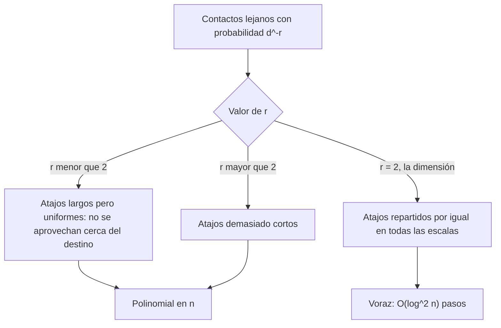

# Computación Distribuida - Propiedades de mundos pequeños en redes

## 3.3 Búsqueda descentralizada.

---

El experimento de Milgram mostró dos cosas: que hay caminos cortos entre personas lejanas (tema 3.2) y que la gente los **encuentra** sin conocer la red, pasando la carta a un conocido "más cercano" al destino. Lo segundo es mucho más sorprendente. Jon Kleinberg (2000) preguntó qué estructura debe tener una red para que una **búsqueda descentralizada**, que en cada paso usa solo información local, encuentre caminos cortos, y descubrió que la respuesta depende de un solo parámetro: cómo decae la probabilidad de un atajo con la distancia. Este tema presenta su modelo, el teorema con su demostración y sus extensiones a redes sociales reales.

### Búsqueda descentralizada

Un **algoritmo descentralizado** reenvía un mensaje hacia un destino $t$ conocido por sus coordenadas; en cada paso, el nodo actual conoce solo sus propios contactos (y sus coordenadas) y las de $t,$ más lo que lleve el mensaje. El algoritmo más natural es el **voraz**: enviar al contacto más cercano a $t$ según una distancia de referencia (geográfica, profesional). Se mide el **número esperado de pasos** entre un par de nodos al azar.

### El modelo de Kleinberg

- Los nodos son los puntos de una malla $n \times n$ con la distancia de Manhattan $d(u, v) = |x_u - x_v| + |y_u - y_v|.$
- **Contactos locales:** cada nodo está unido a sus 4 vecinos de la malla.
- **Contactos lejanos:** cada nodo $u$ tiene además $q$ contactos, uno en el modelo básico, y cada uno es $v$ con probabilidad

$$\Pr[u \to v] = \frac{d(u, v)^{-r}}{\sum_{w \neq u} d(u, w)^{-r}},$$

con un **exponente de agrupamiento** $r \geq 0.$ Con $r = 0$ los atajos son uniformes, como en Watts y Strogatz; con $r$ grande, casi todos son cortos.

**Teorema** (Kleinberg, 2000).

1. Con $r = 2,$ el algoritmo voraz llega en $O(\log^2 n)$ pasos esperados.
2. Con $0 \leq r \lt 2,$ todo algoritmo descentralizado necesita $\Omega(n^{(2 - r)/3})$ pasos esperados.
3. Con $r > 2,$ todo algoritmo descentralizado necesita $\Omega(n^{(r - 2)/(r - 1)})$ pasos esperados.

Es decir, solo cuando el exponente coincide con la **dimensión** de la malla la red es **navegable**. En dimensión $k$ el exponente crítico es $r = k.$

### Demostración de la cota superior

Con $r = 2,$ la constante de normalización es $Z = \sum_{w \neq u} d(u, w)^{-2} \leq \sum_{j=1}^{2n} 4j \cdot j^{-2} = 4 \sum_{j=1}^{2n} \frac{1}{j} \leq 4 \ln(6n),$ porque hay a lo sumo $4j$ nodos a distancia $j.$ Así, $\Pr[u \to v] \geq \frac{1}{4 \ln(6n) \, d(u, v)^2}.$

Se dice que la búsqueda está en la **fase** $j$ si la distancia al destino está entre $2^j$ y $2^{j+1}.$ Sea $u$ el nodo actual en la fase $j,$ con $d(u, t) \leq 2^{j+1},$ y $B_j$ el conjunto de nodos a distancia a lo sumo $2^j$ de $t.$ Hay al menos $2^{2j-1}$ nodos en $B_j,$ y cada uno está a distancia a lo sumo $2^{j+1} + 2^j \lt 2^{j+2}$ de $u.$ La probabilidad de que el contacto lejano de $u$ caiga en $B_j$ es al menos

$$2^{2j-1} \cdot \frac{1}{4 \ln(6n) \cdot 2^{2j+4}} = \frac{1}{128 \ln(6n)}.$$

Como la búsqueda voraz nunca se aleja y en cada paso de la fase hay un nodo nuevo con un contacto lejano nuevo, el número de pasos en la fase $j$ es a lo sumo una variable geométrica con media $128 \ln(6n) = O(\log n).$ Hay $O(\log n)$ fases, de modo que el total esperado es $O(\log^2 n).$ $\blacksquare$

Lo importante es que **la distancia no se reduce a la mitad en cada paso**: se reduce a la mitad tras $O(\log n)$ pasos esperados, y eso basta. La propiedad clave del exponente 2 es que los contactos se reparten por igual entre todas las escalas: un nodo tiene la misma probabilidad de tener un contacto a distancia entre 1 y 2, entre 2 y 4, entre 4 y 8, y así sucesivamente.

### Por qué fallan los otros exponentes

- **Exponente menor que 2.** Hay muchos atajos largos, pero son demasiado uniformes: cerca del destino, la probabilidad de tener un atajo que caiga en una vecindad pequeña de $t$ es diminuta, y la búsqueda acaba caminando por la malla. Existen caminos cortos, pero no se pueden **encontrar**.
- **Exponente mayor que 2.** Casi todos los atajos son cortos; los caminos más cortos son largos y la búsqueda avanza poco a poco.

### Extensiones y redes reales

- **Amistad por rango** (Liben-Nowell y otros, 2005): en una población no uniforme, la probabilidad de que $u$ sea amigo de $v$ es proporcional a $1/\text{rango}_u(v),$ donde el rango es el número de personas más cercanas a $u$ que $v.$ Es la generalización natural del exponente 2 a densidades arbitrarias, y en la red de LiveJournal se observó justamente ese patrón.
- **Jerarquías y dimensiones sociales** (Watts, Dodds y Newman, 2002): las personas tienen varias "distancias" (lugar, profesión, aficiones); la búsqueda voraz usando la menor de ellas funciona en un intervalo amplio de parámetros.
- **Redes superpuestas P2P** como Symphony y Chord (tema 4.2) usan exactamente esta idea para enrutar en $O(\log^2 n)$ o $O(\log n)$ saltos.



### Implementación en Python

El programa implementa el modelo de Kleinberg en una malla toroidal, que evita los efectos de borde, y genera cada contacto lejano solo cuando la búsqueda lo consulta, muestreando primero la distancia y luego uno de los $4d$ nodos a esa distancia; así puede trabajar con mallas de $10^5 \times 10^5,$ diez mil millones de nodos. Mide los pasos de la búsqueda voraz en función de $r$ y de $n$ (ejercicio 1), compara variantes de la búsqueda (ejercicio 2), cuenta los pasos por fase (ejercicio 3) y prueba la búsqueda voraz en una población sintética con ciudades y amistad por rango (ejercicio 4).

```python
import math, random, bisect

class Kleinberg:
    """Malla toroidal n x n; cada nodo tiene sus 4 vecinos y q contactos lejanos con
    probabilidad proporcional a d^(-r). Los contactos se sortean al consultarlos por
    primera vez (decisiones diferidas): la distribución es la misma."""
    def __init__(self, n, r, q=1, semilla=0):
        self.n, self.r, self.q, self.rng = n, r, q, random.Random(semilla)
        dmax = n // 2
        pesos = [4 * d * d ** (-r) for d in range(1, dmax)]   # 4d nodos a distancia d
        tot = sum(pesos); acc = 0; self.cdf = []
        for w in pesos:
            acc += w / tot; self.cdf.append(acc)
        self.contactos = {}

    def dist(self, a, b):
        n = self.n
        dx, dy = abs(a[0] - b[0]), abs(a[1] - b[1])
        return min(dx, n - dx) + min(dy, n - dy)

    def lejanos(self, u):
        if u not in self.contactos:
            res = []
            for _ in range(self.q):
                d = bisect.bisect_left(self.cdf, self.rng.random()) + 1
                k = self.rng.randrange(4 * d)                     # uno de los 4d nodos a distancia d
                lado, t = divmod(k, d)
                dx, dy = [(t, d - t), (d - t, -t), (-t, -(d - t)), (-(d - t), t)][lado]
                res.append(((u[0] + dx) % self.n, (u[1] + dy) % self.n))
            self.contactos[u] = res
        return self.contactos[u]

    def vecinos(self, u):
        x, y = u; n = self.n
        return [((x + 1) % n, y), ((x - 1) % n, y), (x, (y + 1) % n), (x, (y - 1) % n)] + self.lejanos(u)

def voraz(K, s, t):
    u, pasos = s, 0
    while u != t:
        u = min(K.vecinos(u), key=lambda v: K.dist(v, t)); pasos += 1
    return pasos

def voraz_dos_saltos(K, s, t):
    """Mira también los contactos de los vecinos y salta al mejor nodo a 1 o 2 saltos."""
    u, pasos = s, 0
    while u != t:
        mejor, saltos = None, 0
        for v in K.vecinos(u):
            for w, h in [(v, 1)] + [(x, 2) for x in K.vecinos(v)]:
                if mejor is None or (K.dist(w, t), h) < (K.dist(mejor, t), saltos):
                    mejor, saltos = w, h
        u = mejor; pasos += saltos
    return pasos

def promedio(n, r, busquedas, f=voraz, q=1, semilla=0):
    K = Kleinberg(n, r, q, semilla); rng = random.Random(semilla + 1)
    tot = 0
    for _ in range(busquedas):
        s = (rng.randrange(n), rng.randrange(n)); t = (rng.randrange(n), rng.randrange(n))
        tot += f(K, s, t)
    return tot / busquedas

# --- Ejercicio 1: pasos promedio en función de r ---
TAMS = (100, 1000, 10**4, 10**5)
print("ejercicio 1: búsqueda voraz, pasos promedio (200 búsquedas) en mallas de n x n")
print("      r " + "".join(f"{n:>9}" for n in TAMS) + "   crecimiento por cada factor 10 en n")
for r in (0.0, 1.0, 1.5, 2.0, 2.5, 3.0):
    v = [promedio(n, r, 200) for n in TAMS]
    print(f"   {r:4.1f} " + "".join(f"{x:9.1f}" for x in v) + "   " + " ".join(f"x{b / a:.2f}" for a, b in zip(v, v[1:])))
print("   (ln n)^2" + "".join(f"{math.log(n) ** 2:9.1f}" for n in TAMS))

# --- Ejercicio 2: variantes ---
print("ejercicio 2: r = 2, n = 300")
print(f"   voraz simple:                 {promedio(300, 2, 300):6.1f} pasos")
print(f"   voraz con dos saltos:         {promedio(300, 2, 300, voraz_dos_saltos):6.1f} pasos")
print(f"   voraz con 3 contactos lejanos: {promedio(300, 2, 300, q=3):6.1f} pasos")

# --- Ejercicio 3: fases de la demostración ---
K = Kleinberg(1000, 2, semilla=5); rng = random.Random(9)
fases = {}
for _ in range(300):
    s = (rng.randrange(1000), rng.randrange(1000)); t = (rng.randrange(1000), rng.randrange(1000))
    u = s
    while u != t:
        j = int(math.log2(K.dist(u, t)))
        fases[j] = fases.get(j, 0) + 1
        u = min(K.vecinos(u), key=lambda v: K.dist(v, t))
print("ejercicio 3: n = 1000, r = 2: pasos promedio en la fase j (distancia entre 2^j y 2^(j+1))")
print("   " + "  ".join(f"j={j}: {fases[j] / 300:.1f}" for j in sorted(fases)))

# --- Ejercicio 4: amistad por rango con población no uniforme ---
rng = random.Random(4)
ciudades = [(rng.random(), rng.random(), rng.choice([20, 60, 200])) for _ in range(8)]
P = []
for cx, cy, tam in ciudades:
    for _ in range(tam):
        P.append((cx + rng.gauss(0, 0.03), cy + rng.gauss(0, 0.03)))
P += [(rng.random(), rng.random()) for _ in range(300)]          # población rural
N = len(P)
amigos = [set() for _ in range(N)]
for u in range(N):
    orden = sorted(range(N), key=lambda v: (P[u][0] - P[v][0]) ** 2 + (P[u][1] - P[v][1]) ** 2)[1:]
    pesos = [1 / (rango + 1) for rango in range(len(orden))]
    for v in rng.choices(orden, weights=pesos, k=4):                 # 4 amistades por rango
        amigos[u].add(v); amigos[v].add(u)
    for v in orden[:2]:                                              # y sus 2 vecinos más cercanos
        amigos[u].add(v); amigos[v].add(u)

def d2(a, b): return math.dist(P[a], P[b])
exitos, pasos = 0, []
for _ in range(500):
    s, t = rng.sample(range(N), 2)
    u, k = s, 0
    while u != t and k < 200:
        sig = min(amigos[u], key=lambda v: d2(v, t))
        if d2(sig, t) >= d2(u, t): break                            # sin progreso: la cadena se pierde
        u = sig; k += 1
    if u == t:
        exitos += 1; pasos.append(k)
print(f"ejercicio 4: {N} personas en 8 ciudades y zona rural, amistad por rango:"
      f" {exitos}/500 cadenas completadas, media {sum(pasos) / len(pasos):.1f} pasos")
```

Salida:

```text
ejercicio 1: búsqueda voraz, pasos promedio (200 búsquedas) en mallas de n x n
      r       100     1000    10000   100000   crecimiento por cada factor 10 en n
    0.0      18.1     81.4    378.6   1754.7   x4.49 x4.65 x4.63
    1.0      18.2     61.1    189.1    586.3   x3.35 x3.10 x3.10
    1.5      18.9     53.1    130.3    285.7   x2.82 x2.45 x2.19
    2.0      22.8     64.3    137.5    230.4   x2.82 x2.14 x1.68
    2.5      29.5    143.0    524.8   1789.6   x4.84 x3.67 x3.41
    3.0      36.9    306.6   2534.3  21003.1   x8.31 x8.26 x8.29
   (ln n)^2     21.2     47.7     84.8    132.5
ejercicio 2: r = 2, n = 300
   voraz simple:                   39.7 pasos
   voraz con dos saltos:           24.7 pasos
   voraz con 3 contactos lejanos:   20.7 pasos
ejercicio 3: n = 1000, r = 2: pasos promedio en la fase j (distancia entre 2^j y 2^(j+1))
   j=0: 1.0  j=1: 1.8  j=2: 3.3  j=3: 5.1  j=4: 7.1  j=5: 9.6  j=6: 10.9  j=7: 11.9  j=8: 13.0  j=9: 4.5
ejercicio 4: 940 personas en 8 ciudades y zona rural, amistad por rango: 369/500 cadenas completadas, media 5.5 pasos
```

### Ejercicios Propuestos

1. **Implementación.** Implementa el modelo de Kleinberg para distintos valores de $r,$ ejecuta la búsqueda voraz y verifica empíricamente el teorema.

2. **Variantes.** Modifica la búsqueda voraz para usar información de dos saltos, o para combinarla con exploración, y compárala con la simple.

3. **Análisis.** Analiza el comportamiento de la búsqueda con $r = 2,$ calcula el número esperado de pasos en una malla de $n \times n$ y explica cómo cambia con otros valores de $r.$

4. **Redes reales.** En una red social con coordenadas geográficas o temáticas, define una distancia y evalúa la búsqueda descentralizada.

### Soluciones

**Ejercicio 1.** La tabla del programa muestra el teorema, con una salvedad importante. En mallas pequeñas, de $100 \times 100$ o $1000 \times 1000,$ $r = 1$ o $r = 1.5$ dan menos pasos que $r = 2:$ los efectos de tamaño finito son grandes. Lo que distingue a $r = 2$ es el **crecimiento**: al multiplicar $n$ por 10, los pasos con $r = 0$ se multiplican por 4.6, cerca de $10^{2/3} \approx 4.64,$ el exponente de la cota $n^{2/3};$ con $r = 1$ por 3.1, y con $r = 2$ por un factor que **disminuye**, 2.8, 2.1 y 1.7, como corresponde a $\log^2 n.$ Con $n = 10^5,$ $r = 2$ ya es el mejor. Con $r > 2$ el crecimiento es polinomial y rápido.

**Ejercicio 2.** Con información de dos saltos, el nodo conoce los contactos de sus contactos y salta al mejor nodo a 1 o 2 pasos: baja de 39.7 a 24.7 pasos. Manku, Naor y Wieder (2004) demostraron que así se obtienen $O(\log n / \log \log n)$ pasos. Tener más contactos lejanos también ayuda: con $q = 3$ baja a 20.7, y con $q = \log n$ contactos, a $O(\log n).$ La exploración aleatoria, en cambio, no ayuda en este modelo, porque la voraz nunca se queda atascada.

**Ejercicio 3.** Es la demostración: la fase $j$ dura $O(\log n)$ pasos esperados y hay $O(\log n)$ fases, $O(\log^2 n)$ en total; para la malla de $n \times n,$ la cota explícita es $128 \ln(6n) \log_2(2n)$ pasos, muy pesimista. El programa muestra que en cada fase hacen falta varios pasos, más en las fases intermedias, y no uno solo: la afirmación de que "la distancia se reduce a la mitad en cada paso" que traía la versión anterior de este documento no es cierta. Para otros exponentes, ver las cotas inferiores del teorema.

**Ejercicio 4.** Sin descargar datos, el programa genera una población de 940 personas concentrada en 8 ciudades de distinto tamaño más una zona rural, con amistades por rango y con los dos vecinos más cercanos. La búsqueda voraz por distancia geográfica completa el 74% de las cadenas en 5.5 pasos de media; las que fallan se atascan en un nodo sin ningún amigo más cercano al destino, igual que las cartas perdidas de Milgram. Con datos reales, como los de LiveJournal o las coordenadas de los perfiles de Facebook, el procedimiento es el mismo: definir la distancia, calcular rangos y simular cadenas entre pares al azar.

### Referencias

1. Kleinberg, J., The small-world phenomenon: an algorithmic perspective. _Proceedings of the 32nd ACM Symposium on Theory of Computing_, 2000.
2. Kleinberg, J., Navigation in a small world. _Nature_ 406, 2000.
3. Liben-Nowell, D., Novak, J., Kumar, R., Raghavan, P., and Tomkins, A., Geographic routing in social networks. _PNAS_ 102(33), 2005.
4. Easley, D., and Kleinberg, J., _Networks, Crowds, and Markets_. Cambridge University Press, 2010. Capítulo 20.
