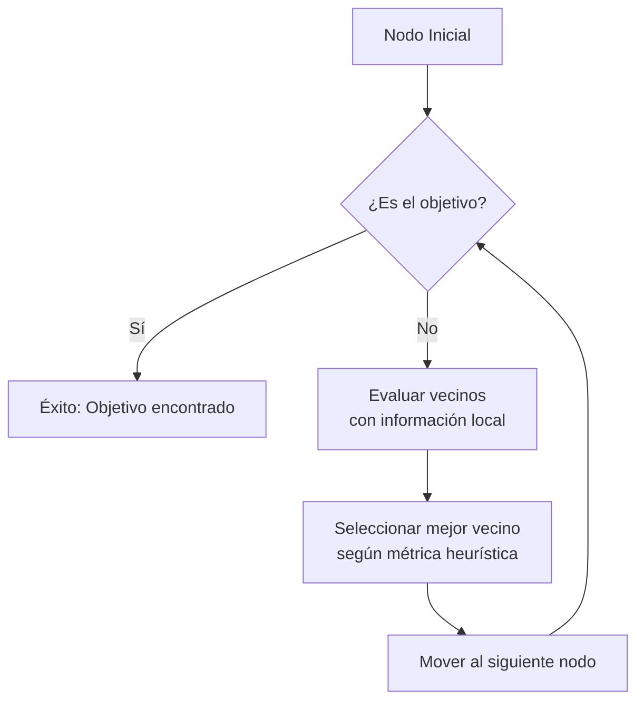

# Computación Distribuida - Propiedades de mundos pequeños en redes

## 3.3 Búsqueda descentralizada.

---

La búsqueda descentralizada es un problema fundamental en computación distribuida donde los nodos de una red deben localizar información o recursos utilizando sólo conocimiento local, sin una visión global de la red. En redes de mundo pequeño, este problema adquiere características especiales debido a la combinación de alto agrupamiento local y cortas distancias globales.

### Definición Formal

Dada una red $G = (V, E)$ con $n$ nodos, la búsqueda descentralizada consiste en encontrar un camino desde un nodo origen $s$ hasta un nodo destino $t$ utilizando únicamente información local en cada nodo, donde cada nodo $v$ conoce:

- Sus vecinos directos: $N(v) = \{u \in V : (v,u) \in E\}$
- Potencialmente alguna información limitada sobre la red global

El costo de la búsqueda se mide por el número de saltos requeridos.

### Modelo de Kleinberg: Redes con Estructura Espacial

#### Definición del Modelo

Kleinberg propuso un modelo donde los nodos se ubican en una retícula $n \times n$ y cada nodo tiene:

- Enlaces locales a vecinos cercanos
- Enlaces largos con probabilidad proporcional a $d(u,v)^{-r}$

La probabilidad de un enlace largo entre $u$ y $v$ es:

$$P(u \rightarrow v) = \frac{d(u,v)^{-r}}{\sum_{w \neq u} d(u,w)^{-r}}$$

donde $d(u,v)$ es la distancia Manhattan en la retícula.

#### Resultados Fundamentales

Kleinberg demostró que:

- Para $r = 0$ (enlaces aleatorios uniformes): La búsqueda requiere $\Theta(n^{2/3})$ pasos
- Para $r = 2$ (probabilidad inversa al cuadrado de la distancia): La búsqueda es eficiente con $\Theta(\log^2 n)$ pasos
- Para $r > 2$: La búsqueda requiere $\Theta(n^{(r-2)/(r-1)})$ pasos

### Algoritmos de Búsqueda Descentralizada

#### Algoritmo Avaro (Greedy)

Cada nodo envía el mensaje al vecino más cercano al destino en el espacio subyacente.

```python
import numpy as np
import networkx as nx
from collections import deque

class DecentralizedSearch:
    def __init__(self, grid_size, r=2):
        self.grid_size = grid_size
        self.r = r
        self.G = self.create_kleinberg_network()

    def create_kleinberg_network(self):
        """Crea una red según el modelo de Kleinberg"""
        G = nx.Graph()
        n = self.grid_size * self.grid_size

        # Añadir nodos con coordenadas
        for i in range(self.grid_size):
            for j in range(self.grid_size):
                node_id = i * self.grid_size + j
                G.add_node(node_id, pos=(i, j))

        # Añadir enlaces locales (vecinos en la retícula)
        for i in range(self.grid_size):
            for j in range(self.grid_size):
                node_id = i * self.grid_size + j
                # Vecinos inmediatos (arriba, abajo, izquierda, derecha)
                for di, dj in [(0,1), (1,0), (0,-1), (-1,0)]:
                    ni, nj = i + di, j + dj
                    if 0 <= ni < self.grid_size and 0 <= nj < self.grid_size:
                        neighbor_id = ni * self.grid_size + nj
                        G.add_edge(node_id, neighbor_id)

        # Añadir enlaces largos según el modelo de Kleinberg
        for i in range(self.grid_size):
            for j in range(self.grid_size):
                node_id = i * self.grid_size + j
                # Calcular probabilidades para enlaces largos
                probabilities = []
                possible_targets = []

                for x in range(self.grid_size):
                    for y in range(self.grid_size):
                        if x == i and y == j:
                            continue
                        target_id = x * self.grid_size + y
                        distance = abs(x-i) + abs(y-j)  # Distancia Manhattan
                        if distance > 1:  # No incluir vecinos inmediatos
                            prob = distance ** (-self.r)
                            probabilities.append(prob)
                            possible_targets.append(target_id)

                # Normalizar probabilidades
                probabilities = np.array(probabilities)
                probabilities /= probabilities.sum()

                # Añadir algunos enlaces largos (por ejemplo, 1 por nodo)
                if len(possible_targets) > 0:
                    long_target = np.random.choice(possible_targets, p=probabilities)
                    G.add_edge(node_id, long_target)

        return G

    def manhattan_distance(self, node1, node2):
        """Calcula la distancia Manhattan entre dos nodos"""
        pos1 = self.G.nodes[node1]['pos']
        pos2 = self.G.nodes[node2]['pos']
        return abs(pos1[0] - pos2[0]) + abs(pos1[1] - pos2[1])

    def greedy_search(self, start, target, max_steps=1000):
        """Algoritmo de búsqueda greedy descentralizada"""
        current = start
        path = [current]
        steps = 0

        while current != target and steps < max_steps:
            neighbors = list(self.G.neighbors(current))

            # Encontrar el vecino más cercano al objetivo
            best_neighbor = None
            min_distance = float('inf')

            for neighbor in neighbors:
                dist = self.manhattan_distance(neighbor, target)
                if dist < min_distance:
                    min_distance = dist
                    best_neighbor = neighbor

            if best_neighbor is None:
                break

            current = best_neighbor
            path.append(current)
            steps += 1

        return path, steps
```

### Diagrama de Búsqueda Descentralizada



### Ejercicios Propuestos

1. **Implementación y Análisis**:
   - Implemente el modelo de Kleinberg para diferentes valores de $r$
   - Ejecute el algoritmo greedy para 1000 búsquedas aleatorias
   - Grafique el número promedio de pasos en función de $r$
   - Verifique empíricamente los resultados teóricos de Kleinberg

2. **Optimización del Algoritmo**:
   - Modifique el algoritmo greedy para que utilice información de dos saltos
   - Implemente una estrategia que combine búsqueda greedy con exploración aleatoria
   - Compare el rendimiento con el algoritmo greedy simple

3. **Análisis Teórico**:
   - Demuestre que para $r = 2$, la distancia esperada se reduce a la mitad en cada paso
   - Calcule el número esperado de pasos para una red de tamaño $n \times n$
   - Analice cómo cambia la complejidad para diferentes valores de $r$

4. **Aplicación a Redes Reales**:
   - Descargue una red social real o de colaboración científica
   - Extraiga las coordenadas espaciales o temáticas de los nodos
   - Implemente una métrica de distancia apropiada
   - Evalúe la eficiencia de búsqueda descentralizada en esta red

### Estrategias Avanzadas de Búsqueda

#### Búsqueda con Información Social

En redes sociales, los nodos pueden usar información sobre intereses o atributos:

$$P(u \rightarrow v) = \frac{sim(u,t) \cdot sim(v,t)}{\sum_{w} sim(w,t)}$$

donde $sim(a,b)$ mide la similitud entre los nodos $a$ y $b$.

#### Algoritmo de Búsqueda Bidireccional

```python
def bidirectional_search(self, start, target, max_steps=500):
    """Búsqueda bidireccional descentralizada"""
    # Implementación de búsqueda desde ambos extremos
    forward_path = [start]
    backward_path = [target]

    forward_current = start
    backward_current = target
    steps = 0

    while steps < max_steps:
        # Paso forward
        forward_neighbors = list(self.G.neighbors(forward_current))
        best_forward = min(forward_neighbors,
                          key=lambda x: self.manhattan_distance(x, target))
        forward_current = best_forward
        forward_path.append(forward_current)

        # Paso backward
        backward_neighbors = list(self.G.neighbors(backward_current))
        best_backward = min(backward_neighbors,
                           key=lambda x: self.manhattan_distance(x, start))
        backward_current = best_backward
        backward_path.append(backward_current)

        steps += 1

        # Verificar intersección
        if forward_current == target or backward_current == start:
            break

        if forward_current in backward_path:
            idx = backward_path.index(forward_current)
            full_path = forward_path + list(reversed(backward_path[:idx]))
            return full_path, steps

        if backward_current in forward_path:
            idx = forward_path.index(backward_current)
            full_path = forward_path[:idx+1] + list(reversed(backward_path))
            return full_path, steps

    return None, steps
```

### Métricas de Evaluación

#### Eficiencia de Búsqueda

La eficiencia se mide mediante:

- **Longitud de camino**: $L = \frac{1}{N} \sum_{i=1}^{N} l_i$
- **Tasa de éxito**: $S = \frac{\text{búsquedas exitosas}}{\text{búsquedas totales}}$
- **Coste de comunicación**: $C = \frac{1}{N} \sum_{i=1}^{N} m_i$

donde $l_i$ es la longitud del camino y $m_i$ es el número de mensajes para la búsqueda $i$.

### Aplicaciones en Sistemas Distribuidos

#### Sistemas Peer-to-Peer (P2P)

En redes P2P como Chord o Kademlia, la búsqueda descentralizada es fundamental:

- **Chord**: Utiliza tablas de enrutamiento finger con $O(\log n)$ saltos
- **Kademlia**: Emplea tablas de enrutamiento XOR con $O(\log n)$ saltos

#### Redes de Sensores Inalámbricos

En WSNs, la búsqueda eficiente es crucial para:

- Localización de datos
- Encaminamiento geográfico
- Agregación de información

### Referencias Bibliográficas

1. Kleinberg, J. (2000). The small-world phenomenon: An algorithmic perspective. Proceedings of the thirty-second annual ACM symposium on Theory of computing.
2. Kleinberg, J. (2004). Complex networks and decentralized search algorithms. Proceedings of the International Congress of Mathematicians.
3. Easley, D., & Kleinberg, J. (2010). Networks, Crowds, and Markets: Reasoning about a Highly Connected World. Cambridge University Press. (Capítulo 20)
4. Watts, D. J., Dodds, P. S., & Newman, M. E. J. (2002). Identity and search in social networks. Science, 296(5571), 1302-1305.
5. Liben-Nowell, D., Novak, J., Kumar, R., Raghavan, P., & Tomkins, A. (2005). Geographic routing in social networks. Proceedings of the National Academy of Sciences.

### Implementación de Pruebas y Evaluación

```python
def evaluate_search_algorithm(self, algorithm, num_trials=100):
    """Evalúa el rendimiento de un algoritmo de búsqueda"""
    results = {
        'success_rate': 0,
        'avg_steps': 0,
        'max_steps': 0,
        'min_steps': float('inf')
    }

    successful_searches = 0
    total_steps = 0

    for _ in range(num_trials):
        start = np.random.randint(0, self.grid_size * self.grid_size)
        target = np.random.randint(0, self.grid_size * self.grid_size)

        if start == target:
            continue

        path, steps = algorithm(start, target)

        if path and path[-1] == target:
            successful_searches += 1
            total_steps += steps
            results['max_steps'] = max(results['max_steps'], steps)
            results['min_steps'] = min(results['min_steps'], steps)

    results['success_rate'] = successful_searches / num_trials
    if successful_searches > 0:
        results['avg_steps'] = total_steps / successful_searches

    return results

# Ejemplo de uso
search = DecentralizedSearch(grid_size=20, r=2)
results = search.evaluate_search_algorithm(search.greedy_search, num_trials=500)
print(f"Tasa de éxito: {results['success_rate']:.2%}")
print(f"Pasos promedio: {results['avg_steps']:.2f}")
```

### Conclusiones

La búsqueda descentralizada en redes de mundo pequeño es un problema fundamental con aplicaciones en múltiples dominios de computación distribuida. El modelo de Kleinberg proporciona un marco teórico elegante para entender cómo la estructura de la red afecta la eficiencia de búsqueda.

Los resultados clave muestran que:

- La estructura espacial con enlaces largos distribuidos específicamente $(r = 2)$ permite búsquedas eficientes
- Algoritmos simples greedy pueden lograr complejidad polilogarítmica
- La información local es suficiente para navegar eficientemente en redes globales

Estos principios se aplican en sistemas P2P, redes sociales, WSNs y otros sistemas distribuidos donde el conocimiento global no está disponible pero se requiere eficiencia en la localización de recursos.
