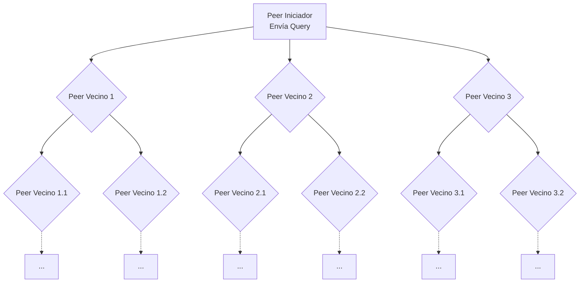
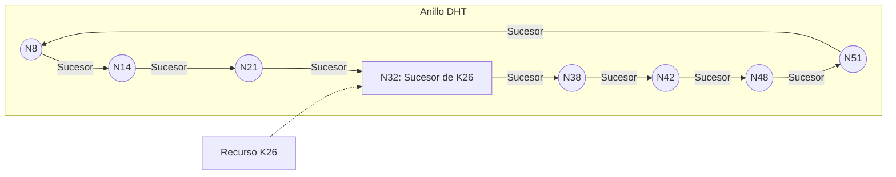

# Computación Distribuida - Búsqueda descentralizada en redes peer to peer

## 4.1 Esquemas de redes peer-to-peer.

---

Las redes peer-to-peer (P2P) representan una arquitectura distribuida fundamental donde los nodos (peers) interactúan directamente sin la necesidad de servidores centralizados. La búsqueda descentralizada es uno de los desafíos más importantes en estos sistemas, ya que implica localizar información o recursos en una red masiva y dinámica sin un índice global centralizado. Esta guía se enfoca en los diferentes esquemas estructurales que permiten realizar estas búsquedas de manera eficiente.

### Conceptos Fundamentales

#### Definición de Red Peer-to-Peer (P2P)

Una red peer-to-peer es una arquitectura de red distribuida que partitiona tareas o cargas de trabajo entre pares (peers). Los peers son participantes igualmente privilegiados y equipotentes en la aplicación. Se dice que forman un sistema de nodos que cooperan entre sí, actuando tanto como clientes como servidores para los demás nodos de la red. Esto contrasta con el modelo cliente-servidor tradicional.

#### Características Clave de las Redes P2P

1.  **Descentralización:** No hay una entidad central que controle la red.
2.  **Autoorganización:** La red se organiza y mantiene a sí misma de manera dinámica.
3.  **Resistencia a fallos:** La salida de nodos no debería colapsar el sistema.
4.  **Escalabilidad:** La red puede crecer para acomodar un gran número de nodos.
5.  **Anonimato (en algunos casos):** La identidad de los peers puede estar oculta.

### Taxonomía de Esquemas P2P

Los sistemas P2P se pueden clasificar ampliamente en dos categorías principales según su estructura de overlay network (red de superposición):

#### Redes P2P No Estructuradas

En estas redes, las conexiones entre peers se establecen de forma arbitraria. No hay una regla predeterminada que dicte qué nodo debe conectarse a qué otro. La búsqueda de recursos normalmente implica mecanismos de _flooding_ o _random walks_.

##### Funcionamiento de la Búsqueda por Inundación (Flooding)

1.  Un peer inicia una consulta por un recurso.
2.  El peer envía la consulta a todos sus vecinos directos.
3.  Cada vecino, a su vez, reenvía la consulta a todos sus vecinos (excepto al que se la envió).
4.  Este proceso continúa hasta que se encuentra el recurso o se alcanza un límite de saltos (Time-To-Live, TTL).

**Fórmula del Ancho de Banda Consumido:**
En el peor caso, el número de mensajes de consulta $M$ generados por una búsqueda con TTL $t$ en una red con grado promedio $d$ es aproximadamente:

$$ M = \sum_{k=1}^{t} d(d-1)^{k-1} $$

Esta es una serie geométrica que crece exponencialmente con $t$, lo que hace que el flooding no sea escalable para redes grandes.

**Ejemplo:** Gnutella (en sus primeras versiones) es un ejemplo clásico de red no estructurada.

##### Diagrama de Búsqueda por Inundación



#### Redes P2P Estructuradas (DHTs - Tablas de Hash Distribuidas)

Estas redes imponen una topología de overlay específica y usan un sistema de direccionamiento global para organizar y localizar recursos de manera determinista. La estructura más común es la **Tabla de Hash Distribuida (DHT)**.

##### Principio de Funcionamiento de una DHT

1.  **Espacio de Claves:** Se define un espacio de identificadores (IDs) grande, por ejemplo, de $0$ a $2^{m}-1$.
2.  **Asignación de IDs:** Tanto los nodos como los recursos (o sus claves) son hasheados para obtener un ID dentro del mismo espacio.
3.  **Regla de Asignación:** Cada recurso es almacenado en el nodo cuyo ID es "el más cercano" al ID del recurso, según una métrica definida (e.g., el sucesor inmediato).
4.  **Enrutamiento:** Cada nodo mantiene una tabla de enrutamiento con enlaces a otros nodos específicos. Los mensajes se enrutan de nodo en nodo, acercándose progresivamente al destino.

**Fórmula de Enrutamiento en Chord:**
En el protocolo Chord (una DHT popular), la distancia entre un nodo $n$ y una clave $k$ se define como la distancia circular en el anillo de identificadores:

$$ distance(n, k) = (k - n) \mod 2^m $$

El recurso con clave $k$ es almacenado por el primer nodo cuyo ID sea mayor o igual a $k$ ( sucesor de $k$ ).

**Ejemplo:** Protocolos como **Chord**, **Kademlia**, **Pastry**, y **Tapestry** son DHTs ampliamente estudiadas.

##### Diagrama de un Anillo DHT (Chord)



### Comparativa entre Esquemas

| Característica                | Redes No Estructuradas             | Redes Estructuradas (DHT)          |
| ----------------------------- | ---------------------------------- | ---------------------------------- |
| **Topología**                 | Aleatoria, ad-hoc                  | Determinista, organizada           |
| **Algoritmo de Búsqueda**     | Flooding, Random Walks             | Enrutamiento determinista          |
| **Garantías de Éxito**        | No garantizado (puede ser parcial) | Garantizado (si el recurso existe) |
| **Overhead de Mantenimiento** | Bajo (solo vecindarios)            | Alto (tablas de enrutamiento)      |
| **Resistencia a Churn**       | Alta                               | Media-Baja (depende del algoritmo) |
| **Ejemplos**                  | Gnutella, Napster (híbrido)        | Chord, Kademlia, Cassandra         |

### Ejercicios Propuestos

1.  **Análisis de Overhead:** Para una red no estructurada con un grado promedio de conexión $d = 4$ y un TTL $t = 7$, calcula el número máximo de mensajes generados por una sola consulta de flooding. ¿Qué sucede si el grado promedio aumenta a $d = 6$?

2.  **Simulación Mental de DHT:** Imagina un anillo Chord con $m = 6$ (por lo tanto, 64 IDs posibles). Los nodos activos son los peers con IDs {1, 4, 9, 18, 20, 33, 40, 51}.
    - ¿Qué nodo es responsable de la clave $k = 25$?
    - Si el nodo 18 abandona la red, ¿qué nodo se convierte en el responsable de la clave $k=25$?
    - Traza la ruta que seguiría una consulta desde el nodo 4 hasta la clave $k=25$.

3.  **Diseño de Esquema:** Evalúa los pros y los contras de usar una red no estructurada versus una DHT para diseñar un sistema de compartición de archivos en una red universitaria. Considera factores como la frecuencia de entrada/salida de usuarios (churn) y los tipos de búsquedas más comunes (por nombre de archivo vs. por contenido).

4.  **Investigación de Kademlia:** Investiga el protocolo Kademlia, otra DHT muy influyente. Explica cómo calcula la "distancia" entre nodos (XOR) y describe brevemente cómo funciona su proceso de búsqueda (utilizando listas de k-buckets). Compara su enfoque con el anillo de Chord.

### Código de Ejemplo (Pseudocódigo para Búsqueda en Chord)

A continuación, se presenta un pseudocódigo simplificado para la operación `find_successor` en la DHT Chord, que es el corazón de sus operaciones de búsqueda y enrutamiento.

```
// Asume que cada nodo n tiene:
// n.successor: el siguiente nodo en el anillo
// n.finger_table: una tabla para enrutamiento eficiente

función find_successor(n, id)
    // 1. Verifica si el id está entre n y su sucesor
    if (id ∈ (n, n.successor]] then
        return n.successor
    else
        // 2. Si no, consulta la tabla de fingers para encontrar el nodo
        // que precede más cercano al id deseado
        n_prime = closest_preceding_node(n, id)
        return find_successor(n_prime, id) // Recursión
    end if
end función

función closest_preceding_node(n, id)
    // Recorre la finger table de mayor a menor distancia
    for i = m downto 1 do
        finger = n.finger_table[i]
        if (finger ∈ (n, id)) then
            return finger
        end if
    end for
    // Si no encuentra un finger mejor, devuelve a sí mismo
    return n
end función
```

### Referencias

1.  **Easley, D., & Kleinberg, J. (2010).** _Networks, Crowds, and Markets: Reasoning about a Highly Connected World._ Cambridge University Press. (Capítulo sobre redes P2P y búsqueda en redes).
2.  **Attiya, H., & Welch, J. (2004).** _Distributed Computing: Fundamentals, Simulations, and Advanced Topics._ Wiley. (Ofrece una perspectiva formal y teórica sobre los algoritmos distribuidos, incluyendo consenso y coherencia, relevantes para DHTs).
3.  **Stoica, I., Morris, R., Karger, D., Kaashoek, M. F., & Balakrishnan, H. (2001).** _Chord: A Scalable Peer-to-peer Lookup Protocol for Internet Applications._ IEEE/ACM Transactions on Networking. (El artículo seminal que introduce Chord).
4.  **Maymounkov, P., & Mazières, D. (2002).** _Kademlia: A Peer-to-peer Information System Based on the XOR Metric._ Proceedings of IPTPS02. (El artículo fundamental sobre Kademlia).
5.  **Lynch, N. A. (1996).** _Distributed Algorithms._ Morgan Kaufmann. (Texto clásico para una comprensión profunda de los fundamentos teóricos).
