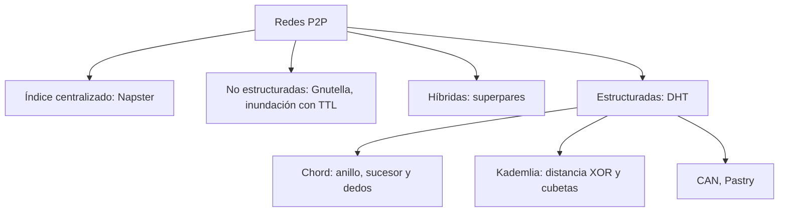

# Computación Distribuida - Búsqueda descentralizada en redes peer to peer

## 4.1 Esquemas de redes peer-to-peer.

---

En una red **entre pares** (_peer-to-peer_, P2P), cada participante es a la vez cliente y servidor: aporta almacenamiento, ancho de banda o cómputo y consume los de los demás, sin un servidor central. Los pares forman una **red superpuesta** (_overlay_): una gráfica lógica de conexiones sobre Internet. El problema central es **encontrar** dónde está un recurso cuando ningún nodo conoce toda la red y los nodos entran y salen todo el tiempo (**rotación** o _churn_). Este tema clasifica los esquemas P2P en centralizados, no estructurados y estructurados, analiza el costo de la inundación con tiempo de vida y presenta las **tablas de dispersión distribuidas** (DHT) Chord y Kademlia, que encuentran cualquier clave en $O(\log n)$ saltos.

### Clasificación

- **Índice centralizado** (Napster, 1999): un servidor guarda qué par tiene qué archivo, y la transferencia es directa entre pares. Búsqueda en $O(1),$ pero el servidor es un punto único de falla, legal y técnico.
- **No estructurados** (Gnutella, 2000): cada par se conecta a unos pocos pares arbitrarios y busca por **inundación** con un tiempo de vida (TTL) o con caminatas aleatorias (tema 4.2). Admiten consultas arbitrarias (por palabras, por contenido) y toleran bien la rotación, pero no garantizan encontrar un objeto raro y gastan muchos mensajes.
- **Híbridos** (KaZaA, Gnutella 0.6): algunos pares con buenos recursos se vuelven **superpares** que indexan a sus pares hoja y forman entre ellos una red no estructurada.
- **Estructurados** (Chord, CAN, Pastry, Kademlia, todos de 2001): la topología y la ubicación de los datos siguen reglas precisas basadas en identificadores, como una tabla de dispersión repartida entre los pares. Garantizan encontrar una clave en $O(\log n)$ saltos con $O(\log n)$ estado por nodo, pero solo buscan por **clave exacta**. BitTorrent usa una DHT de Kademlia para encontrar pares sin rastreador.

### Inundación con TTL

Una consulta se envía a todos los vecinos con un contador TTL; cada par que la recibe por primera vez busca localmente, disminuye el TTL y, si es positivo, la reenvía a sus demás vecinos. En una red donde todos tienen grado $d,$ si no hubiera ciclos, el origen enviaría $d$ mensajes, cada uno de los receptores $d - 1,$ y así sucesivamente:

$$M_{\max}(d, t) = \sum_{i=0}^{t-1} d (d - 1)^i = d \cdot \frac{(d - 1)^t - 1}{d - 2}.$$

El costo crece **exponencialmente** con el TTL, y una vez que se alcanza toda la red los mensajes adicionales son puro desperdicio. En la práctica los ciclos producen duplicados, que los pares descartan por el identificador de la consulta.

### Tablas de dispersión distribuidas

Una DHT ofrece dos operaciones: `poner(clave, valor)` y `obtener(clave)`. Los pares y las claves se asignan a identificadores de $m$ bits con una función de dispersión criptográfica (SHA-1 en Chord y Kademlia), y cada clave se guarda en el par "más cercano" según una distancia en el espacio de identificadores. La **dispersión consistente** hace que, al entrar o salir un par, solo se muevan las claves de su vecindad: en promedio una fracción $1/n.$

### Chord

Los identificadores forman un **anillo** módulo $2^m.$ La clave $k$ es responsabilidad de su **sucesor**: el primer par con identificador mayor o igual que $k,$ dando la vuelta al anillo. Cada par $p$ mantiene:

- su sucesor y su predecesor en el anillo;
- una **tabla de dedos**: el dedo $i,$ para $i = 0, \ldots, m - 1,$ es el sucesor de $p + 2^i.$

**Búsqueda:** si la clave está entre $p$ y su sucesor, el sucesor es el responsable; si no, se reenvía al **dedo más lejano que precede a la clave**. Cada salto al menos reduce a la mitad la distancia en el anillo hasta la clave, así que con $n$ pares hay $O(\log n)$ saltos con alta probabilidad, en promedio $\frac{1}{2} \log_2 n.$ **Mantenimiento:** un par nuevo pregunta su sucesor y toma las claves que le corresponden; un protocolo de **estabilización** periódica corrige sucesores y dedos; cada par guarda una lista de $r$ sucesores para sobrevivir a fallas.

### Kademlia

La distancia entre identificadores es el **XOR** interpretado como entero: $d(x, y) = x \oplus y.$ Es una métrica, porque $d(x, x) = 0,$ es simétrica y cumple la desigualdad del triángulo, y además, para cada $x$ y cada distancia, hay un único $y.$ Cada par organiza sus contactos en **cubetas** de tamaño $k,$ típicamente $k = 20:$ la cubeta $i$ contiene hasta $k$ contactos cuya distancia está entre $2^i$ y $2^{i+1},$ es decir, que comparten con él exactamente el prefijo de los bits más altos hasta el bit $i.$ **Búsqueda:** se pregunta en paralelo a los $\alpha$ contactos más cercanos a la clave, típicamente $\alpha = 3,$ que responden con los $k$ más cercanos que conocen, y se itera; cada ronda fija al menos un bit más del prefijo, así que hay $O(\log n)$ rondas.

**Frente a Chord:** la simetría del XOR hace que los mensajes de búsqueda enseñen a cada par contactos útiles, las consultas paralelas evitan esperar a pares lentos, y las cubetas prefieren contactos antiguos, que estadísticamente siguen vivos, lo que lo hace resistente a la rotación.

| Esquema | Búsqueda | Estado por nodo | Consultas | Rotación |
| --- | --- | --- | --- | --- |
| centralizado | $O(1)$ | servidor $O(n)$ | cualquiera | buena, salvo el servidor |
| inundación | $O(n)$ mensajes en el peor caso | $O(d)$ | cualquiera | muy buena |
| Chord | $O(\log n)$ saltos | $O(\log n)$ | clave exacta | estabilización |
| Kademlia | $O(\log n)$ rondas | $O(k \log n)$ | clave exacta | muy buena |



### Implementación en Python

El programa calcula el número máximo de mensajes de una inundación con TTL y lo compara con una inundación real en redes aleatorias regulares de 10 000 nodos (ejercicio 1); implementa Chord con tabla de dedos, resuelve el ejercicio 2, comprueba que todas las búsquedas desde todos los nodos llegan al sucesor correcto y mide el número de saltos con 100 a 10 000 nodos; y calcula las distancias XOR y las cubetas de Kademlia para los mismos identificadores (ejercicio 4).

```python
import math, random
import networkx as nx

random.seed(41)

# --- Ejercicio 1: costo de la inundación con TTL ---
def max_mensajes(d, ttl):
    """Árbol sin ciclos: el origen envía d, cada receptor reenvía a d - 1."""
    return sum(d * (d - 1) ** i for i in range(ttl))

def inundacion_ttl(G, s, ttl, suprime_duplicados=True):
    mensajes, alcanzados = 0, {s}
    frontera = [(s, None)]
    vistos = {s}
    for _ in range(ttl):
        nueva = []
        for u, de in frontera:
            for v in G[u]:
                if v == de:
                    continue
                mensajes += 1
                alcanzados.add(v)
                if not suprime_duplicados or v not in vistos:
                    vistos.add(v); nueva.append((v, u))
        frontera = nueva
    return mensajes, len(alcanzados)

print("ejercicio 1: mensajes máximos de una consulta, d(1 + (d-1) + ... + (d-1)^(TTL-1))")
for d in (4, 6):
    G = nx.random_regular_graph(d, 10000, seed=d)
    m1, a1 = inundacion_ttl(G, 0, 7)
    print(f"   d = {d}, TTL = 7: cota {max_mensajes(d, 7):6}; en una red aleatoria de 10 000 nodos:"
          f" {m1:6} mensajes, {a1:5} nodos alcanzados")

# --- Ejercicio 2: Chord con m = 6 ---
M = 6
TAM = 2 ** M

def entre(x, a, b, incl_der=True):
    """x en el intervalo circular (a, b] (o (a, b) si incl_der es False)."""
    if a < b:
        return a < x <= b if incl_der else a < x < b
    return (x > a or x <= b) if incl_der else (x > a or x < b)

class Chord:
    def __init__(self, ids):
        self.ids = sorted(ids)
    def sucesor(self, k):
        for i in self.ids:
            if i >= k % TAM:
                return i
        return self.ids[0]
    def dedos(self, n):
        return [self.sucesor((n + 2 ** i) % TAM) for i in range(M)]
    def busca(self, n, k):
        ruta = [n]
        while True:
            suc = self.sucesor((n + 1) % TAM)
            if entre(k, n, suc):
                ruta.append(suc)
                return suc, ruta
            sig = n
            for f in reversed(self.dedos(n)):             # dedo más cercano que precede a k
                if entre(f, n, k, incl_der=False):
                    sig = f; break
            n = sig if sig != n else suc
            ruta.append(n)

ch = Chord([1, 4, 9, 18, 20, 33, 40, 51])
print("ejercicio 2: nodos", ch.ids)
print("   responsable de k = 25:", ch.sucesor(25))
print("   dedos de 4:", ch.dedos(4), "| dedos de 20:", ch.dedos(20))
print("   ruta desde 4 hacia 25:", ch.busca(4, 25)[1])
ch2 = Chord([1, 4, 9, 20, 33, 40, 51])
print("   sin el nodo 18, responsable de 25:", ch2.sucesor(25), "| ruta desde 4:", ch2.busca(4, 25)[1])
ch3 = Chord([1, 4, 9, 18, 20, 40, 51])
print("   si sale 33, responsable de 25:", ch3.sucesor(25))
ok = all(ch.busca(n, k)[0] == ch.sucesor(k) for n in ch.ids for k in range(TAM))
print("   las búsquedas desde todos los nodos para las 64 claves dan el sucesor:", ok)

# Chord grande: saltos
M = 20; TAM = 2 ** M
for n in (100, 1000, 10000):
    big = Chord(random.sample(range(TAM), n))
    saltos = [len(big.busca(random.choice(big.ids), random.randrange(TAM))[1]) - 1 for _ in range(300)]
    print(f"   Chord con {n:5} nodos y m = 20: {sum(saltos) / 300:.2f} saltos promedio, (1/2) lg n = {0.5 * math.log2(n):.2f}")

# --- Ejercicio 4: distancia XOR de Kademlia ---
def xor(a, b): return a ^ b
ids = [1, 4, 9, 18, 20, 33, 40, 51]
k = 25
print("ejercicio 4: Kademlia, distancias XOR a la clave 25:",
      {i: xor(i, k) for i in ids}, "-> más cercano", min(ids, key=lambda i: xor(i, k)))
def cubeta(a, b): return (a ^ b).bit_length() - 1
print("   cubetas de 4 (índice = bit más alto en que difieren):", {i: cubeta(4, i) for i in ids if i != 4})
```

Salida:

```text
ejercicio 1: mensajes máximos de una consulta, d(1 + (d-1) + ... + (d-1)^(TTL-1))
   d = 4, TTL = 7: cota   4372; en una red aleatoria de 10 000 nodos:   3724 mensajes,  3312 nodos alcanzados
   d = 6, TTL = 7: cota 117186; en una red aleatoria de 10 000 nodos:  44891 mensajes, 10000 nodos alcanzados
ejercicio 2: nodos [1, 4, 9, 18, 20, 33, 40, 51]
   responsable de k = 25: 33
   dedos de 4: [9, 9, 9, 18, 20, 40] | dedos de 20: [33, 33, 33, 33, 40, 1]
   ruta desde 4 hacia 25: [4, 20, 33]
   sin el nodo 18, responsable de 25: 33 | ruta desde 4: [4, 20, 33]
   si sale 33, responsable de 25: 40
   las búsquedas desde todos los nodos para las 64 claves dan el sucesor: True
   Chord con   100 nodos y m = 20: 4.11 saltos promedio, (1/2) lg n = 3.32
   Chord con  1000 nodos y m = 20: 5.89 saltos promedio, (1/2) lg n = 4.98
   Chord con 10000 nodos y m = 20: 7.28 saltos promedio, (1/2) lg n = 6.64
ejercicio 4: Kademlia, distancias XOR a la clave 25: {1: 24, 4: 29, 9: 16, 18: 11, 20: 13, 33: 56, 40: 49, 51: 42} -> más cercano 18
   cubetas de 4 (índice = bit más alto en que difieren): {1: 2, 9: 3, 18: 4, 20: 4, 33: 5, 40: 5, 51: 5}
```

### Ejercicios Propuestos

1. **Costo de la inundación.** En una red no estructurada con grado medio $d = 4$ y TTL $t = 7,$ calcula el número máximo de mensajes de una consulta. ¿Qué pasa con $d = 6?$

2. **Chord.** En un anillo Chord con $m = 6,$ es decir 64 identificadores, los pares activos son 1, 4, 9, 18, 20, 33, 40 y 51. ¿Qué par es responsable de la clave 25? Si el par 18 sale de la red, ¿quién es el responsable? Traza la ruta de una consulta de la clave 25 desde el par 4.

3. **Diseño.** Evalúa una red no estructurada frente a una DHT para compartir archivos en una red universitaria, considerando la rotación y el tipo de búsquedas: por nombre exacto o por contenido.

4. **Kademlia.** Explica cómo calcula Kademlia la distancia entre nodos y cómo funciona su búsqueda con cubetas de $k$ contactos, y compáralo con Chord.

### Soluciones

**Ejercicio 1.** Con $d = 4$ y $t = 7:$ $4 \cdot \frac{3^7 - 1}{2} = 4372$ mensajes. Con $d = 6:$ $6 \cdot \frac{5^7 - 1}{4} = 117\,186,$ unas 27 veces más por solo 2 conexiones adicionales por par. En una red aleatoria de 10 000 nodos los ciclos reducen la cifra: con $d = 4$ se envían 3724 mensajes y se alcanza un tercio de la red; con $d = 6$ se alcanzan los 10 000 nodos con unos 45 000 mensajes, más de 4 por nodo: con ese TTL, la mayor parte del tráfico es redundante. Por eso Gnutella pasó a TTL pequeños, superpares y búsquedas que aumentan el TTL de forma progresiva.

**Ejercicio 2.**

- La clave 25 cae entre 20 y 33: su responsable es el sucesor, **33**.
- Si sale el par 18, el responsable **sigue siendo 33**: 18 no tenía la clave. Lo que cambia es la responsabilidad de las claves 10 a 18, que pasan a 20. Si saliera 33, la clave 25 pasaría a 40.
- **Ruta desde 4:** los dedos de 4 son los sucesores de 5, 6, 8, 12, 20 y 36: $[9, 9, 9, 18, 20, 40].$ La clave 25 no está entre 4 y su sucesor 9, y el dedo más lejano que precede a 25 es **20**. En 20, la clave está entre 20 y su sucesor 33: la respuesta es **33**. Ruta $4 \to 20 \to 33,$ dos saltos.

**Ejercicio 3.** En una red universitaria la rotación es alta (laptops que entran y salen, cambios de horario) y las búsquedas suelen ser por palabras, no por identificadores exactos. Una **red no estructurada con superpares**, por ejemplo los servidores de cada facultad, tolera bien la rotación y permite búsquedas por palabras clave; los archivos populares se encuentran rápido porque están muy replicados. Una **DHT** garantiza encontrar cualquier archivo con nombre exacto en $O(\log n)$ saltos, incluso los raros, pero cada entrada y salida obliga a mover claves, y las búsquedas por contenido requieren construir un índice invertido sobre ella (tema 4.2). Una solución híbrida razonable: DHT para localizar fragmentos de archivos con identificador conocido, como BitTorrent, e índice por palabras en superpares.

**Ejercicio 4.** La distancia es $x \oplus y;$ el contacto más cercano a la clave 25 entre los identificadores del ejercicio 2 es **18**, con distancia 11, mientras que en Chord el responsable es 33. Las métricas no coinciden: Chord mide la distancia en el sentido del reloj del anillo y Kademlia por el prefijo común. Para el par 4, el índice de cubeta de cada contacto es el bit más alto en que difieren: 1 en la cubeta 2, 9 en la 3, 18 y 20 en la 4, y 33, 40 y 51 en la 5. La mitad del espacio de identificadores cae en la cubeta más alta, un cuarto en la siguiente, etc.: como los dedos de Chord, da contactos a todas las escalas. Ventajas frente a Chord: la simetría, $d(x, y) = d(y, x),$ permite aprender contactos de las consultas recibidas, la búsqueda paralela con $\alpha$ consultas tolera pares lentos, y no hace falta un protocolo de estabilización aparte.

### Referencias

1. Stoica, I., Morris, R., Karger, D., Kaashoek, M. F., and Balakrishnan, H., Chord: a scalable peer-to-peer lookup service for Internet applications. _ACM SIGCOMM_, 2001.
2. Maymounkov, P., and Mazières, D., Kademlia: a peer-to-peer information system based on the XOR metric. _IPTPS_, 2002.
3. Lua, E. K., Crowcroft, J., Pias, M., Sharma, R., and Lim, S., A survey and comparison of peer-to-peer overlay network schemes. _IEEE Communications Surveys and Tutorials_ 7(2), 2005.
4. Karger, D., et al., Consistent hashing and random trees. _Proceedings of the 29th ACM Symposium on Theory of Computing_, 1997.
