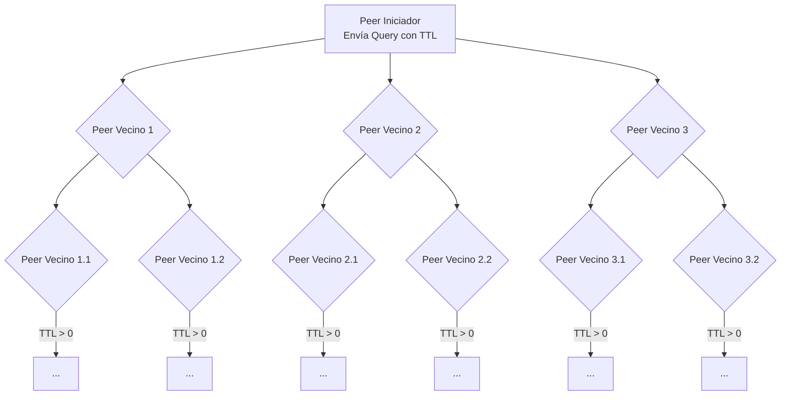
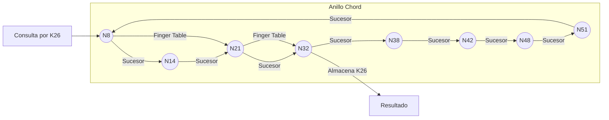

# Computación Distribuida - Búsqueda descentralizada en redes peer to peer

## 4.2 Búsqueda de datos en redes peer-to-peer.

---

La búsqueda de datos es uno de los desafíos fundamentales en las redes peer-to-peer (P2P). A diferencia de los sistemas centralizados donde existe un índice global, en las redes P2P la información está distribuida entre todos los nodos y debe ser localizada de manera eficiente sin una autoridad central. Esta guía explora los principales algoritmos y técnicas para la búsqueda de datos en redes P2P.

### Conceptos Fundamentales

#### Definición de Búsqueda Descentralizada

La búsqueda descentralizada en redes P2P se refiere al proceso de localizar información, recursos o servicios en una red distribuida donde no existe un índice centralizado. Cada nodo posee sólo conocimiento parcial de la red y debe colaborar con otros nodos para encontrar los datos solicitados.

#### Métricas de Desempeño

Para evaluar la eficiencia de los algoritmos de búsqueda se utilizan varias métricas:

- **Recall:** Fracción de resultados relevantes que son efectivamente recuperados

  $$
  \text{Recall} = \frac{\text{Documentos relevantes recuperados}}{\text{Total de documentos relevantes}}
  $$

- **Precisión:** Fracción de resultados recuperados que son relevantes

  $$
  \text{Precisión} = \frac{\text{Documentos relevantes recuperados}}{\text{Total de documentos recuperados}}
  $$

- **Tiempo de respuesta:** Latencia entre la emisión de una consulta y la recepción de resultados

- **Ancho de banda consumido:** Cantidad de datos transmitidos durante el proceso de búsqueda

### Algoritmos de Búsqueda en Redes No Estructuradas

#### Búsqueda por Inundación (Flooding)

Es el algoritmo más básico donde cada nodo reenvía la consulta a todos sus vecinos excepto al que se la envió.

```python
def flooding_search(node, query, ttl, visited=set()):
    """
    Algoritmo de búsqueda por inundación
    node: nodo actual
    query: consulta a buscar
    ttl: tiempo de vida del mensaje
    visited: conjunto de nodos ya visitados
    """
    if ttl <= 0:
        return []

    if node in visited:
        return []

    visited.add(node)

    results = []
    # Buscar localmente
    if node.has_data(query):
        results.append((node, node.get_data(query)))

    # Reenviar a vecinos
    for neighbor in node.neighbors:
        if neighbor not in visited:
            results.extend(flooding_search(neighbor, query, ttl-1, visited))

    return results
```

##### Análisis de Complejidad

El número de mensajes generados por una búsqueda por inundación con TTL $t$ en una red con grado promedio $d$ es:

$$
M = \sum_{k=1}^{t} d(d-1)^{k-1} = O(d^t)
$$

Este crecimiento exponencial hace que el flooding no sea escalable para redes grandes.

#### Búsqueda por Caminata Aleatoria (Random Walk)

En este enfoque, en lugar de reenviar la consulta a todos los vecinos, se elige un subconjunto aleatorio.

```python
def random_walk_search(node, query, walk_length, num_walks=1):
    """
    Algoritmo de búsqueda por caminata aleatoria
    node: nodo inicial
    query: consulta a buscar
    walk_length: longitud de cada caminata
    num_walks: número de caminatas paralelas
    """
    all_results = []

    for _ in range(num_walks):
        current = node
        results = []

        for _ in range(walk_length):
            # Buscar localmente
            if current.has_data(query):
                results.append((current, current.get_data(query)))

            # Elegir próximo nodo aleatoriamente
            if current.neighbors:
                current = random.choice(current.neighbors)
            else:
                break

        all_results.extend(results)

    return all_results
```

#### Búsqueda Informada por Indicios (Informed Search)

Los algoritmos informados utilizan conocimiento sobre la red o los datos para dirigir la búsqueda de manera más eficiente.

```python
def informed_search(node, query, ttl, heuristic):
    """
    Algoritmo de búsqueda informada por heurística
    node: nodo actual
    query: consulta a buscar
    ttl: tiempo de vida del mensaje
    heuristic: función heurística para priorizar vecinos
    """
    if ttl <= 0:
        return []

    # Buscar localmente
    results = []
    if node.has_data(query):
        results.append((node, node.get_data(query)))

    # Ordenar vecinos por heurística
    neighbors = sorted(node.neighbors,
                      key=lambda n: heuristic(n, query),
                      reverse=True)

    # Buscar en los mejores vecinos primero
    for neighbor in neighbors[:min(3, len(neighbors))]:  # Top 3 vecinos
        results.extend(informed_search(neighbor, query, ttl-1, heuristic))

    return results
```

### Algoritmos de Búsqueda en Redes Estructuradas (DHT)

#### Búsqueda en Chord

Chord es una DHT popular que organiza los nodos en un anillo lógico y utiliza tablas de finger para búsquedas eficientes.

```python
class ChordNode:
    def __init__(self, node_id, m=160):
        self.node_id = node_id  # ID en el espacio 0..2^m-1
        self.m = m
        self.finger_table = [None] * m
        self.predecessor = None
        self.data_store = {}

    def find_successor(self, id):
        """Encuentra el nodo responsable de un ID dado"""
        if self.is_responsible(id):
            return self
        else:
            # Encontrar el nodo más cercano que precede a id
            n = self.closest_preceding_node(id)
            return n.find_successor(id)

    def closest_preceding_node(self, id):
        """Encuentra el nodo más cercano que precede a id en la finger table"""
        for i in range(self.m-1, -1, -1):
            if (self.finger_table[i] is not None and
                self.is_between(self.finger_table[i].node_id, self.node_id, id)):
                return self.finger_table[i]
        return self

    def is_responsible(self, id):
        """Determina si este nodo es responsable del ID dado"""
        # En Chord, un nodo es responsable de los IDs entre su predecesor y él mismo
        if self.predecessor is None:
            return True
        return self.is_between(id, self.predecessor.node_id, self.node_id)

    def is_between(self, id, a, b):
        """Determina si id está en el intervalo (a, b] en el anillo circular"""
        if a < b:
            return a < id <= b
        else:  # El intervalo cruza el punto 0
            return id > a or id <= b

    def get(self, key):
        """Obtiene el valor asociado a una clave"""
        # Hash de la clave para obtener su ID
        key_id = hash(key) % (2**self.m)
        # Encontrar el nodo responsable
        responsible_node = self.find_successor(key_id)
        # Obtener el valor del nodo responsable
        return responsible_node.data_store.get(key)

    def put(self, key, value):
        """Almacena un valor asociado a una clave"""
        # Hash de la clave para obtener su ID
        key_id = hash(key) % (2**self.m)
        # Encontrar el nodo responsable
        responsible_node = self.find_successor(key_id)
        # Almacenar el valor en el nodo responsable
        responsible_node.data_store[key] = value
```

##### Complejidad de Búsqueda en Chord

En una red Chord con $N$ nodos, el número de saltos requerido para encontrar un recurso es:

$$
O(\log N)
$$

Cada nodo mantiene una tabla de enrutamiento con $O(\log N)$ entradas.

#### Búsqueda en Kademlia

Kademlia es otra DHT popular que utiliza la distancia XOR para organizar los nodos y optimizar las búsquedas.

```python
class KademliaNode:
    def __init__(self, node_id, k=20):
        self.node_id = node_id
        self.k = k  # Tamaño de los buckets
        self.kbuckets = [[] for _ in range(160)]  # 160 bits de ID
        self.data_store = {}

    def distance(self, id1, id2):
        """Calcula la distancia XOR entre dos IDs"""
        return id1 ^ id2

    def find_node(self, target_id):
        """Encuentra los k nodos más cercanos a target_id"""
        # Inicializar con los nodos conocidos más cercanos
        closest_nodes = self.collect_closest_nodes(target_id, self.k)

        # Iterativamente consultar para refinar la lista
        contacted = set()
        while True:
            # Seleccionar α nodos no contactados más cercanos
            to_contact = [n for n in closest_nodes if n not in contacted][:3]

            if not to_contact:
                break

            # Contactar estos nodos
            for node in to_contact:
                contacted.add(node)
                # Obtener sus k nodos más cercanos a target_id
                their_closest = node.find_nodes(target_id)
                # Fusionar con nuestra lista
                closest_nodes = self.merge_node_lists(closest_nodes, their_closest, target_id, self.k)

            # Si no obtenemos nodos más cercanos, terminamos
            if all(n in contacted for n in closest_nodes[:self.k]):
                break

        return closest_nodes[:self.k]

    def get(self, key):
        """Obtiene el valor asociado a una clave"""
        key_id = hash(key)
        # Encontrar los k nodos más cercanos a key_id
        closest_nodes = self.find_node(key_id)

        # Preguntar a estos nodos por el valor
        for node in closest_nodes:
            if key in node.data_store:
                return node.data_store[key]

        return None

    def put(self, key, value):
        """Almacena un valor en los k nodos más cercanos a la clave"""
        key_id = hash(key)
        # Encontrar los k nodos más cercanos a key_id
        closest_nodes = self.find_node(key_id)

        # Almacenar el valor en estos nodos
        for node in closest_nodes:
            node.data_store[key] = value
```

### Búsqueda por Contenido y Búsqueda Semántica

#### Índices Distribuidos Invertidos

Para búsquedas por contenido, las redes P2P pueden implementar índices invertidos distribuidos.

```python
class DistributedInvertedIndex:
    def __init__(self, dht):
        self.dht = dht  # Una DHT subyacente para almacenamiento

    def index_document(self, doc_id, content):
        """Indexa un documento"""
        terms = self.extract_terms(content)
        for term in terms:
            # Almacenar la referencia al documento bajo el término
            current_list = self.dht.get(term) or []
            if doc_id not in current_list:
                current_list.append(doc_id)
                self.dht.put(term, current_list)

    def search(self, query_terms):
        """Busca documentos que contengan todos los términos de la consulta"""
        if not query_terms:
            return []

        # Obtener listas de documentos para cada término
        doc_lists = []
        for term in query_terms:
            doc_list = self.dht.get(term) or []
            doc_lists.append(set(doc_list))

        # Intersección de todas las listas
        if not doc_lists:
            return []

        result = doc_lists[0]
        for doc_set in doc_lists[1:]:
            result = result.intersection(doc_set)

        return list(result)

    def extract_terms(self, content):
        """Extrae términos de un contenido (simplificado)"""
        # Implementación básica: split por espacios y limpieza
        terms = content.lower().split()
        return [term.strip('.,!?;:()[]{}"\'') for term in terms if term.strip('.,!?;:()[]{}"\'')]
```

### Diagramas de Flujo de Búsqueda

#### Búsqueda por Inundación



#### Búsqueda en DHT Chord



### Ejercicios Propuestos

1. **Análisis de Complejidad:** Para una red con 10,000 nodos y grado promedio 5, compara el número de mensajes generados por:
   - Flooding con TTL=5
   - 5 caminatas aleatorias de longitud 10
   - Búsqueda en Chord

2. **Implementación de Chord:** Implementa el algoritmo de búsqueda en Chord en Python. Crea una red simulada con 16 nodos y prueba la búsqueda de diferentes claves.

3. **Optimización de Búsqueda:** Diseña una función heurística para búsqueda informada que utilice:
   - Historial de consultas previas
   - Perfiles de contenido de nodos
   - Latencia de red

4. **Búsqueda Semántica:** Extiende el índice invertido distribuido para soportar:
   - Búsqueda por frases
   - Ranking de resultados por relevancia
   - Expansión de consultas con sinónimos

5. **Resistencia a Fallos:** Analiza cómo afecta la salida de nodos a los diferentes algoritmos de búsqueda y propone mecanismos de tolerancia a fallos para cada caso.

### Referencias

1. **Easley, D., & Kleinberg, J. (2010).** _Networks, Crowds, and Markets: Reasoning about a Highly Connected World._ Cambridge University Press. (Capítulos 2, 13 y 14 sobre redes complejas y búsqueda).

2. **Stoica, I., Morris, R., Karger, D., Kaashoek, M. F., & Balakrishnan, H. (2001).** _Chord: A Scalable Peer-to-peer Lookup Protocol for Internet Applications._ IEEE/ACM Transactions on Networking.

3. **Maymounkov, P., & Mazières, D. (2002).** _Kademlia: A Peer-to-peer Information System Based on the XOR Metric._ Proceedings of IPTPS02.

4. **Lv, Q., Cao, P., Cohen, E., Li, K., & Shenker, S. (2002).** _Search and Replication in Unstructured Peer-to-Peer Networks._ Proceedings of the 16th International Conference on Supercomputing.

5. **Attiya, H., & Welch, J. (2004).** _Distributed Computing: Fundamentals, Simulations, and Advanced Topics._ Wiley. (Capítulos 10 y 11 sobre algoritmos distribuidos y consistencia).
