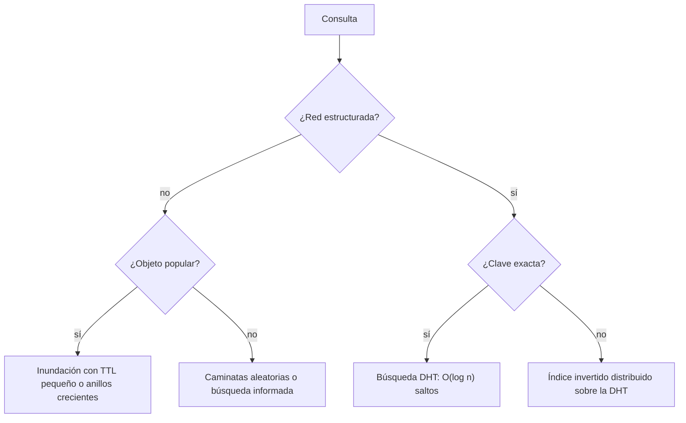

# Computación Distribuida - Búsqueda descentralizada en redes peer to peer

## 4.2 Búsqueda de datos en redes peer-to-peer.

---

El tema 4.1 clasificó las redes entre pares; este estudia cómo se **busca** en ellas. En una red no estructurada nadie sabe dónde está un objeto, y la búsqueda es un compromiso entre la probabilidad de encontrarlo y el número de mensajes: inundación, caminatas aleatorias y búsqueda informada por indicios. En una red estructurada (DHT) cualquier clave se encuentra en $O(\log n)$ saltos, pero solo por identificador exacto, y para buscar por contenido hay que construir encima un **índice invertido distribuido**. Este tema analiza cada técnica con sus métricas, compara su comportamiento ante fallas y presenta las técnicas de replicación que las hacen robustas.

### Métricas

- **Tasa de éxito:** fracción de consultas que encuentran el objeto, si existe.
- **Costo:** mensajes por consulta, y carga en los nodos más solicitados.
- **Latencia:** saltos o rondas hasta la primera respuesta.
- **Estado:** información que cada nodo guarda sobre los demás.
- **Robustez:** cómo cambian las anteriores con la rotación y las fallas.

Una magnitud clave es la **replicación**: si un objeto tiene $r$ copias en nodos al azar, una búsqueda que examina $k$ nodos distintos lo encuentra con probabilidad $1 - (1 - r/n)^k \approx 1 - e^{-kr/n}.$ Para una probabilidad de éxito constante, hay que examinar unos $n/r$ nodos.

### Redes no estructuradas

**Inundación con TTL.** Examina todos los nodos a distancia hasta $t,$ con un costo de hasta $d \frac{(d - 1)^t - 1}{d - 2}$ mensajes (tema 4.1), que crece exponencialmente con $t,$ y gran parte son duplicados. Encuentra pronto los objetos cercanos, pero un objeto raro fuera del horizonte del TTL nunca se encuentra. **Búsqueda en anillos crecientes:** repetir con TTL 1, 2, 3, ... hasta tener éxito, que ahorra mensajes cuando los objetos son populares.

**Caminatas aleatorias.** El origen lanza $k$ caminantes, cada uno avanza a un vecino al azar en cada paso y se detiene al encontrar el objeto o tras $L$ pasos; para no seguir de más, los caminantes consultan periódicamente al origen. El costo es a lo sumo $kL$ mensajes, controlado con precisión, y la cobertura crece de forma lineal con el número de pasos en lugar de exponencial (Lv y otros, 2002). En gráficas con buena expansión, una caminata de $L$ pasos visita del orden de $L$ nodos distintos, así que con $kL \approx n/r$ pasos se encuentra el objeto con probabilidad alta.

**Replicación.** Cohen y Shenker (2002) mostraron que si el número de réplicas de cada objeto es proporcional a la **raíz cuadrada** de su popularidad, se minimiza el tamaño esperado de búsqueda; la replicación en el camino de la respuesta aproxima esa regla.

**Búsqueda informada.** Cada nodo guarda indicios: qué vecino respondió antes a consultas parecidas, un resumen del contenido de sus vecinos (por ejemplo, un filtro de Bloom con sus palabras clave), o estadísticas de tiempo de respuesta. La consulta se envía al vecino con mejor puntaje en lugar de a uno al azar. Aprovecha que las consultas reales se concentran en pocos objetos populares.

### Redes estructuradas

**Chord** (tema 4.1): $O(\log n)$ saltos por búsqueda, en promedio $\frac{1}{2} \log_2 n,$ con $O(\log n)$ entradas en la tabla de dedos. **Kademlia:** $O(\log n)$ rondas con $\alpha$ consultas paralelas y cubetas de $k$ contactos. En ambas, una búsqueda siempre termina en el responsable de la clave: el éxito no es probabilístico.

**Tolerancia a fallas en DHT.** Cada nodo guarda una **lista de sucesores** de longitud $r,$ y cada clave se **replica** en los $r$ sucesores de su responsable. Si cada nodo falla con probabilidad $f$ de forma independiente, una clave se pierde con probabilidad $f^r:$ con $r = \Theta(\log n)$ réplicas, ninguna se pierde con alta probabilidad. La estabilización periódica repara las tablas tras las salidas.

### Búsqueda por contenido sobre una DHT

Una DHT solo responde `obtener(clave)`. Para buscar por palabras se construye un **índice invertido distribuido**: para cada término $t,$ el nodo responsable de $h(t)$ guarda la lista de documentos que lo contienen (la **lista de publicación**), y con **posiciones** si se quieren buscar frases.

- **Consulta de varios términos:** se obtienen las listas de cada término de sus nodos responsables y se intersecan. Para no transferir listas largas, se envía la lista más corta al nodo del siguiente término, o un filtro de Bloom de ella.
- **Frases:** un documento coincide si los términos aparecen en posiciones consecutivas, lo que se comprueba con las listas posicionales.
- **Ranking:** puntaje TF-IDF, $\text{tf}(t, d) \cdot \log \frac{N}{\text{df}(t)},$ que premia los términos frecuentes en el documento y raros en la colección.
- **Sinónimos:** la consulta se expande con un diccionario antes de buscar.

| Técnica | Mensajes | Éxito | Consultas | Fallas |
| --- | --- | --- | --- | --- |
| inundación TTL $t$ | $O(d^t)$ | alto para objetos populares | arbitrarias | se degrada suavemente |
| $k$ caminatas de $L$ pasos | $O(kL)$ | crece con $kL r / n$ | arbitrarias | robusto |
| búsqueda informada | menor con el tiempo | mejora con el uso | arbitrarias | indicios obsoletos |
| DHT | $O(\log n)$ | 100% si hay réplica viva | clave exacta | réplicas en $r$ sucesores |



### Implementación en Python

El programa compara la inundación y las caminatas aleatorias en una red de 10 000 nodos con 1, 10 y 100 réplicas del objeto (ejercicio 1); implementa Chord con 16 nodos cuyos identificadores son SHA-1 módulo 256 y verifica todas las búsquedas (ejercicio 2); simula una búsqueda informada en la que cada búsqueda exitosa deja indicios en los nodos de su camino, con consultas de popularidad Zipf (ejercicio 3); construye un índice invertido distribuido sobre el Chord con TF-IDF, sinónimos y frases (ejercicio 4), y mide el efecto de las fallas en la DHT con réplicas y en la inundación (ejercicio 5).

```python
import hashlib, math, random
from collections import defaultdict, Counter
import networkx as nx

random.seed(42)

# --- Ejercicio 1: inundación, caminatas aleatorias y Chord ---
G = nx.random_regular_graph(5, 10000, seed=1)
def coloca(r):
    return set(random.sample(range(10000), r))

def inundacion(G, s, ttl, tiene):
    vistos, frontera, msgs = {s}, [(s, None)], 0
    for _ in range(ttl):
        nueva = []
        for u, de in frontera:
            for v in G[u]:
                if v == de: continue
                msgs += 1
                if v not in vistos:
                    vistos.add(v); nueva.append((v, u))
        frontera = nueva
    return bool(vistos & tiene), msgs

def caminatas(G, s, k, L, tiene):
    msgs = 0
    for _ in range(k):
        u = s
        for _ in range(L):
            u = random.choice(list(G[u])); msgs += 1
            if u in tiene:
                return True, msgs
    return False, msgs

print("ejercicio 1: 10 000 nodos de grado 5, 200 consultas por réplica")
for r in (1, 10, 100):
    res = {"inund": [0, 0], "cam": [0, 0], "cam_larga": [0, 0]}
    for _ in range(200):
        tiene, s = coloca(r), random.randrange(10000)
        for nombre, f in (("inund", lambda: inundacion(G, s, 5, tiene)),
                          ("cam", lambda: caminatas(G, s, 5, 10, tiene)),
                          ("cam_larga", lambda: caminatas(G, s, 16, 1024, tiene))):
            ok, m = f(); res[nombre][0] += ok; res[nombre][1] += m
    print(f"   {r:3} réplicas: inundación TTL 5 éxito {res['inund'][0] / 2:5.1f}% con {res['inund'][1] / 200:6.0f} msgs;"
          f" 5 caminatas de 10: {res['cam'][0] / 2:5.1f}% con {res['cam'][1] / 200:4.0f};"
          f" 16 caminatas de 1024: {res['cam_larga'][0] / 2:5.1f}% con {res['cam_larga'][1] / 200:6.0f}")
print(f"   Chord con 10 000 nodos: unos (1/2) lg n = {0.5 * math.log2(10000):.1f} saltos, encuentra siempre la clave")

# --- Ejercicio 2: Chord con 16 nodos ---
M = 8
def h(x): return int(hashlib.sha1(str(x).encode()).hexdigest(), 16) % 2 ** M

class Chord:
    def __init__(self, ids, r=3):
        self.ids, self.r = sorted(ids), r
    def sucesor(self, k, vivos=None):
        vivos = self.ids if vivos is None else vivos
        for i in vivos:
            if i >= k: return i
        return vivos[0]
    def busca(self, n, k):
        ruta = [n]
        def entre(x, a, b, der=True):
            return (a < x <= b if der else a < x < b) if a < b else ((x > a or x <= b) if der else (x > a or x < b))
        while True:
            s = self.sucesor((n + 1) % 2 ** M)
            if entre(k, n, s):
                return s, ruta + [s]
            dedos = [self.sucesor((n + 2 ** i) % 2 ** M) for i in range(M)]
            n = next((f for f in reversed(dedos) if entre(f, n, k, False)), s)
            ruta.append(n)

nodos = sorted({h(f"nodo{i}") for i in range(16)})
ch = Chord(nodos)
print("ejercicio 2: identificadores de 16 nodos (SHA-1 mod 256):", nodos)
for clave in ("tesis.pdf", "musica.mp3", "datos.csv"):
    k = h(clave); dueño, ruta = ch.busca(nodos[0], k)
    print(f"   '{clave}' -> clave {k:3}, responsable {dueño:3}, ruta desde {nodos[0]}: {ruta}")
ok = all(ch.busca(n, k)[0] == ch.sucesor(k) for n in nodos for k in range(2 ** M))
print("   todas las búsquedas (16 orígenes x 256 claves) correctas:", ok)

# --- Ejercicio 3: búsqueda informada por historial ---
# Las consultas siguen una distribución de Zipf; cada nodo recuerda qué vecino respondió cada objeto.
Gs = nx.random_regular_graph(4, 2000, seed=3)
objetos = list(range(200))
dueño = {o: random.randrange(2000) for o in objetos}
pesos = [1 / (i + 1) for i in objetos]
memoria = defaultdict(dict)          # memoria[nodo][objeto] = vecino que llevó al objeto

def busca_informada(s, o, L=400):
    u, camino = s, [s]
    for _ in range(L):
        if u == dueño[o]:
            for a, b in zip(camino, camino[1:]):     # el camino exitoso deja indicios
                memoria[a][o] = b
            return len(camino) - 1
        u = memoria[u].get(o) or random.choice(list(Gs[u]))
        camino.append(u)
    return None

for fase in range(4):
    largos = [busca_informada(random.randrange(2000), random.choices(objetos, pesos)[0]) for _ in range(2000)]
    ok = [x for x in largos if x is not None]
    print(f"ejercicio 3: bloque {fase + 1} de 2000 consultas: éxito {len(ok) / 20:.1f}%,"
          f" longitud media {sum(ok) / len(ok):.1f}")

# --- Ejercicio 4: índice invertido distribuido ---
docs = {1: "la red de pares distribuye archivos entre pares",
        2: "una tabla de dispersion distribuida guarda claves",
        3: "la busqueda en la red usa tablas de dispersion",
        4: "los pares comparten musica y archivos en la red"}
sinonimos = {"ficheros": ["archivos"], "nodos": ["pares"]}
indice = defaultdict(lambda: defaultdict(list))         # término -> documento -> posiciones
for d, texto in docs.items():
    for pos, t in enumerate(texto.split()):
        indice[t][d].append(pos)
nodo_de = {t: ch.sucesor(h(t)) for t in indice}           # cada término vive en un nodo de Chord
N = len(docs)

def tfidf(term, d):
    tf = len(indice[term][d]); df = len(indice[term])
    return tf * math.log(N / df) if df else 0

def consulta(texto):
    terms = []
    for t in texto.split():
        terms += sinonimos.get(t, [t])
    puntaje = Counter()
    for t in terms:
        for d in indice.get(t, {}):
            puntaje[d] += tfidf(t, d)
    return [(d, round(p, 3)) for d, p in puntaje.most_common()], sorted({nodo_de[t] for t in terms if t in nodo_de})

def frase(texto):
    ts = texto.split()
    cand = set(indice[ts[0]])
    for t in ts[1:]:
        cand &= set(indice[t])
    return sorted(d for d in cand if any(all(p + i in indice[t][d] for i, t in enumerate(ts)) for p in indice[ts[0]][d]))

print("ejercicio 4: 'pares archivos' ->", consulta("pares archivos"))
print("   con sinónimos, 'nodos ficheros' ->", consulta("nodos ficheros"))
print("   frase 'la red' ->", frase("la red"), "| frase 'red de pares' ->", frase("red de pares"),
      "| frase 'tablas de dispersion' ->", frase("tablas de dispersion"))

# --- Ejercicio 5: fallas ---
print("ejercicio 5: fracción de nodos que fallan")
grande = Chord(random.sample(range(2 ** 16), 1000))
for f in (0.1, 0.3, 0.5):
    vivos = sorted(random.sample(grande.ids, int(1000 * (1 - f))))
    perdidas = {r: 0 for r in (1, 3, 8)}
    for _ in range(2000):
        k = random.randrange(2 ** 16)
        i = next((j for j, x in enumerate(grande.ids) if x >= k), 0)
        for r in perdidas:                         # la clave se replica en sus r sucesores
            replicas = {grande.ids[(i + j) % 1000] for j in range(r)}
            perdidas[r] += not (replicas & set(vivos))
    exito_inund = 0
    vivosG = set(random.sample(range(10000), int(10000 * (1 - f))))
    H = G.subgraph(vivosG)
    for _ in range(200):
        tiene = coloca(10) & vivosG
        s = random.choice(list(vivosG))
        exito_inund += inundacion(H, s, 5, tiene)[0]
    print(f"   f = {f:.0%}: claves perdidas en la DHT con 1, 3 y 8 réplicas:"
          f" {perdidas[1] / 20:.1f}%, {perdidas[3] / 20:.1f}%, {perdidas[8] / 20:.2f}%;"
          f" inundación TTL 5 con 10 réplicas: éxito {exito_inund / 2:.1f}%")
```

Salida:

```text
ejercicio 1: 10 000 nodos de grado 5, 200 consultas por réplica
     1 réplicas: inundación TTL 5 éxito  14.0% con   1671 msgs; 5 caminatas de 10:   0.5% con   50; 16 caminatas de 1024:  69.0% con   9475
    10 réplicas: inundación TTL 5 éxito  89.0% con   1669 msgs; 5 caminatas de 10:   2.0% con   50; 16 caminatas de 1024: 100.0% con   1261
   100 réplicas: inundación TTL 5 éxito 100.0% con   1670 msgs; 5 caminatas de 10:  37.0% con   39; 16 caminatas de 1024: 100.0% con    139
   Chord con 10 000 nodos: unos (1/2) lg n = 6.6 saltos, encuentra siempre la clave
ejercicio 2: identificadores de 16 nodos (SHA-1 mod 256): [27, 38, 40, 44, 86, 109, 112, 115, 120, 122, 135, 138, 161, 178, 184, 217]
   'tesis.pdf' -> clave 255, responsable  27, ruta desde 27: [27, 161, 217, 27]
   'musica.mp3' -> clave 246, responsable  27, ruta desde 27: [27, 161, 217, 27]
   'datos.csv' -> clave 185, responsable 217, ruta desde 27: [27, 161, 178, 184, 217]
   todas las búsquedas (16 orígenes x 256 claves) correctas: True
ejercicio 3: bloque 1 de 2000 consultas: éxito 69.6%, longitud media 71.9
ejercicio 3: bloque 2 de 2000 consultas: éxito 85.2%, longitud media 63.9
ejercicio 3: bloque 3 de 2000 consultas: éxito 91.5%, longitud media 62.2
ejercicio 3: bloque 4 de 2000 consultas: éxito 94.8%, longitud media 60.6
ejercicio 4: 'pares archivos' -> ([(1, 2.079), (4, 1.386)], [27, 161])
   con sinónimos, 'nodos ficheros' -> ([(1, 2.079), (4, 1.386)], [27, 161])
   frase 'la red' -> [1, 3, 4] | frase 'red de pares' -> [1] | frase 'tablas de dispersion' -> [3]
ejercicio 5: fracción de nodos que fallan
   f = 10%: claves perdidas en la DHT con 1, 3 y 8 réplicas: 9.8%, 0.0%, 0.00%; inundación TTL 5 con 10 réplicas: éxito 58.0%
   f = 30%: claves perdidas en la DHT con 1, 3 y 8 réplicas: 29.2%, 1.9%, 0.00%; inundación TTL 5 con 10 réplicas: éxito 21.5%
   f = 50%: claves perdidas en la DHT con 1, 3 y 8 réplicas: 50.8%, 11.1%, 0.00%; inundación TTL 5 con 10 réplicas: éxito 8.5%
```

### Ejercicios Propuestos

1. **Costos.** En una red de 10 000 nodos con grado medio 5, compara los mensajes de una inundación con TTL 5, de 5 caminatas aleatorias de longitud 10 y de una búsqueda en Chord.

2. **Chord.** Implementa la búsqueda de Chord en Python, con una red simulada de 16 nodos, y prueba la búsqueda de distintas claves.

3. **Búsqueda informada.** Diseña una función heurística para búsqueda informada que use el historial de consultas, perfiles de contenido de los nodos y la latencia de la red.

4. **Búsqueda semántica.** Extiende el índice invertido distribuido para buscar frases, ordenar los resultados por relevancia y expandir las consultas con sinónimos.

5. **Fallas.** Analiza cómo afecta la salida de nodos a cada algoritmo de búsqueda y propone mecanismos de tolerancia a fallas.

### Soluciones

**Ejercicio 1.** **Inundación con TTL 5:** a lo sumo $5 \cdot \frac{4^5 - 1}{3} = 1705$ mensajes; en la simulación, unos 1670, casi todos útiles porque con TTL 5 la red aleatoria aún parece un árbol. **5 caminatas de 10:** exactamente 50 mensajes, pero visitan unos 50 nodos, el 0.5% de la red. **Chord:** unos $\frac{1}{2} \log_2 10\,000 \approx 6.6$ saltos y siempre encuentra la clave. La simulación muestra el compromiso: con un objeto de una sola réplica, la inundación acierta el 14% de las veces y las 5 caminatas cortas casi nunca; con 100 réplicas, la inundación siempre acierta, pero gasta 1670 mensajes cuando 16 caminatas largas, que se detienen al primer acierto, necesitan 139. Las caminatas son mucho más baratas cuando el objeto es popular, porque se detienen pronto.

**Ejercicio 2.** Es la clase `Chord` del programa. Las claves se obtienen dispersando el nombre del archivo con SHA-1, como en el Chord real. La clave 255 de "tesis.pdf" es mayor que todos los identificadores, así que su responsable es el primero, 27, dando la vuelta al anillo; la ruta desde 27 recorre dedos cada vez más cercanos: $27 \to 161 \to 217 \to 27.$ Las 4096 combinaciones de origen y clave llegan al responsable correcto.

**Ejercicio 3.** Una heurística para elegir el vecino $v$ al que se reenvía una consulta $q:$

$$\text{puntaje}(v, q) = w_1 \, \text{aciertos}(v, q) + w_2 \, \text{sim}(\text{perfil}(v), q) - w_3 \, \text{latencia}(v),$$

donde los aciertos cuentan las consultas parecidas que $v$ respondió antes, con decaimiento exponencial para olvidar lo viejo; el perfil es un resumen del contenido alcanzable a través de $v,$ por ejemplo un vector de términos o un filtro de Bloom, y la similitud es el coseno; la latencia es un promedio móvil del tiempo de respuesta. Para no quedarse siempre en el mismo vecino, con probabilidad $\epsilon$ se elige uno al azar (exploración). El programa implementa la versión más simple, solo con el historial: cada búsqueda exitosa deja en los nodos de su camino un indicio hacia el objeto, y con consultas de popularidad Zipf la tasa de éxito sube del 70% al 95% en cuatro bloques de consultas.

**Ejercicio 4.** Ver el programa. Cada término se guarda en el nodo de Chord responsable de su dispersión, con su lista de documentos y posiciones. La consulta "pares archivos" visita los nodos de ambos términos y ordena por TF-IDF: el documento 1, que contiene "pares" dos veces, queda primero. Con la tabla de sinónimos, "nodos ficheros" se reescribe a "pares archivos" y da el mismo resultado. La búsqueda de frases interseca las listas y comprueba posiciones consecutivas: "red de pares" solo aparece en el documento 1, aunque los tres términos aparecen en otros.

**Ejercicio 5.**

- **Inundación:** no necesita reparación, pero la red se adelgaza: con el 10% de nodos caídos, el éxito con 10 réplicas baja del 89% al 58%, y con el 50% al 8.5%, porque el horizonte del TTL abarca menos nodos y también caen réplicas. Mecanismos: mantener un grado mínimo reconectándose a nodos nuevos, aumentar el TTL de forma adaptativa y replicar más.
- **Caminatas:** igual de robustas; un caminante que llega a un nodo caído elige otro vecino.
- **Búsqueda informada:** los indicios apuntan a nodos que ya no están; se necesita caducidad de los indicios y respaldo con búsqueda aleatoria.
- **DHT:** sin réplicas, se pierde exactamente la fracción $f$ de las claves; con $r$ réplicas en los sucesores, $f^r:$ con el 30% de fallas, 1.9% con 3 réplicas y nada con 8. Además, listas de sucesores y estabilización periódica para que las rutas sigan funcionando.

### Referencias

1. Lv, Q., Cao, P., Cohen, E., Li, K., and Shenker, S., Search and replication in unstructured peer-to-peer networks. _Proceedings of the 16th International Conference on Supercomputing_, 2002.
2. Cohen, E., and Shenker, S., Replication strategies in unstructured peer-to-peer networks. _ACM SIGCOMM_, 2002.
3. Stoica, I., et al., Chord: a scalable peer-to-peer lookup protocol for Internet applications. _IEEE/ACM Transactions on Networking_ 11(1), 2003.
4. Li, J., Loo, B. T., Hellerstein, J. M., Kaashoek, M. F., Karger, D., and Morris, R., On the feasibility of peer-to-peer web indexing and search. _IPTPS_, 2003.
