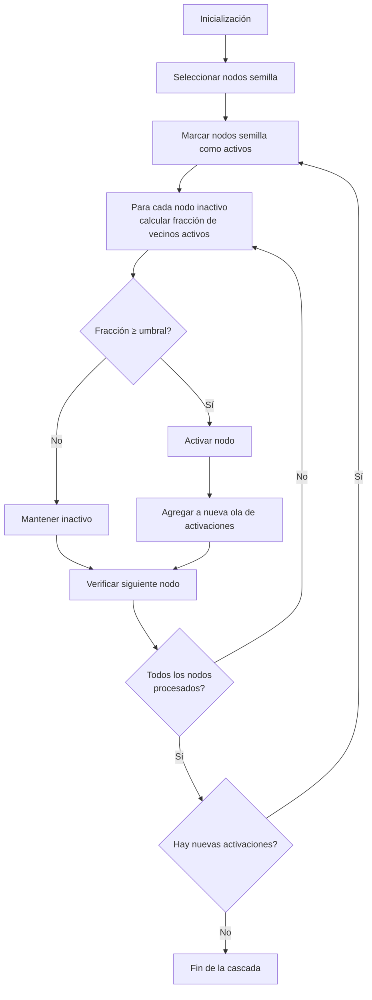

# Computación Distribuida - Comportamiento de cascada en redes

## 5.1 Comportamiento de cascada en redes.

---

El comportamiento de cascada es un fenómeno fundamental en sistemas distribuidos donde una acción o evento se propaga a través de una red, afectando a múltiples nodos de manera secuencial. Este concepto es crucial para entender desde fallos en redes de computadoras hasta la difusión de información en redes sociales.

### Definición Formal

Un comportamiento de cascada ocurre cuando un cambio en el estado de un nodo (por fallo, actualización o adopción de una tecnología) desencadena una secuencia de cambios similares en nodos vecinos, propagándose a través de la red. Matemáticamente, se modela como un proceso de difusión donde la probabilidad de que un nodo $i$ cambie su estado depende del estado de sus vecinos $N(i)$.

### Modelo de Umbral Lineal

Uno de los modelos más estudiados para cascadas es el Modelo de Umbral Lineal, donde cada nodo $v$ tiene un umbral $\theta_v \in [0,1]$. El nodo adopta un nuevo comportamiento si una fracción de sus vecinos mayor o igual a su umbral ya lo ha adoptado:

$$ f(v) = \begin{cases} 1 & \text{si } \frac{|\{u \in N(v): u \text{ ha adoptado}\}|}{|N(v)|} \geq \theta_v \\\ 0 & \text{en caso contrario} \end{cases} $$

### Modelo de Cascada Independiente

En este modelo, cada arista $(u,v)$ tiene una probabilidad $p_{uv}$ de que $u$ active a $v$. La propagación ocurre de manera probabilística:

$$ P(v \text{ se activa en el paso } t) = 1 - \prod_{u \in N_{act}(v)} (1 - p_{uv}) $$

donde $N_{act}(v)$ son los vecinos de $v$ que se activaron en el paso $t-1$.

### Ejemplo de Cascada en una Red

Consideremos una red social donde los nodos representan personas y las aristas relaciones de amistad. Si una persona adopta una nueva tecnología (ej. smartphone), sus amigos pueden adoptarla también si suficientes de sus conexiones ya la tienen.

```python
import networkx as nx
import numpy as np

def simulacion_cascada(G, nodos_semilla, umbral, pasos_max=100):
    """
    Simula una cascada en una red G
    G: grafo de NetworkX
    nodos_semilla: conjunto de nodos inicialmente activos
    umbral: diccionario {nodo: umbral}
    """
    activos = set(nodos_semilla)
    nuevos_activos = set(nodos_semilla)
    historial = [set(nodos_semilla)]

    for paso in range(pasos_max):
        siguiente_ola = set()

        for nodo in set(G.nodes()) - activos:
            vecinos_activos = len(set(G.neighbors(nodo)) & activos)
            grado = G.degree(nodo)

            if grado > 0 and vecinos_activos / grado >= umbral[nodo]:
                siguiente_ola.add(nodo)

        if not siguiente_ola:
            break

        activos |= siguiente_ola
        historial.append(siguiente_ola)

    return activos, historial

# Ejemplo de uso
G = nx.erdos_renyi_graph(100, 0.1)
umbrales = {nodo: 0.3 for nodo in G.nodes()}
semilla = [0, 1, 2]  # Nodos iniciales

activos, historial = simulacion_cascada(G, semilla, umbrales)
print(f"Nodos activos finales: {len(activos)}")
```

### Diagrama de Flujo de una Cascada



### Aplicaciones en Computación Distribuida

1. **Propagación de fallos**: En sistemas distribuidos, un fallo en un nodo puede propagarse a través de la red
2. **Actualizaciones de software**: Distribución de parches de seguridad
3. **Consenso distribuido**: Toma de decisiones coordinadas
4. **Difusión de información**: Protocolos de gossip y broadcasting

### Ejercicios Propuestos

#### Ejercicio 1: Análisis de Umbral Crítico

Dada una red con forma de estrella (un nodo central conectado a $n$ nodos periféricos), calcula el umbral mínimo que debe tener el nodo central para que ocurra una cascada completa cuando:

- Todos los nodos periféricos tienen umbral $\theta_p = 0.5$
- El nodo central tiene umbral $\theta_c$

#### Ejercicio 2: Simulación de Cascada

Implementa en Python una simulación del modelo de cascada independiente donde las probabilidades de activación $p_{uv}$ siguen una distribución normal truncada entre 0 y 1. Analiza cómo diferentes distribuciones de probabilidad afectan la propagación.

#### Ejercicio 3: Contención de Cascadas

Diseña un algoritmo que, dado un grafo $G$ y un conjunto inicial de nodos activos, identifique el conjunto mínimo de nodos a "inmunizar" (remover de la red) para prevenir una cascada completa. Evalúa su complejidad computacional.

### Caso de Estudio: Fallo en Cascada en Sistemas de Energía

El apagón del noreste de Estados Unidos en 2003 es un ejemplo clásico de cascada de fallos. Una línea de transmisión falló en Ohio, sobrecargando líneas adyacentes que posteriormente fallaron, propagándose hasta afectar a 55 millones de personas.

### Referencias

1. Easley, D., & Kleinberg, J. (2010). _Networks, Crowds, and Markets: Reasoning about a Highly Connected World_. Capítulo 19: "Cascading Behavior in Networks".
2. Watts, D. J. (2002). A simple model of global cascades on random networks. _Proceedings of the National Academy of Sciences_.
3. Kempe, D., Kleinberg, J., & Tardos, É. (2003). Maximizing the spread of influence through a social network. _Proceedings of the Ninth ACM SIGKDD International Conference on Knowledge Discovery and Data Mining_.

### Recursos Adicionales

- [Simulador interactivo de cascadas en redes](http://cascade.sims.berkeley.edu/)
- [NetworkX documentation on diffusion processes](https://networkx.org/documentation/stable/reference/algorithms/generated/networkx.algorithms.centrality.diffusion_degree_centrality.html)
- [Curso online: Social and Economic Networks](https://www.coursera.org/learn/social-economic-networks)
