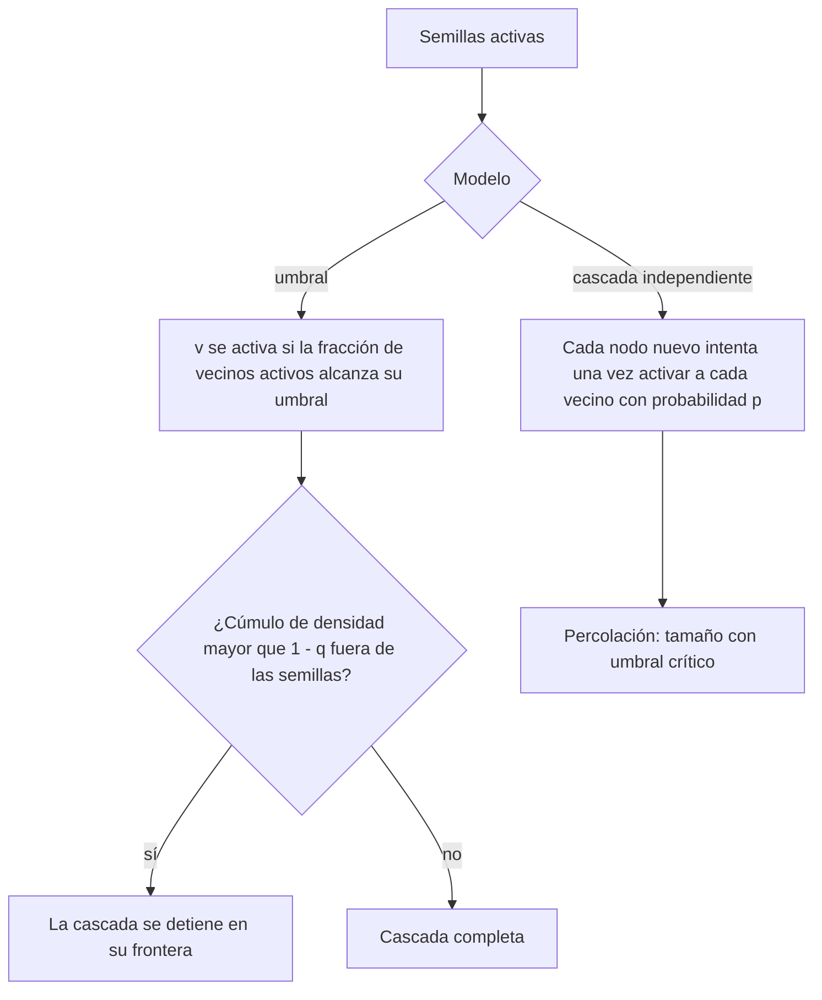

# Computación Distribuida - Comportamiento de cascada en redes

## 5.1 Comportamiento de cascada en redes.

---

Una **cascada** ocurre cuando un comportamiento (adoptar una tecnología, una opinión, una falla) se propaga por una red porque cada nodo decide en función de lo que hacen sus vecinos. Las cascadas explican por qué algunas innovaciones se extienden y otras se estancan en un grupo, por qué una sobrecarga en una línea eléctrica puede apagar un país, y cómo una campaña puede elegir a quién convencer primero. Este tema presenta los dos modelos fundamentales, el de **umbral** y el de **cascada independiente**, demuestra la caracterización de cuándo una cascada se detiene mediante **cúmulos**, y analiza la contención de cascadas por inmunización.

### Modelo de umbral

Cada nodo $v$ está **activo** o **inactivo** y tiene un **umbral** $\theta_v \in [0, 1].$ Un conjunto inicial $S$ de **semillas** está activo; en cada paso, un nodo inactivo se activa si la fracción de sus vecinos activos es al menos $\theta_v:$

$$\frac{|\{u \in N(v) : u \text{ activo}\}|}{\deg(v)} \geq \theta_v.$$

Los nodos activos no se desactivan, así que el proceso termina en a lo sumo $n$ pasos. En el **modelo de umbral lineal** general, cada arista tiene un peso $w_{uv}$ con $\sum_u w_{uv} \leq 1$ y se compara la suma de pesos de los vecinos activos con el umbral, que en la versión de Kempe, Kleinberg y Tardos se elige al azar uniforme en $[0, 1].$

**Motivación con un juego de coordinación.** Si un nodo gana $a$ por cada vecino con el que comparte la tecnología nueva $A$ y $b$ por cada vecino con la vieja $B,$ adopta $A$ si una fracción $p$ de sus vecinos la usa y $p a \geq (1 - p) b,$ es decir $p \geq q = \frac{b}{a + b}.$ Todos los nodos tienen el mismo umbral $q.$

### Cúmulos que bloquean

Un **cúmulo de densidad** $\rho$ es un conjunto $C$ de nodos en el que cada nodo tiene al menos una fracción $\rho$ de sus vecinos dentro de $C.$

**Teorema** (Easley y Kleinberg, a partir de Morris, 2000). Con umbral común $q$ y semillas $S,$ la cascada es **completa** (activa todos los nodos) si y solo si fuera de $S$ no hay ningún cúmulo de densidad mayor que $1 - q.$

**Demostración.** **Primera dirección.** Si hay un cúmulo $C$ de densidad $\rho > 1 - q$ fuera de las semillas, ningún nodo de $C$ se activa jamás. Supón que $v$ es el primero de $C$ en activarse; en ese momento todos sus vecinos activos están fuera de $C,$ y son a lo sumo una fracción $1 - \rho \lt q$ de sus vecinos, así que no alcanza su umbral: contradicción. **Segunda dirección.** Si la cascada se detiene sin activar todo, sea $C$ el conjunto de nodos inactivos al final. Cada $v \in C$ no se activó, así que menos de una fracción $q$ de sus vecinos está activa, es decir, más de $1 - q$ están en $C:$ $C$ es un cúmulo de densidad mayor que $1 - q$ fuera de $S.$ $\blacksquare$

El teorema dice que los obstáculos a la difusión son exactamente las comunidades **cerradas**: grupos que se relacionan mucho más entre sí que con el exterior. Al revés, para que una idea entre en un cúmulo denso hay que sembrarla **dentro** de él.

### Modelo de cascada independiente

Cuando un nodo $u$ se activa en el paso $t,$ tiene **una sola oportunidad** de activar a cada vecino inactivo $v,$ con probabilidad $p_{uv},$ de forma independiente; si lo logra, $v$ queda activo en el paso $t + 1.$ Modela el contagio de información o de enfermedades más que la adopción por conveniencia: un solo contacto basta.

**Equivalencia con percolación.** Lanzar todas las monedas por adelantado da una gráfica aleatoria en la que cada arista $uv$ está "viva" con probabilidad $p_{uv};$ los nodos que terminan activos son exactamente los alcanzables desde $S$ por aristas vivas. Por eso el tamaño de la cascada tiene un **umbral crítico**: en una gráfica aleatoria con probabilidad uniforme $p,$ hay cascadas grandes con probabilidad positiva cuando $p$ supera $\frac{\langle k \rangle}{\langle k^2 \rangle - \langle k \rangle},$ que es casi 0 en las redes libres de escala por la varianza enorme de los grados (tema 5.3).

### Maximización y contención

- **Maximizar la influencia:** elegir $k$ semillas que maximicen el número esperado de activos $\sigma(S).$ Es NP-duro en ambos modelos, pero $\sigma$ es **monótona y submodular**, y el algoritmo voraz que agrega la semilla con mayor ganancia marginal obtiene al menos una fracción $1 - 1/e \approx 63\%$ del óptimo (Kempe, Kleinberg y Tardos, 2003). Se trata en el tema 5.2.
- **Contener:** elegir $k$ nodos que **inmunizar**, que nunca se activan, para minimizar $\sigma.$ También NP-duro en general. Heurísticas: inmunizar los nodos de mayor grado o centralidad, o los que separan a las semillas del resto.



### Implementación en Python

El programa implementa el modelo de umbral, busca el máximo umbral del centro de una estrella que permite la cascada completa (ejercicio 1) y comprueba el teorema de los cúmulos en una gráfica de cúmulos unidos en anillo y, por fuerza bruta sobre todos los subconjuntos, en 400 gráficas aleatorias. Después simula la cascada independiente en una red de Barabási y Albert con probabilidades constantes y con normales truncadas (ejercicio 2) y compara tres estrategias de inmunización (ejercicio 3).

```python
import random
from itertools import combinations
import networkx as nx

random.seed(51)

def umbral(G, semillas, theta, inmunes=frozenset()):
    """Umbral lineal determinista (pesos iguales): v se activa si la fracción de
    vecinos activos es al menos theta[v]."""
    activos = set(semillas)
    cambio = True
    while cambio:
        cambio = False
        for v in G:
            if v in activos or v in inmunes or G.degree(v) == 0:
                continue
            if sum(u in activos for u in G[v]) / G.degree(v) >= theta[v]:
                activos.add(v); cambio = True
    return activos

# --- Ejercicio 1: la estrella ---
print("ejercicio 1: estrella con centro 0 y n hojas de umbral 0.5")
for n in (4, 10):
    S = nx.star_graph(n)
    for k in (1, 2):
        semillas = list(range(1, k + 1))
        mayor = max(tc / 100 for tc in range(101)
                    if len(umbral(S, semillas, {0: tc / 100, **{i: 0.5 for i in range(1, n + 1)}})) == n + 1)
        print(f"   n = {n:2}, {k} hoja(s) semilla: cascada completa si y solo si theta_c <= {mayor:.2f} (k/n = {k / n:.2f})")
    print(f"   n = {n:2}, semilla en el centro: activa {len(umbral(S, [0], {i: 0.5 for i in range(n + 1)}))} de {n + 1}")

# --- cúmulos que bloquean (Morris; Easley y Kleinberg) ---
def densidad_cumulo(G, C):
    """Mínima fracción de vecinos dentro de C entre los nodos de C."""
    return min(sum(u in C for u in G[v]) / G.degree(v) for v in C)

G = nx.connected_caveman_graph(6, 5)          # 6 cúmulos de 5 nodos casi completos, unidos en anillo
cumulos = [set(range(5 * i, 5 * i + 5)) for i in range(6)]
print("cúmulos: densidad de cada uno", round(densidad_cumulo(G, cumulos[1]), 2))
for q in (0.1, 0.2, 0.3, 0.5):
    act = umbral(G, cumulos[0], {v: q for v in G})
    bloquea = any(densidad_cumulo(G, C) > 1 - q for C in cumulos if not C & act)
    print(f"   q = {q}: semilla = un cúmulo -> {len(act):2} de {len(G)} activos;"
          f" hay un cúmulo de densidad > 1 - q fuera de los activos: {bloquea}")

# verificación del teorema en gráficas aleatorias pequeñas
contra = 0
for _ in range(400):
    H = nx.gnp_random_graph(9, 0.4, seed=random.randrange(10**6))
    if not nx.is_connected(H): continue
    q = random.choice([0.2, 0.3, 0.4, 0.5, 0.6])
    S = set(random.sample(list(H), 2))
    completa = len(umbral(H, S, {v: q for v in H})) == len(H)
    resto = [v for v in H if v not in S]
    hay_cumulo = any(densidad_cumulo(H, set(C)) > 1 - q
                     for r in range(1, len(resto) + 1) for C in combinations(resto, r))
    contra += completa == hay_cumulo
print("   teorema (cascada completa si y solo si no hay cúmulo de densidad > 1 - q): contraejemplos", contra)

# --- Ejercicio 2: cascada independiente con probabilidades normales truncadas ---
def normal_truncada(mu, sigma):
    while True:
        x = random.gauss(mu, sigma)
        if 0 <= x <= 1:
            return x

def cascada_independiente(G, semillas, p, inmunes=frozenset()):
    activos, frontera = set(semillas), list(semillas)
    while frontera:
        nueva = []
        for u in frontera:
            for v in G[u]:
                if v not in activos and v not in inmunes and random.random() < p[(u, v)]:
                    activos.add(v); nueva.append(v)
        frontera = nueva
    return len(activos)

B = nx.barabasi_albert_graph(1000, 3, seed=5)
dirigidas = [(u, v) for u, v in B.edges()] + [(v, u) for u, v in B.edges()]
print("ejercicio 2: BA con 1000 nodos, una semilla al azar, tamaño medio de la cascada (300 corridas)")
for nombre, gen in [("constante 0.05", lambda: 0.05), ("normal(0.05, 0.05)", lambda: normal_truncada(0.05, 0.05)),
                    ("constante 0.10", lambda: 0.10), ("normal(0.10, 0.10)", lambda: normal_truncada(0.10, 0.10)),
                    ("normal(0.10, 0.30)", lambda: normal_truncada(0.10, 0.30)), ("constante 0.20", lambda: 0.20)]:
    p = {e: gen() for e in dirigidas}
    media_p = sum(p.values()) / len(p)
    tam = [cascada_independiente(B, [random.randrange(1000)], p) for _ in range(300)]
    grandes = sum(t > 100 for t in tam) / 3
    print(f"   {nombre:20} p media {media_p:.3f}: tamaño medio {sum(tam) / 300:6.1f}, cascadas de más de 100 nodos {grandes:4.1f}%")

# --- Ejercicio 3: contención por inmunización ---
p = {e: 0.15 for e in dirigidas}
semillas = random.sample(range(1000), 5)
def esperado(inmunes, reps=200):
    return sum(cascada_independiente(B, semillas, p, inmunes) for _ in range(reps)) / reps

print("ejercicio 3: cascada independiente con p = 0.15, 5 semillas; tamaño esperado tras inmunizar k nodos")
base = esperado(frozenset())
print(f"   sin inmunizar: {base:.1f}")
candidatos = [v for v in B if v not in semillas]
for k in (5, 20):
    azar = frozenset(random.sample(candidatos, k))
    grado = frozenset(sorted(candidatos, key=B.degree, reverse=True)[:k])
    vecinos = frozenset(sorted({v for s in semillas for v in B[s]} - set(semillas), key=B.degree, reverse=True)[:k])
    print(f"   k = {k:2}: al azar {esperado(azar):6.1f}; mayor grado {esperado(grado):6.1f};"
          f" vecinos de las semillas de mayor grado {esperado(vecinos):6.1f}")
```

Salida:

```text
ejercicio 1: estrella con centro 0 y n hojas de umbral 0.5
   n =  4, 1 hoja(s) semilla: cascada completa si y solo si theta_c <= 0.25 (k/n = 0.25)
   n =  4, 2 hoja(s) semilla: cascada completa si y solo si theta_c <= 0.50 (k/n = 0.50)
   n =  4, semilla en el centro: activa 5 de 5
   n = 10, 1 hoja(s) semilla: cascada completa si y solo si theta_c <= 0.10 (k/n = 0.10)
   n = 10, 2 hoja(s) semilla: cascada completa si y solo si theta_c <= 0.20 (k/n = 0.20)
   n = 10, semilla en el centro: activa 11 de 11
cúmulos: densidad de cada uno 0.75
   q = 0.1: semilla = un cúmulo -> 30 de 30 activos; hay un cúmulo de densidad > 1 - q fuera de los activos: False
   q = 0.2: semilla = un cúmulo -> 30 de 30 activos; hay un cúmulo de densidad > 1 - q fuera de los activos: False
   q = 0.3: semilla = un cúmulo ->  5 de 30 activos; hay un cúmulo de densidad > 1 - q fuera de los activos: True
   q = 0.5: semilla = un cúmulo ->  5 de 30 activos; hay un cúmulo de densidad > 1 - q fuera de los activos: True
   teorema (cascada completa si y solo si no hay cúmulo de densidad > 1 - q): contraejemplos 0
ejercicio 2: BA con 1000 nodos, una semilla al azar, tamaño medio de la cascada (300 corridas)
   constante 0.05       p media 0.050: tamaño medio    1.5, cascadas de más de 100 nodos  0.0%
   normal(0.05, 0.05)   p media 0.064: tamaño medio    2.6, cascadas de más de 100 nodos  0.0%
   constante 0.10       p media 0.100: tamaño medio    9.2, cascadas de más de 100 nodos  2.0%
   normal(0.10, 0.10)   p media 0.129: tamaño medio   36.7, cascadas de más de 100 nodos 17.7%
   normal(0.10, 0.30)   p media 0.278: tamaño medio  414.8, cascadas de más de 100 nodos 63.7%
   constante 0.20       p media 0.200: tamaño medio  196.4, cascadas de más de 100 nodos 44.7%
ejercicio 3: cascada independiente con p = 0.15, 5 semillas; tamaño esperado tras inmunizar k nodos
   sin inmunizar: 198.8
   k =  5: al azar  187.1; mayor grado   60.6; vecinos de las semillas de mayor grado  100.1
   k = 20: al azar  181.7; mayor grado   21.2; vecinos de las semillas de mayor grado   16.8
```

### Ejercicios Propuestos

1. **Umbral crítico.** En una estrella con un centro unido a $n$ hojas, todas con umbral $\theta_p = 0.5,$ ¿cuál es el máximo umbral $\theta_c$ del centro que permite una cascada completa?

2. **Cascada independiente.** Simula el modelo de cascada independiente con probabilidades $p_{uv}$ que siguen una normal truncada a $[0, 1],$ y analiza cómo afecta la distribución a la propagación.

3. **Contención.** Diseña un algoritmo que, dada una gráfica y un conjunto inicial de nodos activos, elija los nodos que conviene inmunizar para contener la cascada, y evalúa su complejidad.

### Soluciones

**Ejercicio 1.** La respuesta depende de dónde estén las semillas, que el enunciado no fijaba. **Semilla en el centro:** cada hoja tiene un solo vecino, el centro, activo: fracción $1 \geq 0.5,$ y todas se activan sin importar $\theta_c.$ **Semillas en las hojas.** Si hay $k$ hojas semilla, el centro ve una fracción $k/n$ de vecinos activos, así que se activa si y solo si $\theta_c \leq k/n;$ en ese caso, todas las hojas se activan en el paso siguiente. El máximo umbral es $\theta_c = k/n,$ que con una sola semilla es $1/n:$ cuanto más grande la estrella, más **fácil de bloquear** es la cascada desde la periferia. Es el teorema de los cúmulos: con $\theta_c > k/n,$ el conjunto de nodos no semilla es un cúmulo de densidad mayor que $1 - \theta_c$ para el centro.

**Ejercicio 2.** Lo que importa no es solo la media de $p,$ sino toda la distribución. Truncar una normal en 0 **sube** la media: con $\mu = 0.1$ y $\sigma = 0.3,$ la media real es 0.28. Además, con varianza grande hay aristas con probabilidad alta que forman "autopistas" de contagio. En la simulación, la normal $(0.10, 0.10)$ con media efectiva 0.13 produce cascadas cuatro veces mayores que la constante 0.10, y la normal $(0.10, 0.30)$ produce cascadas grandes en el 64% de los casos. El tamaño crece de forma muy no lineal alrededor del umbral crítico de percolación: de 0.05 a 0.20 de probabilidad constante, el tamaño medio pasa de 1.5 a 196 nodos.

**Ejercicio 3.** **Formulación:** dado un presupuesto de $k$ nodos, minimizar el tamaño esperado de la cascada. Es NP-duro, y en el modelo de umbral incluso es difícil de aproximar. **Algoritmos:**

- **Exacto:** probar todos los conjuntos de $k$ nodos: $\binom{n}{k}$ evaluaciones, cada una con muchas simulaciones. Solo para gráficas diminutas.
- **Voraz:** agregar en cada paso el nodo cuya inmunización más reduce el tamaño esperado estimado por simulación: $O(k n R \cdot m)$ con $R$ simulaciones. No tiene la garantía $1 - 1/e,$ porque la reducción no es submodular en general, pero funciona bien.
- **Heurísticas estructurales**, mucho más baratas: inmunizar los nodos de **mayor grado**, o los **vecinos de las semillas** que más conectan, o los nodos de un **separador** entre las semillas y el resto.

En la red libre de escala del programa, inmunizar 5 nodos al azar casi no sirve, mientras que inmunizar los 5 de mayor grado reduce la cascada de 199 a 61 nodos: los concentradores son las autopistas. Con 20 nodos, los vecinos de las semillas son aún mejores, porque cortan la cascada en su origen. Es la misma lógica de las campañas de vacunación dirigida (tema 5.3).

### Referencias

1. Easley, D., and Kleinberg, J., _Networks, Crowds, and Markets_. Cambridge University Press, 2010. Capítulo 19.
2. Morris, S., Contagion. _Review of Economic Studies_ 67(1), 2000.
3. Kempe, D., Kleinberg, J., and Tardos, É., Maximizing the spread of influence through a social network. _Proceedings of ACM KDD_, 2003.
4. Granovetter, M., Threshold models of collective behavior. _American Journal of Sociology_ 83(6), 1978.
