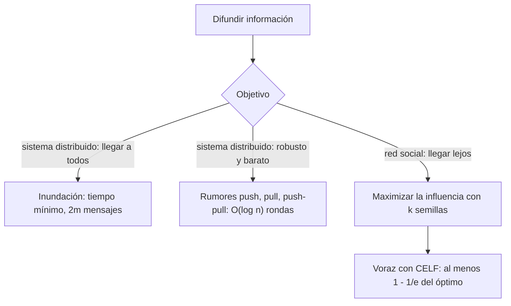

# Computación Distribuida - Comportamiento de cascada en redes

## 5.2 Difusión de información en redes.

---

La difusión de información en redes tiene dos caras. En los **sistemas distribuidos**, es un problema de ingeniería: hacer llegar una actualización a todos los nodos rápido, con pocos mensajes y a pesar de fallas, con protocolos como la inundación o los **rumores** (_gossip_). En las **redes sociales**, es un fenómeno que se observa y se quiere influir: qué tan lejos llega una noticia y a quién conviene contársela primero. Este tema compara la inundación con los protocolos de rumores push, pull y push-pull, analiza el tiempo logarítmico de los rumores, y resuelve el problema de **maximizar la influencia** con el algoritmo voraz y su garantía de $1 - 1/e.$

### Inundación y rumores

**Inundación** (tema 2.2): cada nodo que recibe el mensaje por primera vez lo reenvía a todos sus vecinos. Óptima en tiempo, igual a la excentricidad de la fuente, con $2m - (n - 1)$ mensajes, pero requiere que cada nodo contacte a todos sus vecinos y es frágil si un enlace falla en el momento del envío.

**Rumores** (Demers y otros, 1987): en cada ronda, cada nodo contacta a uno o unos pocos vecinos al azar.

- **Push:** los nodos informados envían el rumor a un vecino al azar. Al principio crece de forma exponencial, pero al final se desperdician mensajes: casi todos los contactos llegan a nodos ya informados.
- **Pull:** los nodos no informados preguntan a un vecino al azar. Al principio es lento, pero al final la fracción de no informados decae de forma **doblemente exponencial**: si queda una fracción $s,$ tras una ronda queda $s^2.$
- **Push-pull:** ambos a la vez; combina la fase rápida inicial de push con el final rápido de pull.

**Teorema** (Frieze y Grimmett, 1985; Pittel, 1987). En la gráfica completa, push informa a todos en $\log_2 n + \ln n + O(1)$ rondas con alta probabilidad, y push-pull en $\log_3 n + O(\log \log n)$ rondas (Karp y otros, 2000), con $O(n \log \log n)$ mensajes.

**Idea.** Mientras pocos nodos saben, cada uno informa a uno nuevo por ronda y los informados se duplican: $\log_2 n$ rondas para llegar a la mitad. Al final, con push, cada no informado tiene probabilidad aproximada $1 - e^{-1}$ de recibir algún mensaje por ronda, así que la fracción restante se multiplica por $1/e$ y hacen falta $\ln n$ rondas más; con pull se eleva al cuadrado, y bastan $O(\log \log n).$

**Terminación.** Con **pérdida de interés**, un nodo deja de difundir con probabilidad $1/k$ cada vez que contacta a alguien que ya sabía. Ahorra mensajes, pero una fracción de nodos queda sin informar: en la gráfica completa, aproximadamente $e^{-(k+1)}.$ Por eso se combina con **antientropía** periódica (tema 5.3).

En gráficas que no son completas, el tiempo de los rumores depende de la **conductancia**: es $O(\log n / \phi)$ para push-pull (Giakkoupis, 2011). En estrellas y redes con concentradores, push es lento, porque el centro solo puede informar a una hoja por ronda; pull es rápido, porque todas las hojas preguntan al centro a la vez.

### Difusión en redes sociales

Se modela con los mismos procesos del tema 5.1: **umbral lineal**, en el que un nodo adopta si suficientes vecinos lo hicieron, y **cascada independiente**, en el que cada nuevo adoptante tiene una oportunidad de convencer a cada vecino. La pregunta práctica es la **maximización de la influencia**: dado un presupuesto de $k$ semillas, elegir el conjunto $S$ que maximiza el número esperado de activos $\sigma(S).$

**Teorema** (Kempe, Kleinberg y Tardos, 2003). En ambos modelos, $\sigma$ es **monótona**, porque $S \subseteq T$ implica $\sigma(S) \leq \sigma(T),$ y **submodular**: la ganancia marginal $\sigma(S \cup \{v\}) - \sigma(S)$ es menor cuanto mayor es $S.$ Encontrar el óptimo es NP-duro, pero el voraz que agrega la semilla de mayor ganancia marginal da $\sigma(S_{\text{voraz}}) \geq (1 - 1/e) \, \sigma(S^*).$

**Por qué es submodular** (cascada independiente). Fijando el resultado de todas las monedas, $\sigma$ es el número de nodos alcanzables desde $S$ en la gráfica de aristas vivas: una función de cobertura, que es submodular; un promedio de funciones submodulares también lo es. **La garantía:** para funciones monótonas submodulares, si el óptimo es $\text{OPT},$ cada paso voraz cierra al menos una fracción $1/k$ de la distancia que falta al óptimo, así que tras $k$ pasos falta a lo sumo $(1 - 1/k)^k \text{OPT} \leq \text{OPT}/e$ (Nemhauser, Wolsey y Fisher, 1978).

**En la práctica:** $\sigma$ se estima por simulación de Monte Carlo, lo que es caro. La **evaluación perezosa** (CELF, Leskovec y otros, 2007) aprovecha la submodularidad: una ganancia calculada en una ronda anterior es una cota superior de la actual, y basta recalcular la del mejor candidato. Métodos posteriores muestrean conjuntos alcanzables inversos (RIS) y obtienen la misma garantía en tiempo casi lineal.



### Implementación en Python

El programa resuelve la estrella del ejercicio 1 con el modelo de umbral; compara en una red de Barabási y Albert de 200 nodos la inundación con push, pull, push-pull y push con pérdida de interés, midiendo rondas, mensajes y cobertura (ejercicio 2); y para la maximización de la influencia compara, en el club de karate, el voraz con CELF contra el óptimo por fuerza bruta y, en una red de 500 nodos, contra las heurísticas de mayor grado y al azar (ejercicio 3).

```python
import heapq, math, random
from itertools import combinations
import networkx as nx

random.seed(52)

# --- Ejercicio 1: estrella con hojas de umbral 0.6 ---
def umbral(G, S, theta):
    act, cambio = set(S), True
    while cambio:
        cambio = False
        for v in G:
            if v not in act and sum(u in act for u in G[v]) / G.degree(v) >= theta[v]:
                act.add(v); cambio = True
    return act

print("ejercicio 1: hojas con umbral 0.6; máximo umbral del centro para cascada completa desde k hojas")
for n in (5, 10, 50, 100):
    S = nx.star_graph(n)
    fila = []
    for k in (1, 3):
        mayor = max(t / 1000 for t in range(1001)
                    if len(umbral(S, range(1, k + 1), {0: t / 1000, **{i: 0.6 for i in range(1, n + 1)}})) == n + 1)
        fila.append(f"k = {k}: {mayor:.3f}")
    print(f"   n = {n:3}: " + ", ".join(fila))

# --- Ejercicio 2: inundación frente a rumores en Barabási-Albert ---
G = nx.barabasi_albert_graph(200, 2, seed=52)

def inundacion(G, s):
    inf, frontera, msgs, rondas = {s}, [(s, None)], 0, 0
    while frontera:
        nueva = []
        for u, de in frontera:
            for v in G[u]:
                if v == de: continue
                msgs += 1
                if v not in inf:
                    inf.add(v); nueva.append((v, u))
        if nueva: rondas += 1
        frontera = nueva
    return rondas, msgs, len(inf) / len(G)

def rumor(G, s, modo="push", fanout=1, k=None, max_rondas=200):
    """push: los informados envían; pull: los no informados preguntan;
    k: con 'pérdida de interés', un nodo deja de difundir con probabilidad 1/k
    cada vez que contacta a alguien que ya sabía."""
    inf, activos, msgs = {s}, {s}, 0
    for r in range(1, max_rondas + 1):
        nuevos = set()
        if modo in ("push", "pushpull"):
            for u in list(activos):
                for v in random.sample(list(G[u]), min(fanout, G.degree(u))):
                    msgs += 1
                    if v in inf or v in nuevos:
                        if k and random.random() < 1 / k:
                            activos.discard(u)
                    else:
                        nuevos.add(v)
        if modo in ("pull", "pushpull"):
            for v in G:
                if v not in inf:
                    u = random.choice(list(G[v])); msgs += 1
                    if u in inf: nuevos.add(v)
        inf |= nuevos; activos |= nuevos
        if len(inf) == len(G) or not activos:
            return r, msgs, len(inf) / len(G)
    return max_rondas, msgs, len(inf) / len(G)

def promedio(f, reps=100):
    res = [f() for _ in range(reps)]
    return [sum(x[i] for x in res) / reps for i in range(3)]

m = G.number_of_edges()
print(f"ejercicio 2: Barabási-Albert, 200 nodos, {m} aristas, 100 corridas desde nodos al azar")
filas = [("inundación", lambda: inundacion(G, random.randrange(200))),
         ("push, fanout 1", lambda: rumor(G, random.randrange(200))),
         ("push, fanout 2", lambda: rumor(G, random.randrange(200), fanout=2)),
         ("pull", lambda: rumor(G, random.randrange(200), "pull")),
         ("push-pull", lambda: rumor(G, random.randrange(200), "pushpull")),
         ("push con pérdida de interés k = 2", lambda: rumor(G, random.randrange(200), k=2)),
         ("push con pérdida de interés k = 4", lambda: rumor(G, random.randrange(200), k=4))]
for nombre, f in filas:
    r, msgs, cob = promedio(f)
    print(f"   {nombre:34} rondas {r:5.1f}  mensajes {msgs:7.0f}  cobertura {cob:6.1%}")

# --- Ejercicio 3: maximización de la influencia ---
def ic(G, S, p):
    act, fr = set(S), list(S)
    while fr:
        nuevo = []
        for u in fr:
            for v in G[u]:
                if v not in act and random.random() < p:
                    act.add(v); nuevo.append(v)
        fr = nuevo
    return len(act)

def sigma(G, S, p, R):
    return sum(ic(G, S, p) for _ in range(R)) / R

def voraz_celf(G, k, p, R):
    """Voraz con evaluación perezosa (CELF): la submodularidad permite no recalcular todo."""
    S, actual, evals = [], 0.0, 0
    cola = []
    for v in G:
        cola.append((-sigma(G, [v], p, R), v, 0)); evals += 1
    heapq.heapify(cola)
    while len(S) < k:
        g, v, ronda = heapq.heappop(cola)
        if ronda == len(S):
            S.append(v); actual -= g
        else:
            ganancia = sigma(G, S + [v], p, R) - actual; evals += 1
            heapq.heappush(cola, (-ganancia, v, len(S)))
    return S, evals

H = nx.karate_club_graph()
p, R = 0.1, 400
mejor = max(combinations(H, 2), key=lambda S: sigma(H, S, p, 200))
Sv, ev = voraz_celf(H, 2, p, R)
grado = sorted(H, key=H.degree, reverse=True)[:2]
print("ejercicio 3: club de karate, p = 0.1, k = 2 (evaluado con 5000 simulaciones)")
for nombre, S in (("óptimo por fuerza bruta", mejor), ("voraz CELF", Sv), ("mayor grado", grado)):
    print(f"   {nombre:24} {sorted(S)}: sigma = {sigma(H, S, p, 5000):.2f}")
B = nx.barabasi_albert_graph(500, 2, seed=7)
for k in (5, 10):
    Sv, ev = voraz_celf(B, k, 0.05, 100)
    grado = sorted(B, key=B.degree, reverse=True)[:k]
    azar = random.sample(list(B), k)
    print(f"   BA 500 nodos, p = 0.05, k = {k:2}: voraz {sigma(B, Sv, 0.05, 2000):6.1f} ({ev} evaluaciones, sin CELF {500 * k}),"
          f" mayor grado {sigma(B, grado, 0.05, 2000):6.1f}, al azar {sigma(B, azar, 0.05, 2000):6.1f}")
```

Salida:

```text
ejercicio 1: hojas con umbral 0.6; máximo umbral del centro para cascada completa desde k hojas
   n =   5: k = 1: 0.200, k = 3: 0.600
   n =  10: k = 1: 0.100, k = 3: 0.300
   n =  50: k = 1: 0.020, k = 3: 0.060
   n = 100: k = 1: 0.010, k = 3: 0.030
ejercicio 2: Barabási-Albert, 200 nodos, 396 aristas, 100 corridas desde nodos al azar
   inundación                         rondas   5.1  mensajes     593  cobertura 100.0%
   push, fanout 1                     rondas  43.4  mensajes    6047  cobertura 100.0%
   push, fanout 2                     rondas  22.2  mensajes    5883  cobertura 100.0%
   pull                               rondas  19.3  mensajes    2672  cobertura 100.0%
   push-pull                          rondas   9.7  mensajes    1946  cobertura 100.0%
   push con pérdida de interés k = 2  rondas  27.2  mensajes     333  cobertura  55.6%
   push con pérdida de interés k = 4  rondas  38.4  mensajes     739  cobertura  73.7%
ejercicio 3: club de karate, p = 0.1, k = 2 (evaluado con 5000 simulaciones)
   óptimo por fuerza bruta  [0, 33]: sigma = 6.38
   voraz CELF               [0, 33]: sigma = 6.39
   mayor grado              [0, 33]: sigma = 6.42
   BA 500 nodos, p = 0.05, k =  5: voraz   14.4 (519 evaluaciones, sin CELF 2500), mayor grado   14.4, al azar    6.2
   BA 500 nodos, p = 0.05, k = 10: voraz   24.8 (536 evaluaciones, sin CELF 5000), mayor grado   25.0, al azar   15.0
```

### Ejercicios Propuestos

1. **Umbral crítico.** En una estrella con un centro unido a $n$ hojas de umbral $\theta_p = 0.6,$ calcula el máximo umbral del centro que permite una difusión completa, y analiza cómo cambia al crecer $n.$

2. **Comparación.** Compara la inundación y los rumores en una red de Barabási y Albert con 200 nodos: tiempo de convergencia, número total de mensajes y cobertura final.

3. **Maximización.** Dada una red social y un presupuesto de $k$ semillas, diseña un algoritmo que elija las $k$ semillas que maximizan la difusión esperada en el modelo de cascada independiente.

### Soluciones

**Ejercicio 1.** Como en el tema 5.1, el umbral de las hojas no importa: su único vecino es el centro, y cuando este se activa ven una fracción $1 \geq 0.6.$ Con $k$ hojas semilla, el centro se activa si y solo si $\theta_c \leq k/n,$ y ese es el máximo. Al crecer $n,$ el umbral máximo **tiende a 0** como $k/n:$ una estrella grande es muy difícil de activar desde la periferia, pero muy fácil desde el centro, que activa todo de inmediato. Es la asimetría de los concentradores: su adopción es decisiva y a la vez la más difícil de conseguir por presión de los vecinos.

**Ejercicio 2.** Ver la tabla. La **inundación** es la más rápida (5 rondas) y, en esta red dispersa, la más barata: $2m - (n - 1) = 593$ mensajes. **Push** con fanout 1 tarda 43 rondas: las hojas informadas empujan una y otra vez hacia el concentrador que ya sabía, y el concentrador solo informa a un vecino por ronda. **Pull** y **push-pull** aprovechan que todas las hojas preguntan al concentrador a la vez: push-pull termina en unas 10 rondas con un tercio de los mensajes de push. La **pérdida de interés** reduce mucho los mensajes, pero deja sin informar entre una cuarta parte y casi la mitad de los nodos. Los rumores no son más eficientes que la inundación en gráficas dispersas: su ventaja es que cada nodo hace un trabajo constante por ronda, no depende de que todos los envíos tengan éxito y tolera fallas y cambios en la red.

**Ejercicio 3.** **Algoritmo voraz con CELF:**

1. Estimar por Monte Carlo $\sigma(\{v\})$ para cada nodo y ponerlos en una cola de prioridad.
2. Repetir $k$ veces: sacar el mejor candidato; si su ganancia se calculó con el conjunto actual, agregarlo a $S;$ si no, recalcular $\sigma(S \cup \{v\}) - \sigma(S)$ y devolverlo a la cola.

**Garantía:** $(1 - 1/e - \epsilon)$ del óptimo, donde $\epsilon$ viene del error de la simulación. **Costo:** sin CELF, $k n$ evaluaciones de $\sigma,$ cada una de $R$ simulaciones de $O(m):$ $O(k n R m).$ En el programa, CELF reduce las evaluaciones de 5000 a 536. En el club de karate coincide con el óptimo por fuerza bruta, los dos líderes del club, nodos 0 y 33. En redes libres de escala con $p$ pequeño, elegir los de **mayor grado** es casi igual de bueno y muchísimo más barato; la diferencia aparece cuando los concentradores están juntos y sus influencias se traslapan, donde el voraz, por la submodularidad, prefiere semillas en regiones distintas.

### Referencias

1. Demers, A., et al., Epidemic algorithms for replicated database maintenance. _Proceedings of the 6th ACM Symposium on Principles of Distributed Computing_, 1987.
2. Karp, R., Schindelhauer, C., Shenker, S., and Vöcking, B., Randomized rumor spreading. _Proceedings of the 41st IEEE Symposium on Foundations of Computer Science_, 2000.
3. Kempe, D., Kleinberg, J., and Tardos, É., Maximizing the spread of influence through a social network. _Proceedings of ACM KDD_, 2003.
4. Leskovec, J., et al., Cost-effective outbreak detection in networks. _Proceedings of ACM KDD_, 2007.
