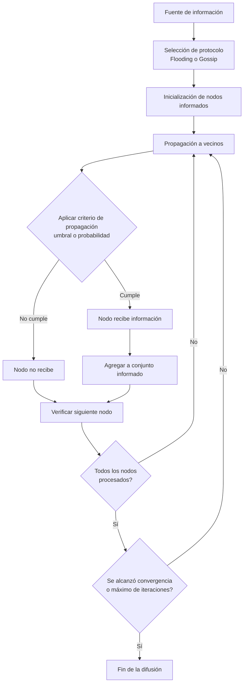

# Computación Distribuida - Comportamiento de cascada en redes

## 5.2 Difusión de información en redes.

---

La difusión de información es un proceso fundamental en sistemas distribuidos donde datos, mensajes o estados se propagan a través de una red de nodos interconectados. Este fenómeno es crucial para entender desde protocolos de comunicación hasta la propagación de malware y la formación de consenso en sistemas distribuidos.

### Definición Formal

La difusión de información se refiere al proceso mediante el cual un elemento de información (datos, mensaje, estado) se propaga desde uno o más nodos fuente a través de una red, alcanzando eventualmente a todos o a un subconjunto significativo de nodos. Matemáticamente, se modela como un proceso estocástico donde la probabilidad de que un nodo $i$ reciba información depende de su conectividad y de los mecanismos de propagación.

### Modelos de Difusión

#### Modelo de Umbral Lineal

Cada nodo $v$ tiene un umbral $\theta_v \in [0,1]$. El nodo adopta información si una fracción suficiente de sus vecinos ya la tiene:

$$ f(v) = \begin{cases} 1 & \text{si } \frac{|\{u \in N(v): u \text{ tiene la información}\}|}{|N(v)|} \geq \theta_v \\\ 0 & \text{en caso contrario} \end{cases} $$

#### Modelo de Cascada Independiente

Cada arista $(u,v)$ tiene una probabilidad $p_{uv}$ de que $u$ transmita información a $v$. La probabilidad de activación es:

$$ P(v \text{ recibe información en } t) = 1 - \prod_{u \in N_{info}(v)} (1 - p_{uv}) $$

donde $N_{info}(v)$ son los vecinos de $v$ que tienen la información en el tiempo $t-1$.

### Protocolos de Difusión

#### Flooding (Inundación)

```python
class FloodingProtocol:
    def __init__(self, network):
        self.network = network
        self.informed_nodes = set()

    def diffuse(self, source_node, message, ttl=10):
        """Protocolo de flooding con TTL (Time To Live)"""
        if ttl <= 0:
            return

        self.informed_nodes.add(source_node)

        for neighbor in self.network.get_neighbors(source_node):
            if neighbor not in self.informed_nodes:
                self.diffuse(neighbor, message, ttl-1)
```

#### Gossiping (Rumores)

```python
import random
import numpy as np

class GossipProtocol:
    def __init__(self, network, probability=0.5):
        self.network = network
        self.probability = probability
        self.informed_nodes = set()

    def gossip(self, source_node, message, rounds=10):
        self.informed_nodes.add(source_node)
        current_informed = {source_node}

        for _ in range(rounds):
            new_informed = set()

            for node in current_informed:
                for neighbor in self.network.get_neighbors(node):
                    if (neighbor not in self.informed_nodes and
                        random.random() < self.probability):
                        new_informed.add(neighbor)

            self.informed_nodes.update(new_informed)
            current_informed = new_informed

            if not new_informed:
                break
```

### Diagrama de Proceso de Difusión



### Métricas de Desempeño

#### Tiempo de Convergencia

El tiempo esperado para que todos los nodos reciban la información:

$$
T_{conv} = \mathbb{E}[\min\{t: I(t) = V\}]
$$

donde $I(t)$ es el conjunto de nodos informados en el tiempo $t$ y $V$ es el conjunto de todos los nodos.

#### Overhead de Comunicación

Número total de mensajes transmitidos:

$$
M_{total} = \sum_{t=0}^{T} \sum_{v \in I(t)} |N(v) \setminus I(t)|
$$

### Ejemplos de Aplicación

#### Ejemplo 1: Red Social

En una red social con 100 usuarios, donde cada usuario tiene en promedio 10 amigos, si un usuario publica una noticia importante y cada usuario la comparte con una probabilidad de 0.7 a sus amigos, podemos modelar la difusión usando el modelo de cascada independiente.

#### Ejemplo 2: Sistema Distribuido

En un sistema distribuido de 50 nodos organizados en una topología de malla, donde se necesita propagar una actualización crítica de software. El protocolo de flooding asegura que todos los nodos reciban la actualización, pero con mayor overhead de mensajes.

### Ejercicios Propuestos

#### Ejercicio 1: Análisis de Umbral Crítico

Para una red en forma de estrella con un nodo central conectado a $n$ nodos periféricos:

1. Calcula el umbral mínimo del nodo central para que ocurra difusión completa cuando todos los nodos periféricos tienen umbral $\theta_p = 0.6$
2. Analiza cómo cambia este umbral cuando $n$ aumenta

#### Ejercicio 2: Simulación Comparativa

Implementa en Python una comparación entre los protocolos de flooding y gossiping para una red de escala libre (Barabási-Albert) con 200 nodos. Mide:

- Tiempo de convergencia
- Número total de mensajes
- Porcentaje de cobertura final

#### Ejercicio 3: Optimización de Difusión

Dada una red social representada como grafo $G(V,E)$ y un presupuesto $k$ para semillas iniciales, diseña un algoritmo que seleccione los $k$ nodos que maximicen la difusión esperada bajo el modelo de cascada independiente.

### Caso de Estudio: Difusión en Internet

El protocolo BGP (Border Gateway Protocol) para enrutamiento entre sistemas autónomos utiliza mecanismos de difusión para propagar información de rutas. Las actualizaciones BGP se difunden mediante un proceso similar al gossiping, donde los routers comparten información de rutas con sus vecinos.

### Referencias

1. Easley, D., & Kleinberg, J. (2010). _Networks, Crowds, and Markets: Reasoning about a Highly Connected World_. Capítulos 19-21.
2. Attiya, H., & Welch, J. (2004). _Distributed Computing: Fundamentals, Simulations, and Advanced Topics_. Capítulo 7: "Broadcast and Multicast".
3. Kempe, D., Kleinberg, J., & Tardos, É. (2003). Maximizing the spread of influence through a social network. _Proceedings of the Ninth ACM SIGKDD International Conference on Knowledge Discovery and Data Mining_.
4. Lynch, N. A. (1996). _Distributed Algorithms_. Capítulo 15: "Basic Asynchronous Network Algorithms".

### Recursos Adicionales

- [NetworkX library for network analysis](https://networkx.org/)
- [Simulador de difusión de información](https://github.com/networkx/networkx/tree/main/examples/diffusion)
- [Curso: Distributed Algorithms and Systems](https://www.distributed-algorithms.org/)
