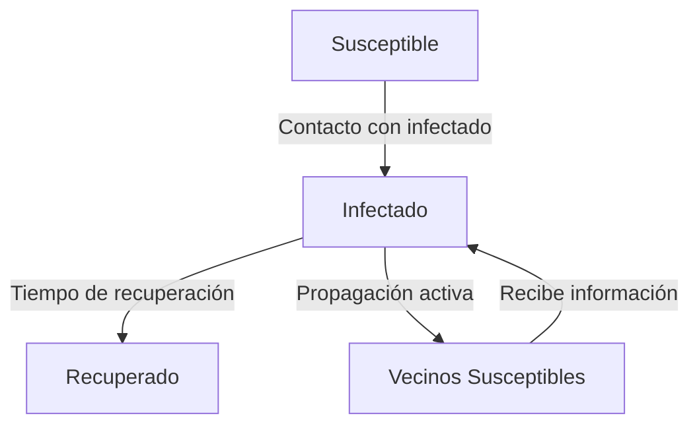

# Computación Distribuida - Comportamiento de cascada en redes

## 5.3 Algoritmos de epidemia en redes.

---

Los algoritmos de epidemia (o protocolos gossip) son mecanismos de comunicación inspirados en la propagación de enfermedades que permiten la diseminación eficiente de información en sistemas distribuidos masivos. Estos algoritmos son altamente escalables, tolerantes a fallos y proporcionan un buen balance entre overhead de comunicación y velocidad de propagación.

### Definición Formal

Un algoritmo de epidemia es un protocolo de comunicación donde los nodos intercambian información periódicamente con un subconjunto aleatorio de sus vecinos, similar a cómo se propagan las enfermedades contagiosas. Matemáticamente, se modela como un proceso estocástico donde la probabilidad de que un nodo $i$ se "infecte" (reciba información) depende de su interacción con nodos ya infectados.

### Modelos Epidemiológicos Básicos

#### Modelo SIR (Susceptible-Infectado-Recuperado)

- **Susceptible (S)**: Nodos que pueden contraer la información
- **Infectado (I)**: Nodos que tienen la información y pueden propagarla
- **Recuperado (R)**: Nodos que tienen la información pero ya no la propagan

Ecuaciones diferenciales para el modelo SIR continuo:

$$ \begin{aligned} \frac{dS}{dt} &= -\beta SI \\\ \frac{dI}{dt} &= \beta SI - \gamma I \\\ \frac{dR}{dt} &= \gamma I \end{aligned} $$

donde $\beta$ es la tasa de infección y $\gamma$ es la tasa de recuperación.

#### Modelo SI (Susceptible-Infectado)

Para sistemas donde la información es permanente:

$$
\frac{dI}{dt} = \beta I (1 - I)
$$

### Algoritmos de Epidemia en Sistemas Distribuidos

#### Protocolo Básico de Gossip

```python
import random
import numpy as np
from collections import deque

class GossipNode:
    def __init__(self, node_id, network, fanout=3):
        self.id = node_id
        self.network = network
        self.fanout = fanout  # Número de vecinos contactados por ronda
        self.data = set()
        self.rumor_mongering = True

    def gossip_round(self):
        """Ejecuta una ronda de gossip"""
        if not self.data or not self.rumor_mongering:
            return

        neighbors = self.network.get_neighbors(self.id)
        if not neighbors:
            return

        # Seleccionar aleatoriamente 'fanout' vecinos
        selected_neighbors = random.sample(neighbors, min(self.fanout, len(neighbors)))

        for neighbor_id in selected_neighbors:
            neighbor = self.network.get_node(neighbor_id)
            if neighbor:
                # Enviar datos al vecino
                self.send_data(neighbor)

    def receive_data(self, new_data):
        """Procesa datos recibidos"""
        if new_data not in self.data:
            self.data.add(new_data)
            # Continuar propagando si está en modo rumor mongering
            if self.rumor_mongering:
                self.gossip_round()

    def send_data(self, target_node):
        """Envía datos a un nodo objetivo"""
        if self.data:
            data_to_send = random.choice(list(self.data))
            target_node.receive_data(data_to_send)
```

#### Protocolo Anti-Entropía

```python
class AntiEntropyNode(GossipNode):
    def __init__(self, node_id, network, protocol_type='push-pull'):
        super().__init__(node_id, network)
        self.protocol_type = protocol_type  # 'push', 'pull', o 'push-pull'

    def anti_entropy_round(self):
        """Ejecuta una ronda de anti-entropía"""
        neighbors = self.network.get_neighbors(self.id)
        if not neighbors:
            return

        partner = random.choice(neighbors)
        partner_node = self.network.get_node(partner)

        if self.protocol_type in ['push', 'push-pull']:
            # Fase push: enviar nuestros datos al partner
            self.push_data(partner_node)

        if self.protocol_type in ['pull', 'push-pull']:
            # Fase pull: solicitar datos del partner
            self.pull_data(partner_node)

    def push_data(self, target_node):
        """Envía datos al nodo objetivo (fase push)"""
        if self.data:
            data_to_send = random.sample(list(self.data),
                                        min(5, len(self.data)))  # Límite de datos por mensaje
            target_node.receive_data_batch(data_to_send)

    def pull_data(self, target_node):
        """Solicita datos al nodo objetivo (fase pull)"""
        # Simulamos la solicitud y recepción de datos
        if target_node.data:
            data_to_request = random.sample(list(target_node.data),
                                          min(5, len(target_node.data)))
            self.receive_data_batch(data_to_request)

    def receive_data_batch(self, data_batch):
        """Procesa un lote de datos recibidos"""
        for data_item in data_batch:
            if data_item not in self.data:
                self.data.add(data_item)
```

### Diagrama de Estados y Transiciones



### Análisis Matemático

#### Tiempo de Propagación

El tiempo esperado para que la información llegue a todos los nodos en una red completa de tamaño $n$:

$$
E[T] \approx O(\log n)
$$

#### Número de Mensajes

El número total de mensajes en una ronda de gossip:

$$
M_{total} = \sum_{i=1}^{n} fanout_i
$$

donde $fanout_i$ es el número de vecinos contactados por el nodo $i$.

### Ejemplos de Aplicación

#### Ejemplo 1: Base de Datos Distribuida

Sistema con 100 nodos donde cada nodo mantiene una copia de una base de datos. Los algoritmos de epidemia se usan para mantener la consistencia eventual entre las réplicas.

#### Ejemplo 2: Detección de Fallos

En un cluster de 50 servidores, se utiliza un protocolo gossip para diseminar información sobre el estado de salud de los nodos y detectar fallos rápidamente.

### Ejercicios Propuestos

#### Ejercicio 1: Simulación de Propagación

Implementa una simulación del modelo SIR en una red de escala libre (Barabási-Albert) con 200 nodos. Analiza:

1. El efecto de la tasa de infección $\beta$ en la velocidad de propagación
2. El porcentaje máximo de nodos infectados
3. El tiempo hasta que la epidemia se extingue

#### Ejercicio 2: Comparación de Protocolos

Compara los protocolos push, pull y push-pull en términos de:

1. Tiempo de convergencia
2. Overhead de comunicación
3. Robustez frente a fallos de nodos

#### Ejercicio 3: Optimización de Parámetros

Para una red social con distribución de grados power-law, encuentra los valores óptimos de:

1. Fanout (número de contactos por ronda)
2. Intervalo entre rondas de gossip
3. Umbral para cambiar de push a pull

### Caso de Estudio: Amazon DynamoDB

Amazon DynamoDB utiliza protocolos de epidemia para:

- Descubrimiento de miembros y detección de fallos
- Diseminación de actualizaciones de esquema
- Mantenimiento de consistencia eventual entre réplicas

### Referencias

1. Demers, A., Greene, D., Hauser, C., Irish, W., Larson, J., Shenker, S., ... & Terry, D. (1987). Epidemic algorithms for replicated database maintenance. _Proceedings of the sixth annual ACM Symposium on Principles of distributed computing_.
2. Eugster, P. T., Guerraoui, R., Kermarrec, A. M., & Massoulié, L. (2004). Epidemic information dissemination in distributed systems. _IEEE Computer_.
3. Kermack, W. O., & McKendrick, A. G. (1927). A contribution to the mathematical theory of epidemics. _Proceedings of the Royal Society of London_.
4. Vogels, W., van Renesse, R., & Birman, K. (2003). The power of epidemics: robust communication for large-scale distributed systems. _ACM SIGCOMM Computer Communication Review_.

### Recursos Adicionales

- [Simulador de epidemias en redes complejas](https://github.com/networkx/networkx/tree/main/examples/epidemics)
- [Libro: Epidemic Algorithms for Replicated Databases](https://dl.acm.org/doi/10.1145/41840.41841)
- [Curso: Distributed Systems](https://www.distributed-systems.net/)
