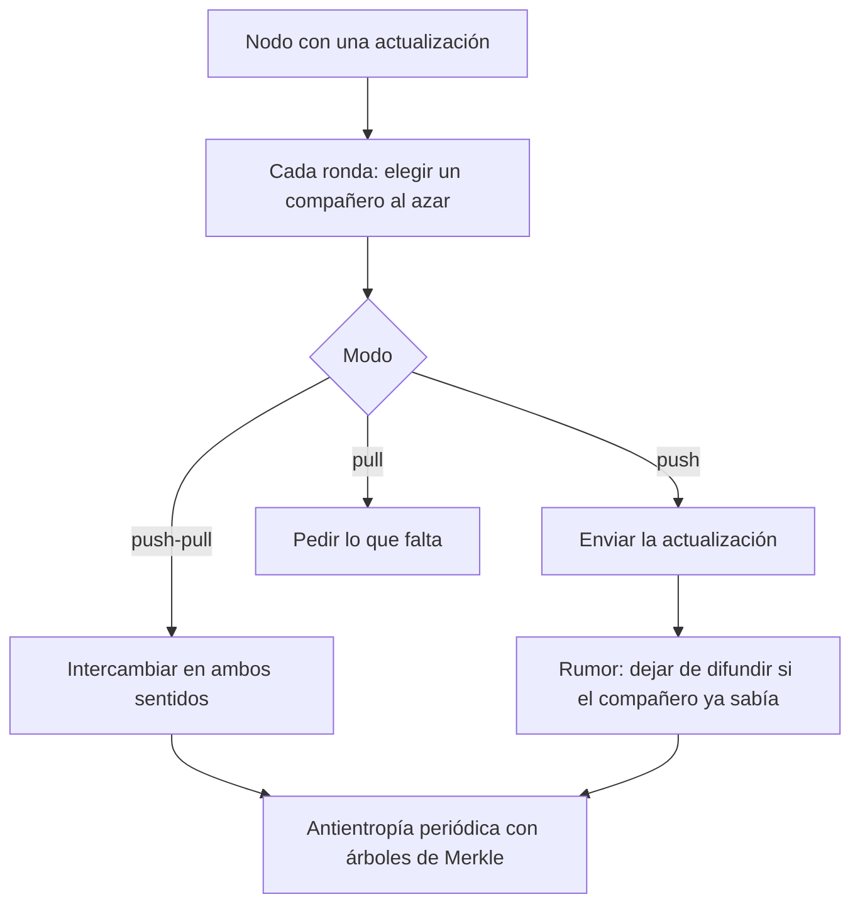

# Computación Distribuida - Comportamiento de cascada en redes

## 5.3 Algoritmos de epidemia en redes.

---

Las epidemias se propagan sin coordinación central, con contactos aleatorios, y aun así llegan a casi toda la población en poco tiempo y son muy difíciles de detener. Los **algoritmos epidémicos** (_gossip_) aprovechan esas mismas propiedades a propósito: para replicar datos, mantener la pertenencia a un grupo o detectar fallas en sistemas con miles de nodos. Este tema presenta los modelos epidemiológicos SI y SIR, su umbral epidémico en redes y por qué las redes libres de escala casi no lo tienen, y luego los protocolos epidémicos de Demers y otros, push, pull, push-pull y antientropía, con su análisis y su uso en sistemas reales como Dynamo y Cassandra.

### Modelos epidemiológicos

**SI:** cada individuo es **susceptible** o **infectado**, y un infectado contagia a cada contacto susceptible a tasa $\beta.$ Con mezcla homogénea, la fracción infectada $i$ cumple $\frac{di}{dt} = \beta \langle k \rangle \, i (1 - i),$ una **logística**: crece de forma exponencial al principio y se satura en 1.

**SIR:** además, los infectados se **recuperan** a tasa $\gamma$ y quedan inmunes. Con mezcla homogénea, en la versión de Kermack y McKendrick (1927):

$$\frac{ds}{dt} = -\beta \langle k \rangle s i, \qquad \frac{di}{dt} = \beta \langle k \rangle s i - \gamma i, \qquad \frac{dr}{dt} = \gamma i.$$

La epidemia crece si y solo si $\frac{di}{dt} > 0$ al inicio, con $s \approx 1:$ si el **número reproductivo básico** $R_0 = \beta \langle k \rangle / \gamma$ es mayor que 1. El alcance final $r_\infty$ cumple $r_\infty = 1 - e^{-R_0 r_\infty},$ que tiene una solución positiva solo si $R_0 > 1.$

### El umbral epidémico en redes

En una red, lo que importa no es el grado medio sino el número de contactos de quien **ya está infectado**, y a un nodo se llega con probabilidad proporcional a su grado. Sea $T$ la **transmisibilidad**, la probabilidad de que un infectado contagie a un vecino antes de recuperarse; en tiempo discreto, con probabilidad $\beta$ de contagio por paso y $\gamma$ de recuperación, $T = \frac{\beta}{\beta + \gamma - \beta\gamma}.$ El SIR equivale entonces a percolación de aristas con probabilidad $T$ (tema 5.1), y hay brotes grandes si y solo si

$$T > T_c = \frac{\langle k \rangle}{\langle k^2 \rangle - \langle k \rangle}.$$

**Idea.** Un nodo al que se llega por una arista tiene, en promedio, $\frac{\langle k^2 \rangle - \langle k \rangle}{\langle k \rangle}$ aristas más (el **grado excedente**); el brote crece si cada infectado contagia en promedio a más de uno de ellos. En las redes libres de escala con $\gamma \leq 3,$ $\langle k^2 \rangle$ diverge al crecer la red, y $T_c \to 0:$ **cualquier** enfermedad o rumor se propaga (Pastor-Satorras y Vespignani, 2001). Por la misma razón, vacunar al azar es inútil, pero vacunar a los concentradores, o a **vecinos** de nodos al azar, que tienden a tener grado alto (la paradoja de la amistad), es muy eficaz (Cohen, Havlin y ben-Avraham, 2003).

### Protocolos epidémicos

Demers y otros (1987) propusieron estos protocolos para mantener consistentes las réplicas de una base de datos en Xerox. Cada nodo, periódicamente, elige un compañero al azar e intercambia información:

- **Push:** los nodos que tienen una actualización la envían.
- **Pull:** cada nodo pregunta a su compañero por actualizaciones que no tenga.
- **Push-pull:** ambos a la vez.

**Antientropía:** los dos nodos comparan **todo** su contenido y se sincronizan. Es costosa, pero garantiza la convergencia eventual; para que sea eficiente, se comparan resúmenes, como árboles de Merkle, en lugar de los datos. **Difusión de rumores:** solo se propagan las actualizaciones recientes, que se dejan de difundir cuando parecen ya conocidas; es barata, pero puede dejar nodos sin la actualización. En la práctica se combinan: rumores para la propagación rápida y antientropía periódica de respaldo.

| Protocolo | Rondas en la gráfica completa | Mensajes | Final |
| --- | --- | --- | --- |
| push | $\log_2 n + \ln n + O(1)$ | $O(n \log n)$ | lento: la fracción sin informar se multiplica por $1/e$ |
| pull | $\log_2 n + O(\log \log n)$ | $O(n \log n)$ | rápido: la fracción se eleva al cuadrado |
| push-pull | $\log_3 n + O(\log \log n)$ | $O(n \log \log n)$ con terminación adecuada | rápido |

**Robustez.** Como cada ronda elige compañeros nuevos al azar, un nodo caído solo hace que se pierdan algunos mensajes: el protocolo no necesita detectar fallas ni reconstruir estructuras, y el tiempo crece suavemente con la fracción de fallas.

**Sistemas reales.** Dynamo, el almacén de claves y valores de Amazon descrito en 2007, usa un protocolo epidémico para la pertenencia al anillo y la detección de fallas, y antientropía con árboles de Merkle para reparar réplicas; Cassandra y Riak siguen ese diseño. El servicio DynamoDB que Amazon ofrece hoy se inspira en Dynamo, pero su arquitectura interna es distinta. Bitcoin difunde transacciones y bloques por un protocolo epidémico, y Consul y Serf usan SWIM para la pertenencia.



### Implementación en Python

El programa simula el SIR en tiempo discreto en una red de Barabási y Albert de 200 nodos con varios valores de $\beta$ y calcula el umbral de transmisibilidad de la red (ejercicio 1); compara push, pull y push-pull en la gráfica completa con 1000 y 10 000 nodos, sin fallas y con el 30% de los nodos caídos (ejercicio 2), y explora el fanout y el momento de cambiar de push a pull en una red libre de escala de 2000 nodos (ejercicio 3).

```python
import math, random
import networkx as nx

random.seed(53)

# --- Ejercicio 1: SIR discreto en Barabási-Albert ---
G = nx.barabasi_albert_graph(200, 2, seed=53)
grados = [d for _, d in G.degree()]
k1, k2 = sum(grados) / 200, sum(d * d for d in grados) / 200
print(f"ejercicio 1: BA de 200 nodos, <k> = {k1:.2f}, <k^2> = {k2:.1f};"
      f" umbral de transmisibilidad <k>/(<k^2> - <k>) = {k1 / (k2 - k1):.3f}")

def sir(G, beta, gamma, semilla):
    """En cada paso cada infectado contagia a cada vecino susceptible con prob. beta
    y luego se recupera con prob. gamma."""
    estado = {v: "S" for v in G}; estado[semilla] = "I"
    I, t, pico, curva = {semilla}, 0, 1, []
    while I:
        t += 1
        nuevos = {v for u in I for v in G[u] if estado[v] == "S" and random.random() < beta}
        recuperados = {u for u in I if random.random() < gamma}
        for v in nuevos: estado[v] = "I"
        for u in recuperados: estado[u] = "R"
        I = (I - recuperados) | nuevos
        pico = max(pico, len(I))
    return t, pico, sum(1 for v in G if estado[v] == "R")

gamma = 0.2
print("   gamma = 0.2 (5 pasos de infección en promedio); 200 corridas por beta")
print("    beta   T = beta/(beta+gamma-beta*gamma)  pico medio  alcance final  duración  brotes > 20%")
for beta in (0.01, 0.03, 0.05, 0.1, 0.2, 0.4):
    res = [sir(G, beta, gamma, random.randrange(200)) for _ in range(200)]
    T = beta / (beta + gamma - beta * gamma)
    grandes = [r for r in res if r[2] > 40]
    print(f"   {beta:5.2f}   {T:8.3f}                        {sum(r[1] for r in res) / 200 / 2:6.1f}%"
          f"     {sum(r[2] for r in res) / 200 / 2:6.1f}%     {sum(r[0] for r in res) / 200:6.1f}"
          f"     {len(grandes) / 2:5.1f}%")

# --- Ejercicio 2: push, pull y push-pull en la gráfica completa ---
def chisme(n, modo, fallos=0.0, max_rondas=500):
    vivos = [random.random() >= fallos for _ in range(n)]
    vivos[0] = True
    sabe = [False] * n; sabe[0] = True
    rondas = msgs = 0
    objetivo = sum(vivos)
    while sum(s for s, v in zip(sabe, vivos) if v) < objetivo and rondas < max_rondas:
        rondas += 1
        nuevo = sabe[:]
        for u in range(n):
            if not vivos[u]: continue
            if modo == "push" and not sabe[u]: continue        # en push solo envían los que saben
            if modo == "pull" and sabe[u]: continue            # en pull solo preguntan los que no saben
            v = random.randrange(n - 1); v += v >= u
            msgs += 1
            if not vivos[v]: continue                       # el contacto no responde
            if modo in ("push", "pushpull") and sabe[u]: nuevo[v] = True
            if modo in ("pull", "pushpull") and sabe[v]: nuevo[u] = True
        sabe = nuevo
    return rondas, msgs / n

print("ejercicio 2: gráfica completa, cada nodo contacta a uno por ronda (100 corridas)")
for n in (1000, 10000):
    print(f"   n = {n}: log2 n + ln n = {math.log2(n) + math.log(n):.1f}, log3 n = {math.log(n, 3):.1f}")
    for modo in ("push", "pull", "pushpull"):
        for f in (0.0, 0.3):
            res = [chisme(n, modo, f) for _ in range(100 if n == 1000 else 20)]
            r = sum(x[0] for x in res) / len(res); m = sum(x[1] for x in res) / len(res)
            print(f"      {modo:9} con {f:.0%} de nodos caídos: {r:5.1f} rondas, {m:5.1f} mensajes por nodo")

# --- Ejercicio 3: parámetros en una red con ley de potencia ---
B = nx.barabasi_albert_graph(2000, 3, seed=7)
ady = {v: list(B[v]) for v in B}
def difunde(fanout, cambio):
    """push con fanout dado; cuando la fracción informada estimada supera 'cambio', pasa a pull."""
    sabe = {0}; rondas = msgs = 0; n = len(ady)
    while len(sabe) < n and rondas < 300:
        rondas += 1
        nuevo = set(sabe)
        if len(sabe) / n < cambio:
            for u in sabe:
                for v in random.sample(ady[u], min(fanout, len(ady[u]))):
                    msgs += 1; nuevo.add(v)
        else:
            for v in ady:
                if v not in sabe:
                    msgs += 1
                    if random.choice(ady[v]) in sabe: nuevo.add(v)
        sabe = nuevo
    return rondas, msgs

print("ejercicio 3: BA de 2000 nodos; rondas y mensajes por nodo (30 corridas)")
for fanout in (1, 2, 4):
    for cambio in (1.01, 0.5, 0.2):
        res = [difunde(fanout, cambio) for _ in range(30)]
        r = sum(x[0] for x in res) / 30; m = sum(x[1] for x in res) / 30 / 2000
        nombre = "solo push" if cambio > 1 else f"pull desde {cambio:.0%}"
        print(f"   fanout {fanout}, {nombre:14}: {r:5.1f} rondas, {m:5.2f} mensajes por nodo")
```

Salida:

```text
ejercicio 1: BA de 200 nodos, <k> = 3.96, <k^2> = 37.1; umbral de transmisibilidad <k>/(<k^2> - <k>) = 0.120
   gamma = 0.2 (5 pasos de infección en promedio); 200 corridas por beta
    beta   T = beta/(beta+gamma-beta*gamma)  pico medio  alcance final  duración  brotes > 20%
    0.01      0.048                           0.6%        0.6%        5.5       0.0%
    0.03      0.134                           1.0%        1.4%        7.5       0.0%
    0.05      0.208                           2.1%        5.1%       12.7      11.0%
    0.10      0.357                           8.5%       26.1%       24.8      45.5%
    0.20      0.556                          26.9%       62.3%       29.1      74.5%
    0.40      0.769                          54.5%       90.5%       31.3      93.5%
ejercicio 2: gráfica completa, cada nodo contacta a uno por ronda (100 corridas)
   n = 1000: log2 n + ln n = 16.9, log3 n = 6.3
      push      con 0% de nodos caídos:  18.1 rondas,   8.0 mensajes por nodo
      push      con 30% de nodos caídos:  23.2 rondas,   7.4 mensajes por nodo
      pull      con 0% de nodos caídos:  13.8 rondas,  10.1 mensajes por nodo
      pull      con 30% de nodos caídos:  20.0 rondas,   9.1 mensajes por nodo
      pushpull  con 0% de nodos caídos:   9.3 rondas,   9.3 mensajes por nodo
      pushpull  con 30% de nodos caídos:  12.2 rondas,   8.6 mensajes por nodo
   n = 10000: log2 n + ln n = 22.5, log3 n = 8.4
      push      con 0% de nodos caídos:  23.9 rondas,  10.5 mensajes por nodo
      push      con 30% de nodos caídos:  30.8 rondas,   9.9 mensajes por nodo
      pull      con 0% de nodos caídos:  17.8 rondas,  13.8 mensajes por nodo
      pull      con 30% de nodos caídos:  25.4 rondas,  11.7 mensajes por nodo
      pushpull  con 0% de nodos caídos:  11.6 rondas,  11.6 mensajes por nodo
      pushpull  con 30% de nodos caídos:  16.1 rondas,  11.3 mensajes por nodo
ejercicio 3: BA de 2000 nodos; rondas y mensajes por nodo (30 corridas)
   fanout 1, solo push     :  55.5 rondas, 40.21 mensajes por nodo
   fanout 1, pull desde 50%:  20.0 rondas,  2.21 mensajes por nodo
   fanout 1, pull desde 20%:  18.7 rondas,  2.10 mensajes por nodo
   fanout 2, solo push     :  26.0 rondas, 33.96 mensajes por nodo
   fanout 2, pull desde 50%:  13.7 rondas,  2.26 mensajes por nodo
   fanout 2, pull desde 20%:  13.7 rondas,  2.10 mensajes por nodo
   fanout 4, solo push     :  14.7 rondas, 31.31 mensajes por nodo
   fanout 4, pull desde 50%:  10.3 rondas,  2.38 mensajes por nodo
   fanout 4, pull desde 20%:  11.1 rondas,  1.92 mensajes por nodo
```

### Ejercicios Propuestos

1. **SIR.** Simula el modelo SIR en una red de Barabási y Albert con 200 nodos y analiza el efecto de la tasa de infección $\beta$ en la velocidad de propagación, el porcentaje máximo de infectados y el tiempo hasta la extinción.

2. **Protocolos.** Compara push, pull y push-pull en tiempo de convergencia, costo de comunicación y robustez frente a fallas de nodos.

3. **Parámetros.** En una red con distribución de grados de ley de potencia, encuentra buenos valores para el fanout, el intervalo entre rondas y el umbral para cambiar de push a pull.

### Soluciones

**Ejercicio 1.** El umbral de la red es $T_c = 3.96 / (37.1 - 3.96) \approx 0.12,$ mucho menor que el $1/\langle k \rangle \approx 0.25$ que daría la mezcla homogénea, por la varianza de los grados. Con $\gamma = 0.2,$ $T$ cruza el umbral cerca de $\beta = 0.03:$ por debajo, los brotes se extinguen en pocos pasos; a partir de $\beta = 0.05$ aparecen brotes grandes en una fracción creciente de las corridas. Al aumentar $\beta,$ el pico de infectados simultáneos sube del 1% al 55%, el alcance final del 1% al 90%, y la duración crece hasta saturarse: con $\beta$ grande la epidemia es rápida pero larga, porque alcanza a casi todos. Cerca del umbral el resultado es muy variable: la misma $\beta$ produce brotes diminutos o enormes según la semilla.

**Ejercicio 2.** Ver la salida.

- **Tiempo:** push-pull es el más rápido (9 rondas con 1000 nodos), seguido de pull y de push, que se acerca a $\log_2 n + \ln n.$
- **Mensajes:** push solo cuesta mensajes de los nodos que ya saben, unos 8 a 10 por nodo; pull y push-pull hacen que todos contacten a alguien en cada ronda. En sistemas reales los nodos intercambian rumores periódicamente de todos modos, y lo que cuesta es el contenido, no el contacto.
- **Robustez:** con el 30% de los nodos caídos, los tres siguen informando a todos los vivos, con un aumento de tiempo de entre 30% y 50% y sin ningún mecanismo de recuperación.

**Ejercicio 3.** En la red libre de escala del programa:

- **Fanout:** duplicarlo reduce las rondas casi a la mitad en push puro, pero no los mensajes: el costo total es parecido y el tiempo mejora. Un fanout de 2 a 4 es un buen compromiso; Cassandra contacta a 1 a 3 nodos por ronda.
- **Cambio de push a pull:** es el parámetro decisivo. Push puro gasta unos 40 mensajes por nodo porque, al final, casi todos los envíos van a nodos que ya saben; cambiar a pull cuando se cree informada una fracción de entre 20% y 50% reduce el costo a unos 2 mensajes por nodo y las rondas a la mitad o menos. En la práctica la fracción no se conoce; se estima, por ejemplo, contando cuántos contactos recientes ya sabían, o se usa push-pull desde el inicio.
- **Intervalo entre rondas:** fija la latencia real, rondas por intervalo, contra la carga de red, mensajes por intervalo. Debe ser varias veces mayor que el tiempo de ida y vuelta para que las respuestas lleguen antes de la siguiente ronda; los sistemas usan entre 0.1 y 1 segundo.

### Referencias

1. Demers, A., Greene, D., Hauser, C., et al., Epidemic algorithms for replicated database maintenance. _Proceedings of the 6th ACM Symposium on Principles of Distributed Computing_, 1987.
2. Pastor-Satorras, R., and Vespignani, A., Epidemic spreading in scale-free networks. _Physical Review Letters_ 86(14), 2001.
3. DeCandia, G., et al., Dynamo: Amazon's highly available key-value store. _Proceedings of the 21st ACM Symposium on Operating Systems Principles_, 2007.
4. Newman, M. E. J., _Networks_. Oxford University Press, 2018. Capítulos 16 y 17.
