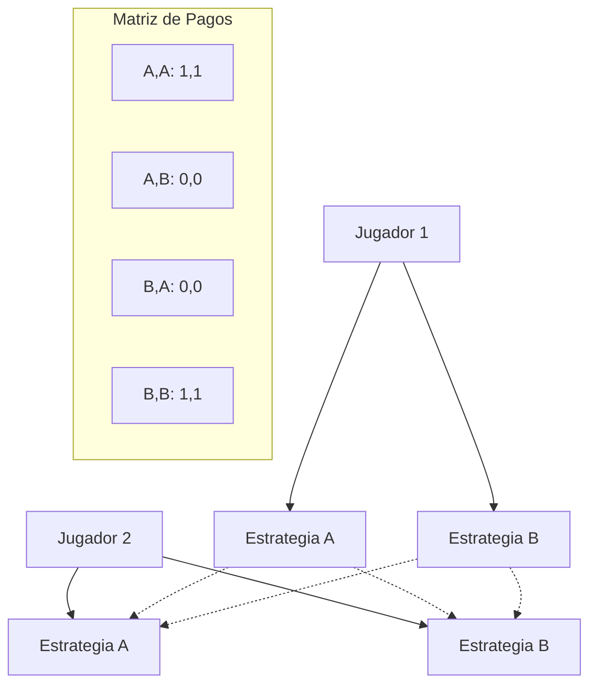

# Computación Distribuida - Modelos económicos para comportamiento en redes

## 6.1 Fundamentos de teoría de juegos.

---

La teoría de juegos proporciona un marco matemático para modelar interacciones estratégicas entre agentes racionales. En computación distribuida, estos modelos son esenciales para entender el comportamiento en redes donde múltiples entidades toman decisiones independientes que afectan el sistema global.

### Conceptos Básicos

#### Juego en Forma Normal

Un juego en forma normal consiste en:

- Un conjunto de jugadores $N = \{1, 2, ..., n\}$
- Para cada jugador $i$, un conjunto de estrategias $S_i$
- Para cada jugador $i$, una función de utilidad $u_i: S_1 × S_2 × ... × S_n → ℝ$

#### Equilibrio de Nash

Un perfil de estrategias $ s^* = ( s\_1 ^ *, s\_2 ^ *, ..., s\_n ^ *) $ es un **equilibrio de Nash** si para cada jugador $i$ y cada estrategia alternativa $s\_i ∈ S\_i$:

$$ u\_i (s\_i ^ *, s\_{-i} ^ *) ≥ u\_i(s\_i, s\_{-i} ^ *) $$

Donde $s_{-i}^*$ representa las estrategias de todos los jugadores excepto $i$.

### Tipos de Juegos

#### Juego de Coordinación



#### Dilema del Prisionero

El famoso juego donde dos prisioneros deben decidir entre cooperar o traicionar:

|                            | Prisionero B: Callar | Prisionero B: Confesar |
| :------------------------: | :------------------: | :--------------------: |
|  **Prisionero A: Callar**  |       (-1, -1)       |        (-3, 0)         |
| **Prisionero A: Confesar** |       (0, -3)        |        (-2, -2)        |

### Conceptos Avanzados

#### Estrategias Mixtas

Cuando los jugadores randomizan sobre sus estrategias puras. Para un jugador con estrategias $S_i = \{s_1, s_2, ..., s_m\}$, una estrategia mixta es una distribución de probabilidad:

$$\sigma_i = (p_1, p_2, ..., p_m) \quad \text{donde} \quad \sum_{j=1}^m p_j = 1 \quad \text{y} \quad p_j ≥ 0$$

#### Utilidad Esperada

La utilidad esperada para el jugador $i$ bajo estrategias mixtas es:

$$u_i(\sigma_1, ..., \sigma_n) = \sum_{s_1 ∈ S_1} ... \sum_{s_n ∈ S_n} \left[ \prod_{j=1}^n \sigma_j(s_j) \right] u_i(s_1, ..., s_n)$$

### Aplicaciones en Computación Distribuida

#### Protocolos de Consenso

En sistemas distribuidos, los nodos deben alcanzar consenso sobre un valor. La teoría de juegos modela incentivos para comportamiento honesto vs. comportamiento byzantino.

**Ejemplo**: Modelo de utilidad para participación en consenso:

$$u_i(a_i, a_{-i}) = R \cdot \mathbb{I}_{\text{consenso alcanzado}} - C(a_i)$$

Donde:

- $R$ es la recompensa por consenso
- $C(a_i)$ es el costo de la acción $a_i$
- $\mathbb{I}$ es la función indicadora

#### Ejercicio Propuesto 1

Considera un sistema blockchain con 3 mineros. Cada minero puede:

- Cooperar (seguir el protocolo)
- Desviarse (intentar atacar)

Las recompensas son:

- Si todos cooperan: cada uno obtiene 10
- Si uno desvía y los demás cooperan: el desviado obtiene 15, los demás 0
- Si dos o más desvían: todos obtienen -5

Encuentra todos los equilibrios de Nash puros.

### Implementación de Simulaciones

#### Simulador Básico de Dilema del Prisionero

```python
import numpy as np

class PrisonersDilemma:
    def __init__(self, temptation=3, reward=1, punishment=0, suckers=-1):
        self.payoffs = {
            ('C', 'C'): (reward, reward),
            ('C', 'D'): (suckers, temptation),
            ('D', 'C'): (temptation, suckers),
            ('D', 'D'): (punishment, punishment)
        }

    def play_round(self, strategy1, strategy2):
        action1 = strategy1.decide()
        action2 = strategy2.decide()
        payoff1, payoff2 = self.payoffs[(action1, action2)]

        # Actualizar historial
        strategy1.update_history(action2)
        strategy2.update_history(action1)

        return (action1, action2), (payoff1, payoff2)

class TitForTat:
    def __init__(self):
        self.history = []

    def decide(self):
        if not self.history:
            return 'C'  # Cooperar primero
        return self.history[-1]  # Repetir última acción del oponente

    def update_history(self, opponent_action):
        self.history.append(opponent_action)

# Simulación
pd_game = PrisonersDilemma()
strategy1 = TitForTat()
strategy2 = TitForTat()

results = []
for _ in range(10):
    actions, payoffs = pd_game.play_round(strategy1, strategy2)
    results.append((actions, payoffs))

print("Resultados de la simulación:")
for i, (actions, payoffs) in enumerate(results):
    print(f"Ronda {i+1}: Acciones {actions}, Pagos {payoffs}")
```

#### Ejercicio Propuesto 2

Extiende el simulador anterior para implementar:

1. Estrategia "Always Defect" (siempre desertar)
2. Estrategia "Random" (elegir aleatoriamente)
3. Calcula las utilidades promedio después de 100 rondas para cada par de estrategias

### Teorema de Nash

**Teorema**: Todo juego finito con un número finito de jugadores tiene al menos un equilibrio de Nash en estrategias mixtas.

La demostración utiliza el punto fijo de Brouwer, conectando con problemas de computación distribuida sobre fixed points en espacios de estrategias.

### Aplicación: Diseño de Mecanismos

En sistemas distribuidos, el diseño de mecanismos asegura que los agentes racionales tengan incentivos para revelar información verdadera.

**Fórmula de subasta de segundo precio (Vickrey):**

- Cada jugador anuncia valor $v_i$
- El ganador es quien ofrece más, paga el segundo precio más alto
- Utilidad para el ganador: $u_i = v_i - p$ donde $p$ es el segundo precio
- Utilidad para perdedores: $0$

Este mecanismo es **incentive-compatible**: es dominante strategy truthful.

#### Ejercicio Propuesto 3

Demuestra que en una subasta de segundo precio con 3 jugadores:

- Valores: $v_1 = 10$, $v_2 = 8$, $v_3 = 6$
- Las estrategias de anunciar el valor verdadero constituyen un equilibrio de Nash

### Juegos Cooperativos vs. No Cooperativos

#### Función Característica

En juegos cooperativos, se define una función característica $v: 2^N → ℝ$ que asigna un valor a cada coalición:

$$v(C) = \text{valor máximo que la coalición C puede garantizar}$$

#### Valor de Shapley

El valor de Shapley asigna ganancias justas a cada jugador:

$$\phi_i(v) = \sum_{C ⊆ N \setminus \{i\}} \frac{|C|! (n - |C| - 1)!}{n!} [v(C ∪ \{i\}) - v(C)]$$

### Referencias Bibliográficas

#### Bibliografía Básica

1. Easley, D., & Kleinberg, J. (2010). _Networks, Crowds, and Markets: Reasoning about a Highly Connected World_. Cambridge University Press. [En línea](http://www.cs.cornell.edu/home/kleinber/networks-book/)
   - Capítulo 6: Games
   - Capítulo 10: Matching Markets

2. Attiya, H., & Welch, J. (2004). _Distributed Computing: Fundamentals, Simulations, and Advanced Topics_. Wiley Series on Parallel and Distributed Computing
   - Capítulo 12: Shared Memory vs. Networks
   - Sección 14.3: Game-Theoretic Approaches

#### Bibliografía Complementaria

3. Lynch, N. (1996). _Distributed Algorithms_. Morgan Kaufman Pub
   - Capítulo 16: Knowledge and Common Knowledge

4. Tel, G. (2001). _Introduction to Distributed Algorithms_ (2nd ed.). Cambridge University Press
   - Capítulo 11: Fault-Tolerant Consensus

### Ejercicios Adicionales

#### Ejercicio 4: Análisis de Redes Sociales

Considera una red social donde los usuarios pueden:

- Compartir contenido ( costo personal $c > 0$, beneficio social $b > c$ )
- No compartir ( costo $0$, beneficio $0$ )

Si $k$ es el número de vecinos que comparten:

- Utilidad por compartir: $b \cdot k - c$
- Utilidad por no compartir: $b \cdot k$

Encuentra los equilibrios de Nash para:

1. $b = 2$, $c = 1$, red completa con 4 nodos
2. $b = 1$, $c = 2$, red en estrella con 5 nodos

#### Ejercicio 5: Implementación de Algoritmo

Implementa en Python el algoritmo de mejor respuesta para encontrar equilibrios de Nash en juegos 2×2:

```python
def find_nash_equilibria(payoff_matrix):
    """
    Encuentra equilibrios de Nash en juegos 2x2
    payoff_matrix: diccionario con estructura:
        {('A1','B1'): (u1, u2), ...}
    """
    # Implementar algoritmo de mejor respuesta
    equilibria = []
    # Tu código aquí
    return equilibria
```

### Soluciones a Ejercicios Selectos

#### Solución Ejercicio 1

Para el juego de minería blockchain:

- Perfil (Cooperar, Cooperar, Cooperar):
  - Si un minero se desvía unilateralmente, obtiene 15 > 10 → No es EN

- Perfil (Desviar, Cooperar, Cooperar):
  - El desviado obtiene 15, pero si coopera obtendría 10 → Mejora unilateral
  - Los cooperadores obtienen 0, pero si se desvían obtendrían -5 → No mejora
  - No es EN porque el desviado ya está mejor

- Perfil (Desviar, Desviar, Desviar):
  - Cualquier minero que cambie a cooperar obtendría 0 > -5 → Mejora unilateral
  - No es EN

**Conclusión**: No hay equilibrios de Nash puros en este juego.
