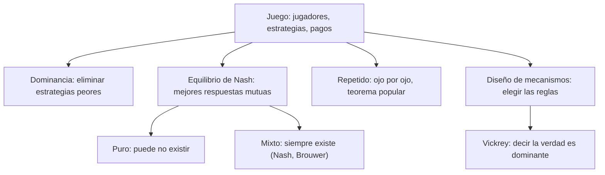

# Computación Distribuida - Modelos económicos para comportamiento en redes

## 6.1 Fundamentos de teoría de juegos.

---

Los algoritmos distribuidos clásicos suponen que los nodos siguen el protocolo o fallan. En Internet, en las redes entre pares o en las cadenas de bloques, los nodos pertenecen a personas u organizaciones con **intereses propios** que pueden desviarse del protocolo si les conviene: no compartir archivos, minar en secreto, mentir sobre su capacidad. La **teoría de juegos** estudia las decisiones de agentes racionales cuyo resultado depende de las decisiones de los demás, y da el lenguaje para diseñar protocolos en los que seguir las reglas sea lo que más conviene. Este tema presenta los juegos en forma normal, la dominancia, el equilibrio de Nash en estrategias puras y mixtas, el teorema de existencia de Nash, los juegos repetidos y una introducción al diseño de mecanismos con la subasta de Vickrey.

### Juegos en forma normal

Un **juego en forma normal** consta de:

- un conjunto de **jugadores** $N = \{1, \ldots, n\};$
- para cada jugador $i,$ un conjunto de **estrategias** $S_i;$
- para cada jugador, una **función de pago** $u_i : S_1 \times \cdots \times S_n \to \mathbb{R}.$

Un **perfil** es una elección $s = (s_1, \ldots, s_n);$ se escribe $s_{-i}$ para las estrategias de todos menos $i.$ Con dos jugadores y estrategias finitas, el juego se representa con una **matriz de pagos** cuyas celdas tienen el par $(u_1, u_2).$

**Dilema del prisionero:**

| | Coopera | Deserta |
| --- | --- | --- |
| **Coopera** | $(3, 3)$ | $(0, 5)$ |
| **Deserta** | $(5, 0)$ | $(1, 1)$ |

### Dominancia y equilibrio de Nash

Una estrategia $s_i$ **domina estrictamente** a $s'_i$ si $u_i(s_i, s_{-i}) > u_i(s'_i, s_{-i})$ para todo $s_{-i}.$ Un jugador racional nunca usa una estrategia estrictamente dominada. En el dilema del prisionero, desertar domina a cooperar para ambos: el resultado es $(1, 1),$ aunque $(3, 3)$ sería mejor para los dos. Es el modelo básico de un **conflicto entre el interés individual y el colectivo**, como compartir recursos en una red entre pares.

Un perfil $s^*$ es un **equilibrio de Nash** si ningún jugador mejora cambiando solo él de estrategia:

$$u_i(s_i^*, s_{-i}^*) \geq u_i(s_i, s_{-i}^*) \quad \text{para todo } i \text{ y todo } s_i \in S_i.$$

Equivalentemente, cada $s_i^*$ es una **mejor respuesta** a $s_{-i}^*.$ Es **estricto** si las desigualdades son estrictas. Un equilibrio no tiene por qué ser bueno: el criterio de bienestar es la **eficiencia de Pareto**, un perfil en el que no se puede mejorar a nadie sin empeorar a alguien.

### Estrategias mixtas y el teorema de Nash

Una **estrategia mixta** $\sigma_i$ es una distribución de probabilidad sobre $S_i,$ y el pago es el **esperado**. En "pares o nones" no hay equilibrio puro: si uno juega fijo, el otro lo explota. El equilibrio mixto se encuentra con el **principio de indiferencia:** en un equilibrio, cada estrategia que un jugador usa con probabilidad positiva le da el mismo pago esperado, porque si una diera más, convendría usar solo esa. En un juego $2 \times 2$ con pagos $A$ para la fila, la columna juega su primera estrategia con probabilidad $q$ tal que

$$q A_{11} + (1 - q) A_{12} = q A_{21} + (1 - q) A_{22}.$$

**Teorema** (Nash, 1950). Todo juego con un número finito de jugadores y de estrategias tiene al menos un equilibrio en estrategias mixtas.

**Idea de la demostración.** La función que a cada perfil mixto le asigna un perfil "mejorado", desplazando probabilidad hacia las estrategias que darían más pago, es continua y va del producto de símplices (un conjunto convexo y compacto) en sí mismo; por el **teorema del punto fijo de Brouwer** tiene un punto fijo, y en un punto fijo nadie puede mejorar: es un equilibrio. La demostración no es constructiva, y calcular un equilibrio de Nash es PPAD-completo (Daskalakis, Goldberg y Papadimitriou, 2006), una clase que se cree intratable (tema 6.2).

### Juegos repetidos

Si el dilema del prisionero se juega muchas veces, la amenaza de castigo en rondas futuras puede sostener la cooperación. **Ojo por ojo** (_tit for tat_): cooperar en la primera ronda y después copiar la última jugada del otro. En los torneos de Axelrod (1980) fue la estrategia más exitosa: es amable (nunca deserta primero), castiga, perdona y es clara. El **teorema popular** dice que, en el juego repetido infinitamente con jugadores suficientemente pacientes, cualquier pago promedio factible que dé a cada jugador más que su pago de castigo puede sostenerse como equilibrio. BitTorrent usa una variante de ojo por ojo para incentivar que los pares suban datos.

### Diseño de mecanismos

El **diseño de mecanismos** es la teoría de juegos al revés: se elige el juego (las reglas) para que, cuando los agentes actúan en su propio interés, el resultado sea el deseado. Un mecanismo es **compatible con incentivos** si decir la verdad es una estrategia dominante.

**Subasta de Vickrey** (segundo precio, sobre cerrado): gana la oferta más alta y paga la **segunda** más alta.

**Teorema.** En la subasta de Vickrey, ofrecer el valor verdadero $v_i$ es una estrategia débilmente dominante.

**Demostración.** Sea $p = \max_{j \neq i} b_j$ la mejor oferta de los demás. Si $v_i > p,$ ofrecer $v_i$ gana y da $v_i - p > 0;$ cualquier oferta mayor que $p$ da lo mismo, y una menor pierde y da 0. Si $v_i \lt p,$ ofrecer $v_i$ pierde y da 0; ganar requeriría ofrecer más de $p$ y pagar $p > v_i,$ con pago negativo. Si $v_i = p,$ todo da 0. En ningún caso otra oferta mejora a la verdadera. $\blacksquare$

En la subasta de **primer precio**, en cambio, ofrecer el valor verdadero da pago 0 seguro, y conviene ofrecer menos. El mecanismo VCG (Vickrey, Clarke y Groves) generaliza la idea: cada agente paga el daño que su presencia causa a los demás.

### Juegos cooperativos

En un **juego cooperativo** los jugadores forman **coaliciones** y una **función característica** $v : 2^N \to \mathbb{R}$ da el valor que cada coalición puede garantizar. El **valor de Shapley** reparte $v(N)$ dando a cada jugador su contribución marginal promedio sobre todos los órdenes de llegada: $\phi_i = \frac{1}{n!} \sum_{\pi} \left[ v(P_i^\pi \cup \{i\}) - v(P_i^\pi) \right],$ donde $P_i^\pi$ son los jugadores antes de $i$ en el orden $\pi.$ Es el único reparto eficiente, simétrico, aditivo y que da 0 a quien no aporta nada; se usa, por ejemplo, para repartir costos de una red entre sus usuarios o para explicar modelos de aprendizaje automático.



### Implementación en Python

El programa encuentra por enumeración los equilibrios puros del juego de los mineros (ejercicio 1); organiza un torneo de 100 rondas del dilema del prisionero entre cinco estrategias (ejercicio 2); verifica que en la subasta de Vickrey decir la verdad no admite ninguna desviación rentable y es dominante sobre una rejilla de ofertas (ejercicio 3); calcula los equilibrios del juego de compartir contenido (ejercicio 4), y calcula los equilibrios puros y mixtos, con fracciones exactas, de cinco juegos $2 \times 2$ clásicos (ejercicio 5).

```python
import random
from fractions import Fraction
from itertools import product, permutations

random.seed(61)

def equilibrios_puros(estrategias, pago):
    """estrategias: lista de listas por jugador; pago(perfil) -> tupla de utilidades.
    Devuelve los perfiles donde nadie mejora cambiando solo (estrictos y débiles)."""
    res = []
    for perfil in product(*estrategias):
        u = pago(perfil)
        estricto, es = True, True
        for i, S in enumerate(estrategias):
            for s in S:
                if s == perfil[i]: continue
                alt = list(perfil); alt[i] = s
                v = pago(tuple(alt))[i]
                if v > u[i]: es = False
                if v == u[i]: estricto = False
        if es:
            res.append((perfil, u, "estricto" if estricto else "débil"))
    return res

# --- Ejercicio 1: mineros ---
def mineros(perfil):
    d = perfil.count("D")
    if d == 0: return (10, 10, 10)
    if d == 1: return tuple(15 if a == "D" else 0 for a in perfil)
    return (-5, -5, -5)

print("ejercicio 1: mineros (C = cooperar, D = desviarse)")
for perfil, u, tipo in equilibrios_puros([["C", "D"]] * 3, mineros):
    print(f"   {''.join(perfil)} pagos {u}: equilibrio {tipo}")

# --- Ejercicio 2: dilema del prisionero repetido ---
PAGOS = {("C", "C"): (3, 3), ("C", "D"): (0, 5), ("D", "C"): (5, 0), ("D", "D"): (1, 1)}
estrategias = {
    "siempre coopera": lambda mio, suyo: "C",
    "siempre deserta": lambda mio, suyo: "D",
    "ojo por ojo":     lambda mio, suyo: suyo[-1] if suyo else "C",
    "al azar":         lambda mio, suyo: random.choice("CD"),
    "rencoroso":       lambda mio, suyo: "D" if "D" in suyo else "C",
}
def partida(e1, e2, rondas=100):
    h1, h2, u1, u2 = [], [], 0, 0
    for _ in range(rondas):
        a, b = e1(h1, h2), e2(h2, h1)
        p = PAGOS[(a, b)]; u1 += p[0]; u2 += p[1]
        h1.append(a); h2.append(b)
    return u1 / rondas, u2 / rondas

nombres = list(estrategias)
print("ejercicio 2: pago medio por ronda en 100 rondas (fila contra columna)")
print("   " + " " * 16 + "".join(f"{n[:9]:>10}" for n in nombres))
totales = {n: 0 for n in nombres}
for a in nombres:
    fila = []
    for b in nombres:
        u = partida(estrategias[a], estrategias[b])[0]
        fila.append(u); totales[a] += u
    print(f"   {a:16}" + "".join(f"{x:10.2f}" for x in fila))
print("   promedio contra todas:", {n: round(t / len(nombres), 2) for n, t in totales.items()})

# --- Ejercicio 3: subasta de Vickrey ---
valores = (10, 8, 6)
def vickrey(ofertas):
    orden = sorted(range(3), key=lambda i: (-ofertas[i], i))
    g, segundo = orden[0], ofertas[orden[1]]
    return tuple(valores[i] - segundo if i == g else 0 for i in range(3))

rejilla = [x / 2 for x in range(0, 31)]       # ofertas de 0 a 15 en pasos de 0.5
verdad = vickrey(valores)
mejora = [(i, b, vickrey(tuple(b if j == i else valores[j] for j in range(3)))[i])
          for i in range(3) for b in rejilla
          if vickrey(tuple(b if j == i else valores[j] for j in range(3)))[i] > verdad[i]]
print(f"ejercicio 3: ofertas verdaderas {valores}: pagos {verdad}; desviaciones rentables encontradas: {len(mejora)}")
dominante = all(vickrey(tuple(valores[i] if j == i else o[j] for j in range(3)))[i] >=
                vickrey(tuple(b if j == i else o[j] for j in range(3)))[i]
                for i in range(3) for b in rejilla[::3] for o in product(rejilla[::3], repeat=3))
print("   decir la verdad es dominante contra cualquier oferta de los demás (rejilla de 0 a 15):", dominante)
primer_precio = lambda o: tuple(valores[i] - o[i] if i == min(range(3), key=lambda k: (-o[k], k)) else 0 for i in range(3))
print("   en primer precio, ofrecer el valor verdadero da", primer_precio(valores),
      "y ofrecer 8.5 el primero da", primer_precio((8.5, 8, 6)))

# --- Ejercicio 4: compartir contenido ---
def compartir(G, b, c):
    n = len(G)
    def pago(perfil):
        return tuple(b * sum(perfil[j] for j in G[i]) - c * perfil[i] for i in range(n))
    return pago

completa4 = {i: [j for j in range(4) if j != i] for i in range(4)}
estrella5 = {0: [1, 2, 3, 4], 1: [0], 2: [0], 3: [0], 4: [0]}
for nombre, G, b, c in (("completa con 4 nodos, b = 2, c = 1", completa4, 2, 1),
                        ("estrella con 5 nodos, b = 1, c = 2", estrella5, 1, 2)):
    pago = compartir(G, b, c)
    eq = equilibrios_puros([[0, 1]] * len(G), pago)
    todos = pago(tuple([1] * len(G)))
    print(f"ejercicio 4: {nombre}: equilibrios {[(''.join(map(str, p)), u) for p, u, _ in eq]};"
          f" si todos comparten: {todos}")

# --- Ejercicio 5: equilibrios en juegos 2 x 2, puros y mixtos ---
def nash_2x2(A, B):
    """A, B: pagos de fila y columna. Puros por mejor respuesta; mixto por indiferencia."""
    puros = [(i, j) for i in range(2) for j in range(2)
             if A[i][j] >= A[1 - i][j] and B[i][j] >= B[i][1 - j]]
    mixto = None
    da, db = A[0][0] - A[0][1] - A[1][0] + A[1][1], B[0][0] - B[0][1] - B[1][0] + B[1][1]
    if da != 0 and db != 0:
        q = Fraction(A[1][1] - A[0][1], da)      # prob. de que columna juegue 0: fila indiferente
        p = Fraction(B[1][1] - B[1][0], db)      # prob. de que fila juegue 0: columna indiferente
        if 0 < p < 1 and 0 < q < 1:
            mixto = (p, q)
    return puros, mixto

juegos = {
    "dilema del prisionero": ([[3, 0], [5, 1]], [[3, 5], [0, 1]]),
    "coordinación":          ([[2, 0], [0, 1]], [[2, 0], [0, 1]]),
    "batalla de los sexos":  ([[3, 0], [0, 2]], [[2, 0], [0, 3]]),
    "pares o nones":         ([[1, -1], [-1, 1]], [[-1, 1], [1, -1]]),
    "halcón y paloma":       ([[-1, 4], [0, 2]], [[-1, 0], [4, 2]]),
}
for nombre, (A, B) in juegos.items():
    puros, mixto = nash_2x2(A, B)
    m = f"fila juega 0 con p = {mixto[0]}, columna con q = {mixto[1]}" if mixto else "ninguno"
    print(f"ejercicio 5: {nombre:22} puros {puros}; mixto: {m}")
```

Salida:

```text
ejercicio 1: mineros (C = cooperar, D = desviarse)
   CCD pagos (0, 0, 15): equilibrio estricto
   CDC pagos (0, 15, 0): equilibrio estricto
   DCC pagos (15, 0, 0): equilibrio estricto
   DDD pagos (-5, -5, -5): equilibrio débil
ejercicio 2: pago medio por ronda en 100 rondas (fila contra columna)
                    siempre c siempre d ojo por o   al azar rencoroso
   siempre coopera       3.00      0.00      3.00      1.35      3.00
   siempre deserta       5.00      1.00      1.04      2.92      1.04
   ojo por ojo           3.00      0.99      3.00      2.45      3.00
   al azar               3.94      0.51      2.35      2.13      0.50
   rencoroso             3.00      0.99      3.00      3.23      3.00
   promedio contra todas: {'siempre coopera': 2.07, 'siempre deserta': 2.2, 'ojo por ojo': 2.49, 'al azar': 1.89, 'rencoroso': 2.64}
ejercicio 3: ofertas verdaderas (10, 8, 6): pagos (2, 0, 0); desviaciones rentables encontradas: 0
   decir la verdad es dominante contra cualquier oferta de los demás (rejilla de 0 a 15): True
   en primer precio, ofrecer el valor verdadero da (0, 0, 0) y ofrecer 8.5 el primero da (1.5, 0, 0)
ejercicio 4: completa con 4 nodos, b = 2, c = 1: equilibrios [('0000', (0, 0, 0, 0))]; si todos comparten: (5, 5, 5, 5)
ejercicio 4: estrella con 5 nodos, b = 1, c = 2: equilibrios [('00000', (0, 0, 0, 0, 0))]; si todos comparten: (2, -1, -1, -1, -1)
ejercicio 5: dilema del prisionero  puros [(1, 1)]; mixto: ninguno
ejercicio 5: coordinación           puros [(0, 0), (1, 1)]; mixto: fila juega 0 con p = 1/3, columna con q = 1/3
ejercicio 5: batalla de los sexos   puros [(0, 0), (1, 1)]; mixto: fila juega 0 con p = 3/5, columna con q = 2/5
ejercicio 5: pares o nones          puros []; mixto: fila juega 0 con p = 1/2, columna con q = 1/2
ejercicio 5: halcón y paloma        puros [(0, 1), (1, 0)]; mixto: fila juega 0 con p = 2/3, columna con q = 2/3
```

### Ejercicios Propuestos

1. **Mineros.** Tres mineros de una cadena de bloques pueden cooperar (seguir el protocolo) o desviarse (atacar). Si todos cooperan, cada uno obtiene 10; si uno se desvía y los demás cooperan, el que se desvía obtiene 15 y los demás 0; si dos o más se desvían, todos obtienen $-5.$ Encuentra todos los equilibrios de Nash puros.

2. **Torneo.** Implementa un simulador del dilema del prisionero repetido con las estrategias "siempre deserta", "al azar" y "ojo por ojo", entre otras, y calcula los pagos promedio tras 100 rondas para cada par.

3. **Vickrey.** En una subasta de segundo precio con valores $v_1 = 10,$ $v_2 = 8$ y $v_3 = 6,$ demuestra que ofrecer el valor verdadero es un equilibrio de Nash.

4. **Compartir contenido.** En una red social, compartir cuesta $c > 0$ a quien comparte y da un beneficio $b$ a cada vecino. Con $k$ vecinos que comparten, la utilidad es $bk - c$ si se comparte y $bk$ si no. Encuentra los equilibrios con $b = 2,$ $c = 1$ en la gráfica completa de 4 nodos, y con $b = 1,$ $c = 2$ en la estrella de 5 nodos.

5. **Juegos de 2 por 2.** Implementa un algoritmo que encuentre los equilibrios de Nash de un juego $2 \times 2.$

### Soluciones

**Ejercicio 1.** La solución de la versión anterior de este documento, que concluía que no había equilibrios puros, era incorrecta. Revisando cada perfil:

- **Todos cooperan:** no es equilibrio, porque cualquiera gana 15 en lugar de 10 desviándose.
- **Uno se desvía:** sí es equilibrio, estricto. Quien se desvía obtiene 15, y cooperando obtendría 10. Cada cooperador obtiene 0, y desviándose habría dos desviados y obtendría $-5.$ Hay tres equilibrios de este tipo, uno por cada minero.
- **Dos se desvían:** no es equilibrio, porque un desviado que vuelve a cooperar pasa de $-5$ a 0.
- **Todos se desvían:** es un equilibrio **débil**: quien cambie a cooperar sigue en un perfil con dos desviados y obtiene $-5$ igual.

El juego tiene la estructura de "halcón y paloma": un solo atacante es tolerable, varios destruyen el valor para todos.

**Ejercicio 2.** Ver la tabla. "Siempre deserta" gana contra cooperadores incondicionales y empata en desgracia consigo mismo; "ojo por ojo" y "rencoroso" obtienen 3 entre sí y castigan a los desertores, perdiendo solo la primera ronda contra ellos. En el promedio contra todas, las estrategias recíprocas ganan, como en los torneos de Axelrod, aunque "siempre deserta" nunca pierde un enfrentamiento individual: ganar enfrentamientos y ganar el torneo no son lo mismo.

**Ejercicio 3.** Por el teorema de la sección, decir la verdad es dominante, y en particular un equilibrio. En concreto: con ofertas $(10, 8, 6)$ gana el jugador 1 y paga 8, con pago 2. Si el jugador 1 ofrece algo mayor que 8 sigue pagando 8; si ofrece menos, pierde. El jugador 2, para ganar, debería ofrecer más de 10 y pagaría 10 por algo que vale 8. El jugador 3, igual. El programa no encuentra ninguna desviación rentable en una rejilla de 31 ofertas, y comprueba la dominancia contra 1331 combinaciones de ofertas de los demás.

**Ejercicio 4.** Con estas utilidades, compartir **cuesta** $c$ y no cambia lo que uno recibe, que depende solo de los vecinos: no compartir domina estrictamente a compartir para todos, sin importar $b$ ni la red. El único equilibrio es que **nadie comparta**, con pago 0. En la gráfica completa, si todos compartieran cada uno obtendría $2 \cdot 3 - 1 = 5:$ es un dilema del prisionero de 4 jugadores. En la estrella con $b = 1,$ $c = 2,$ que todos compartan ni siquiera es deseable para las hojas, que obtienen $1 - 2 = -1;$ el óptimo social es que comparta solo el centro, con bienestar total $4 \cdot 1 - 2 = 2.$ Para sostener la cooperación hacen falta incentivos externos (tema 6.2).

**Ejercicio 5.** Es `nash_2x2` del programa. **Puros:** una celda es equilibrio si su pago para la fila es al menos el de la otra fila en la misma columna, y su pago para la columna es al menos el de la otra columna en la misma fila. **Mixtos:** por el principio de indiferencia, la probabilidad $q$ de la columna iguala los pagos esperados de las dos filas, y la $p$ de la fila iguala los de las dos columnas; si ambas están estrictamente entre 0 y 1, hay un equilibrio mixto. En la batalla de los sexos, además de los dos puros, hay uno mixto en el que la fila elige su opción preferida con probabilidad $3/5$ y la columna la de la fila con $2/5,$ que es peor para ambos que cualquiera de los puros.

### Referencias

1. Osborne, M. J., _An Introduction to Game Theory_. Oxford University Press, 2004. Capítulos 2 a 4, 14 y 15.
2. Nisan, N., Roughgarden, T., Tardos, É., and Vazirani, V. V., _Algorithmic Game Theory_. Cambridge University Press, 2007. Capítulos 1 y 9.
3. Easley, D., and Kleinberg, J., _Networks, Crowds, and Markets_. Cambridge University Press, 2010. Capítulos 6 y 9.
4. Axelrod, R., _The Evolution of Cooperation_. Basic Books, 1984.
