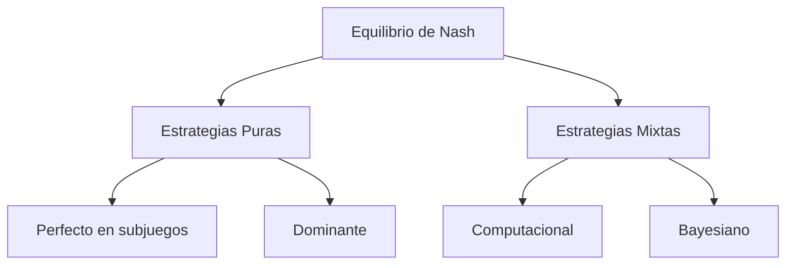
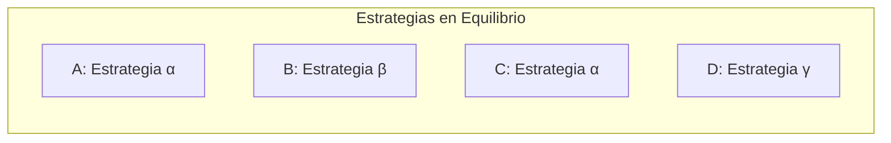
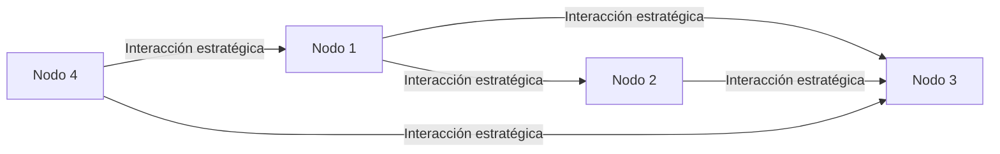

# Computación Distribuida - Modelos económicos para comportamiento en redes

## 6.2 Equilibrio de Nash.

---

El equilibrio de Nash es un concepto fundamental en teoría de juegos que modela situaciones donde múltiples agentes toman decisiones de forma independiente, y cada uno está eligiendo su mejor estrategia dada las estrategias de los demás. En computación distribuida, este concepto ayuda a entender y predecir el comportamiento en sistemas con entidades autónomas que interactúan en red.

### Definición Formal

#### Equilibrio de Nash

Un **equilibrio de Nash** es un perfil de estrategias $ s ^ * = ( s\_1 ^ *, s\_2 ^ *, \ldots, s\_n ^ *) $ donde para cada jugador $i$ y cada estrategia alternativa $ s\_i \in S\_i $:

$$ u\_i(s\_i ^ *, s\_{-i} ^ *) \geq u\_i(s\_i, s\_{-i} ^ * ) $$

Donde:

- $N = \{1, 2, \ldots, n\}$ es el conjunto de jugadores
- $S_i$ es el conjunto de estrategias del jugador $i$
- $u_i$ es la función de utilidad del jugador $i$
- $s_{-i}^*$ representa las estrategias de todos los jugadores excepto $i$

#### Existencia del Equilibrio (Teorema de Nash)

**Teorema**: Todo juego finito con un número finito de jugadores tiene al menos un equilibrio de Nash en estrategias mixtas.

### Tipos de Equilibrios de Nash

#### Equilibrio de Nash en Estrategias Puras



#### Equilibrio en Estrategias Mixtas

Cuando los jugadores randomizan sobre sus estrategias puras. Para un jugador con estrategias $S_i = \{s_1, s_2, ..., s_m\}$, una estrategia mixta es una distribución de probabilidad:

$$\sigma_i = (p_1, p_2, ..., p_m) \quad \text{donde} \quad \sum_{j=1}^m p_j = 1 \quad \text{y} \quad p_j \geq 0$$

### Ejemplo Clásico: Dilema del Prisionero

#### Matriz de Pagos

|                            | Prisionero B: Callar | Prisionero B: Confesar |
| :------------------------: | :------------------: | :--------------------: |
|  **Prisionero A: Callar**  |       (-1, -1)       |        (-3, 0)         |
| **Prisionero A: Confesar** |       (0, -3)        |        (-2, -2)        |

#### Análisis del Equilibrio

Para encontrar el equilibrio de Nash:

- Si B calla: A prefiere confesar (0 > -1)
- Si B confiesa: A prefiere confesar (-2 > -3)
- Simétricamente para B

**Equilibrio de Nash**: (Confesar, Confesar) con pagos (-2, -2)

### Aplicación en Computación Distribuida: Protocolos de Consenso

#### Modelo de Utilidad para Participación

En sistemas blockchain, los mineros deciden si cooperar con el protocolo o desviarse:

$$ u\_i(a\_i, a\_{-i}) = R \cdot \mathbb{I}\_{\text{consenso alcanzado}} - C(a\_i) + P(a\_i, a\_{-i}) $$

Donde:

- $R$: recompensa por consenso
- $C(a_i)$: costo de la acción $a_i$
- $P(a_i, a_{-i})$: penalizaciones/recompensas adicionales
- $\mathbb{I}$: función indicadora (1 si se alcanza consenso, 0 si no)

#### Ejercicio Propuesto 1

Considera un sistema con 3 nodos donde cada uno puede:

- Cooperar (costo: 2, beneficio global: 10)
- Desviarse (costo: 0, beneficio personal extra: 3)

Si los beneficios se comparten equitativamente:

1. Construye la matriz de pagos
2. Encuentra todos los equilibrios de Nash
3. Analiza la eficiencia de Pareto

### Algoritmos para Computar Equilibrios de Nash

#### Implementación de Búsqueda de Equilibrios 2×2

```python
import numpy as np

def find_nash_equilibria(payoffs):
    """
    Encuentra todos los equilibrios de Nash en juegos 2x2
    payoffs: matriz 2x2x2 donde payoffs[i][j] = (pago_jugador1, pago_jugador2)
    """
    equilibria = []

    # Verificar estrategias puras
    for i in range(2):
        for j in range(2):
            is_equilibrium = True
            # Verificar si jugador 1 no tiene incentivo para desviarse
            for k in range(2):
                if payoffs[k][j][0] > payoffs[i][j][0]:
                    is_equilibrium = False
                    break

            # Verificar si jugador 2 no tiene incentivo para desviarse
            if is_equilibrium:
                for k in range(2):
                    if payoffs[i][k][1] > payoffs[i][j][1]:
                        is_equilibrium = False
                        break

            if is_equilibrium:
                equilibria.append(('Pure', (i, j)))

    # Verificar estrategias mixtas (para juegos 2x2)
    # Implementar cálculo de equilibrios mixtos
    # [...]

    return equilibria

# Ejemplo: Dilema del Prisionero
prisoners_dilemma = np.array([
    [[-1, -1], [-3, 0]],   # A: Callar, B: Callar/Confesar
    [[0, -3], [-2, -2]]    # A: Confesar, B: Callar/Confesar
])

print("Equilibrios de Nash encontrados:")
print(find_nash_equilibria(prisoners_dilemma))
```

#### Ejercicio Propuesto 2

Extiende el algoritmo anterior para:

1. Calcular equilibrios en estrategias mixtas para juegos 2×2
2. Implementar el algoritmo de mejor respuesta para juegos n×m
3. Calcular la eficiencia del equilibrio (price of anarchy)

### Equilibrio de Nash en Redes

#### Juegos de Red y Externalidades

En redes, la utilidad de un jugador often depende de las decisiones de sus vecinos:

$$u_i(a_i, a_{-i}) = v_i(a_i) + \sum_{j \in N(i)} w_{ij}(a_i, a_j) - c_i(a_i)$$

Donde:

- $v_i(a_i)$: valor intrínseco de la acción
- $w_{ij}(a_i, a_j)$: efecto de red del vecino $j$
- $c_i(a_i)$: costo de la acción
- $N(i)$: vecinos del nodo $i$

#### Diagrama de Red y Equilibrios





### Aplicaciones en Sistemas Distribuidos

#### Mecanismos de Incentivos

Diseño de protocolos donde la estrategia dominante es comportarse honestamente:

**Teorema de Revelación**: Para cualquier mecanismo con equilibrios de Nash, existe un mecanismo equivalente donde decir la verdad es equilibrio de Nash.

#### Ejemplo: Subasta de Vickrey (Segundo Precio)

- Cada jugador anuncia su valor $v_i$
- El ganador paga el segundo precio más alto
- Estrategia óptima: anunciar el valor verdadero $(b_i = v_i)$

$$ u_i(b_i, b_{-i}) = \begin{cases} v_i - \max_{j \neq i} b_j & \text{si } b_i > \max_{j \neq i} b_j \\\ 0 & \text{en otro caso} \end{cases}$$

#### Ejercicio Propuesto 3

Analiza un sistema de votación distribuida donde:
- 3 nodos deben acordar un valor
- Cada nodo tiene preferencia privada $v_i \in \{0, 1\}$
- Costo de votar: $c > 0$
- Beneficio por consenso: $b > c$

1. Modela como juego y encuentra equilibrios de Nash
2. Diseña un mecanismo que incentive la participación honesta
3. Calcula la eficiencia del equilibrio

### Limitaciones y Críticas

#### Problemas Computacionales

Encontrar equilibrios de Nash es PPAD-completo para juegos con ≥ 3 jugadores.

**Price of Anarchy**: Medida de ineficiencia de equilibrios:

$$PoA = \frac{\max_{s \in S} \sum_i u_i(s)}{\min_{s \in NE} \sum_i u_i(s)}$$

Donde $NE$ es el conjunto de equilibrios de Nash.

### Referencias Bibliográficas

#### Bibliografía Básica
1. Easley, D., & Kleinberg, J. (2010). *Networks, Crowds, and Markets: Reasoning about a Highly Connected World*. Cambridge University Press.
   - Capítulo 6: Games (Secciones 6.1-6.5)
   - Capítulo 10: Matching Markets (Sección 10.6)

2. Attiya, H., & Welch, J. (2004). *Distributed Computing: Fundamentals, Simulations, and Advanced Topics*.
   - Capítulo 12: Shared Memory vs. Networks
   - Sección 14.3: Game-Theoretic Approaches

#### Bibliografía Complementaria
3. Nisan, N., Roughgarden, T., Tardos, E., & Vazirani, V. V. (2007). *Algorithmic Game Theory*. Cambridge University Press.
   - Capítulo 2: The Price of Anarchy
   - Capítulo 3: Mechanisms and Algorithms

### Ejercicios Adicionales

#### Ejercicio 4: Análisis de Red P2P

Considera una red P2P donde los usuarios pueden:
- Compartir archivos ( costo $c > 0$, beneficio social $b > c$ )
- No compartir ( costo $0$, beneficio $0$ )

La utilidad depende de los vecinos que comparten:
- Utilidad por compartir: $k \cdot b - c$ donde $k$ es el número de vecinos que comparten
- Utilidad por no compartir: $k \cdot b$

Encuentra:
1. Los equilibrios de Nash para diferentes topologías
2. El price of anarchy
3. Mecanismos para mejorar la eficiencia

#### Ejercicio 5: Implementación Avanzada

Implementa un algoritmo que:
1. Simule dinámicas de mejor respuesta en una red
2. Encuentre equilibrios de Nash aproximados
3. Visualice la convergencia (o no convergencia) al equilibrio

```python
def best_response_dynamics(initial_strategies, payoff_function, max_iter=100):
    """
    Simula dinámicas de mejor respuesta
    """
    strategies = initial_strategies.copy()
    history = [strategies.copy()]

    for _ in range(max_iter):
        new_strategies = strategies.copy()
        for i in range(len(strategies)):
            # Calcular mejor respuesta para jugador i
            best_payoff = -float('inf')
            best_strategy = None

            for possible_strategy in get_possible_strategies(i):
                payoff = payoff_function(i, possible_strategy, strategies)
                if payoff > best_payoff:
                    best_payoff = payoff
                    best_strategy = possible_strategy

            new_strategies[i] = best_strategy

        if new_strategies == strategies:
            break  # Equilibrio alcanzado

        strategies = new_strategies
        history.append(strategies.copy())

    return strategies, history
```

### Soluciones a Ejercicios Selectos

#### Solución Ejercicio 1

Para el sistema de 3 nodos:

**Matriz de pagos** (considerando beneficio compartido equitativamente):

- Si todos cooperan: cada uno obtiene $\frac{30}{3} - 2 = 8$
- Si dos cooperan y uno se desvía: cooperadores obtienen $\frac{20}{3} - 2 ≈ 4.67$, desviado obtiene $\frac{20}{3} + 3 ≈ 9.67$
- Si uno coopera y dos se desvían: cooperador obtiene $\frac{10}{3} - 2 ≈ 1.33$, desviados obtienen $\frac{10}{3} + 3 ≈ 6.33$
- Si todos se desvían: cada uno obtiene $0 + 3 = 3$

**Equilibrio de Nash**: (Desviarse, Desviarse, Desviarse) aunque es Pareto inferior a (Cooperar, Cooperar, Cooperar).
