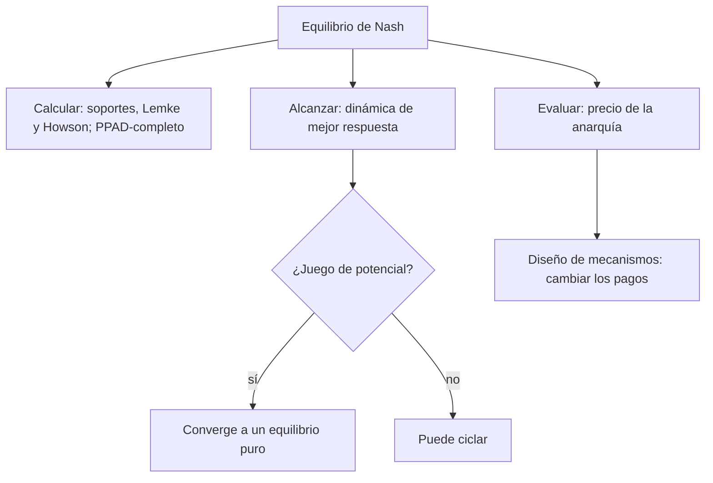

# Computación Distribuida - Modelos económicos para comportamiento en redes

## 6.2 Equilibrio de Nash.

---

El tema 6.1 definió el equilibrio de Nash: un perfil de estrategias en el que nadie gana cambiando solo. Este tema lo estudia como objeto computacional y de diseño. ¿Cómo se calcula un equilibrio y qué tan difícil es? ¿Llegan a él agentes que solo ajustan su estrategia poco a poco? ¿Cuánto bienestar se pierde porque los agentes actúan por su cuenta, el **precio de la anarquía**? ¿Y cómo se cambian las reglas para que el equilibrio sea bueno? Se presentan la enumeración de soportes, la complejidad PPAD, las dinámicas de mejor respuesta y los juegos de potencial, los juegos en redes y su aplicación a incentivos en sistemas distribuidos.

### Definición y existencia

Para un juego finito con estrategias mixtas $\sigma = (\sigma_1, \ldots, \sigma_n),$ $\sigma^*$ es un equilibrio de Nash si para todo jugador $i$ y toda estrategia pura $s_i,$

$$u_i(\sigma_i^*, \sigma_{-i}^*) \geq u_i(s_i, \sigma_{-i}^*).$$

Basta comparar contra estrategias **puras**, porque el pago de una mixta es un promedio de pagos de puras. Por el teorema de Nash (tema 6.1), siempre existe uno en mixtas, pero puede no existir en puras (pares o nones, piedra, papel o tijera) y puede haber muchos (coordinación).

### Calcular equilibrios

**Puros:** recorrer todos los perfiles y comprobar las desviaciones unilaterales. Con $n$ jugadores y $k$ estrategias son $k^n$ perfiles, exponencial en $n,$ aunque lineal en el tamaño de la tabla de pagos.

**Mixtos en juegos de dos jugadores: enumeración de soportes.** El **soporte** de una estrategia mixta es el conjunto de estrategias con probabilidad positiva. En un equilibrio, por el principio de indiferencia, todas las estrategias del soporte de la fila dan el mismo pago contra la mezcla de la columna, y ninguna estrategia fuera del soporte da más. Para cada par de soportes $I$ y $J$ del mismo tamaño $k$ (en juegos no degenerados), se resuelve el sistema lineal

$$\sum_{j \in J} A_{ij} q_j = v \ \ (i \in I), \qquad \sum_{j \in J} q_j = 1,$$

y el análogo para $p$ con la matriz de la columna; se acepta si las probabilidades son no negativas y ninguna estrategia fuera del soporte supera el pago $v.$ Es exponencial en el peor caso. El **algoritmo de Lemke y Howson** (1964) sigue un camino de pivotes, como el simplex, y también es exponencial en el peor caso. Un juego bimatricial no degenerado tiene un número **impar** de equilibrios.

**Complejidad.** Encontrar un equilibrio de Nash no es NP-difícil en el sentido usual, porque siempre existe uno. Pertenece a **PPAD**, la clase de problemas de búsqueda cuya solución existe por un argumento de paridad en una gráfica dirigida, y es PPAD-completo incluso con dos jugadores (Chen y Deng, 2006). Los juegos de **suma cero** sí se resuelven en tiempo polinomial con programación lineal: el teorema minimax de von Neumann.

### Dinámicas y juegos de potencial

En un sistema distribuido nadie calcula el equilibrio; los agentes ajustan su estrategia. En la **dinámica de mejor respuesta**, en cada paso un jugador cambia a su mejor respuesta contra las estrategias actuales de los demás. Si llega a un punto fijo, es un equilibrio puro; pero puede ciclar, como en piedra, papel o tijera.

Un juego es **de potencial** (Monderer y Shapley, 1996) si existe una función $\Phi$ sobre los perfiles tal que, para toda desviación unilateral,

$$u_i(s'_i, s_{-i}) - u_i(s_i, s_{-i}) = \Phi(s'_i, s_{-i}) - \Phi(s_i, s_{-i}).$$

**Teorema.** En un juego de potencial finito existe un equilibrio puro, y toda dinámica de mejoras estrictas converge a uno. **Demostración:** cada mejora estricta aumenta $\Phi,$ que toma un número finito de valores; no puede crecer indefinidamente, así que la dinámica se detiene, y donde se detiene nadie puede mejorar. $\blacksquare$ Los juegos de **congestión** (tema 6.5) y los de **coordinación en redes** son de potencial: en estos, $\Phi$ es la suma, sobre las aristas, del pago de coordinación.

### Eficiencia: precio de la anarquía

Para un juego con un costo social $C$ que se quiere minimizar, el **precio de la anarquía** es

$$\text{PoA} = \frac{\max_{s \text{ equilibrio}} C(s)}{\min_{s} C(s)},$$

la razón entre el peor equilibrio y el óptimo; el **precio de la estabilidad** usa el mejor equilibrio. En el **ejemplo de Pigou**, una unidad de tráfico va de $s$ a $t$ por dos rutas, una de costo constante 1 y otra de costo igual a la fracción $x$ que la usa. En equilibrio todos usan la segunda, que nunca es peor que 1, y el costo total es 1; el óptimo manda la mitad por cada una, con costo $\frac{1}{2} \cdot \frac{1}{2} + \frac{1}{2} \cdot 1 = \frac{3}{4}.$ PoA $= 4/3,$ que es el peor caso para costos lineales (Roughgarden y Tardos, 2002; tema 6.5).

### Juegos en redes e incentivos

En un **juego en red**, el pago de cada nodo depende solo de su estrategia y de las de sus vecinos. Los **bienes públicos en redes** modelan compartir: aportar beneficia a los vecinos y cuesta a quien aporta. Sin incentivos, el equilibrio suele ser que nadie aporte (tema 6.1, ejercicio 4). Los mecanismos para corregirlo cambian los pagos:

- **Reciprocidad:** BitTorrent sube datos preferentemente a los pares que le suben (estrangulamiento con ojo por ojo).
- **Reputación:** los pares que contribuyen tienen prioridad en el servicio.
- **Pagos o subsidios:** créditos por contribuir, como las recompensas por bloque en las cadenas de bloques.
- **Mecanismos compatibles con incentivos:** Vickrey y VCG, para asignar recursos cuando los agentes tienen información privada.



### Implementación en Python

El programa construye la tabla de pagos del ejercicio 1 y encuentra sus equilibrios; implementa la enumeración de soportes con `numpy` para juegos bimatriciales y la aplica a piedra, papel o tijera y a un juego de $3 \times 3$ con 7 equilibrios, prueba la dinámica de mejor respuesta y calcula el precio de la anarquía del ejemplo de Pigou (ejercicio 2); encuentra los equilibrios del juego de votación (ejercicio 3); analiza el juego de compartir en tres topologías y el subsidio necesario para que compartir sea el único equilibrio (ejercicio 4), y simula la dinámica de mejor respuesta en una red con juegos de coordinación y anticoordinación (ejercicio 5).

```python
import random
from fractions import Fraction
from itertools import product, combinations
import numpy as np
import networkx as nx

random.seed(62)

def equilibrios_puros(S, pago):
    res = []
    for perfil in product(*S):
        u = pago(perfil)
        if all(pago(perfil[:i] + (s,) + perfil[i + 1:])[i] <= u[i] for i in range(len(S)) for s in S[i]):
            res.append((perfil, u))
    return res

# --- Ejercicio 1: tres nodos que cooperan o se desvían ---
def nodos(perfil):
    c = perfil.count("C")
    return tuple(Fraction(10 * c, 3) - 2 if a == "C" else Fraction(10 * c, 3) + 3 for a in perfil)

print("ejercicio 1: matriz de pagos del jugador 1 según cuántos de los otros dos cooperan")
for a in "CD":
    print(f"   juega {a}: " + "  ".join(f"{k} cooperan: {float(nodos((a,) + ('C',) * k + ('D',) * (2 - k))[0]):5.2f}" for k in range(3)))
eq = equilibrios_puros([("C", "D")] * 3, nodos)
print("   equilibrios:", [("".join(p), [float(x) for x in u]) for p, u in eq],
      "| todos cooperan:", [float(x) for x in nodos(("C",) * 3)])

# --- Ejercicio 2: equilibrios mixtos por enumeración de soportes, n x m ---
def soporte(A, B):
    """Todos los equilibrios de un juego bimatricial no degenerado, por soportes del mismo tamaño."""
    A, B = np.array(A, float), np.array(B, float)
    n, m = A.shape
    res = []
    for k in range(1, min(n, m) + 1):
        for I in combinations(range(n), k):
            for J in combinations(range(m), k):
                # q en J hace indiferente a la fila en I; p en I hace indiferente a la columna en J
                Ma = np.zeros((k + 1, k + 1)); Ma[:k, :k] = A[np.ix_(I, J)]; Ma[:k, k] = -1; Ma[k, :k] = 1
                Mb = np.zeros((k + 1, k + 1)); Mb[:k, :k] = B[np.ix_(I, J)].T; Mb[:k, k] = -1; Mb[k, :k] = 1
                rhs = np.zeros(k + 1); rhs[k] = 1
                try:
                    qv = np.linalg.solve(Ma, rhs); pv = np.linalg.solve(Mb, rhs)
                except np.linalg.LinAlgError:
                    continue
                q, va = qv[:k], qv[k]; p, vb = pv[:k], pv[k]
                if (q < -1e-9).any() or (p < -1e-9).any():
                    continue
                P = np.zeros(n); P[list(I)] = p; Q = np.zeros(m); Q[list(J)] = q
                if (A @ Q <= va + 1e-9).all() and (P @ B <= vb + 1e-9).all():
                    r4 = lambda x: round(float(x), 4) + 0.0
                    res.append(([r4(x) for x in P], [r4(x) for x in Q], r4(va), r4(vb)))
    return res

PPT_A = [[0, -1, 1], [1, 0, -1], [-1, 1, 0]]
PPT_B = [[-x for x in fila] for fila in PPT_A]
print("ejercicio 2: piedra, papel o tijera:", soporte(PPT_A, PPT_B))
A = [[3, 0, 2], [1, 2, 0], [0, 1, 3]]
B = [[2, 1, 0], [0, 3, 1], [1, 0, 2]]
for P, Q, va, vb in soporte(A, B):
    print(f"   juego 3 x 3: fila {P}, columna {Q}, pagos ({va}, {vb})")

def mejor_respuesta(A, B, i0=0, j0=0, max_iter=50):
    i, j, hist = i0, j0, [(i0, j0)]
    for _ in range(max_iter):
        i2 = int(np.argmax(np.array(A)[:, j]))
        j2 = int(np.argmax(np.array(B)[i2, :]))
        if (i2, j2) == (i, j):
            return "converge", hist
        i, j = i2, j2; hist.append((i, j))
        if hist.count((i, j)) > 1:
            return "ciclo", hist
    return "sin converger", hist

print("   mejor respuesta alternada en el juego 3 x 3 desde (0, 0):", mejor_respuesta(A, B))
print("   en piedra, papel o tijera:", mejor_respuesta(PPT_A, PPT_B))

# precio de la anarquía: el ejemplo de Pigou y la red de Braess (tema 6.5)
def pigou(x): return x * x + (1 - x) * 1          # fracción x por la ruta de costo x, el resto por la de costo 1
opt = min(pigou(x / 1000) for x in range(1001))
print(f"   precio de la anarquía en Pigou: equilibrio 1 (todos por la ruta x), óptimo {opt:.4f}, PoA = {1 / opt:.4f} = 4/3")

# --- Ejercicio 3: votación ---
def votacion(pref, b, c):
    """Cada nodo vota (por su preferencia) o se abstiene. El valor ganador es el de la mayoría de votos;
    empate o nadie vota: no hay acuerdo. Pago: b si gana su preferencia, menos c si votó."""
    def pago(perfil):
        votos = [pref[i] for i in range(3) if perfil[i]]
        uno = sum(votos); cero = len(votos) - uno
        gan = 1 if uno > cero else (0 if cero > uno else None)
        return tuple((b if gan == pref[i] else 0) - (c if perfil[i] else 0) for i in range(3))
    return pago

for pref in ((1, 1, 1), (1, 1, 0)):
    for b, c in ((3, 1), (3, 1.5)):
        eq = equilibrios_puros([(0, 1)] * 3, votacion(pref, b, c))
        print(f"ejercicio 3: preferencias {pref}, b = {b}, c = {c}: equilibrios"
              f" {[(''.join(map(str, p)), u) for p, u in eq]}")

# --- Ejercicio 4: compartir en P2P, con y sin incentivo ---
def p2p(G, b, c, r=0):
    nodos_ = list(G)
    def pago(perfil):
        s = dict(zip(nodos_, perfil))
        return tuple(b * sum(s[j] for j in G[i]) - (c - r) * s[i] for i in nodos_)
    return pago

for nombre, G in (("anillo de 6", nx.cycle_graph(6)), ("estrella de 6", nx.star_graph(5)), ("completa de 6", nx.complete_graph(6))):
    b, c = 1, 2
    pago = p2p(G, b, c)
    eq = equilibrios_puros([(0, 1)] * len(G), pago)
    mejor = max(product((0, 1), repeat=len(G)), key=lambda p: sum(pago(p)))
    rmin = next(r / 10 for r in range(0, 50) if all(p == tuple([1] * len(G)) for p, _ in equilibrios_puros([(0, 1)] * len(G), p2p(G, b, c, r / 10)))
                and equilibrios_puros([(0, 1)] * len(G), p2p(G, b, c, r / 10)))
    print(f"ejercicio 4: {nombre}, b = 1, c = 2: equilibrio {[''.join(map(str, p)) for p, _ in eq]} con bienestar"
          f" {sum(eq[0][1])}; óptimo {''.join(map(str, mejor))} con {sum(pago(mejor))};"
          f" subsidio mínimo para que compartir sea el único equilibrio: r > {rmin - 0.1:.1f}")

# --- Ejercicio 5: dinámica de mejor respuesta en una red ---
def dinamica(G, pago_local, inicial, max_iter=200):
    s = dict(inicial); historia = [sum(s.values())]
    for it in range(max_iter):
        cambio = False
        for v in G:                                    # actualización asíncrona, un nodo a la vez
            mejor = max((0, 1), key=lambda a: (pago_local(G, s, v, a), a == s[v]))
            if mejor != s[v]:
                s[v] = mejor; cambio = True
        historia.append(sum(s.values()))
        if not cambio:
            return "converge", it + 1, historia
    return "sin converger", max_iter, historia

coord = lambda G, s, v, a: sum((2 if a == 1 else 1) * (s[u] == a) for u in G[v])   # coordinación: A vale 2, B vale 1
anti = lambda G, s, v, a: sum(s[u] != a for u in G[v])                              # anticoordinación
H = nx.watts_strogatz_graph(100, 6, 0.1, seed=5)
ini = {v: int(random.random() < 0.3) for v in H}
for nombre, f in (("coordinación", coord), ("anticoordinación", anti)):
    est, it, hist = dinamica(H, f, ini)
    print(f"ejercicio 5: {nombre:16} {est} en {it} barridos; nodos con la estrategia 1: {hist[:6]} ... {hist[-1]}")
# un juego sin equilibrio puro: pares o nones en dos nodos, actualizando simultáneamente
s = (0, 0); ciclo = [s]
for _ in range(6):
    s = (s[1], 1 - s[0]); ciclo.append(s)            # el 1 quiere igualar, el 2 quiere diferir
print("   pares o nones con mejor respuesta simultánea:", ciclo)
```

Salida:

```text
ejercicio 1: matriz de pagos del jugador 1 según cuántos de los otros dos cooperan
   juega C: 0 cooperan:  1.33  1 cooperan:  4.67  2 cooperan:  8.00
   juega D: 0 cooperan:  3.00  1 cooperan:  6.33  2 cooperan:  9.67
   equilibrios: [('DDD', [3.0, 3.0, 3.0])] | todos cooperan: [8.0, 8.0, 8.0]
ejercicio 2: piedra, papel o tijera: [([0.3333, 0.3333, 0.3333], [0.3333, 0.3333, 0.3333], 0.0, 0.0)]
   juego 3 x 3: fila [1.0, 0.0, 0.0], columna [1.0, 0.0, 0.0], pagos (3.0, 2.0)
   juego 3 x 3: fila [0.0, 1.0, 0.0], columna [0.0, 1.0, 0.0], pagos (2.0, 3.0)
   juego 3 x 3: fila [0.0, 0.0, 1.0], columna [0.0, 0.0, 1.0], pagos (3.0, 2.0)
   juego 3 x 3: fila [0.75, 0.25, 0.0], columna [0.5, 0.5, 0.0], pagos (1.5, 1.5)
   juego 3 x 3: fila [0.3333, 0.0, 0.6667], columna [0.25, 0.0, 0.75], pagos (2.25, 1.3333)
   juego 3 x 3: fila [0.0, 0.5, 0.5], columna [0.0, 0.75, 0.25], pagos (1.5, 1.5)
   juego 3 x 3: fila [0.3333, 0.25, 0.4167], columna [0.25, 0.5, 0.25], pagos (1.25, 1.0833)
   mejor respuesta alternada en el juego 3 x 3 desde (0, 0): ('converge', [(0, 0)])
   en piedra, papel o tijera: ('ciclo', [(0, 0), (1, 2), (0, 1), (2, 0), (1, 2)])
   precio de la anarquía en Pigou: equilibrio 1 (todos por la ruta x), óptimo 0.7500, PoA = 1.3333 = 4/3
ejercicio 3: preferencias (1, 1, 1), b = 3, c = 1: equilibrios [('001', (3, 3, 2)), ('010', (3, 2, 3)), ('100', (2, 3, 3))]
ejercicio 3: preferencias (1, 1, 1), b = 3, c = 1.5: equilibrios [('001', (3, 3, 1.5)), ('010', (3, 1.5, 3)), ('100', (1.5, 3, 3))]
ejercicio 3: preferencias (1, 1, 0), b = 3, c = 1: equilibrios [('001', (0, 0, 2)), ('010', (3, 2, 0)), ('100', (2, 3, 0))]
ejercicio 3: preferencias (1, 1, 0), b = 3, c = 1.5: equilibrios [('001', (0, 0, 1.5)), ('010', (3, 1.5, 0)), ('100', (1.5, 3, 0))]
ejercicio 4: anillo de 6, b = 1, c = 2: equilibrio ['000000'] con bienestar 0; óptimo 000000 con 0; subsidio mínimo para que compartir sea el único equilibrio: r > 2.0
ejercicio 4: estrella de 6, b = 1, c = 2: equilibrio ['000000'] con bienestar 0; óptimo 100000 con 3; subsidio mínimo para que compartir sea el único equilibrio: r > 2.0
ejercicio 4: completa de 6, b = 1, c = 2: equilibrio ['000000'] con bienestar 0; óptimo 111111 con 18; subsidio mínimo para que compartir sea el único equilibrio: r > 2.0
ejercicio 5: coordinación     converge en 4 barridos; nodos con la estrategia 1: [30, 86, 95, 100, 100] ... 100
ejercicio 5: anticoordinación converge en 4 barridos; nodos con la estrategia 1: [30, 55, 46, 47, 47] ... 47
   pares o nones con mejor respuesta simultánea: [(0, 0), (0, 1), (1, 1), (1, 0), (0, 0), (0, 1), (1, 1)]
```

### Ejercicios Propuestos

1. **Cooperar o desviarse.** Tres nodos pueden cooperar, con costo 2 y un beneficio global de 10 que se reparte por igual entre los tres, o desviarse, con costo 0 y un beneficio personal adicional de 3. Construye la matriz de pagos, encuentra los equilibrios de Nash y analiza su eficiencia de Pareto.

2. **Algoritmos.** Calcula equilibrios en estrategias mixtas, implementa la dinámica de mejor respuesta para juegos de $n \times m$ y calcula el precio de la anarquía.

3. **Votación.** Tres nodos deben acordar un valor. Cada uno prefiere $v_i \in \{0, 1\},$ votar le cuesta $c > 0$ y obtiene $b > c$ si gana su preferencia. Modela el juego, encuentra sus equilibrios y propón un mecanismo que incentive la participación.

4. **Red P2P.** Compartir archivos cuesta $c$ y da $b$ a cada vecino; la utilidad es $kb - c$ si se comparte y $kb$ si no, con $k$ el número de vecinos que comparten. Encuentra los equilibrios en distintas topologías, la pérdida de eficiencia y mecanismos para mejorarla.

5. **Dinámica en red.** Simula la dinámica de mejor respuesta en una red y estudia su convergencia o falta de convergencia.

### Soluciones

**Ejercicio 1.** Con $c$ cooperadores, quien coopera obtiene $\frac{10c}{3} - 2$ y quien se desvía $\frac{10c}{3} + 3.$ Desviarse da siempre 5 más que cooperar, sin importar lo que hagan los demás: es **estrictamente dominante**. El único equilibrio es que todos se desvíen, con 3 para cada uno, mientras que si todos cooperan obtienen 8: el equilibrio no es eficiente en el sentido de Pareto, porque todos estarían mejor cooperando. Es un dilema del prisionero de tres jugadores; la cooperación necesita repetición, reputación o un pago adicional de más de 5 por cooperar.

**Ejercicio 2.** Ver el programa. En piedra, papel o tijera, la enumeración de soportes encuentra el único equilibrio, $(1/3, 1/3, 1/3)$ para ambos, con valor 0, y la dinámica de mejor respuesta cicla. En el juego de $3 \times 3$ encuentra 7 equilibrios, un número impar como predice la teoría: 3 puros, 3 con soporte de tamaño 2 y uno con soporte completo. La dinámica de mejor respuesta para juegos de $n \times m$ es `mejor_respuesta`: alterna mejores respuestas y detecta un ciclo cuando un perfil se repite. El precio de la anarquía del ejemplo de Pigou se calcula buscando el óptimo en una rejilla: $3/4,$ contra el costo 1 del equilibrio.

**Ejercicio 3.** **Modelo:** cada nodo vota por su preferencia o se abstiene; gana el valor con más votos, y con empate o sin votos no hay acuerdo. **Equilibrios.** Con $b > c,$ si los tres prefieren 1, exactamente **un** nodo vota, cualquiera; con más votantes, cualquiera de ellos podría abstenerse sin cambiar el resultado y ahorrarse $c.$ Si dos prefieren 1 y uno 0, también hay equilibrios con un solo votante, incluso el de la minoría, porque un nodo de la mayoría que votara solo empataría. Es la **paradoja del votante**: con costo de votar, la participación de equilibrio es mínima y el resultado puede no reflejar a la mayoría. **Mecanismos:** recompensar la participación con más de $c$ (como las recompensas por validar bloques), hacer obligatoria la participación con penalización, o reducir $c$ a casi cero (votar como parte automática del protocolo). En sistemas de consenso tolerantes a fallas no se vota por preferencias, sino que se exige un quórum de mensajes, y los incentivos se resuelven con depósitos que se pierden si se viola el protocolo.

**Ejercicio 4.** Compartir es estrictamente dominado para todos, así que en **cualquier topología** el único equilibrio es que nadie comparta, con bienestar 0. El óptimo social sí depende de la red: un nodo que comparte genera $b \deg(v) - c$ de bienestar neto, y conviene que comparta si $\deg(v) > c/b.$ En el anillo con $b = 1,$ $c = 2,$ el beneficio iguala al costo y el óptimo es indiferente; en la estrella conviene que comparta solo el centro, con bienestar 3; en la completa, que compartan todos, con 18. Como el equilibrio tiene bienestar 0 y el óptimo positivo, el **precio de la anarquía**, medido como razón de bienestares, no está acotado. **Mecanismo:** un subsidio $r$ por compartir hace que la utilidad sea $kb - (c - r);$ con $r > c$ compartir pasa a ser dominante, y el programa confirma que es el umbral en las tres redes. Un subsidio así cuesta $nr;$ por eso se prefieren mecanismos de reciprocidad, que no requieren dinero externo.

**Ejercicio 5.** La coordinación en red, en la que cada nodo gana 2 por cada vecino con la estrategia 1 si la usa y 1 por cada vecino con la 0, es un juego de potencial: la dinámica asíncrona converge, aquí en 4 barridos, y como la estrategia 1 es mejor, se extiende a toda la red. La anticoordinación, en la que cada nodo gana por cada vecino distinto, también es de potencial y converge, a una partición en la que cada nodo difiere de la mayoría de sus vecinos, cerca del corte máximo local. En cambio, con actualización **simultánea** de mejores respuestas en pares o nones, que no tiene equilibrio puro, los dos jugadores recorren un ciclo de 4 perfiles para siempre.

### Referencias

1. Nisan, N., Roughgarden, T., Tardos, É., and Vazirani, V. V., _Algorithmic Game Theory_. Cambridge University Press, 2007. Capítulos 2, 3, 17 y 19.
2. Daskalakis, C., Goldberg, P. W., and Papadimitriou, C. H., The complexity of computing a Nash equilibrium. _SIAM Journal on Computing_ 39(1), 2009.
3. Monderer, D., and Shapley, L. S., Potential games. _Games and Economic Behavior_ 14(1), 1996.
4. Roughgarden, T., _Twenty Lectures on Algorithmic Game Theory_. Cambridge University Press, 2016.
