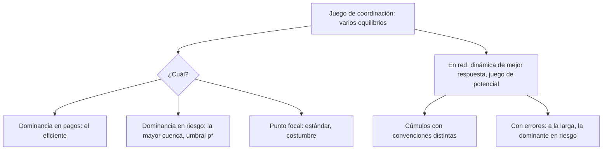

# Computación Distribuida - Modelos económicos para comportamiento en redes

## 6.3 Juegos de coordinación y estrategias.

---

En un **juego de coordinación**, a los jugadores les conviene sobre todo hacer **lo mismo** que los demás: usar el mismo protocolo, el mismo formato de archivo, la misma versión de software, conducir por el mismo lado del camino. Tienen varios equilibrios, y el problema ya no es que el equilibrio sea malo, como en el dilema del prisionero, sino **cuál** se alcanza. Este tema define los juegos de coordinación y sus variantes, introduce los criterios para elegir entre equilibrios (dominancia en pagos y en riesgo), estudia las dinámicas que llevan a la coordinación en una red, el efecto de la topología, el ruido y los costos de cambio, y la teoría de las **convenciones** como equilibrios estables seleccionados por la evolución.

### Juegos de coordinación

Un juego de dos jugadores con estrategias $A$ y $B$ es de coordinación si coordinar es mejor que no coordinar para ambos: $u(A, A) > u(B, A)$ y $u(B, B) > u(A, B).$ Entonces $(A, A)$ y $(B, B)$ son equilibrios de Nash estrictos, y hay un tercero en estrategias mixtas.

| Juego | Matriz de pagos | Rasgo |
| --- | --- | --- |
| coordinación pura | $(1, 1)$ en la diagonal, $(0, 0)$ fuera | indiferencia entre los equilibrios |
| con un equilibrio mejor | $(2, 2)$ y $(1, 1)$ en la diagonal | conflicto entre lo eficiente y lo establecido |
| batalla de los sexos | $(3, 2)$ y $(2, 3)$ en la diagonal | cada uno prefiere un equilibrio distinto |
| caza del ciervo | ciervo $(5, 5);$ liebre $(3, 3);$ cruzados $(0, 3)$ | el eficiente es arriesgado |

### Selección de equilibrios

- **Dominancia en pagos:** un equilibrio es mejor que otro para todos. En la caza del ciervo, (ciervo, ciervo).
- **Dominancia en riesgo** (Harsanyi y Selten, 1988): el equilibrio que conviene elegir si no se sabe qué hará el otro, el que tiene mayor **cuenca de atracción**. En un juego simétrico con pagos $a = u(A, A),$ $b = u(A, B),$ $c = u(B, A),$ $d = u(B, B),$ conviene $A$ si la fracción de oponentes que juega $A$ es mayor que

$$p^* = \frac{d - b}{(a - c) + (d - b)},$$

y $A$ domina en riesgo si $p^* \lt 1/2.$ En la caza del ciervo $p^* = 3/5:$ la liebre domina en riesgo aunque el ciervo domine en pagos.

- **Puntos focales** (Schelling, 1960): rasgos externos, como la costumbre o un estándar publicado, que hacen evidente cuál elegir.

### Coordinación en redes

Cuando cada nodo juega el juego de coordinación con cada vecino y elige una sola estrategia para todos, es el modelo de cascadas del tema 5.1: un nodo adopta $A$ si al menos una fracción $p^*$ de sus vecinos la usa. Es un **juego de potencial**, así que la dinámica de mejor respuesta **asíncrona** siempre converge (tema 6.2). Pero:

- **La actualización simultánea puede oscilar:** en una gráfica bipartita en la que los dos lados empiezan con estrategias opuestas, todos cambian a la vez y se intercambian para siempre.
- **El resultado depende de las condiciones iniciales:** la red puede quedar dividida en **cúmulos** con convenciones distintas, porque un cúmulo denso no se invade (tema 5.1). La coordinación global no está garantizada.
- **La topología importa:** en un anillo, los grupos se forman fácilmente y persisten; en redes con atajos o concentradores, las convenciones se extienden más.
- **Los costos de cambio** congelan la situación inicial: un nodo solo cambia si la ganancia supera el costo.

### Convenciones y ruido

Una **convención** (Lewis, 1969) es un equilibrio de un juego de coordinación que la población sigue porque los demás lo siguen. Peyton Young (1993) y Kandori, Mailath y Rob (1993) explicaron cuál surge a la larga con la **dinámica con errores**: los agentes responden a lo que observan, pero con probabilidad pequeña $\epsilon$ se equivocan. Así la población salta de vez en cuando de una convención a otra, y pasar de $B$ a $A$ requiere que una fracción $p^*$ se equivoque a la vez, mientras que salir de $A$ requiere $1 - p^*.$ Cuando $\epsilon \to 0,$ la población pasa casi todo el tiempo en el equilibrio **dominante en riesgo**, que puede ser ineficiente. Por eso el teclado QWERTY o un protocolo heredado pueden persistir aunque haya alternativas mejores: los **efectos de red** y la dependencia de la trayectoria.



### Implementación en Python

El programa calcula los equilibrios del juego de protocolos con costo de cambio (ejercicio 1); compara la actualización simultánea, la secuencial y la aleatoria, y el efecto de las condiciones iniciales en una red de mundo pequeño (ejercicio 2); encuentra los equilibrios del juego de versiones de software para varios parámetros (ejercicio 3); simula la formación de convenciones en cuatro topologías con mejor respuesta, ruido, costos de cambio e imitación (ejercicios 4 y 6), y simula la dinámica de Kandori, Mailath y Rob en la caza del ciervo (ejercicio 5).

```python
import math, random
from itertools import product
import networkx as nx

random.seed(63)

def equilibrios(S, pago):
    return [p for p in product(*S)
            if all(pago(p[:i] + (s,) + p[i + 1:])[i] <= pago(p)[i] for i in range(len(S)) for s in S[i])]

# --- Ejercicio 1: dos protocolos con costo de cambio ---
inicial = ("A", "B")                        # el jugador 1 usa A y el 2 usa B al principio
def protocolos(p):
    base = 10 if p[0] == p[1] else 0
    return tuple(base - (2 if p[i] != inicial[i] else 0) for i in range(2))
print("ejercicio 1: el jugador 1 usa A y el 2 usa B; cambiar cuesta 2")
for a in "AB":
    print("   " + "  ".join(f"({a},{b}): {protocolos((a, b))}" for b in "AB"))
print("   equilibrios:", equilibrios([("A", "B")] * 2, protocolos))
for n in (4,):
    ini = ("A", "A", "B", "B")
    def pago4(p):
        todos = len(set(p)) == 1
        return tuple((10 if todos else 0) - (2 if p[i] != ini[i] else 0) for i in range(4))
    print(f"   4 nodos, dos en A y dos en B: equilibrios {[''.join(x) for x in equilibrios([('A', 'B')] * 4, pago4)]}")

# --- Ejercicio 2: reglas de actualización ---
def coordinacion(G, s, v, a, ventaja=1.0):
    return sum((ventaja if a == 1 else 1.0) * (s[u] == a) for u in G[v])

def dinamica(G, s0, regla, max_pasos=200):
    s = dict(s0)
    for t in range(1, max_pasos + 1):
        if regla == "simultánea":
            nuevo = {v: max((0, 1), key=lambda a: (coordinacion(G, s, v, a), a == s[v])) for v in G}
            cambio = nuevo != s; s = nuevo
        else:
            orden = list(G) if regla == "secuencial" else random.sample(list(G), len(G))
            cambio = False
            for v in orden:
                b = max((0, 1), key=lambda a: (coordinacion(G, s, v, a), a == s[v]))
                if b != s[v]: s[v] = b; cambio = True
        if not cambio:
            return t, s
    return None, s

C = nx.complete_bipartite_graph(3, 3)
alterno = {v: int(v < 3) for v in C}                 # un lado con 1 y el otro con 0
print("ejercicio 2: bipartita completa K(3,3) con los lados en estrategias opuestas")
for regla in ("simultánea", "secuencial", "aleatoria"):
    t, s = dinamica(C, alterno, regla)
    print(f"   {regla:10}: {'no converge en 200 pasos' if t is None else f'converge en {t} pasos'}, estado final {''.join(str(s[v]) for v in C)}")
G = nx.watts_strogatz_graph(200, 6, 0.1, seed=1)
for frac in (0.3, 0.5, 0.7):
    ts, finales = [], []
    for _ in range(50):
        s0 = {v: int(random.random() < frac) for v in G}
        t, s = dinamica(G, s0, "aleatoria")
        ts.append(t); finales.append(sum(s.values()) / len(G))
    print(f"   mundo pequeño de 200, fracción inicial con 1 = {frac}: pasos {sum(ts) / 50:.1f},"
          f" fracción final con 1: media {sum(finales) / 50:.2f}, consenso total en {sum(f in (0, 1) for f in finales)}/50")

# --- Ejercicio 3: versiones de software ---
def software(alfa, beta, gamma, ini=("v1",) * 5):
    calidad = {"v1": 1, "v2": 2}
    def pago(p):
        coord = len(set(p)) == 1
        return tuple(alfa * coord + beta * calidad[p[i]] - gamma * (p[i] != ini[i]) for i in range(5))
    return pago
print("ejercicio 3: 5 nodos en v1; u = alfa [todos iguales] + beta calidad - gamma [migró]")
for a, b, g in ((10, 1, 2), (10, 3, 2), (1, 1, 0.5), (10, 1, 0.5)):
    eq = equilibrios([("v1", "v2")] * 5, software(a, b, g))
    nombres = sorted({"todos v1" if set(e) == {"v1"} else "todos v2" if set(e) == {"v2"} else "".join(x[1] for x in e) for e in eq})
    bien = {n: sum(software(a, b, g)(("v1",) * 5 if n == "todos v1" else ("v2",) * 5)) for n in nombres if n.startswith("todos")}
    print(f"   alfa = {a:2}, beta = {b}, gamma = {g}: equilibrios {nombres}; bienestar {bien}")

# --- Ejercicios 4 y 6: convenciones con ruido en distintas topologías ---
def convencion(G, pasos, eps, costo=0.0, regla="mejor"):
    s = {v: random.randint(0, 1) for v in G}
    for _ in range(pasos):
        v = random.choice(list(G))
        if random.random() < eps:
            s[v] = random.randint(0, 1); continue
        if regla == "mejor":
            pa = {a: coordinacion(G, s, v, a) - (costo if a != s[v] else 0) for a in (0, 1)}
            s[v] = max((0, 1), key=lambda a: (pa[a], a == s[v]))
        elif regla == "imitación":                     # copia al vecino más exitoso (incluido él mismo)
            cand = list(G[v]) + [v]
            s[v] = s[max(cand, key=lambda u: (coordinacion(G, s, u, s[u]) / max(1, G.degree(u)), u == v))]
    mayoria = max(sum(s.values()), len(G) - sum(s.values())) / len(G)
    grupos = nx.number_connected_components(G.subgraph([v for v in G if s[v] == 1])) + \
             nx.number_connected_components(G.subgraph([v for v in G if s[v] == 0]))
    return mayoria, grupos

redes = {"anillo": nx.watts_strogatz_graph(300, 4, 0, seed=2), "mundo pequeño": nx.watts_strogatz_graph(300, 4, 0.1, seed=2),
         "aleatoria": nx.gnm_random_graph(300, 600, seed=2), "libre de escala": nx.barabasi_albert_graph(300, 2, seed=2)}
print("ejercicios 4 y 6: 300 nodos, 30 000 actualizaciones; fracción de la convención mayoritaria y número de grupos")
for regla, eps, costo in (("mejor", 0.0, 0.0), ("mejor", 0.05, 0.0), ("mejor", 0.0, 1.5), ("imitación", 0.0, 0.0)):
    fila = []
    for nombre, R in redes.items():
        res = [convencion(R, 30000, eps, costo, regla) for _ in range(5)]
        fila.append(f"{nombre} {sum(r[0] for r in res) / 5:.2f}/{sum(r[1] for r in res) / 5:.0f}")
    print(f"   {regla:9} ruido {eps:.2f} costo {costo}: " + "; ".join(fila))

# --- Ejercicio 5: protocolos de replicación P (eficiente) y Q (seguro), caza del ciervo ---
#            P      Q
PAGO = {("P", "P"): 5, ("P", "Q"): 0, ("Q", "P"): 3, ("Q", "Q"): 3}
p_star = (3 - 0) / (5 - 0 - 3 + 3)              # fracción de P que hace indiferente
print(f"ejercicio 5: P contra P 5, P contra Q 0, Q contra cualquiera 3; P conviene si más de {p_star:.0%} usa P")
def kmr(N, eps, periodos):
    """Kandori, Mailath y Rob: cada periodo todos responden a la fracción actual; con prob. eps se equivocan."""
    k, en_P = N, 0                       # se empieza con todos en P
    for _ in range(periodos):
        frac = k / N
        mejor = "P" if 5 * frac > 3 else "Q"
        k = sum(1 for _ in range(N) if (random.random() < eps) != (mejor == "P"))
        en_P += k / N > p_star
    return en_P / periodos
for eps in (0.05, 0.1, 0.2):
    print(f"   10 nodos, error {eps}: fracción del tiempo en la convención P: {kmr(10, eps, 20000):.3f}")
```

Salida:

```text
ejercicio 1: el jugador 1 usa A y el 2 usa B; cambiar cuesta 2
   (A,A): (10, 8)  (A,B): (0, 0)
   (B,A): (-2, -2)  (B,B): (8, 10)
   equilibrios: [('A', 'A'), ('B', 'B')]
   4 nodos, dos en A y dos en B: equilibrios ['AAAA', 'AABB', 'BBBB']
ejercicio 2: bipartita completa K(3,3) con los lados en estrategias opuestas
   simultánea: no converge en 200 pasos, estado final 111000
   secuencial: converge en 2 pasos, estado final 000000
   aleatoria : converge en 2 pasos, estado final 111111
   mundo pequeño de 200, fracción inicial con 1 = 0.3: pasos 3.6, fracción final con 1: media 0.06, consenso total en 8/50
   mundo pequeño de 200, fracción inicial con 1 = 0.5: pasos 3.9, fracción final con 1: media 0.48, consenso total en 0/50
   mundo pequeño de 200, fracción inicial con 1 = 0.7: pasos 3.6, fracción final con 1: media 0.93, consenso total en 11/50
ejercicio 3: 5 nodos en v1; u = alfa [todos iguales] + beta calidad - gamma [migró]
   alfa = 10, beta = 1, gamma = 2: equilibrios ['todos v1', 'todos v2']; bienestar {'todos v1': 55, 'todos v2': 50}
   alfa = 10, beta = 3, gamma = 2: equilibrios ['todos v1', 'todos v2']; bienestar {'todos v1': 65, 'todos v2': 70}
   alfa =  1, beta = 1, gamma = 0.5: equilibrios ['todos v1', 'todos v2']; bienestar {'todos v1': 10.0, 'todos v2': 12.5}
   alfa = 10, beta = 1, gamma = 0.5: equilibrios ['todos v1', 'todos v2']; bienestar {'todos v1': 55.0, 'todos v2': 57.5}
ejercicios 4 y 6: 300 nodos, 30 000 actualizaciones; fracción de la convención mayoritaria y número de grupos
   mejor     ruido 0.00 costo 0.0: anillo 0.53/28; mundo pequeño 0.54/4; aleatoria 0.63/5; libre de escala 0.65/3
   mejor     ruido 0.05 costo 0.0: anillo 0.61/19; mundo pequeño 0.67/10; aleatoria 0.97/12; libre de escala 0.98/7
   mejor     ruido 0.00 costo 1.5: anillo 0.55/30; mundo pequeño 0.53/9; aleatoria 0.54/14; libre de escala 0.61/5
   imitación ruido 0.00 costo 0.0: anillo 0.56/20; mundo pequeño 0.63/5; aleatoria 0.56/6; libre de escala 0.58/3
ejercicio 5: P contra P 5, P contra Q 0, Q contra cualquiera 3; P conviene si más de 60% usa P
   10 nodos, error 0.05: fracción del tiempo en la convención P: 0.003
   10 nodos, error 0.1: fracción del tiempo en la convención P: 0.015
   10 nodos, error 0.2: fracción del tiempo en la convención P: 0.008
```

### Ejercicios Propuestos

1. **Protocolos.** Unos nodos deben elegir entre los protocolos A y B; si todos eligen el mismo, cada uno obtiene 10, si no, 0, y cambiar de protocolo cuesta 2. Construye la matriz de pagos para dos jugadores, encuentra los equilibrios y analiza su estabilidad.

2. **Reglas de actualización.** Implementa la dinámica de coordinación con actualización simultánea, secuencial y aleatoria; mide el tiempo de convergencia y el efecto de las condiciones iniciales.

3. **Versiones de software.** Cinco nodos eligen entre v1 y v2, técnicamente superior pero incompatible. La utilidad es $\alpha \cdot [\text{todos coinciden}] + \beta \cdot \text{calidad}(a_i) - \gamma \cdot [\text{migró}].$ Encuentra los equilibrios, analiza el efecto de $\alpha,$ $\beta$ y $\gamma,$ y propón mecanismos para alcanzar el eficiente.

4. **Reglas y topología.** Estudia el efecto de la regla de decisión (mejor respuesta, imitación), de la topología, de los costos de cambio y la formación de cúmulos.

5. **Replicación.** Los nodos de un sistema de archivos eligen entre un protocolo de replicación P, de mejor rendimiento pero que solo funciona bien si los demás lo usan, y uno Q, seguro pero moderado. Formula el juego, encuentra sus equilibrios, analiza su eficiencia y propón cómo alcanzar el eficiente.

6. **Convenciones.** Simula la formación de convenciones por interacciones locales y analiza el efecto del ruido y su estabilidad.

### Soluciones

**Ejercicio 1.** Si el jugador 1 empieza en A y el 2 en B, la matriz resta 2 a quien cambia: $(A, A) = (10, 8),$ $(A, B) = (0, 0),$ $(B, A) = (-2, -2),$ $(B, B) = (8, 10).$ Hay dos equilibrios puros, $(A, A)$ y $(B, B),$ en los que coordinan y uno de los dos paga el cambio; es una **batalla de los sexos**: cada uno prefiere que cambie el otro. Ambos son estrictos y estables ante pequeñas perturbaciones. Con 4 nodos, dos en A y dos en B, aparece además el equilibrio **sin coordinar** $AABB:$ ningún nodo logra la coordinación cambiando solo, y cambiar solo cuesta. Es un fallo de coordinación: hace falta que varios cambien a la vez, lo que requiere comunicación o un estándar.

**Ejercicio 2.** En la bipartita completa con los lados opuestos, la actualización **simultánea** oscila sin fin: todos ven a la mayoría de sus vecinos con la otra estrategia y cambian a la vez. La **secuencial** y la **aleatoria** convergen en 2 pasos, cada una a una convención distinta según quién se mueva primero: el resultado no está determinado por el juego. En la red de mundo pequeño, la convergencia es rápida (unos 4 barridos), pero el estado final depende de la fracción inicial: con 30% iniciales en 1, casi todos terminan en 0, y con 50% la red queda dividida; el consenso total es la excepción.

**Ejercicio 3.** Con todos empezando en v1, los dos perfiles de consenso son siempre equilibrios cuando $\alpha$ es grande: nadie quiere quedarse solo. Lo que cambia es cuál es **eficiente**: v2 da un bienestar mayor si la ganancia de calidad supera el costo de migrar, $\beta \cdot (2 - 1) > \gamma.$ Con $\beta = 1,$ $\gamma = 2,$ quedarse en v1 es mejor; con $\beta = 3$ o $\gamma = 0.5,$ migrar a v2 es mejor, pero la población puede quedarse atrapada en v1. **Mecanismos:** subsidiar la migración, que reduce $\gamma;$ garantizar compatibilidad hacia atrás durante una transición, que reduce la penalización por no coordinar, o fijar una fecha en la que todos cambian a la vez, un punto focal. Es lo que hacen los cambios de protocolo con "días de bandera" y las transiciones de IPv4 a IPv6 con doble pila.

**Ejercicio 4.** Ver la tabla del programa. Con **mejor respuesta sin ruido**, el anillo queda fragmentado en unos 28 grupos, con la convención mayoritaria apenas por encima del 50%; con atajos (mundo pequeño, aleatoria) o concentradores (libre de escala), los grupos son pocos, pero sin ruido la población rara vez llega al consenso. El **ruido** desatasca la dinámica y, salvo en el anillo, lleva casi a toda la población a una convención. Los **costos de cambio** congelan la situación inicial y aumentan el número de grupos. La **imitación** de vecinos exitosos produce resultados parecidos a la mejor respuesta.

**Ejercicio 5.** Es una **caza del ciervo**: P contra P da 5, P contra Q da 0, Q siempre da 3. Equilibrios: todos P (eficiente en pagos), todos Q, y uno mixto con 60% en P. Conviene P solo si más del 60% lo usa, así que Q **domina en riesgo**. En la dinámica con errores, aunque la población empiece toda en P, termina pasando más del 98% del tiempo en Q: salir de P requiere menos errores simultáneos que entrar. **Mecanismo:** cambiar los pagos para que P sea robusto, por ejemplo con una capa de compatibilidad que dé a P contra Q algo cercano a 3, lo que baja $p^*;$ o coordinar la adopción explícitamente con un anuncio y una fecha, para que la fracción que usa P supere de golpe el umbral.

**Ejercicio 6.** Ver los ejercicios 4 y 5. Las convenciones surgen de interacciones locales cuando la red permite que una mayoría local se propague, y son estables ante perturbaciones pequeñas porque son equilibrios estrictos. Con ruido persistente, a la larga, la población pasa la mayor parte del tiempo en la convención dominante en riesgo, y el tiempo de espera para cambiar de convención crece exponencialmente con el tamaño del grupo, salvo en redes muy locales como el anillo, donde los cambios ocurren por fronteras de grupos y son mucho más rápidos (Ellison, 1993).

### Referencias

1. Easley, D., and Kleinberg, J., _Networks, Crowds, and Markets_. Cambridge University Press, 2010. Capítulos 6 y 19.
2. Young, H. P., _Individual Strategy and Social Structure_. Princeton University Press, 1998.
3. Kandori, M., Mailath, G. J., and Rob, R., Learning, mutation, and long run equilibria in games. _Econometrica_ 61(1), 1993.
4. Ellison, G., Learning, local interaction, and coordination. _Econometrica_ 61(5), 1993.
