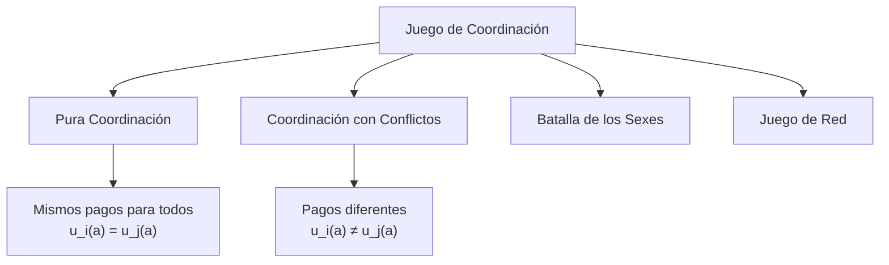
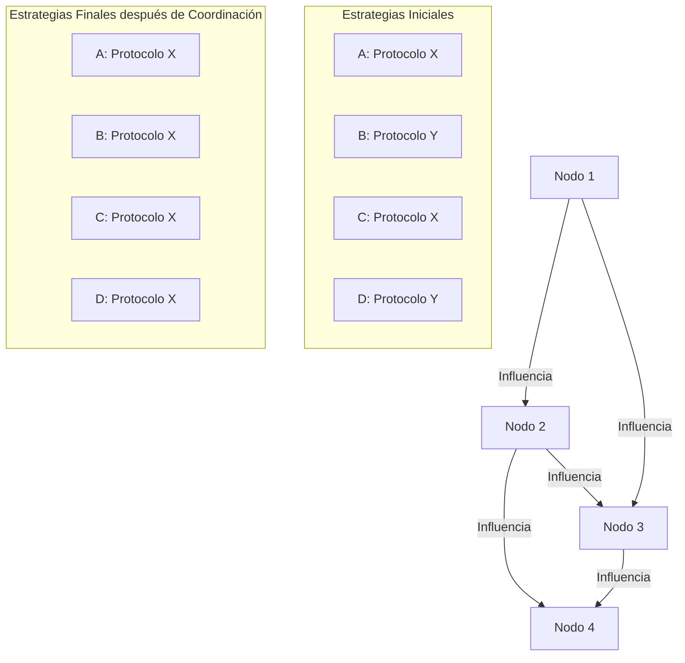

# Computación Distribuida - Modelos económicos para comportamiento en redes

## 6.3 Juegos de coordinación y estrategias.

---

Los juegos de coordinación modelan situaciones donde múltiples agentes se benefician al alinear sus decisiones. En sistemas distribuidos, estos juegos son fundamentales para entender cómo los nodos independientes pueden alcanzar consenso y coordinarse sin una autoridad central.

### Conceptos Fundamentales

#### Juego de Coordinación Formal

Un juego de coordinación se define como:

- Conjunto de jugadores $N = \{1, 2, ..., n\}$
- Para cada jugador $i$, un conjunto de acciones $A_i$
- Funciones de utilidad $u_i(a_1, a_2, ..., a_n)$ donde:
  - $u_i(a, a, ..., a) > u_i(a_i, a_{-i})$ cuando $a_i \neq a$ (beneficio por coordinar)
  - Existen múltiples acciones de coordinación posibles

#### Equilibrios de Coordinación

En un juego de coordinación puro, existen múltiples equilibrios de Nash puros, cada uno correspondiente a una convención diferente:

$$\text{NE} = \{a \in A \mid u_i(a, a, ..., a) \geq u_i(a_i, a, ..., a) \ \forall a_i \in A_i, \forall i \in N\}$$

### Tipos de Juegos de Coordinación

#### Juego de Pura Coordinación



#### Batalla de los Sexes

Dos jugadores quieren coordinar pero tienen preferencias diferentes:

|            | Fútbol | Teatro |
| :--------: | :----: | :----: |
| **Fútbol** | (2, 1) | (0, 0) |
| **Teatro** | (0, 0) | (1, 2) |

**Equilibrios de Nash**: (Fútbol, Fútbol) y (Teatro, Teatro)

### Aplicación en Computación Distribuida: Consenso

#### Modelo de Utilidad para Protocolos de Consenso

En sistemas blockchain, los mineros deben coordinar para alcanzar consenso:

$$ u\_i(a\_i, a\_{-i}) = R \cdot \mathbb{I}\_{\text{consenso}} - C\_i(a\_i) + \alpha \cdot \sum\_{j \neq i} \mathbb{I}\_{a\_j = a\_i} $$

Donde:

- $R$: recompensa por consenso
- $C_i(a_i)$: costo de la acción $a_i$
- $\alpha$: factor de coordinación
- $\mathbb{I}$: función indicadora

#### Ejercicio Propuesto 1

Considera una red con 4 nodos que deben elegir entre dos protocolos (A y B). Las utilidades son:

- Si todos eligen el mismo: cada uno obtiene 10
- Si no hay coordinación: cada uno obtiene 0
- Costo de cambiar de protocolo: 2

1. Construye la matriz de pagos para 2 jugadores
2. Encuentra todos los equilibrios de Nash
3. Analiza la estabilidad de cada equilibrio

### Estrategias de Coordinación

#### Estrategias de Mejor Respuesta

La mejor respuesta del jugador $i$ a las estrategias $a_{-i}$ es:

$$BR_i(a_{-i}) = \arg\max_{a_i \in A_i} u_i(a_i, a_{-i})$$

#### Dinámicas de Aprendizaje

```python
import numpy as np

class CoordinationGame:
    def __init__(self, num_players, num_actions):
        self.num_players = num_players
        self.num_actions = num_actions
        # Matriz de pagos: players x actions x actions
        self.payoffs = np.random.rand(num_players, num_actions, num_actions)

    def best_response(self, player, current_actions):
        """Calcula la mejor respuesta para un jugador"""
        best_action = 0
        best_payoff = -float('inf')

        for action in range(self.num_actions):
            # Calcular pago asumiendo que el jugador cambia a 'action'
            temp_actions = current_actions.copy()
            temp_actions[player] = action
            payoff = self.calculate_payoff(player, temp_actions)

            if payoff > best_payoff:
                best_payoff = payoff
                best_action = action

        return best_action

    def calculate_payoff(self, player, actions):
        """Calcula el pago para un jugador dado el vector de acciones"""
        # Implementar función de pago basada en coordinación
        coordination_level = np.sum(actions == actions[player]) - 1
        base_payoff = self.payoffs[player, actions[player], actions[player]]
        return base_payoff * (coordination_level / (self.num_players - 1))

# Simulación de dinámicas de mejor respuesta
def simulate_coordination(game, initial_actions, max_iter=100):
    history = [initial_actions.copy()]
    current_actions = initial_actions.copy()

    for iteration in range(max_iter):
        changed = False
        for player in range(game.num_players):
            br = game.best_response(player, current_actions)
            if br != current_actions[player]:
                current_actions[player] = br
                changed = True

        history.append(current_actions.copy())
        if not changed:
            break

    return history

# Ejemplo de uso
game = CoordinationGame(3, 2)  # 3 jugadores, 2 acciones
initial_actions = np.array([0, 0, 1])  # Dos con acción 0, uno con acción 1
history = simulate_coordination(game, initial_actions)
print("Evolución de las acciones:", history)
```

#### Ejercicio Propuesto 2

Extiende el simulador anterior para:

1. Implementar diferentes reglas de actualización (simultánea, secuencial, aleatoria)
2. Calcular el tiempo de convergencia a equilibrios de coordinación
3. Analizar el efecto de las condiciones iniciales

### Juegos de Red y Coordinación

#### Externalidades de Red

La utilidad de un jugador depende de cuántos otros eligen la misma acción:

$$u_i(a_i, a_{-i}) = v(a_i) + f\left(\sum_{j \neq i} \mathbb{I}_{a_j = a_i}\right)$$

Donde:

- $v(a_i)$: valor intrínseco de la acción $a_i$
- $f$: función de externalidad de red (usualmente creciente)

#### Diagrama de Coordinación en Red



### Aplicaciones en Sistemas Distribuidos

#### Selección de Protocolo

Los nodos deben coordinar para elegir el mismo protocolo de comunicación:

$$ u\_i(\text{protocolo}\_i, \text{protocolo}\_{-i}) =  \begin{cases}  b\_i - c\_i & \text{si } \text{protocolo}\_i = \text{protocolo}\_{\text{majority}} \\\ -c\_i & \text{en otro caso} \end{cases} $$

#### Coordinación en Sistemas Blockchain

En mecanismos de consenso como Proof of Work y Proof of Stake, los mineros deben coordinar para:

1. Elegir la cadena válida
2. Actualizar protocolos
3. Responder a forks

#### Ejercicio Propuesto 3

Modela una situación donde:

- 5 nodos deben elegir entre dos versiones de software (v1 y v2)
- v2 es técnicamente superior pero incompatible con v1
- Los beneficios dependen de la coordinación y la calidad técnica:

$$ u\_i (a\_i, a\_{-i}) = \alpha \cdot \mathbb{I}\_{\text{coordinación}} + \beta \cdot \text{calidad}(a\_i) - \gamma \cdot \text{costo-migración}(a\_i) $$

1. Encuentra los equilibrios de Nash
2. Analiza cómo $\alpha$, $\beta$, $\gamma$ afectan la coordinación
3. Propón mecanismos para alcanzar el equilibrio eficiente

### Teoría de Convenciones

#### Definición de Convención

Una convención es un equilibrio de Nash que es:

1. **Estable**: Autoreforzante
2. **Arbitrario**: Podrían existir otras convenciones igualmente buenas
3. **Socialmente coordinado**: Todos se benefician de seguirlo

#### Evolución de Convenciones

Modelado mediante procesos de Markov con estados absorbentes:

$$P_{a \to a'} = \prod_{i=1}^n P(\text{jugador } i \text{ cambia a } a'_i \mid a)$$

### Implementación de Mecanismos de Coordinación

#### Algoritmo de Coordinación Descentralizada

```python
class DecentralizedCoordination:
    def __init__(self, network_graph, num_options):
        self.graph = network_graph
        self.num_options = num_options
        self.decisions = {}
        self.initialize_decisions()

    def initialize_decisions(self):
        """Inicializa decisiones aleatorias para cada nodo"""
        for node in self.graph.nodes:
            self.decisions[node] = np.random.randint(self.num_options)

    def coordinate_round(self, update_prob=0.5):
        """Una ronda de actualización de coordinación"""
        new_decisions = self.decisions.copy()

        for node in self.graph.nodes:
            if np.random.random() < update_prob:
                # Observar decisiones de vecinos
                neighbor_decisions = [self.decisions[n] for n in self.graph.neighbors(node)]
                if neighbor_decisions:
                    # Elegir la acción más común entre vecinos
                    counts = np.bincount(neighbor_decisions, minlength=self.num_options)
                    new_decisions[node] = np.argmax(counts)

        self.decisions = new_decisions
        return self.get_coordination_level()

    def get_coordination_level(self):
        """Calcula el nivel de coordinación global"""
        if not self.decisions:
            return 0
        counts = np.bincount(list(self.decisions.values()), minlength=self.num_options)
        return np.max(counts) / len(self.decisions)

    def run_coordination(self, max_rounds=100, target_coordination=0.95):
        """Ejecuta el proceso de coordinación hasta convergencia"""
        coordination_history = []

        for round in range(max_rounds):
            coordination = self.coordinate_round()
            coordination_history.append(coordination)

            if coordination >= target_coordination:
                break

        return coordination_history

# Ejemplo de uso
import networkx as nx
# Crear red aleatoria
G = nx.erdos_renyi_graph(20, 0.3)  # 20 nodos, probabilidad de conexión 0.3
coordinator = DecentralizedCoordination(G, 2)  # 2 opciones
history = coordinator.run_coordination()
print("Niveles de coordinación:", history)
```

#### Ejercicio Propuesto 4

Extiende el algoritmo de coordinación para:

1. Implementar diferentes reglas de decisión (mayoría, mejor respuesta, imitación)
2. Analizar el efecto de la topología de red en la coordinación
3. Incorporar costos de cambio de decisión
4. Estudiar la formación de clusters de coordinación

### Referencias Bibliográficas

#### Bibliografía Básica

1. Easley, D., & Kleinberg, J. (2010). _Networks, Crowds, and Markets: Reasoning about a Highly Connected World_. Cambridge University Press.
   - Capítulo 6: Games (Secciones 6.1-6.5)
   - Capítulo 17: Network Effects

2. Attiya, H., & Welch, J. (2004). _Distributed Computing: Fundamentals, Simulations, and Advanced Topics_.
   - Capítulo 14: Game-Theoretic Approaches

#### Bibliografía Complementaria

3. Young, H. P. (1993). The Evolution of Conventions. _Econometrica_, 61(1), 57-84.
4. Axelrod, R. (1984). _The Evolution of Cooperation_. Basic Books.

### Ejercicios Adicionales

#### Ejercicio 5: Coordinación en Sistemas de Archivos Distribuidos

Modela un sistema donde:

- N nodos deben elegir entre dos protocolos de replicación (P y Q)
- P tiene mejor rendimiento pero mayor costo
- Q tiene menor costo pero rendimiento moderado
- Los beneficios dependen de la compatibilidad con otros nodos

1. Formula el juego de coordinación
2. Encuentra todos los equilibrios de Nash
3. Analiza la eficiencia de Pareto de cada equilibrio
4. Propón un mecanismo para alcanzar el equilibrio eficiente

#### Ejercicio 6: Simulación de Formación de Convenciones

Implementa una simulación donde:

- Agentes interactúan en una red
- Pueden adoptar diferentes comportamientos (convenciones)
- Las convenciones se propagan por imitación de vecinos exitosos

Analiza:

- Cómo emerge la coordinación global desde interacciones locales
- El efecto del ruido y las perturbaciones
- La estabilidad de las convenciones emergentes

### Soluciones a Ejercicios Selectos

#### Solución Ejercicio 1

Para el juego de coordinación con 2 jugadores y 2 protocolos (A, B):

**Matriz de pagos**:

- (A, A): (10-2, 10-2) = (8, 8) si ambos ya usaban A, o (10, 10) si ambos cambiaron
- (B, B): similar
- (A, B): (0, 0)
- (B, A): (0, 0)

**Equilibrios de Nash**: (A, A) y (B, B)

**Análisis de estabilidad**: Ambos equilibrios son estables, pero pueden existir problemas de coordinación si los jugadores no pueden comunicar sus intenciones.
