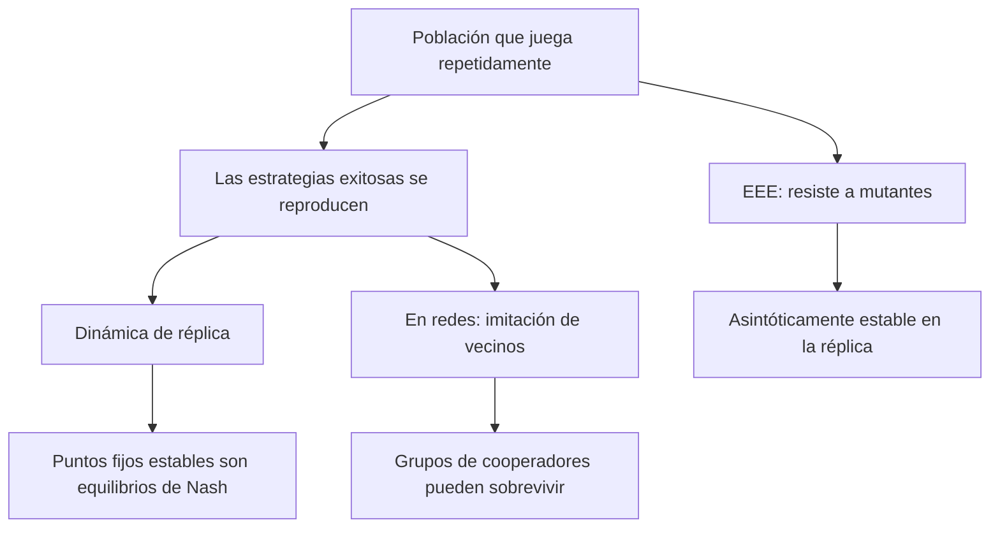

# Computación Distribuida - Modelos económicos para comportamiento en redes

## 6.4 Teoría de juegos evolucionaria.

---

La teoría de juegos clásica supone jugadores perfectamente racionales que calculan equilibrios. La **teoría de juegos evolucionaria** (Maynard Smith y Price, 1973) prescinde de esa hipótesis: una **población** grande juega repetidamente, cada individuo con una estrategia fija, y las estrategias que obtienen más pago se **reproducen** (biológicamente, o por imitación entre personas o actualización de software entre nodos). La pregunta es qué estrategias sobreviven. Sorprendentemente, a menudo se recuperan los equilibrios de Nash, ahora como resultados de un proceso dinámico. Este tema define las **estrategias evolutivamente estables**, la **dinámica de réplica** y su relación con el equilibrio de Nash, otras dinámicas (logit, mejor respuesta, con mutación) y la evolución en **redes**, donde la estructura puede sostener la cooperación.

### Estrategias evolutivamente estables

Se considera un juego simétrico de dos jugadores con matriz de pagos $A,$ donde $A_{ij}$ es el pago de la estrategia $i$ contra la $j.$ Una estrategia $s$ es **evolutivamente estable** (EEE) si una población que la usa no puede ser invadida por una fracción pequeña de mutantes con otra estrategia $t.$ Formalmente, para todo $t \neq s,$

1. $u(s, s) > u(t, s),$ o bien
2. $u(s, s) = u(t, s)$ y $u(s, t) > u(t, t).$

La primera condición dice que contra la población residente $s$ es mejor que $t;$ la segunda, que si empatan, $s$ le gana a $t$ entre los propios mutantes. Toda EEE es un equilibrio de Nash simétrico, y todo equilibrio de Nash estricto es una EEE; la EEE es un **refinamiento** del equilibrio de Nash.

### Dinámica de réplica

Sea $x_i$ la fracción de la población con la estrategia $i.$ El pago esperado de $i$ es $f_i(x) = (Ax)_i$ y el promedio $\bar f = x^\top A x.$ La **ecuación de réplica** (Taylor y Jonker, 1978) dice que una estrategia crece en proporción a cuánto supera al promedio:

$$\dot x_i = x_i \left( f_i(x) - \bar f(x) \right).$$

Preserva el símplex: las fracciones siguen sumando 1 y una estrategia ausente no aparece. Sus propiedades principales:

- Todo equilibrio de Nash simétrico es un punto fijo, pero no al revés (las estrategias puras son siempre puntos fijos).
- Todo punto fijo **estable** es un equilibrio de Nash (teorema popular de la dinámica evolutiva).
- Toda EEE es **asintóticamente estable** (Taylor y Jonker).

**Caso de dos estrategias.** Con $A = \begin{pmatrix} a & b \\ c & d \end{pmatrix}$ y $x = x_1:$

$$\dot x = x(1 - x) \left[ (a - c) x + (b - d)(1 - x) \right].$$

Además de 0 y 1, hay un punto interior $x^* = \frac{d - b}{(a - c) + (d - b)}$ si está en $(0, 1).$ Tres casos genéricos:

- **Dominancia**, si $a > c$ y $b > d,$ o al revés: una estrategia elimina a la otra. Dilema del prisionero: desertar.
- **Coordinación**, si $a > c$ y $d > b:$ el punto $x^*$ es **inestable** y separa las cuencas de las dos EEE puras.
- **Anticoordinación**, si $a \lt c$ y $d \lt b:$ el punto $x^*$ es **estable** y es la única EEE, mixta. Halcón y paloma.

**Tres o más estrategias.** En piedra, papel o tijera estándar, la réplica tiene órbitas cerradas alrededor de $(1/3, 1/3, 1/3)$ y conserva $x_1 x_2 x_3:$ ninguna estrategia gana, y la población cicla. Si ganar da más de lo que cuesta perder, el centro es atractor; si da menos, la población se aleja hacia el borde.

### Otras dinámicas

- **Logit** (respuesta suave): $\dot x = \text{softmax}(\eta f(x)) - x;$ con $\eta$ finito modela decisiones con ruido, y sus puntos fijos son los **equilibrios de respuesta cuantal**.
- **Mejor respuesta:** $\dot x = BR(x) - x;$ la población se mueve hacia la mejor respuesta pura.
- **Con mutación:** $\dot x_i = x_i(f_i - \bar f) + \mu(1/n - x_i);$ evita la extinción y estabiliza los ciclos.
- **Imitación** con la **regla de Fermi:** un individuo $v$ copia la estrategia de un vecino $u$ con probabilidad $\frac{1}{1 + e^{(P_v - P_u)/K}},$ donde $K$ es el ruido. En poblaciones grandes y bien mezcladas, la imitación se aproxima a la dinámica de réplica.

### Evolución en redes

En una población bien mezclada, el dilema del prisionero lleva siempre a la deserción. En una **red**, cada individuo juega solo con sus vecinos e imita a vecinos exitosos, y los cooperadores pueden formar **grupos** que se benefician entre sí y resisten a los desertores. Nowak y May (1992) lo mostraron en mallas, y Ohtsuki y otros (2006) dieron una regla aproximada: con imitación por mejor desempeño local en un juego de donación, la cooperación es favorecida si $b/c > k,$ el grado medio. Santos y Pacheco (2005) encontraron que las redes **libres de escala** favorecen especialmente la cooperación cuando los pagos se acumulan, porque los concentradores cooperadores obtienen mucho y son muy imitados.



### Implementación en Python

El programa integra la dinámica de réplica con Runge y Kutta de cuarto orden, que conserva las órbitas cerradas de piedra, papel o tijera (el método de Euler las abre en espiral), y comprueba las condiciones de EEE. Lo aplica al juego de compartir en P2P (ejercicio 1) y a los tres casos del juego de $2 \times 2$ (ejercicio 6); compara réplica, logit y mejor respuesta en tres variantes de piedra, papel o tijera, con y sin mutación (ejercicio 2), y simula la imitación con la regla de Fermi en redes aleatorias, de mundo pequeño y libres de escala para el juego de donación, la votación y la elección de protocolos (ejercicios 3, 4 y 5).

```python
import math, random
import numpy as np
import networkx as nx

random.seed(64)

def campo(A, x):
    f = A @ x
    return x * (f - x @ f)

def rk4(A, x, dt):
    k1 = campo(A, x); k2 = campo(A, x + dt / 2 * k1); k3 = campo(A, x + dt / 2 * k2); k4 = campo(A, x + dt * k3)
    return x + dt / 6 * (k1 + 2 * k2 + 2 * k3 + k4)

def replicador(A, x, T=60.0, dt=0.01):
    A = np.array(A, float); x = np.array(x, float)
    for _ in range(int(T / dt)):
        x = rk4(A, x, dt)
        x = np.clip(x, 0, None); x /= x.sum()
    return x

def es_eee(A, i):
    """Estrategia pura i es evolutivamente estable si para todo j != i:
    A[i][i] > A[j][i], o A[i][i] == A[j][i] y A[i][j] > A[j][j]."""
    n = len(A)
    return all(A[i][i] > A[j][i] or (A[i][i] == A[j][i] and A[i][j] > A[j][j]) for j in range(n) if j != i)

# --- Ejercicio 1: cooperar o desertar en P2P ---
print("ejercicio 1: matriz [[b - c, -c], [b, 0]] (fila: C, D)")
for b, c in ((3, 1), (1, 3), (10, 1)):
    A = [[b - c, -c], [b, 0]]
    print(f"   b = {b:2}, c = {c}: EEE {[s for s, i in (('C', 0), ('D', 1)) if es_eee(A, i)]};"
          f" réplica desde 99% cooperadores -> {np.round(replicador(A, [0.99, 0.01]), 3)}")

# --- Ejercicio 6: el juego general 2 x 2 ---
print("ejercicio 6: A = [[a, b], [c, d]]; punto interior x* = (d - b)/((a - c) + (d - b))")
for nombre, (a, b, c, d) in {"coordinación": (2, 0, 0, 1), "halcón y paloma": (-1, 4, 0, 2),
                             "dilema del prisionero": (3, 0, 5, 1)}.items():
    A = [[a, b], [c, d]]
    den = (a - c) + (d - b)
    xs = (d - b) / den if den else None
    interior = xs is not None and 0 < xs < 1
    # estabilidad del punto interior: x' = x(1-x)[(a-c)x + (b-d)(1-x)]; derivada en x*: x*(1-x*)(a - c - b + d)
    estab = "estable" if interior and xs * (1 - xs) * den < 0 else ("inestable" if interior else "-")
    finales = [round(float(replicador(A, [x0, 1 - x0])[0]), 3) for x0 in (0.1, 0.5, 0.9)]
    print(f"   {nombre:22} EEE puras {[s for s, i in (('1', 0), ('2', 1)) if es_eee(A, i)]},"
          f" x* = {xs if xs is None else round(xs, 3)} ({estab}); réplica desde x = 0.1, 0.5, 0.9 -> {finales}")

# --- Ejercicio 2: otras dinámicas en piedra, papel o tijera ---
def dinamica(A, x, regla, T=200.0, dt=0.01, eta=5.0):
    A = np.array(A, float); x = np.array(x, float); hist = []
    for k in range(int(T / dt)):
        f = A @ x
        if regla == "réplica":
            dx = (rk4(A, x, dt) - x) / dt              # Runge-Kutta: conserva las órbitas cerradas
        elif regla == "logit":
            e = np.exp(eta * (f - f.max())); dx = e / e.sum() - x
        elif regla == "mejor respuesta":
            br = np.zeros(len(x)); br[int(np.argmax(f))] = 1; dx = br - x
        x = x + dt * dx; x = np.clip(x, 1e-12, None); x /= x.sum()
        if k % int(50 / dt) == 0: hist.append(np.round(x, 3))
    return x, hist

for nombre, A in {"PPT estándar": [[0, -1, 1], [1, 0, -1], [-1, 1, 0]],
                  "PPT, ganar 2 y perder 1": [[0, -1, 2], [2, 0, -1], [-1, 2, 0]],
                  "PPT, ganar 1 y perder 2": [[0, -2, 1], [1, 0, -2], [-2, 1, 0]]}.items():
    fila = []
    for regla in ("réplica", "logit", "mejor respuesta"):
        x, _ = dinamica(A, [0.5, 0.3, 0.2], regla)
        fila.append(f"{regla}: {np.round(x, 3)}")
    x, _ = dinamica(A, [0.5, 0.3, 0.2], "réplica")
    print(f"ejercicio 2: {nombre:24} " + " | ".join(fila) + f" | x1 x2 x3 final = {np.prod(x):.4f} (inicial 0.0300)")

# ruido: la réplica con mutación converge al interior en PPT estándar
A = np.array([[0, -1, 1], [1, 0, -1], [-1, 1, 0]], float); x = np.array([0.5, 0.3, 0.2]); mu = 0.01
for _ in range(20000):
    f = A @ x; x = x + 0.01 * (x * (f - x @ f) + mu * (1 / 3 - x)); x /= x.sum()
print("   PPT estándar con mutación 0.01:", np.round(x, 3))

# --- Ejercicios 3, 4 y 5: dinámica de imitación en redes ---
def evolucion_red(G, M, x0, rondas=150, K=0.1, invasores=None):
    """Regla de Fermi: v copia a un vecino u al azar con prob. 1/(1 + exp((P_v - P_u)/K))."""
    nodos = list(G); ady = {v: list(G[v]) for v in nodos}
    s = {v: int(random.random() < x0) for v in nodos}    # 1 = primera estrategia
    if invasores is not None:
        s = {v: 1 for v in nodos}
        for v in random.sample(nodos, invasores): s[v] = 0
    for _ in range(rondas):
        P = {v: sum(M[1 - s[v]][1 - s[u]] for u in ady[v]) for v in nodos}
        nuevo = dict(s)
        for v in nodos:
            if not ady[v]: continue
            u = random.choice(ady[v])
            arg = max(-50, min(50, (P[v] - P[u]) / K))
            if random.random() < 1 / (1 + math.exp(arg)):
                nuevo[v] = s[u]
        s = nuevo
    return sum(s.values()) / len(nodos)

n = 400
redes = {"aleatoria": nx.gnm_random_graph(n, 1200, seed=1), "mundo pequeño": nx.watts_strogatz_graph(n, 6, 0.1, seed=1),
         "libre de escala": nx.barabasi_albert_graph(n, 3, seed=1)}
print("ejercicio 4: donación en red (cooperar cuesta c = 1 y da b al vecino), regla de Fermi; fracción final de cooperadores")
for b in (1.5, 3, 6):
    M = [[b - 1, -1], [b, 0]]                         # índice 0 = C, 1 = D en la matriz
    fila = [f"{nombre} {[round(evolucion_red(R, M, 0.5), 2) for _ in range(4)]}" for nombre, R in redes.items()]
    print(f"   b/c = {b}: " + ", ".join(fila))
M = [[3 - 1, -1], [3, 0]]
print("   invasión: 10 desertores en una red de cooperadores, b/c = 3:",
      ", ".join(f"{nombre} {[round(evolucion_red(R, M, 0, invasores=10), 2) for _ in range(4)]}" for nombre, R in redes.items()))

print("ejercicio 3: votación honesta (H) o manipulada (M); H con H 2, H con M 0, M con cualquiera 1")
V = [[2, 0], [1, 1]]
print(f"   EEE: {[s for s, i in (('H', 0), ('M', 1)) if es_eee(V, i)]}; umbral de la réplica x* = 0.5")
for x0 in (0.3, 0.6):
    print(f"   inicio con {x0:.0%} honestos: " + ", ".join(f"{nombre} {[round(evolucion_red(R, V, x0), 2) for _ in range(4)]}" for nombre, R in redes.items()))

print("ejercicio 5: protocolos de enrutamiento R1 (rápido y caro) y R2 (barato); compatibilidad entre vecinos")
E = [[4, 0], [1, 2]]                                    # R1-R1 4, R1-R2 0, R2-R1 1, R2-R2 2
xs = (2 - 0) / ((4 - 1) + (2 - 0))
print(f"   EEE {[s for s, i in (('R1', 0), ('R2', 1)) if es_eee(E, i)]}; umbral x* = {xs:.2f};"
      f" réplica desde 30% y 50% en R1: {[round(float(replicador(E, [x0, 1 - x0])[0]), 3) for x0 in (0.3, 0.5)]}")
```

Salida:

```text
ejercicio 1: matriz [[b - c, -c], [b, 0]] (fila: C, D)
   b =  3, c = 1: EEE ['D']; réplica desde 99% cooperadores -> [0. 1.]
   b =  1, c = 3: EEE ['D']; réplica desde 99% cooperadores -> [0. 1.]
   b = 10, c = 1: EEE ['D']; réplica desde 99% cooperadores -> [0. 1.]
ejercicio 6: A = [[a, b], [c, d]]; punto interior x* = (d - b)/((a - c) + (d - b))
   coordinación           EEE puras ['1', '2'], x* = 0.333 (inestable); réplica desde x = 0.1, 0.5, 0.9 -> [0.0, 1.0, 1.0]
   halcón y paloma        EEE puras [], x* = 0.667 (estable); réplica desde x = 0.1, 0.5, 0.9 -> [0.667, 0.667, 0.667]
   dilema del prisionero  EEE puras ['2'], x* = -1.0 (-); réplica desde x = 0.1, 0.5, 0.9 -> [0.0, 0.0, 0.0]
ejercicio 2: PPT estándar             réplica: [0.206 0.288 0.506] | logit: [0.333 0.333 0.333] | mejor respuesta: [0.318 0.366 0.316] | x1 x2 x3 final = 0.0300 (inicial 0.0300)
ejercicio 2: PPT, ganar 2 y perder 1  réplica: [0.333 0.333 0.333] | logit: [0.333 0.333 0.333] | mejor respuesta: [0.33 0.34 0.33] | x1 x2 x3 final = 0.0370 (inicial 0.0300)
ejercicio 2: PPT, ganar 1 y perder 2  réplica: [0.887 0.113 0.   ] | logit: [0.333 0.333 0.333] | mejor respuesta: [0.479 0.171 0.35 ] | x1 x2 x3 final = 0.0000 (inicial 0.0300)
   PPT estándar con mutación 0.01: [0.34  0.356 0.303]
ejercicio 4: donación en red (cooperar cuesta c = 1 y da b al vecino), regla de Fermi; fracción final de cooperadores
   b/c = 1.5: aleatoria [0.0, 0.0, 0.0, 0.0], mundo pequeño [0.0, 0.0, 0.0, 0.0], libre de escala [0.0, 0.0, 0.0, 0.0]
   b/c = 3: aleatoria [0.0, 0.0, 0.0, 0.0], mundo pequeño [0.0, 0.0, 0.0, 0.0], libre de escala [0.0, 0.0, 0.0, 0.0]
   b/c = 6: aleatoria [0.0, 0.0, 0.0, 0.0], mundo pequeño [0.0, 0.0, 0.0, 0.0], libre de escala [0.0, 1.0, 0.0, 1.0]
   invasión: 10 desertores en una red de cooperadores, b/c = 3: aleatoria [0.0, 0.0, 0.0, 0.0], mundo pequeño [0.0, 0.0, 0.0, 0.0], libre de escala [1.0, 0.0, 1.0, 0.0]
ejercicio 3: votación honesta (H) o manipulada (M); H con H 2, H con M 0, M con cualquiera 1
   EEE: ['H', 'M']; umbral de la réplica x* = 0.5
   inicio con 30% honestos: aleatoria [0.0, 0.0, 0.0, 0.0], mundo pequeño [0.07, 0.25, 0.34, 0.08], libre de escala [0.0, 0.0, 0.0, 1.0]
   inicio con 60% honestos: aleatoria [1.0, 1.0, 1.0, 1.0], mundo pequeño [1.0, 1.0, 1.0, 1.0], libre de escala [1.0, 0.0, 0.0, 1.0]
ejercicio 5: protocolos de enrutamiento R1 (rápido y caro) y R2 (barato); compatibilidad entre vecinos
   EEE ['R1', 'R2']; umbral x* = 0.40; réplica desde 30% y 50% en R1: [0.0, 1.0]
```

### Ejercicios Propuestos

1. **Compartir en P2P.** Los nodos cooperan, compartiendo con costo $c > 0,$ o desertan; los pagos son C contra C $b - c,$ C contra D $-c,$ D contra C $b,$ D contra D 0. Encuentra las EEE para distintos $b$ y $c,$ analiza la dinámica de réplica y simula la evolución en una red libre de escala.

2. **Dinámicas.** Implementa otras dinámicas evolutivas (logit, mejor respuesta), agrega ruido, analiza la estabilidad de los puntos fijos y describe el campo vectorial en el símplex.

3. **Votación.** Los nodos votan honestamente o manipulan, las recompensas dependen de la coordinación y los nodos imitan estrategias exitosas. Modélalo como juego evolutivo, encuentra sus equilibrios y simula la dinámica en distintas topologías.

4. **Topología y cooperación.** Compara la evolución de la cooperación en redes aleatorias, libres de escala y de mundo pequeño, el efecto de la razón beneficio a costo y la robustez frente a invasiones de desertores.

5. **Protocolos.** Dos protocolos de enrutamiento compiten; la utilidad depende de la compatibilidad con los vecinos y del costo y beneficio de cada uno. Formula el juego evolutivo, encuentra sus equilibrios y simula la adopción.

6. **Estabilidad.** Para el juego con matriz $A = \begin{pmatrix} a & b \\ c & d \end{pmatrix},$ deriva las condiciones para las EEE, los puntos estables de la dinámica de réplica y los equilibrios de Nash.

### Soluciones

**Ejercicio 1.** Desertar domina estrictamente: contra C, D obtiene $b > b - c,$ y contra D, $0 > -c.$ Para **todos** los $b, c > 0,$ la única EEE es D, y la réplica lleva a la extinción de los cooperadores desde cualquier estado interior, incluso desde 99% de cooperadores. En redes, en cambio, la cooperación puede sobrevivir; ver el ejercicio 4.

**Ejercicio 2.** En piedra, papel o tijera **estándar**, la réplica conserva $x_1 x_2 x_3$ (0.0300 al inicio y al final): las órbitas son cerradas y la población cicla. Si ganar vale 2 y perder $-1,$ el centro es un **atractor**; si ganar vale 1 y perder $-2,$ la población se acerca al borde y casi se extingue una estrategia. La dinámica **logit** converge al centro en los tres casos, porque el ruido suaviza las respuestas, y la de **mejor respuesta** converge al centro en las dos primeras y cicla en la tercera. Una mutación pequeña también estabiliza el ciclo de la versión estándar. **Estabilidad:** se linealiza el campo en el punto fijo; si todos los valores propios de la jacobiana restringida al símplex tienen parte real negativa, es asintóticamente estable. **Campo vectorial:** en el símplex de 3 estrategias las flechas giran alrededor del centro: hacia papel donde abunda piedra, hacia tijera donde abunda papel, y así sucesivamente.

**Ejercicio 3.** Con H contra H 2, H contra M 0 y M contra cualquiera 1, es una **caza del ciervo**: H y M son ambas EEE, y $x^* = 1/2$ separa sus cuencas. En la población bien mezclada, empezar con menos de la mitad de honestos lleva a la manipulación general. En las redes, con 60% de honestos iniciales, la honestidad gana en la red aleatoria y en la de mundo pequeño en todas las corridas, pero en la libre de escala depende de qué estrategia adopten los concentradores. Con 30%, la red de mundo pequeño conserva grupos honestos.

**Ejercicio 4.** En la población bien mezclada, la cooperación desaparece siempre. En las simulaciones con la regla de Fermi y pagos acumulados, en las redes aleatoria y de mundo pequeño (grado medio 6) desaparece también para $b/c \leq 6;$ en la red libre de escala, con $b/c = 6,$ la mitad de las corridas termina en **cooperación total**: los concentradores cooperadores acumulan mucho pago y sus vecinos los imitan. Ante una **invasión** de 10 desertores en una red de cooperadores con $b/c = 3,$ las redes aleatoria y de mundo pequeño son invadidas por completo, y la libre de escala resiste en la mitad de las corridas: la heterogeneidad de grados es la que protege la cooperación, como encontraron Santos y Pacheco.

**Ejercicio 5.** Con R1 contra R1 4, R1 contra R2 0, R2 contra R1 1 y R2 contra R2 2, es un juego de coordinación: ambas son EEE, y R1 se impone si más del 40% lo usa al inicio. R1 es eficiente en pagos (4 contra 2) y además domina en riesgo, porque $x^* = 0.4 \lt 1/2.$ La réplica desde 30% lleva a R2 y desde 50% a R1: la adopción depende de la masa crítica inicial, y un protocolo mejor puede fracasar si no la alcanza.

**Ejercicio 6.** Con $A = \begin{pmatrix} a & b \\ c & d \end{pmatrix}:$

- **Equilibrios de Nash simétricos:** la estrategia 1 pura si $a \geq c;$ la 2 pura si $d \geq b;$ el mixto $x^*$ si $a - c$ y $d - b$ tienen el mismo signo, distinto de cero.
- **EEE:** la estrategia 1 si $a > c,$ o $a = c$ y $b > d;$ la 2 si $d > b,$ o $d = b$ y $c > a;$ el mixto $x^*$ si $a \lt c$ y $d \lt b.$
- **Réplica:** con $g(x) = (a - c)x + (b - d)(1 - x),$ el punto 1 es estable si $g(1) = a - c > 0,$ el 0 si $g(0) = b - d \lt 0,$ y el interior si la derivada de $x(1 - x)g(x)$ en $x^*$ es negativa, es decir, si $(a - c) + (d - b) \lt 0.$

En genérico, los puntos estables de la réplica coinciden con las EEE. El programa confirma los tres casos: coordinación (dos EEE puras e interior inestable), halcón y paloma, con interior estable en $x^* = 2/3,$ y dilema del prisionero (sin interior; gana desertar).

### Referencias

1. Weibull, J. W., _Evolutionary Game Theory_. MIT Press, 1995.
2. Hofbauer, J., and Sigmund, K., _Evolutionary Games and Population Dynamics_. Cambridge University Press, 1998.
3. Nowak, M. A., _Evolutionary Dynamics_. Harvard University Press, 2006.
4. Santos, F. C., and Pacheco, J. M., Scale-free networks provide a unifying framework for the emergence of cooperation. _Physical Review Letters_ 95(9), 2005.
