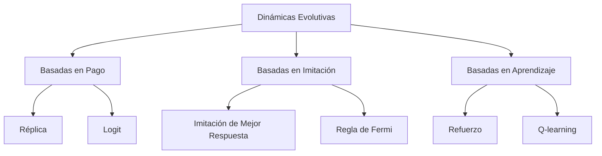
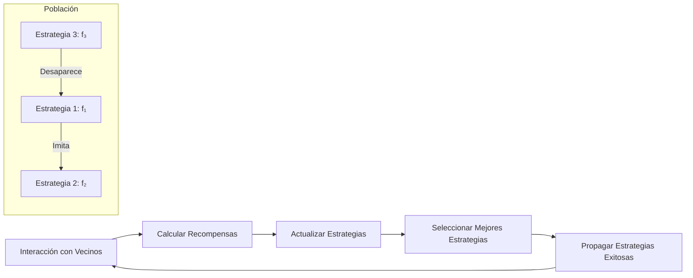

# Computación Distribuida - Modelos económicos para comportamiento en redes

## 6.4 Teoría de juegos evolucionaria.

---

La teoría de juegos evolutiva estudia cómo las estrategias se propagan en poblaciones a través de mecanismos de selección natural y aprendizaje. En computación distribuida, proporciona herramientas para modelar y analizar el comportamiento emergente en sistemas con múltiples agentes que interactúan y adaptan sus estrategias.

### Conceptos Fundamentales

#### Juegos Simétricos y Estrategias

Un juego simétrico de 2 jugadores se define mediante una matriz de pagos $A$ donde:

- $A_{ij}$ representa el pago para el jugador que usa la estrategia $i$ contra la estrategia $j$
- Para $n$ estrategias: $A \in \mathbb{R}^{n \times n}$

#### Estrategias Evolutivamente Estables (EEE)

Una estrategia $x$ es **evolutivamente estable** si para toda estrategia alternativa $y \neq x$, existe un $\bar{\epsilon} > 0$ tal que:

$$u(x, \epsilon y + (1-\epsilon)x) > u(y, \epsilon y + (1-\epsilon)x)$$

para todo $0 < \epsilon < \bar{\epsilon}$, donde $u(a, b)$ es el pago de la estrategia $a$ contra $b$.

### Dinámicas Evolutivas

#### Réplica Dinámica

La ecuación de réplica describe cómo la frecuencia de las estrategias cambia con el tiempo:

$$\frac{dx_i}{dt} = x_i[u(i, x) - \bar{u}(x)]$$

Donde:

- $x_i$ es la frecuencia de la estrategia $i$
- $u(i, x) = \sum_j A_{ij}x_j$ es el pago esperado de la estrategia $i$
- $\bar{u}(x) = \sum_i x_i u(i, x)$ es el pago promedio

#### Diagrama de Dinámicas Evolutivas



### Aplicación en Redes Distribuidas

#### Coordinación Evolutiva en P2P

En redes peer-to-peer, los nodos eligen estrategias de cooperación basadas en interacciones previas:

$$p_i^{t+1}(s) = \frac{e^{\beta U_i^t(s)}}{\sum_{s'} e^{\beta U_i^t(s')}}$$

Donde:

- $p_i^t(s)$ es la probabilidad que el nodo $i$ use estrategia $s$ en tiempo $t$
- $U_i^t(s) = \sum_{j \in N(i)} u(s, s_j^t)$ es la utilidad acumulada
- $\beta$ es el parámetro de intensidad de selección

#### Ejercicio Propuesto 1

Considera una red P2P donde los nodos pueden:

- Cooperar (C): comparten recursos, costo $c > 0$
- Desertar (D): no comparten, costo $0$

La matriz de pagos es:

- C vs C: $b - c$
- C vs D: $-c$
- D vs C: $b$
- D vs D: $0$

1. Encuentra las EEE para diferentes valores de $b$ y $c$
2. Analiza la dinámica de réplica para este juego
3. Simula la evolución en una red scale-free

### Implementación de Simulaciones

#### Simulador de Dinámica de Réplica

```python
import numpy as np
import matplotlib.pyplot as plt

class EvolutionaryGame:
    def __init__(self, payoff_matrix):
        self.A = payoff_matrix  # Matriz de pagos
        self.n = payoff_matrix.shape[0]  # Número de estrategias

    def replicator_dynamics(self, x, t=0):
        """Ecuación de réplica: dx_i/dt = x_i[(Ax)_i - x^T A x]"""
        Ax = np.dot(self.A, x)
        avg_payoff = np.dot(x, Ax)
        return x * (Ax - avg_payoff)

    def simulate(self, initial_x, T=100, dt=0.1):
        """Simula la dinámica de réplica"""
        time = np.arange(0, T, dt)
        x_hist = np.zeros((len(time), self.n))
        x_hist[0] = initial_x

        for i in range(1, len(time)):
            dx = self.replicator_dynamics(x_hist[i-1])
            x_hist[i] = x_hist[i-1] + dx * dt
            x_hist[i] = np.clip(x_hist[i], 0, 1)  # Mantener en simplex
            x_hist[i] /= np.sum(x_hist[i])  # Normalizar

        return time, x_hist

# Ejemplo: Dilema del Prisionero
A = np.array([[3, 0],  # C vs C, C vs D
              [5, 1]]) # D vs C, D vs D

game = EvolutionaryGame(A)
initial_x = np.array([0.8, 0.2])  # 80% cooperadores, 20% desertores
time, x_hist = game.simulate(initial_x, T=50)

# Visualización
plt.figure(figsize=(10, 6))
for i in range(game.n):
    plt.plot(time, x_hist[:, i], label=f'Estrategia {i}')
plt.xlabel('Tiempo')
plt.ylabel('Frecuencia')
plt.title('Dinámica Evolutiva - Dilema del Prisionero')
plt.legend()
plt.grid(True)
plt.show()
```

#### Ejercicio Propuesto 2

Extiende el simulador para:

1. Implementar diferentes dinámicas evolutivas (logit, mejor respuesta)
2. Incorporar ruido estocástico en las actualizaciones
3. Analizar la estabilidad de puntos fijos
4. Visualizar campos vectoriales en el simplex 2D

### Estrategias Evolutivas en Sistemas Distribuidos

#### Algoritmos Evolutivos para Consenso

En sistemas blockchain, los mineros adaptan sus estrategias basados en recompensas:

$$f_i^{t+1} = f_i^t + \alpha \cdot (r_i^t - \bar{r}^t) \cdot \frac{df_i}{dr_i}$$

Donde:

- $f_i^t$ es la estrategia del minero $i$ en tiempo $t$
- $r_i^t$ es la recompensa obtenida
- $\bar{r}^t$ es la recompensa promedio
- $\alpha$ es la tasa de aprendizaje

#### Diagrama de Evolución de Estrategias



### Aplicaciones en Protocolos Distribuidos

#### Evolución de Cooperación en Redes

El teorema de valoración muestra cómo puede emerger la cooperación:

$$\frac{b}{c} > k$$

Donde:

- $b$ es el beneficio de la cooperación
- $c$ es el costo
- $k$ es el grado promedio de la red

#### Ejercicio Propuesto 3

Analiza un sistema de votación distribuida donde:

- Los nodos pueden votar honestamente o manipular
- Las recompensas dependen de la coordinación
- Los nodos imitan estrategias exitosas

1. Modela como juego evolutivo
2. Encuentra los equilibrios evolutivos
3. Simula la dinámica en diferentes topologías

### Teoría de Juegos en Redes Complejas

#### Pagos Dependientes de la Red

La utilidad de un nodo $i$ en una red $G$:

$$u_i(s_i, s_{-i}) = \sum_{j \in N(i)} \pi(s_i, s_j) - c(s_i)$$

Donde $N(i)$ son los vecinos de $i$ y $\pi$ es el pago bilateral.

#### Dinámica de Imitación

Regla de actualización basada en imitación:

$$P(s_i \rightarrow s_j) = \frac{1}{1 + e^{-\beta(u_j - u_i)}}$$

#### Implementación de Simulación en Red

```python
import networkx as nx
from typing import List, Dict

class NetworkEvolutionaryGame:
    def __init__(self, network: nx.Graph, payoff_matrix: np.ndarray,
                 strategies: List[int], beta: float = 1.0):
        self.network = network
        self.A = payoff_matrix
        self.beta = beta  # Intensidad de selección
        self.strategies = strategies
        self.n = len(strategies)

        # Inicializar estrategias aleatorias
        for node in network.nodes:
            network.nodes[node]['strategy'] = np.random.choice(strategies)
            network.nodes[node]['payoff'] = 0.0

    def calculate_payoffs(self):
        """Calcula pagos para todos los nodos"""
        for node in self.network.nodes:
            strategy_i = self.network.nodes[node]['strategy']
            total_payoff = 0.0

            for neighbor in self.network.neighbors(node):
                strategy_j = self.network.nodes[neighbor]['strategy']
                total_payoff += self.A[strategy_i, strategy_j]

            self.network.nodes[node]['payoff'] = total_payoff

    def update_strategies(self):
        """Actualiza estrategias por imitación"""
        new_strategies = {}

        for node in self.network.nodes:
            # Encontrar vecino más exitoso
            best_neighbor = None
            best_payoff = -float('inf')

            for neighbor in list(self.network.neighbors(node)) + [node]:
                payoff = self.network.nodes[neighbor]['payoff']
                if payoff > best_payoff:
                    best_payoff = payoff
                    best_neighbor = neighbor

            # Probabilidad de imitación (regla de Fermi)
            if best_neighbor != node:
                payoff_diff = (self.network.nodes[best_neighbor]['payoff'] -
                              self.network.nodes[node]['payoff'])
                prob_imitate = 1 / (1 + np.exp(-self.beta * payoff_diff))

                if np.random.random() < prob_imitate:
                    new_strategies[node] = self.network.nodes[best_neighbor]['strategy']
                else:
                    new_strategies[node] = self.network.nodes[node]['strategy']
            else:
                new_strategies[node] = self.network.nodes[node]['strategy']

        # Aplicar nuevas estrategias
        for node, strategy in new_strategies.items():
            self.network.nodes[node]['strategy'] = strategy

    def simulate(self, steps: int = 100):
        """Ejecuta simulación evolutiva"""
        cooperation_levels = []

        for step in range(steps):
            self.calculate_payoffs()
            self.update_strategies()

            # Calcular nivel de cooperación
            cooperators = sum(1 for node in self.network.nodes
                            if self.network.nodes[node]['strategy'] == 0)
            cooperation_levels.append(cooperators / self.network.number_of_nodes())

        return cooperation_levels

# Ejemplo de uso
G = nx.watts_strogatz_graph(100, 4, 0.1)  # Red small-world
A = np.array([[3, 0], [5, 1]])  # Dilema del prisionero

game = NetworkEvolutionaryGame(G, A, strategies=[0, 1], beta=0.1)
cooperation_history = game.simulate(steps=200)
```

#### Ejercicio Propuesto 4

Investiga cómo diferentes topologías afectan la evolución de la cooperación:

1. Compara redes aleatorias, scale-free y small-world
2. Analiza el efecto del parámetro $\beta$
3. Estudia la robustez a invasiones de estrategias egoístas

### Referencias Bibliográficas

#### Bibliografía Básica

1. Easley, D., & Kleinberg, J. (2010). _Networks, Crowds, and Markets: Reasoning about a Highly Connected World_. Cambridge University Press.
   - Capítulo 7: Evolutionary Game Theory

2. Attiya, H., & Welch, J. (2004). _Distributed Computing: Fundamentals, Simulations, and Advanced Topics_.
   - Capítulo 14: Game-Theoretic Approaches

#### Bibliografía Complementaria

3. Nowak, M. A. (2006). _Evolutionary Dynamics: Exploring the Equations of Life_. Harvard University Press.
4. Weibull, J. W. (1995). _Evolutionary Game Theory_. MIT Press.
5. Santos, F. C., & Pacheco, J. M. (2005). Scale-free networks provide a unifying framework for the emergence of cooperation. _Physical Review Letters_, 95(9).

### Ejercicios Adicionales

#### Ejercicio 5: Evolución de Protocolos

Modela la competencia entre dos protocolos de routing donde:

- Los nodos eligen protocolos basados en performance
- La utilidad depende de la compatibilidad con vecinos
- Los protocolos tienen diferentes características de costo/beneficio

1. Formula como juego evolutivo
2. Encuentra los equilibrios evolutivos
3. Simula la dinámica de adopción

#### Ejercicio 6: Análisis de Estabilidad

Para el juego de coordinación con matriz:

$$A = \begin{bmatrix} a & b \\ c & d \end{bmatrix}$$

Deriva condiciones para:

1. Estrategias evolutivamente estables
2. Puntos estables de la dinámica de réplica
3. Equilibrios de Nash

### Soluciones a Ejercicios Selectos

#### Solución Ejercicio 1

Para el juego de cooperación-deserción:

**Matriz de pagos**:

$$A = \begin{bmatrix} b-c & -c \\ b & 0 \end{bmatrix}$$

**EEE análisis**:

- Si $b > c$: Cooperar es EEE
- Si $b < c$: Desertar es EEE
- Si $b = c$: Ambas pueden ser estables

**Dinámica de réplica**:

$$\frac{dx}{dt} = x(1-x)[(b-c)(1-x) - c x]$$

Donde $x$ es la frecuencia de cooperadores.
