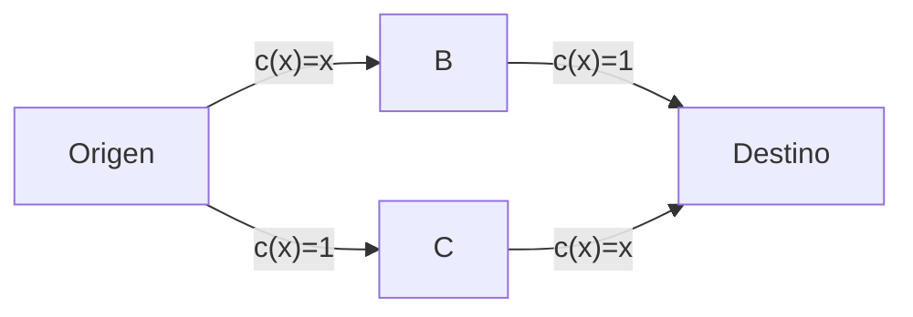
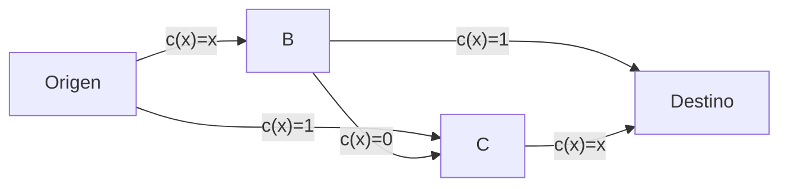
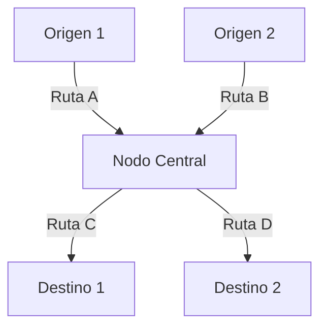

# Computación Distribuida - Modelos económicos para comportamiento en redes

## 6.5 Modelado de tráfico en redes utilizando teoría de juegos.

---

El modelado de tráfico en redes utilizando teoría de juegos estudia cómo los usuarios toman decisiones de routing de forma descentralizada y cómo estas decisiones afectan el rendimiento global del sistema. Este enfoque es fundamental para entender la congestión, optimizar el flujo y diseñar mecanismos de incentivos en redes distribuidas.

### Conceptos Fundamentales

#### Juego de Congestión

Un juego de congestión se define como:

- Conjunto de jugadores $N = \{1, 2, ..., n\}$ (usuarios de la red)
- Conjunto de recursos $E$ (enlaces o rutas)
- Estrategias $S_i \subseteq 2^E$ ( conjunto de rutas disponibles para el jugador $i$ )
- Función de costo $c_e: \mathbb{N} \rightarrow \mathbb{R}$ para cada recurso $e \in E$

#### Función de Costo

El costo de un recurso $e$ depende del número de usuarios que lo utilizan:

$$c_e(x_e) = a_e x_e + b_e$$

Donde:

- $x_e$ es el número de usuarios usando el recurso $e$
- $a_e$ y $b_e$ son parámetros específicos del recurso

#### Costo para el Jugador

El costo total para un jugador $i$ que usa ruta $r$ es:

$$C_i(r) = \sum_{e \in r} c_e(x_e)$$

### Equilibrio de Nash en Juegos de Congestión

#### Definición de Equilibrio

Un perfil de estrategias $s^*$ es un equilibrio de Nash si para todo jugador $i$ y toda estrategia alternativa $s_i \in S_i$:

$$ C\_i(s\_i ^ *, s\_{-i} ^ *) \leq C\_i( s\_i, s\_{-i} ^ * ) $$

#### Existencia de Equilibrio

**Teorema**: Todo juego de congestión con funciones de costo no decrecientes tiene al menos un equilibrio de Nash puro.

#### Price of Anarchy (Precio de la Anarquía)

Mide la ineficiencia de los equilibrios descentralizados:

$$PoA = \frac{\max_{s \in NE} C(s)}{\min_{s \in S} C(s)}$$

Donde $NE$ es el conjunto de equilibrios de Nash y $C(s)$ es el costo social total.

### Ejemplo Clásico: Paradoja de Braess

#### Red Original



#### Red con Enlace Adicional



#### Análisis de la Paradoja

- **Sin enlace adicional**: Costo de equilibrio = 1.5 por usuario
- **Con enlace adicional**: Costo de equilibrio = 2 por usuario
- **Paradoja**: Añadir capacidad empeora el rendimiento

#### Ejercicio Propuesto 1

Analiza una red con la siguiente topología:

```
Origen → A → Destino (c(x) = x)
Origen → B → Destino (c(x) = 2x)
Origen → C → Destino (c(x) = 3x)
```

1. Encuentra el equilibrio de Nash para 6 usuarios
2. Calcula el costo social total en equilibrio
3. Calcula el óptimo social
4. Determina el Price of Anarchy

### Implementación de Simulaciones

#### Simulador de Juego de Congestión

```python
import numpy as np
import matplotlib.pyplot as plt
from typing import List, Dict, Callable

class CongestionGame:
    def __init__(self, resources: List[Dict], players: int):
        """
        resources: Lista de diccionarios con:
            - 'cost_func': función de costo c(x)
            - 'initial_users': usuarios iniciales
        """
        self.resources = resources
        self.n_players = players
        self.n_resources = len(resources)
        self.player_strategies = np.zeros(players, dtype=int)

    def calculate_costs(self) -> np.ndarray:
        """Calcula costos actuales para todos los recursos"""
        costs = np.zeros(self.n_resources)
        for i, res in enumerate(self.resources):
            users = np.sum(self.player_strategies == i)
            costs[i] = res['cost_func'](users)
        return costs

    def best_response(self, player: int) -> int:
        """Encuentra la mejor respuesta para un jugador"""
        current_strategy = self.player_strategies[player]
        current_cost = self.resources[current_strategy]['cost_func'](
            np.sum(self.player_strategies == current_strategy)
        )

        best_strategy = current_strategy
        best_cost = current_cost

        for strategy in range(self.n_resources):
            if strategy == current_strategy:
                continue

            # Calcular costo si el jugador cambia a esta estrategia
            current_users = np.sum(self.player_strategies == strategy)
            potential_cost = self.resources[strategy]['cost_func'](current_users + 1)

            if potential_cost < best_cost:
                best_cost = potential_cost
                best_strategy = strategy

        return best_strategy

    def simulate(self, max_iter: int = 100) -> List[float]:
        """Simula dinámicas de mejor respuesta"""
        social_costs = []

        for _ in range(max_iter):
            # Mejor respuesta para cada jugador (en orden aleatorio)
            order = np.random.permutation(self.n_players)
            for player in order:
                new_strategy = self.best_response(player)
                self.player_strategies[player] = new_strategy

            # Calcular costo social
            total_cost = 0
            for i, res in enumerate(self.resources):
                users = np.sum(self.player_strategies == i)
                total_cost += users * res['cost_func'](users)
            social_costs.append(total_cost)

            # Verificar convergencia
            if len(social_costs) > 1 and abs(social_costs[-1] - social_costs[-2]) < 1e-6:
                break

        return social_costs

# Ejemplo de uso
def linear_cost(x, a=1, b=0):
    return a * x + b

resources = [
    {'cost_func': lambda x: linear_cost(x, a=1, b=0)},
    {'cost_func': lambda x: linear_cost(x, a=2, b=0)},
    {'cost_func': lambda x: linear_cost(x, a=3, b=0)}
]

game = CongestionGame(resources, players=6)
cost_history = game.simulate()

plt.plot(cost_history)
plt.xlabel('Iteración')
plt.ylabel('Costo Social Total')
plt.title('Convergencia al Equilibrio de Nash')
plt.show()
```

#### Ejercicio Propuesto 2

Extiende el simulador para:

1. Implementar diferentes funciones de costo (cuadráticas, exponenciales)
2. Incorporar capacidades máximas en los recursos
3. Calcular el Price of Anarchy automáticamente
4. Visualizar la distribución de usuarios en equilibrio

### Aplicaciones en Redes de Computadoras

#### Routing en Internet

Modelado como juego donde:

- Los usuarios eligen rutas para minimizar latencia
- Los enlaces tienen funciones de costo que representan delay
- El equilibrio de Nash corresponde a routing egoísta

#### Función de Delay

Para un enlace $e$, el delay típico es:

$$d_e(x_e) = \frac{1}{c_e - x_e} \quad \text{para } x_e < c_e$$

Donde $c_e$ es la capacidad del enlace.

#### Ejercicio Propuesto 3

Modela una red con 4 rutas posibles donde:

- Cada ruta tiene capacidad diferente: [10, 15, 20, 25] Mbps
- 50 usuarios, cada uno demanda 1 Mbps
- La función de delay es $d_e(x_e) = \frac{1}{c_e - x_e}$

1. Encuentra el equilibrio de Nash
2. Calcula el delay promedio en equilibrio
3. Compara con el óptimo social

### Mecanismos de Incentivos

#### Tarificación de Congestión

Introducir precios para internalizar externalidades:

$$p_e(x_e) = x_e \cdot c_e'(x_e)$$

Donde el costo percibido por el usuario es:

$$\tilde{c}_e(x_e) = c_e(x_e) + p_e(x_e)$$

#### Teorema de Tarificación Óptima

**Teorema**: Con tarificacióm $p_e(x_e) = x_e \cdot c_e'(x_e)$, el equilibrio de Nash coincide con el óptimo social.

#### Implementación de Mecanismo de Precios

```python
class CongestionPricing:
    def __init__(self, resources, players):
        self.game = CongestionGame(resources, players)
        self.pricing_factors = np.ones(len(resources))

    def optimal_pricing(self):
        """Calcula precios óptimos para internalizar externalidades"""
        for i, res in enumerate(self.game.resources):
            # Aproximar derivada numéricamente
            x = np.sum(self.game.player_strategies == i)
            h = 1e-6
            derivative = (res['cost_func'](x + h) - res['cost_func'](x)) / h
            self.pricing_factors[i] = x * derivative

    def perceived_cost(self, resource_idx, users):
        """Costo percibido incluyendo precio"""
        base_cost = self.game.resources[resource_idx]['cost_func'](users)
        return base_cost + self.pricing_factors[resource_idx]
```

#### Ejercicio Propuesto 4

Implementa un sistema de tarificación de congestión para:

1. Una red con 3 rutas y funciones de costo cuadráticas
2. 100 usuarios con demandas variables
3. Compara el equilibrio con y sin tarificación
4. Analiza cómo afecta el Price of Anarchy

### Modelos Avanzados

#### Tráfico con Información Incompleta

Juegos Bayesianos donde los usuarios tienen información privada sobre sus preferencias:

$$u_i(s_i, s_{-i}, \theta_i) = -C_i(s_i, s_{-i}) - \theta_i \cdot t_i(s_i)$$

Donde $\theta_i$ es el valor privado del tiempo para el usuario $i$.

#### Routing con Múltiples Orígenes-Destinos



#### Ejercicio Propuesto 5

Modela una red con múltiples OD pairs:

- 2 orígenes, 2 destinos
- 4 rutas posibles con capacidades diferentes
- 200 usuarios distribuidos aleatoriamente entre OD pairs
- Funciones de costo logarítmicas: $c_e(x_e) = \log(1 + x_e/c_e)$

1. Encuentra el equilibrio de Nash
2. Calcula la eficiencia del sistema
3. Propón un mecanismo de tarificación

### Referencias Bibliográficas

#### Bibliografía Básica

1. Easley, D., & Kleinberg, J. (2010). _Networks, Crowds, and Markets: Reasoning about a Highly Connected World_. Cambridge University Press.
   - Capítulo 8: Modeling Network Traffic using Game Theory

2. Attiya, H., & Welch, J. (2004). _Distributed Computing: Fundamentals, Simulations, and Advanced Topics_.
   - Capítulo 14: Game-Theoretic Approaches to Routing

#### Bibliografía Complementaria

3. Roughgarden, T. (2005). _Selfish Routing and the Price of Anarchy_. MIT Press.
4. Orda, A., Rom, R., & Shimkin, N. (1993). Competitive routing in multi-user communication networks. _IEEE/ACM Transactions on Networking_, 1(5).

### Ejercicios Adicionales

#### Ejercicio 6: Redes con Capacidades Dinámicas

Investiga un modelo donde las capacidades de los enlaces pueden ajustarse dinámicamente basado en la congestión:

$$c_e^{t+1} = c_e^t + \alpha \cdot (x_e^t - \beta \cdot c_e^t)$$

1. Analiza la estabilidad del sistema
2. Encuentra puntos de equilibrio
3. Simula la dinámica conjunta de routing y ajuste de capacidad

#### Ejercicio 7: Aprendizaje en Juegos de Congestión

Implementa algoritmos de aprendizaje para usuarios:

- Q-learning para descubrir mejores rutas
- Algoritmos de replicator dynamics
- Estrategias de imitación basadas en rendimiento

### Soluciones a Ejercicios Selectos

#### Solución Ejercicio 1

Para la red con 3 rutas y 6 usuarios:

**Funciones de costo**:

- Ruta A: $c_A(x) = x$
- Ruta B: $c_B(x) = 2x$
- Ruta C: $c_C(x) = 3x$

**Equilibrio de Nash**:
En equilibrio, los costos deben ser iguales para todas las rutas usadas:

- $x_A = 3$, $x_B = 2$, $x_C = 1$
- Costos: $c_A = 3$, $c_B = 4$, $c_C = 3$ → No es equilibrio

Ajustando: $x_A = 3$, $x_B = 2$, $x_C = 1$ no es estable porque los usuarios en B querrían moverse a A.

El equilibrio real es: $x_A = 4$, $x_B = 2$, $x_C = 0$

- Costos: $c_A = 4$, $c_B = 4$, $c_C = 0$ (pero nadie usa C)

**Costo social total**: $4×4 + 2×4 = 16 + 8 = 24$

**Óptimo social**: Distribución que minimiza $\sum x_e^2$

- $x_A = 3$, $x_B = 2$, $x_C = 1$ → Costo = $3^2 + 2×2^2 + 3×1^2 = 9 + 8 + 3 = 20$

**Price of Anarchy**: $PoA = 24/20 = 1.2$
