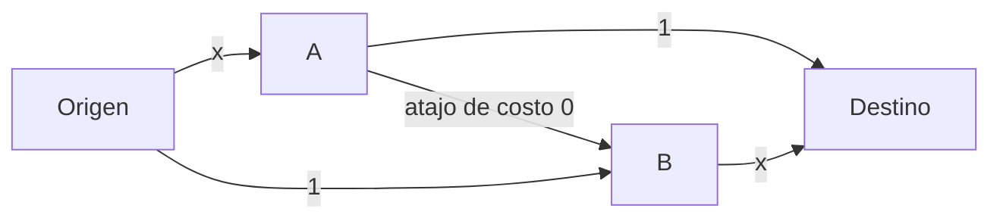

# Computación Distribuida - Modelos económicos para comportamiento en redes

## 6.5 Modelado de tráfico en redes utilizando teoría de juegos.

---

En una red de carreteras o de computadoras, cada usuario elige su ruta para llegar lo antes posible, pero el tiempo de cada ruta depende de cuántos la usan. Es un **juego de congestión**: el equilibrio resultante puede ser peor que el que diseñaría un planificador central, y añadir capacidad puede empeorarlo todo, como muestra la **paradoja de Braess**. Este tema define los juegos de congestión atómicos y el modelo de tráfico no atómico de **Wardrop**, demuestra que tienen equilibrio usando una función de potencial, acota el **precio de la anarquía** (4/3 con costos lineales) y presenta los **peajes de costo marginal**, que hacen que el equilibrio sea óptimo, con aplicaciones al enrutamiento en redes de datos.

### Juegos de congestión

Un **juego de congestión** (Rosenthal, 1973) tiene un conjunto $E$ de recursos (enlaces) con funciones de costo crecientes $c_e(x),$ donde $x$ es el número de usuarios del recurso, y jugadores que eligen cada uno un subconjunto de recursos permitido (una ruta de su origen a su destino). El costo de un jugador es la suma de los costos de los recursos que usa:

$$C_i(s) = \sum_{e \in s_i} c_e(x_e(s)).$$

**Teorema** (Rosenthal, 1973). Todo juego de congestión es un juego de potencial con

$$\Phi(s) = \sum_{e \in E} \sum_{k=1}^{x_e(s)} c_e(k),$$

y por tanto tiene un equilibrio de Nash puro, al que converge la dinámica de mejor respuesta.

**Demostración.** Si el jugador $i$ cambia de $s_i$ a $s'_i,$ los recursos de $s'_i \setminus s_i$ ganan un usuario y su término en $\Phi$ aumenta en $c_e(x_e + 1),$ y los de $s_i \setminus s'_i$ pierden uno y su término disminuye en $c_e(x_e).$ Así, $\Delta \Phi = \sum_{e \in s'_i \setminus s_i} c_e(x_e + 1) - \sum_{e \in s_i \setminus s'_i} c_e(x_e),$ que es exactamente $C_i(s'_i, s_{-i}) - C_i(s).$ Toda mejora estricta reduce $\Phi,$ que toma un número finito de valores. $\blacksquare$

### Tráfico no atómico: equilibrio de Wardrop

Con muchísimos usuarios, cada uno con un efecto despreciable, el tráfico se modela como un **flujo** continuo. Sea $D$ la demanda entre un origen y un destino, $f_P$ el flujo por la ruta $P$ y $x_e = \sum_{P \ni e} f_P.$ El **primer principio de Wardrop** (1952) define el equilibrio: todas las rutas **usadas** tienen el mismo costo, y ninguna ruta sin uso es más barata. El **segundo principio** describe el óptimo social, que minimiza el costo total $C(f) = \sum_e x_e c_e(x_e).$

- **Equilibrio:** minimiza el potencial de Beckmann $\sum_e \int_0^{x_e} c_e(t) \, dt.$
- **Óptimo:** es el equilibrio con los **costos marginales** $c_e^*(x) = c_e(x) + x c'_e(x)$ en lugar de $c_e.$

### Paradoja de Braess

Una unidad de tráfico va de $O$ a $D$ por dos rutas, $O \to A \to D$ y $O \to B \to D,$ con costos $c_{OA}(x) = x,$ $c_{AD} = 1,$ $c_{OB} = 1$ y $c_{BD}(x) = x.$ En equilibrio la mitad va por cada ruta y cada usuario tarda $1/2 + 1 = 1.5.$ Se agrega un atajo $A \to B$ de costo 0. La ruta $O \to A \to B \to D$ cuesta $x_{OA} + x_{BD} \leq 2,$ y nunca es peor que las otras: en el nuevo equilibrio **todos** la usan y tardan $1 + 1 = 2.$ Agregar un enlace gratuito empeoró a todos en 33%. Se ha observado en ciudades (el cierre de la calle 42 de Nueva York en 1990 redujo los atascos) y en redes eléctricas y mecánicas.



### Precio de la anarquía

**Teorema** (Roughgarden y Tardos, 2002). Con funciones de costo lineales $c_e(x) = a_e x + b_e,$ $a_e, b_e \geq 0,$ el costo del equilibrio de Wardrop es a lo sumo $4/3$ del óptimo, sin importar la red.

**Idea de la demostración.** Sea $x$ el equilibrio y $x^*$ el óptimo. Por la condición de equilibrio (variacional), $\sum_e c_e(x_e) x_e \leq \sum_e c_e(x_e) x^*_e.$ Para costos lineales, $c_e(x_e) x^*_e \leq c_e(x^*_e) x^*_e + \frac{1}{4} c_e(x_e) x_e,$ porque $a x y \leq a y^2 + \frac{a x^2}{4}.$ Sumando, $C(x) \leq C(x^*) + \frac{1}{4} C(x),$ es decir, $C(x) \leq \frac{4}{3} C(x^*).$ $\blacksquare$ El **ejemplo de Pigou** alcanza la cota. Con polinomios de grado $d,$ la cota es $\left(1 - d (d + 1)^{-(d+1)/d}\right)^{-1},$ que crece como $\Theta(d / \ln d),$ y también la alcanza un ejemplo de Pigou con $c(x) = x^d.$

### Peajes de costo marginal

Si cada usuario paga en el enlace $e$ un peaje

$$\tau_e = x^*_e \, c'_e(x^*_e),$$

el **daño** que su presencia causa a los demás, el equilibrio con costos $c_e + \tau_e$ coincide con el óptimo social (Pigou, 1920; Beckmann, McGuire y Winsten, 1956): las condiciones de Wardrop con los costos más los peajes son exactamente las condiciones del óptimo. Así se diseñan los cargos por congestión de Londres y Estocolmo. En redes de datos, el análogo son los mecanismos de control de congestión con precios, como la interpretación de TCP como optimización de utilidad de red (Kelly, 1998).

### Redes de computadoras

En enrutamiento, el costo típico de un enlace es el retraso de una cola M/M/1, $d_e(x) = \frac{1}{c_e - x},$ donde $c_e$ es la capacidad. Si cada flujo elige la ruta de menor retraso (enrutamiento egoísta, como en las redes superpuestas que eligen rutas por medición), el resultado es un equilibrio de Wardrop. Con esas funciones el precio de la anarquía depende de la carga relativa, pero también está acotado si la red no está saturada.

### Implementación en Python

El programa resuelve el equilibrio de Wardrop y el óptimo social en enlaces paralelos por bisección sobre el nivel de costo común, y simula la paradoja de Braess con 1000 usuarios que mejoran su ruta. Con él resuelve el ejercicio de 6 usuarios por enumeración de perfiles (ejercicio 1); calcula el precio de la anarquía con costos polinomiales y exponenciales y lo compara con la fórmula (ejercicio 2); resuelve la red M/M/1 de 4 rutas (ejercicio 3); calcula los peajes de costo marginal con costos cuadráticos (ejercicio 4); encuentra los equilibrios de una red con dos pares origen y destino que comparten un enlace (ejercicio 5); simula capacidades que se ajustan con la congestión (ejercicio 6) y dos reglas de aprendizaje (ejercicio 7).

```python
import math, random
from itertools import product

random.seed(65)

# --- Equilibrio de Wardrop y óptimo en enlaces paralelos (tráfico no atómico) ---
def nivel(fs, D, inv, lo=0.0, hi=1e6):
    """Encuentra L tal que la suma de flujos x_e(L) = D, con x_e(L) = inv_e(L) (función creciente)."""
    for _ in range(200):
        L = (lo + hi) / 2
        if sum(inv(f, L) for f in fs) > D: hi = L
        else: lo = L
    x = [inv(f, lo) for f in fs]                       # justo por debajo del nivel
    resto = D - sum(x)
    for i, f in enumerate(fs):                         # enlaces de costo constante en el nivel
        extra = min(resto, inv(f, hi) - x[i])
        x[i] += extra; resto -= extra
    return x

def inversa(c, L, xmax=1e6):
    """Mayor x en [0, xmax] con c(x) <= L (c creciente)."""
    if c(0) > L: return 0.0
    lo, hi = 0.0, xmax
    for _ in range(100):
        m = (lo + hi) / 2
        if c(m) <= L: lo = m
        else: hi = m
    return lo

def wardrop(costos, D, xmax=1e6):
    return nivel(costos, D, lambda c, L: inversa(c, L, xmax))

def optimo(costos, D, xmax=1e6, h=1e-6):
    marg = [(lambda c: (lambda x: c(x) + x * (c(x + h) - c(x)) / h))(c) for c in costos]
    return nivel(marg, D, lambda c, L: inversa(c, L, xmax))

def costo_total(costos, x):
    return sum(xi * c(xi) for c, xi in zip(costos, x))

# Pigou y Braess
pig = [lambda x: x, lambda x: 1.0]
xe, xo = wardrop(pig, 1, 1), optimo(pig, 1, 1)
print(f"Pigou: equilibrio {[round(v, 3) for v in xe]} costo {costo_total(pig, xe):.3f};"
      f" óptimo {[round(v, 3) for v in xo]} costo {costo_total(pig, xo):.3f}; PoA {costo_total(pig, xe) / costo_total(pig, xo):.3f}")

def braess(rutas_usadas, N=1000, rondas=200, con_atajo=True):
    """Usuarios atómicos con mejor respuesta: rutas O-A-D, O-B-D y O-A-B-D (atajo de costo 0)."""
    rutas = {"OAD": ["OA", "AD"], "OBD": ["OB", "BD"]}
    if con_atajo: rutas["OABD"] = ["OA", "AB", "BD"]
    c = {"OA": lambda x: x / N, "AD": lambda x: 1.0, "OB": lambda x: 1.0, "BD": lambda x: x / N, "AB": lambda x: 0.0}
    elec = [random.choice(list(rutas)) for _ in range(N)]
    for _ in range(rondas):
        carga = {e: 0 for e in c}
        for r in elec:
            for e in rutas[r]: carga[e] += 1
        cambio = False
        for i in random.sample(range(N), N // 10):
            actual = elec[i]
            def costo(r):
                return sum(c[e](carga[e] + (0 if e in rutas[actual] else 1)) for e in rutas[r])
            mejor = min(rutas, key=lambda r: (costo(r), r != actual))
            if mejor != actual:
                for e in rutas[actual]: carga[e] -= 1
                for e in rutas[mejor]: carga[e] += 1
                elec[i] = mejor; cambio = True
    carga = {e: 0 for e in c}
    for r in elec:
        for e in rutas[r]: carga[e] += 1
    tiempo = sum(sum(c[e](carga[e]) for e in rutas[r]) for r in elec) / N
    return {r: elec.count(r) for r in rutas}, tiempo

for atajo in (False, True):
    rep, t = braess(None, con_atajo=atajo)
    print(f"Braess {'con' if atajo else 'sin'} atajo, 1000 usuarios: rutas {rep}, tiempo medio {t:.3f}")

# --- Ejercicio 1: 6 usuarios, costos x, 2x, 3x ---
pend = (1, 2, 3)
def costos_ej1(x): return [p * xi for p, xi in zip(pend, x)]
perfiles = [x for x in product(range(7), repeat=3) if sum(x) == 6]
def es_ne(x):
    for i in range(3):
        if x[i] == 0: continue
        for j in range(3):
            if j != i and pend[j] * (x[j] + 1) < pend[i] * x[i]:
                return False
    return True
ne = [x for x in perfiles if es_ne(x)]
social = lambda x: sum(p * xi * xi for p, xi in zip(pend, x))
opt = min(perfiles, key=social)
peor = max(ne, key=social)
print("ejercicio 1: equilibrios (cargas en A, B, C):", [(x, social(x)) for x in ne])
print(f"   óptimo {opt} con costo social {social(opt)}; PoA = {social(peor)}/{social(opt)} = {social(peor) / social(opt):.3f}")
lin = [lambda x, p=p: p * x for p in pend]
print(f"   versión no atómica con 6 unidades: equilibrio {[round(v, 3) for v in wardrop(lin, 6)]}, costo {costo_total(lin, wardrop(lin, 6)):.3f};"
      f" óptimo {[round(v, 3) for v in optimo(lin, 6)]}, costo {costo_total(lin, optimo(lin, 6)):.3f}")

# --- Ejercicio 2: otras funciones de costo y capacidades ---
print("ejercicio 2: PoA en Pigou generalizado, c1(x) = x^d y c2 = 1")
for d in (1, 2, 4, 8):
    cs = [lambda x, d=d: x ** d, lambda x: 1.0]
    e, o = wardrop(cs, 1, 1), optimo(cs, 1, 1)
    teorico = 1 / (1 - d * (d + 1) ** (-(d + 1) / d))
    print(f"   d = {d}: PoA {costo_total(cs, e) / costo_total(cs, o):.3f} (fórmula {teorico:.3f})")
cs = [lambda x: math.exp(x) - 1, lambda x: 1.5]
e, o = wardrop(cs, 1, 1), optimo(cs, 1, 1)
print(f"   exponencial e^x - 1 frente a 1.5: PoA {costo_total(cs, e) / costo_total(cs, o):.3f}")

# --- Ejercicio 3: 4 rutas M/M/1 con capacidades 10, 15, 20, 25 y 50 unidades ---
caps = [10, 15, 20, 25]
mm1 = [lambda x, c=c: 1 / (c - x) if x < c else 1e9 for c in caps]
e = wardrop(mm1, 50, max(caps)); o = optimo(mm1, 50, max(caps))
print("ejercicio 3: equilibrio", [round(v, 2) for v in e], "retraso medio", round(costo_total(mm1, e) / 50, 4),
      "| óptimo", [round(v, 2) for v in o], "retraso medio", round(costo_total(mm1, o) / 50, 4),
      "| PoA", round(costo_total(mm1, e) / costo_total(mm1, o), 4))
print("   retraso de cada ruta en equilibrio:", [round(c(v), 4) for c, v in zip(mm1, e)])

# --- Ejercicio 4: tarificación con costos cuadráticos ---
cuad = [lambda x: 1 + 0.002 * x * x, lambda x: 2 + 0.001 * x * x, lambda x: 0.5 + 0.004 * x * x]
D = sum(random.uniform(0.5, 1.5) for _ in range(100))
e, o = wardrop(cuad, D), optimo(cuad, D)
peajes = [2 * 0.002 * o[0] ** 2, 2 * 0.001 * o[1] ** 2, 2 * 0.004 * o[2] ** 2]      # tau = x c'(x)
con_peaje = [lambda x, c=c, t=t: c(x) + t for c, t in zip(cuad, peajes)]
ep = wardrop(con_peaje, D)
print(f"ejercicio 4: demanda total {D:.1f}: sin peaje {[round(v, 1) for v in e]} costo {costo_total(cuad, e):.1f};"
      f" óptimo {[round(v, 1) for v in o]} costo {costo_total(cuad, o):.1f}")
print(f"   peajes x c'(x) = {[round(t, 2) for t in peajes]}; equilibrio con peajes {[round(v, 1) for v in ep]}"
      f" costo de viaje {costo_total(cuad, ep):.1f}; PoA {costo_total(cuad, e) / costo_total(cuad, o):.4f} -> 1")

# --- Ejercicio 5: dos pares origen-destino que comparten un enlace ---
n1 = sum(random.random() < 0.5 for _ in range(200)); n2 = 200 - n1
cap = {"a": 50, "b": 60, "s": 100}
c5 = {e: (lambda x, k=k: math.log(1 + x / k)) for e, k in cap.items()}
def costo_social5(k1, k2):            # k1 del par 1 por a (el resto por s), k2 del par 2 por b
    xa, xb, xs = k1, k2, (n1 - k1) + (n2 - k2)
    return xa * c5["a"](xa) + xb * c5["b"](xb) + xs * c5["s"](xs)
def es_ne5(k1, k2):
    xa, xb, xs = k1, k2, (n1 - k1) + (n2 - k2)
    ok = True
    if k1 > 0: ok &= c5["a"](xa) <= c5["s"](xs + 1) + 1e-12
    if k1 < n1: ok &= c5["s"](xs) <= c5["a"](xa + 1) + 1e-12
    if k2 > 0: ok &= c5["b"](xb) <= c5["s"](xs + 1) + 1e-12
    if k2 < n2: ok &= c5["s"](xs) <= c5["b"](xb + 1) + 1e-12
    return ok
ne5 = [(k1, k2) for k1 in range(n1 + 1) for k2 in range(n2 + 1) if es_ne5(k1, k2)]
op5 = min(((k1, k2) for k1 in range(n1 + 1) for k2 in range(n2 + 1)), key=lambda k: costo_social5(*k))
peor5 = max(ne5, key=lambda k: costo_social5(*k))
print(f"ejercicio 5: {n1} usuarios del par 1 y {n2} del par 2; equilibrios (por a, por b): {ne5[:3]}{'...' if len(ne5) > 3 else ''}")
print(f"   costo social en equilibrio {costo_social5(*peor5):.2f}, óptimo {op5} con {costo_social5(*op5):.2f};"
      f" eficiencia {costo_social5(*op5) / costo_social5(*peor5):.4f}")

# --- Ejercicio 6: capacidades que se ajustan ---
def capacidad_dinamica(alfa, beta, pasos=300):
    c = [10.0, 10.0]
    for _ in range(pasos):
        costos = [lambda x, k=c[0]: x / k, lambda x, k=c[1]: 0.5 + x / (2 * k)]
        x = wardrop(costos, 20)
        c = [max(0.5, ci + alfa * (xi - beta * ci)) for ci, xi in zip(c, x)]   # capacidad mínima 0.5
    return [round(v, 3) for v in c], [round(v, 3) for v in x]
print("ejercicio 6: c(t+1) = c(t) + alfa (x(t) - beta c(t)), 20 unidades, dos enlaces")
for alfa, beta in ((0.5, 0.5), (1.9, 0.5), (3.9, 0.5), (4.5, 0.5)):
    cap_f, flujo = capacidad_dinamica(alfa, beta)
    print(f"   alfa = {alfa}, beta = {beta} (|1 - alfa beta| = {abs(1 - alfa * beta):.2f}): capacidades {cap_f}, flujos {flujo}")

# --- Ejercicio 7: aprendizaje en Pigou (usuarios atómicos) ---
N = 200
def aprende(regla, rondas=400, eps=0.1, tasa=0.1):
    Q = [[0.0, 0.0] for _ in range(N)]          # estimación del costo de cada ruta
    elec = [random.randint(0, 1) for _ in range(N)]
    for t in range(rondas):
        x = sum(elec) / N                        # fracción por la ruta 1 (costo x)
        costo = [1.0, x]                         # ruta 0 cuesta 1, ruta 1 cuesta x
        if regla == "Q":
            for i in range(N):
                a = elec[i]
                Q[i][a] += tasa * (costo[a] - Q[i][a])
                elec[i] = random.randint(0, 1) if random.random() < eps else min((0, 1), key=lambda r: Q[i][r])
        elif regla == "imitación":
            nuevo = elec[:]
            for i in range(N):
                j = random.randrange(N)
                if costo[elec[j]] < costo[elec[i]] and random.random() < (costo[elec[i]] - costo[elec[j]]):
                    nuevo[i] = elec[j]
            elec = nuevo
    return sum(elec) / N
print("ejercicio 7: Pigou con 200 usuarios; fracción final por la ruta de costo x (equilibrio de Wardrop: 1)")
print(f"   Q-learning con exploración 10%: {aprende('Q'):.3f} | imitación proporcional a la mejora: {aprende('imitación'):.3f}")
```

Salida:

```text
Pigou: equilibrio [1.0, 0.0] costo 1.000; óptimo [0.5, 0.5] costo 0.750; PoA 1.333
Braess sin atajo, 1000 usuarios: rutas {'OAD': 500, 'OBD': 500}, tiempo medio 1.500
Braess con atajo, 1000 usuarios: rutas {'OAD': 1, 'OBD': 1, 'OABD': 998}, tiempo medio 1.998
ejercicio 1: equilibrios (cargas en A, B, C): [((3, 2, 1), 20), ((4, 1, 1), 21)]
   óptimo (3, 2, 1) con costo social 20; PoA = 21/20 = 1.050
   versión no atómica con 6 unidades: equilibrio [3.273, 1.636, 1.091], costo 19.636; óptimo [3.273, 1.636, 1.091], costo 19.636
ejercicio 2: PoA en Pigou generalizado, c1(x) = x^d y c2 = 1
   d = 1: PoA 1.333 (fórmula 1.333)
   d = 2: PoA 1.626 (fórmula 1.626)
   d = 4: PoA 2.151 (fórmula 2.151)
   d = 8: PoA 3.081 (fórmula 3.081)
   exponencial e^x - 1 frente a 1.5: PoA 1.396
ejercicio 3: equilibrio [5.0, 10.0, 15.0, 20.0] retraso medio 0.2 | óptimo [6.17, 10.31, 14.58, 18.94] retraso medio 0.1925 | PoA 1.039
   retraso de cada ruta en equilibrio: [0.2, 0.2, 0.2, 0.2]
ejercicio 4: demanda total 104.5: sin peaje [36.2, 40.3, 28.0] costo 378.8; óptimo [34.3, 45.0, 25.1] costo 372.7
   peajes x c'(x) = [4.72, 4.05, 5.05]; equilibrio con peajes [34.3, 45.0, 25.1] costo de viaje 372.7; PoA 1.0164 -> 1
ejercicio 5: 98 usuarios del par 1 y 102 del par 2; equilibrios (por a, por b): [(47, 57), (48, 57)]
   costo social en equilibrio 133.82, óptimo (48, 57) con 133.81; eficiencia 1.0000
ejercicio 6: c(t+1) = c(t) + alfa (x(t) - beta c(t)), 20 unidades, dos enlaces
   alfa = 0.5, beta = 0.5 (|1 - alfa beta| = 0.75): capacidades [40.0, 0.5], flujos [20.0, 0.0]
   alfa = 1.9, beta = 0.5 (|1 - alfa beta| = 0.05): capacidades [40.0, 0.5], flujos [20.0, 0.0]
   alfa = 3.9, beta = 0.5 (|1 - alfa beta| = 0.95): capacidades [40.0, 0.5], flujos [20.0, 0.0]
   alfa = 4.5, beta = 0.5 (|1 - alfa beta| = 1.25): capacidades [34.667, 0.5], flujos [16.072, 3.928]
ejercicio 7: Pigou con 200 usuarios; fracción final por la ruta de costo x (equilibrio de Wardrop: 1)
   Q-learning con exploración 10%: 0.940 | imitación proporcional a la mejora: 1.000
```

### Ejercicios Propuestos

1. **Tres rutas.** De un origen a un destino hay tres rutas con costos $x,$ $2x$ y $3x,$ donde $x$ es el número de usuarios de la ruta. Para 6 usuarios, encuentra el equilibrio, su costo social, el óptimo y el precio de la anarquía.

2. **Otras funciones.** Extiende el análisis a costos cuadráticos y exponenciales, con capacidades máximas, y calcula el precio de la anarquía.

3. **Retrasos M/M/1.** Cuatro rutas tienen capacidades de 10, 15, 20 y 25 Mbps, y 50 usuarios demandan 1 Mbps cada uno. Con retraso $d_e(x_e) = \frac{1}{c_e - x_e},$ encuentra el equilibrio, el retraso medio y compáralo con el óptimo.

4. **Peajes.** En una red con 3 rutas de costos cuadráticos y 100 usuarios con demandas variables, compara el equilibrio con y sin peajes de congestión y el efecto sobre el precio de la anarquía.

5. **Varios pares.** En una red con 2 orígenes, 2 destinos y 4 rutas de distintas capacidades, con 200 usuarios repartidos entre los pares y costos $c_e(x_e) = \log(1 + x_e / c_e),$ encuentra el equilibrio, la eficiencia y un mecanismo de peajes.

6. **Capacidades dinámicas.** Las capacidades se ajustan con la congestión: $c_e^{t+1} = c_e^t + \alpha (x_e^t - \beta c_e^t).$ Analiza la estabilidad, los puntos de equilibrio y la dinámica conjunta con el enrutamiento.

7. **Aprendizaje.** Implementa algoritmos de aprendizaje con los que los usuarios descubran buenas rutas: Q-learning, dinámica de réplica e imitación.

### Soluciones

**Ejercicio 1.** Por enumeración de los 28 repartos, hay dos equilibrios: $(3, 2, 1),$ con costos individuales 3, 4 y 3, y $(4, 1, 1),$ con 4, 2 y 3. En el primero, el usuario de B que paga 4 no gana yendo a A (también pagaría 4) ni a C (pagaría 6). Costos sociales: $1 \cdot 9 + 2 \cdot 4 + 3 \cdot 1 = 20$ y $16 + 2 + 3 = 21.$ El óptimo, que minimiza $x_A^2 + 2x_B^2 + 3x_C^2,$ es $(3, 2, 1)$ con 20: el precio de la anarquía es $21/20 = 1.05$ y el de la estabilidad, 1. En la versión no atómica con 6 unidades de flujo, equilibrio y óptimo **coinciden**: con costos $a_e x,$ igualar $a_e x_e$ (Wardrop) e igualar el costo marginal $2a_e x_e$ dan el mismo reparto, proporcional a $1/a_e.$

**Ejercicio 2.** En el ejemplo de Pigou con $c_1(x) = x^d$ y $c_2 = 1,$ el precio de la anarquía calculado coincide con la fórmula: $4/3$ con $d = 1,$ 1.63 con $d = 2,$ 2.15 con $d = 4$ y 3.08 con $d = 8.$ Cuanto más pronunciada es la congestión, peor el equilibrio. Con $e^x - 1$ frente a una ruta de costo 1.5 es 1.40. Las **capacidades máximas** se modelan con funciones que crecen sin límite al acercarse a la capacidad, como las M/M/1 del ejercicio 3.

**Ejercicio 3.** En equilibrio, los retrasos se igualan: $\frac{1}{c_e - x_e} = L$ implica $x_e = c_e - 1/L,$ y como los flujos suman 50, $1/L = (70 - 50)/4 = 5:$ flujos $(5, 10, 15, 20)$ con retraso 0.2 en todas las rutas. El óptimo iguala los costos marginales $\frac{c_e}{(c_e - x_e)^2},$ es decir, $c_e - x_e \propto \sqrt{c_e}:$ flujos aproximados $(6.17, 10.31, 14.58, 18.94),$ que cargan más los enlaces pequeños y mejoran el retraso medio a 0.1925. El precio de la anarquía es 1.039.

**Ejercicio 4.** Con costos $c_e(x) = a_e + b_e x^2$ y una demanda total de unos 104 (100 usuarios con demandas entre 0.5 y 1.5), el equilibrio sin peajes cuesta 378.8 y el óptimo 372.7: PoA 1.016. Los peajes $\tau_e = x^*_e c'_e(x^*_e) = 2 b_e (x^*_e)^2$ son 4.72, 4.05 y 5.05, y el equilibrio con peajes reproduce exactamente el óptimo: el costo de viaje baja a 372.7 y el precio de la anarquía a 1. Los usuarios pagan los peajes, pero el recaudo puede devolverse sin cambiar los incentivos.

**Ejercicio 5.** Se modela así: el par 1 tiene una ruta propia $a$ (capacidad 50) y el par 2 una ruta propia $b$ (capacidad 60), y ambos pueden usar un enlace compartido $s$ (capacidad 100): 4 rutas en total. Con 98 y 102 usuarios, la enumeración encuentra los equilibrios $(47, 57)$ y $(48, 57),$ que indican cuántos usuarios van por $a$ y por $b,$ con el resto por $s;$ el segundo es además el óptimo: con costos logarítmicos, cóncavos, la diferencia entre equilibrio y óptimo es mínima, eficiencia 1.0000. Un mecanismo de peajes de costo marginal, $\tau_e = \frac{x_e}{c_e + x_e},$ la derivada de $x \log(1 + x/c)$ menos el costo, cerraría la pequeña brecha.

**Ejercicio 6.** Con flujos fijos, la capacidad sigue $c^{t+1} = (1 - \alpha\beta) c^t + \alpha x,$ con punto fijo $c^* = x/\beta,$ estable si y solo si $|1 - \alpha\beta| \lt 1,$ es decir $0 \lt \alpha \lt 2/\beta.$ En la dinámica conjunta, el flujo se redistribuye en cada paso al equilibrio de Wardrop con las capacidades actuales, y un enlace sin tráfico pierde capacidad, lo que lo hace menos atractivo: el sistema tiende a concentrar todo en un enlace, con $c^* = 20/0.5 = 40.$ Con $\alpha = 4.5,$ fuera de la región estable, el sistema oscila y el reparto no se estabiliza. Es una realimentación positiva que en la práctica se amortigua con mínimos de capacidad e histéresis.

**Ejercicio 7.** En el ejemplo de Pigou con 200 usuarios: con **Q-learning**, cada usuario estima el costo de cada ruta con un promedio móvil y elige la más barata salvo con probabilidad 10%, en que explora; termina con el 94% en la ruta congestionada, el equilibrio de Wardrop salvo la exploración. Con **imitación**, cada usuario copia a otro al azar con probabilidad proporcional a cuánto más barato le fue, y converge al equilibrio. La imitación proporcional a la mejora es, en una población grande, la **dinámica de réplica** (tema 6.4), que converge al equilibrio de Wardrop en los juegos de congestión porque el potencial de Beckmann es una función de Lyapunov. Ninguna de estas reglas aprende el óptimo social: para eso hacen falta peajes.

### Referencias

1. Roughgarden, T., _Selfish Routing and the Price of Anarchy_. MIT Press, 2005.
2. Roughgarden, T., and Tardos, É., How bad is selfish routing? _Journal of the ACM_ 49(2), 2002.
3. Rosenthal, R. W., A class of games possessing pure-strategy Nash equilibria. _International Journal of Game Theory_ 2, 1973.
4. Nisan, N., Roughgarden, T., Tardos, É., and Vazirani, V. V., _Algorithmic Game Theory_. Cambridge University Press, 2007. Capítulo 18.
