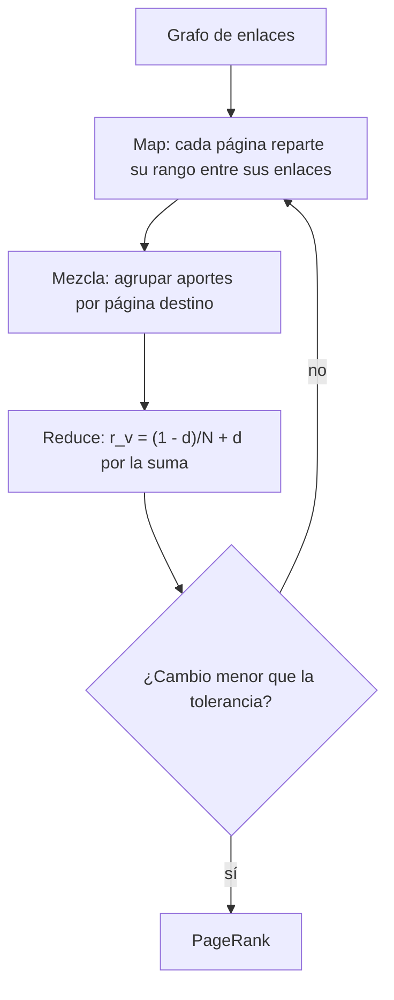

# Computación Distribuida - Temas selectos de redes y algoritmos distribuidos

## 7.1 Análisis de ligas para búsquedas en el Web.

---

Antes de 1998, los buscadores ordenaban las páginas sobre todo por su **contenido**: cuántas veces aparecían las palabras de la consulta. Era fácil de manipular y daba malos resultados. El **análisis de ligas** usa en cambio la estructura de los enlaces: un enlace de la página $u$ a la $v$ es un voto de confianza de su autor, y una página es importante si la enlazan páginas importantes. Este tema presenta los dos algoritmos fundacionales, **PageRank** (Brin y Page, 1998) y **HITS** (Kleinberg, 1999), demuestra la convergencia de PageRank con la teoría de cadenas de Markov, y explica cómo se calculan sobre miles de millones de páginas con **MapReduce**, minimizando la comunicación.

### PageRank

El **navegante aleatorio** sigue, con probabilidad $d$ (el **factor de amortiguación**, típicamente 0.85), un enlace al azar de la página actual, y con probabilidad $1 - d$ salta a una página cualquiera. El PageRank de una página es la fracción del tiempo que pasa en ella a la larga:

$$r_v = \frac{1 - d}{N} + d \sum_{u \to v} \frac{r_u}{\text{salida}(u)}.$$

**Forma matricial.** Sea $P$ la matriz de transición del navegante sin saltos, $P_{uv} = 1/\text{salida}(u)$ si $u \to v.$ Las páginas **colgantes**, sin enlaces de salida, se tratan como si enlazaran a todas. La **matriz de Google** es

$$M = d P + \frac{1 - d}{N} \mathbf{1}\mathbf{1}^\top,$$

y el PageRank es el vector de probabilidad $r$ con $r^\top = r^\top M,$ el vector propio izquierdo de valor propio 1. Se calcula por **iteración de potencias**: $r^{(k+1)\top} = r^{(k)\top} M.$

**Teorema.** $M$ tiene una única distribución estacionaria $r,$ y la iteración converge a ella desde cualquier distribución inicial, con $\|r^{(k)} - r\|_1 \leq 2 d^k.$

**Demostración.** $M$ es estocástica y todas sus entradas son positivas, al menos $(1 - d)/N:$ la cadena es irreducible y aperiódica, y por el teorema de Perron y Frobenius tiene un único vector estacionario positivo. Para la velocidad, si $x$ e $y$ son distribuciones, $(x - y)^\top M = d (x - y)^\top P,$ porque el término de salto contribuye igual a ambas y se cancela, y $\|(x - y)^\top P\|_1 \leq \|x - y\|_1$ porque $P$ es estocástica. Así, cada iteración multiplica la distancia por a lo sumo $d,$ y $\|x\|_1$ y $\|y\|_1$ valen 1, de modo que la distancia inicial es a lo sumo 2. $\blacksquare$

Con $d = 0.85,$ unas 50 iteraciones dan una precisión de $10^{-3}$ relativa; el **salto aleatorio** es lo que garantiza la convergencia y evita que el navegante quede atrapado en componentes sin salida (tema 1.2).

### HITS

Para una consulta, HITS toma un **subgrafo base**: las páginas que contienen los términos y las que las enlazan o son enlazadas por ellas. Cada página tiene un puntaje de **autoridad** $a$ y uno de **concentrador** $h,$ con refuerzo mutuo:

$$a_v = \sum_{u \to v} h_u, \qquad h_u = \sum_{u \to v} a_v,$$

es decir $a = A^\top h$ y $h = A a,$ normalizando en cada paso. Iterar equivale a la iteración de potencias de $A^\top A$ para $a$ y de $A A^\top$ para $h:$ si el valor propio principal es simple, $a$ converge al vector propio principal de $A^\top A.$ A diferencia de PageRank, HITS depende de la consulta, distingue dos papeles, y es más fácil de manipular con granjas de enlaces.

### Cálculo distribuido con MapReduce

El Web tiene decenas de miles de millones de páginas; el grafo no cabe en una máquina. En **MapReduce** (Dean y Ghemawat, 2004), cada iteración de PageRank es un trabajo:

- **Map:** para cada página $u$ con rango $r_u$ y lista de salida, emitir $(v, r_u/\text{salida}(u))$ para cada destino $v,$ y además $(u, \text{lista de salida})$ para conservar el grafo.
- **Reduce:** para cada página $v,$ sumar los aportes recibidos y calcular $r_v = (1 - d)/N + d \cdot \text{suma};$ emitir $(v, (r_v, \text{lista de salida})).$

El costo dominante es la **mezcla** (_shuffle_): un mensaje por enlace y por iteración. Se reduce con:

- **Particionar por sitio:** la mayoría de los enlaces son internos a un sitio, así que asignar todas las páginas de un sitio a la misma máquina hace que esos aportes no crucen la red.
- **Combinadores:** sumar localmente los aportes destinados a la misma página antes de enviarlos.
- **PageRank por bloques** (Kamvar y otros, 2003): calcular primero el PageRank local de cada sitio y luego combinar con un PageRank entre sitios.
- **Sistemas para grafos** como Pregel, que mantienen el grafo en memoria entre iteraciones y solo envían mensajes por las aristas.



### Implementación en Python

El programa calcula a mano las tres primeras iteraciones de PageRank y de HITS en el grafo del ejercicio 1 y compara con el límite, con `networkx` y con el vector propio de $A^\top A;$ implementa un pequeño motor de MapReduce y con él PageRank y HITS (ejercicio 3); mide la convergencia desde dos vectores iniciales distintos (ejercicio 4), y cuenta los aportes que cruzan la red con tres formas de repartir 1000 páginas de 20 sitios entre 10 máquinas (ejercicio 5).

```python
import math, random, zlib
from collections import defaultdict
import numpy as np
import networkx as nx

random.seed(71)

enlaces = {1: [2, 3], 2: [3], 3: [1], 4: [3]}
nodos = sorted(enlaces)
N = len(nodos)

# --- Ejercicio 1: PageRank a mano, iteración por iteración ---
d = 0.85
r = {v: 1 / N for v in nodos}
print("ejercicio 1: PageRank con d = 0.85, r(0) = 1/4")
for k in range(1, 4):
    nuevo = {v: (1 - d) / N for v in nodos}
    for u in nodos:
        for v in enlaces[u]:
            nuevo[v] += d * r[u] / len(enlaces[u])
    r = nuevo
    print(f"   iteración {k}: " + "  ".join(f"r{v} = {x:.4f}" for v, x in r.items()) + f"  (suma {sum(r.values()):.4f})")
for _ in range(200):
    nuevo = {v: (1 - d) / N for v in nodos}
    for u in nodos:
        for v in enlaces[u]:
            nuevo[v] += d * r[u] / len(enlaces[u])
    r = nuevo
print("   límite:", {v: round(x, 4) for v, x in r.items()}, "| networkx:",
      {v: round(x, 4) for v, x in nx.pagerank(nx.DiGraph([(u, v) for u in enlaces for v in enlaces[u]]), alpha=d).items()})

# --- Ejercicio 2: HITS a mano ---
a = {v: 1.0 for v in nodos}; h = {v: 1.0 for v in nodos}
print("ejercicio 2: HITS, a(0) = h(0) = 1, normalizando con la norma euclidiana")
for k in range(1, 4):
    a = {v: sum(h[u] for u in nodos if v in enlaces[u]) for v in nodos}
    h = {u: sum(a[v] for v in enlaces[u]) for u in nodos}
    na, nh = math.sqrt(sum(x * x for x in a.values())), math.sqrt(sum(x * x for x in h.values()))
    a = {v: x / na for v, x in a.items()}; h = {v: x / nh for v, x in h.items()}
    print(f"   iteración {k}: autoridad " + " ".join(f"{a[v]:.3f}" for v in nodos) +
          " | concentrador " + " ".join(f"{h[v]:.3f}" for v in nodos))
A = np.array([[1 if v in enlaces[u] else 0 for v in nodos] for u in nodos], float)
w, V = np.linalg.eigh(A.T @ A)
print("   vector propio principal de A^T A:", np.round(np.abs(V[:, -1]), 3), "valor propio", round(w[-1], 3))

# --- Ejercicio 3: MapReduce para PageRank y HITS ---
def mapreduce(registros, mapper, reducer):
    grupos = defaultdict(list)
    for clave, valor in registros:
        for k2, v2 in mapper(clave, valor):           # fase map
            grupos[k2].append(v2)                     # mezcla (shuffle) por clave
    return [salida for k2 in sorted(grupos) for salida in reducer(k2, grupos[k2])]

def pr_map(u, valor):
    rango, salientes = valor
    yield u, ("grafo", salientes)                     # reenviar la estructura
    for v in salientes:
        yield v, ("aporte", rango / len(salientes))

def pr_reduce(v, valores):
    salientes = next(x for t, x in valores if t == "grafo")
    rango = (1 - d) / N + d * sum(x for t, x in valores if t == "aporte")
    yield v, (rango, salientes)

datos = [(u, (1 / N, enlaces[u])) for u in nodos]
for _ in range(3):
    datos = mapreduce(datos, pr_map, pr_reduce)
print("ejercicio 3: PageRank con MapReduce tras 3 rondas:", {u: round(x[0], 4) for u, x in datos})

def hits_map_a(u, valor):                             # ronda 1: autoridades
    hu, salientes, entrantes = valor
    yield u, ("nodo", (salientes, entrantes))
    for v in salientes:
        yield v, ("h", hu)
def hits_red_a(v, valores):
    s, e = next(x for t, x in valores if t == "nodo")
    yield v, (sum(x for t, x in valores if t == "h"), s, e)
def hits_map_h(v, valor):                             # ronda 2: concentradores
    av, salientes, entrantes = valor
    yield v, ("nodo", (salientes, entrantes, av))
    for u in entrantes:
        yield u, ("a", av)
def hits_red_h(u, valores):
    s, e, au = next(x for t, x in valores if t == "nodo")
    yield u, (sum(x for t, x in valores if t == "a"), au, s, e)

entrantes = {v: [u for u in nodos if v in enlaces[u]] for v in nodos}
datos = [(u, (1.0, enlaces[u], entrantes[u])) for u in nodos]
for _ in range(3):
    pa = mapreduce(datos, hits_map_a, hits_red_a)
    na = math.sqrt(sum(x[0] ** 2 for _, x in pa))
    pa = [(v, (x[0] / na, x[1], x[2])) for v, x in pa]
    ph = mapreduce(pa, hits_map_h, hits_red_h)
    nh = math.sqrt(sum(x[0] ** 2 for _, x in ph))
    datos = [(u, (x[0] / nh, x[2], x[3])) for u, x in ph]
    autoridad = {v: x[1] for v, x in ph}
print("   HITS con MapReduce tras 3 rondas: autoridad", {v: round(x, 3) for v, x in autoridad.items()},
      "concentrador", {u: round(x[0], 3) for u, x in datos})

# --- Ejercicio 4: convergencia ---
G = nx.gnp_random_graph(500, 0.01, seed=3, directed=True)
P = np.zeros((500, 500))
for u in G:
    sal = list(G[u])
    if sal: P[u, sal] = 1 / len(sal)
    else: P[u, :] = 1 / 500
print("ejercicio 4: red aleatoria de 500 páginas; error ||r(k) - r*||_1 desde dos vectores iniciales")
for alfa in (0.85, 0.5):
    M = alfa * P + (1 - alfa) / 500
    estrella = np.ones(500) / 500
    for _ in range(500): estrella = estrella @ M
    for nombre, x in (("uniforme", np.ones(500) / 500), ("concentrado en una página", np.eye(500)[0])):
        errs = []
        for k in range(1, 31):
            x = x @ M
            if k in (5, 10, 20, 30): errs.append(f"k={k}: {np.abs(x - estrella).sum():.1e}")
        print(f"   alfa = {alfa}, inicio {nombre:26}: " + "  ".join(errs) + f"  (alfa^30 = {alfa ** 30:.1e})")

# --- Ejercicio 5: comunicación según la partición ---
sitios, por_sitio = 20, 50
W = nx.DiGraph()
for s in range(sitios):
    base = s * por_sitio
    for i in range(por_sitio):
        u = base + i
        for _ in range(8):                             # 90% de los enlaces dentro del sitio
            if random.random() < 0.9: W.add_edge(u, base + random.randrange(por_sitio))
            else: W.add_edge(u, random.randrange(sitios * por_sitio))
def cruces(asig):
    return sum(asig[u] != asig[v] for u, v in W.edges())
maquinas = 10
azar = {v: random.randrange(maquinas) for v in W}
por_dispersion = {v: zlib.crc32(f"http://sitio{v // por_sitio}.mx/p{v}".encode()) % maquinas for v in W}
por_sitio_asig = {v: (v // por_sitio) % maquinas for v in W}
print(f"ejercicio 5: {W.number_of_edges()} enlaces, 10 máquinas; aportes que cruzan la red por iteración:"
      f" al azar {cruces(azar)}, por dispersión de la URL {cruces(por_dispersion)}, por sitio {cruces(por_sitio_asig)}")
```

Salida:

```text
ejercicio 1: PageRank con d = 0.85, r(0) = 1/4
   iteración 1: r1 = 0.2500  r2 = 0.1437  r3 = 0.5687  r4 = 0.0375  (suma 1.0000)
   iteración 2: r1 = 0.5209  r2 = 0.1437  r3 = 0.2978  r4 = 0.0375  (suma 1.0000)
   iteración 3: r1 = 0.2906  r2 = 0.2589  r3 = 0.4130  r4 = 0.0375  (suma 1.0000)
   límite: {1: 0.3725, 2: 0.1958, 3: 0.3941, 4: 0.0375} | networkx: {1: 0.3725, 2: 0.1958, 3: 0.3942, 4: 0.0375}
ejercicio 2: HITS, a(0) = h(0) = 1, normalizando con la norma euclidiana
   iteración 1: autoridad 0.302 0.302 0.905 0.000 | concentrador 0.676 0.507 0.169 0.507
   iteración 2: autoridad 0.092 0.370 0.925 0.000 | concentrador 0.703 0.502 0.050 0.502
   iteración 3: autoridad 0.027 0.381 0.924 0.000 | concentrador 0.706 0.500 0.015 0.500
   vector propio principal de A^T A: [0.    0.383 0.924 0.   ] valor propio 3.414
ejercicio 3: PageRank con MapReduce tras 3 rondas: {1: 0.2906, 2: 0.2589, 3: 0.413, 4: 0.0375}
   HITS con MapReduce tras 3 rondas: autoridad {1: 0.027, 2: 0.381, 3: 0.924, 4: 0.0} concentrador {1: 0.706, 2: 0.5, 3: 0.015, 4: 0.5}
ejercicio 4: red aleatoria de 500 páginas; error ||r(k) - r*||_1 desde dos vectores iniciales
   alfa = 0.85, inicio uniforme                  : k=5: 4.3e-03  k=10: 6.3e-05  k=20: 9.7e-09  k=30: 1.9e-12  (alfa^30 = 7.6e-03)
   alfa = 0.85, inicio concentrado en una página : k=5: 3.3e-01  k=10: 5.0e-03  k=20: 7.3e-07  k=30: 1.3e-10  (alfa^30 = 7.6e-03)
   alfa = 0.5, inicio uniforme                  : k=5: 1.7e-04  k=10: 1.9e-07  k=20: 1.5e-13  k=30: 4.9e-15  (alfa^30 = 9.3e-10)
   alfa = 0.5, inicio concentrado en una página : k=5: 2.3e-02  k=10: 2.5e-05  k=20: 1.8e-11  k=30: 1.1e-15  (alfa^30 = 9.3e-10)
ejercicio 5: 7557 enlaces, 10 máquinas; aportes que cruzan la red por iteración: al azar 6693, por dispersión de la URL 6680, por sitio 691
```

### Ejercicios Propuestos

1. **PageRank.** En el grafo con enlaces de 1 a 2 y a 3, de 2 a 3, de 3 a 1 y de 4 a 3, calcula a mano las tres primeras iteraciones de PageRank con $d = 0.85.$

2. **HITS.** Para el mismo grafo, calcula las tres primeras iteraciones de HITS.

3. **MapReduce.** Diseña un esquema MapReduce para HITS, con sus funciones de mapa y de reducción.

4. **Convergencia.** Demuestra que PageRank converge a un vector único, sin importar el vector inicial, usando cadenas de Markov.

5. **Comunicación.** Propón una estrategia para minimizar la comunicación entre máquinas en un PageRank distribuido.

### Soluciones

**Ejercicio 1.** Con $r^{(0)} = 1/4$ para todas y el término de salto $0.15/4 = 0.0375:$

- **Iteración 1:** $r_1 = 0.0375 + 0.85 \cdot 0.25 = 0.25$ (de 3); $r_2 = 0.0375 + 0.85 \cdot 0.125 = 0.1437$ (de 1, que reparte entre 2); $r_3 = 0.0375 + 0.85 (0.125 + 0.25 + 0.25) = 0.5687$ (de 1, 2 y 4); $r_4 = 0.0375.$
- **Iteración 2:** $r_1 = 0.0375 + 0.85 \cdot 0.5687 = 0.5209;$ $r_2 = 0.0375 + 0.85 \cdot 0.125 = 0.1437;$ $r_3 = 0.0375 + 0.85 (0.125 + 0.1437 + 0.0375) = 0.2978;$ $r_4 = 0.0375.$
- **Iteración 3:** $(0.2906, 0.2589, 0.4130, 0.0375).$

Los valores oscilan, porque el ciclo $1 \to 3 \to 1$ pasa el rango de un lado a otro, y convergen a $(0.3725, 0.1958, 0.3941, 0.0375).$ La página 4, que nadie enlaza, tiene el mínimo $(1 - d)/N.$

**Ejercicio 2.** Con $a = h = 1$ al inicio, la primera autoridad es el grado de entrada, $(1, 1, 3, 0),$ normalizado $(0.302, 0.302, 0.905, 0),$ y el concentrador suma las autoridades de los enlazados: $(0.302 + 0.905, 0.905, 0.302, 0.905),$ normalizado $(0.676, 0.507, 0.169, 0.507).$ Tras 3 iteraciones, la autoridad es $(0.027, 0.381, 0.924, 0)$ y converge al vector propio principal de $A^\top A,$ $(0, 0.383, 0.924, 0):$ la página 3 es la gran autoridad, y la 1, que enlaza a 2 y a 3, el mejor concentrador. La página 1 pierde toda su autoridad porque solo la enlaza 3, un mal concentrador.

**Ejercicio 3.** Una iteración de HITS son dos trabajos de MapReduce, porque la actualización de $h$ necesita las autoridades nuevas:

- **Autoridades.** Map: para cada $u$ con $h_u,$ emitir $(v, h_u)$ por cada enlace $u \to v,$ y $(u, \text{estructura}).$ Reduce: $a_v = \sum h_u.$
- **Concentradores.** Map: para cada $v$ con $a_v,$ emitir $(u, a_v)$ por cada enlace **entrante** $u \to v,$ lo que requiere guardar también la lista de entrada. Reduce: $h_u = \sum a_v.$
- **Normalización:** un trabajo adicional, o un contador global, calcula $\|a\|$ y $\|h\|,$ y la siguiente fase de mapa divide por ellos.

El programa lo implementa y reproduce los valores del ejercicio 2.

**Ejercicio 4.** Es el teorema de la sección de PageRank: la matriz de Google es estocástica y positiva, así que la cadena es irreducible y aperiódica y tiene una única distribución estacionaria, y la contracción $\|(x - y)^\top M\|_1 \leq d \|x - y\|_1$ da la convergencia geométrica desde cualquier inicio. En el programa, desde un vector uniforme y desde uno concentrado en una sola página, el error cae geométricamente, y más rápido que $d^k:$ la cota es para el peor grafo, y en grafos con buena expansión el segundo valor propio de $P$ es mucho menor que 1.

**Ejercicio 5.** Ver la sección de MapReduce. En el programa, con el 90% de los enlaces dentro del sitio, asignar las páginas al azar o por dispersión de la URL completa hace que crucen la red unos 6700 de los 7557 aportes por iteración, mientras que asignar por **sitio** reduce el tráfico a 691, casi 10 veces menos. Con **combinadores**, los aportes de una máquina hacia la misma página se suman antes de enviarse, y con **PageRank por bloques** se iteran muchas veces los bloques locales, que no requieren red, antes de cada sincronización global.

### Referencias

1. Page, L., Brin, S., Motwani, R., and Winograd, T., The PageRank citation ranking: bringing order to the Web. _Stanford InfoLab Technical Report_, 1999.
2. Kleinberg, J., Authoritative sources in a hyperlinked environment. _Journal of the ACM_ 46(5), 1999.
3. Langville, A. N., and Meyer, C. D., _Google's PageRank and Beyond_. Princeton University Press, 2006.
4. Leskovec, J., Rajaraman, A., and Ullman, J. D., _Mining of Massive Datasets_. Cambridge University Press, 2020. Capítulos 2 y 5.
