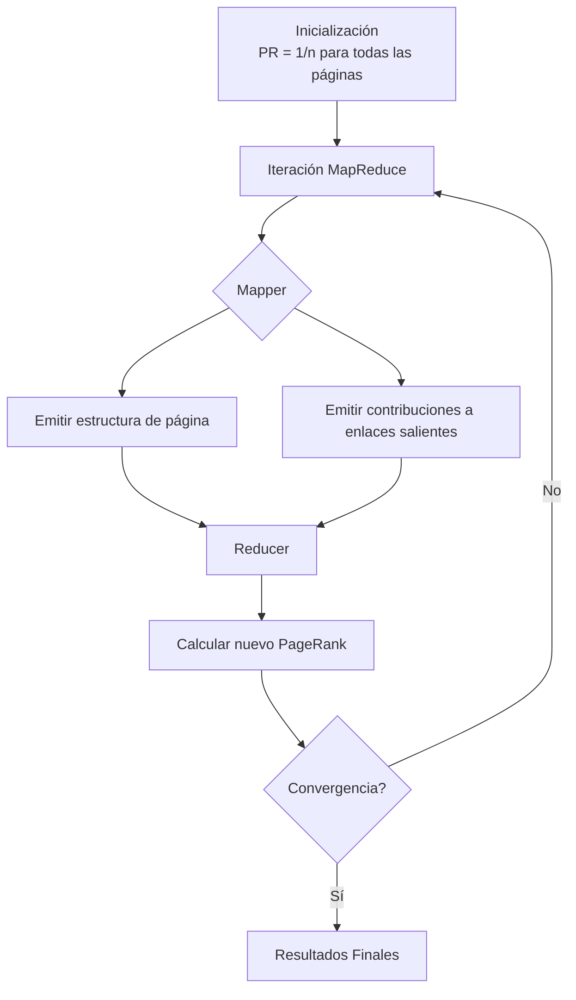

# Computación Distribuida - Temas selectos de redes y algoritmos distribuidos

## 7.1 Análisis de ligas para búsquedas en el Web.

---

El análisis de ligas (enlaces) es fundamental para entender la estructura y relevancia de la información en la Web. Este estudio se centra en algoritmos distribuidos que permiten analizar billones de documentos interconectados para determinar su importancia relativa.

### Conceptos Fundamentales

#### Grafo de la Web

La Web puede modelarse como un grafo dirigido $G = (V, E)$ donde:

- $V$: conjunto de páginas web (vértices)
- $E$: conjunto de hipervínculos (aristas dirigidas)

Si existe un enlace de la página $u$ a la página $v$, representamos esta relación como $(u, v) \in E$.

#### Matriz de Adyacencia

Para un grafo con $n$ páginas, definimos la matriz de adyacencia $M$ donde:

$$
M_{ij} =
\begin{cases}
1 & \text{si existe enlace de } j \text{ a } i \\
0 & \text{en caso contrario}
\end{cases}
$$

### Algoritmo PageRank

#### Concepto Básico

PageRank, desarrollado por los fundadores de Google, asigna importancia a las páginas web basándose en el principio de que un enlace desde una página importante vale más que uno desde una página menos importante.

#### Modelo del Surfista Aleatorio

PageRank modela el comportamiento de un usuario que navega aleatoriamente:

1. Con probabilidad $d$ (factor de amortiguamiento), sigue un enlace aleatorio
2. Con probabilidad $1-d$, salta a cualquier página aleatoria

#### Fórmula de PageRank

Para una página $i$, su PageRank $PR(i)$ se calcula como:

$$
PR(i) = \frac{1-d}{n} + d \sum_{j \in B(i)} \frac{PR(j)}{L(j)}
$$

Donde:

- $B(i)$: páginas que enlazan a $i$
- $L(j)$: número de enlaces salientes de $j$
- $d$: factor de amortiguamiento (típicamente 0.85)
- $n$: número total de páginas

#### Formulación Matricial

$$
\mathbf{PR} = (1-d) \frac{\mathbf{e}}{n} + d \mathbf{M} \mathbf{PR}
$$

Donde:

- $\mathbf{PR}$: vector de PageRank
- $\mathbf{M}$: matriz estocástica derivada de la matriz de adyacencia
- $\mathbf{e}$: vector de unos

### Algoritmo HITS (Hypertext-Induced Topic Search)

#### Concepto

HITS identifica dos tipos de páginas:

- **Hubs**: Páginas que enlazan a buenas autoridades
- **Authorities**: Páginas con contenido relevante sobre un tema

#### Proceso Iterativo

1. **Paso de autoridades**: $a(i) = \sum_{j \in F(i)} h(j)$
2. **Paso de hubs**: $h(i) = \sum_{j \in B(i)} a(j)$

Donde:

- $a(i)$: puntuación de autoridad de la página $i$
- $h(i)$: puntuación de hub de la página $i$
- $F(i)$: páginas enlazadas por $i$
- $B(i)$: páginas que enlazan a $i$

#### Normalización

Después de cada iteración, se normalizan los vectores:

$$
\mathbf{a} = \frac{\mathbf{a}}{\|\mathbf{a}\|}, \quad \mathbf{h} = \frac{\mathbf{h}}{\|\mathbf{h}\|}
$$

### Implementación Distribuida

#### Desafíos en Computación Distribuida

1. **Escala**: Billones de páginas web
2. **Distribución**: Datos repartidos en múltiples servidores
3. **Actualizaciones**: La Web cambia constantemente
4. **Tolerancia a fallos**: El sistema debe funcionar despite fallos parciales

#### Algoritmo MapReduce para PageRank

```python
# Mapper
def page_rank_mapper(page, content):
    # Emitir la estructura original de la página
    yield page, ('structure', content)

    # Emitir contribuciones a páginas enlazadas
    pr_contribution = current_pr[page] / len(outlinks)
    for outlink in outlinks:
        yield outlink, ('contribution', pr_contribution)

# Reducer
def page_rank_reducer(page, values):
    total_contribution = 0
    structure = None

    for value_type, data in values:
        if value_type == 'contribution':
            total_contribution += data
        elif value_type == 'structure':
            structure = data

    new_pr = (1 - d) / n + d * total_contribution
    yield page, new_pr
```

### Diagrama de Flujo del Proceso PageRank



### Ejemplo Práctico

#### Grafo de Ejemplo

Consideremos un mini-web con 4 páginas:

- Página A → enlaces a B, C
- Página B → enlace a C
- Página C → enlace a A
- Página D → enlace a C

#### Cálculo Manual de PageRank (Primera Iteración)

Asumiendo $d = 0.85$ y $PR_0 = [0.25, 0.25, 0.25, 0.25]$:

$$
PR_1(A) = \frac{0.15}{4} + 0.85 \times \left(\frac{PR_0(C)}{1}\right) = 0.0375 + 0.85 \times 0.25 = 0.25
$$

$$
PR_1(B) = \frac{0.15}{4} + 0.85 \times \left(\frac{PR_0(A)}{2}\right) = 0.0375 + 0.85 \times 0.125 = 0.14375
$$

$$
PR_1(C) = \frac{0.15}{4} + 0.85 \times \left(\frac{PR_0(A)}{2} + \frac{PR_0(B)}{1} + \frac{PR_0(D)}{1}\right) = 0.0375 + 0.85 \times (0.125 + 0.25 + 0.25) = 0.569375
$$

$$
PR_1(D) = \frac{0.15}{4} + 0.85 \times 0 = 0.0375
$$

### Ejercicios Propuestos

#### Ejercicio 1: Cálculo de PageRank

Dado el siguiente grafo web:

- Página 1 → enlaces a 2, 3
- Página 2 → enlace a 3
- Página 3 → enlace a 1
- Página 4 → enlace a 3

Calcular manualmente las primeras 3 iteraciones de PageRank con $d = 0.85$.

#### Ejercicio 2: Algoritmo HITS

Para el mismo grafo del ejercicio 1, calcular manualmente las primeras 3 iteraciones del algoritmo HITS.

#### Ejercicio 3: Diseño Distribuido

Diseñar un esquema MapReduce para el algoritmo HITS, especificando las funciones mapper y reducer.

#### Ejercicio 4: Análisis de Convergencia

Demostrar por qué PageRank converge a un vector único independientemente del vector inicial, utilizando conceptos de cadenas de Markov.

#### Ejercicio 5: Optimización en Redes Distribuidas

Proponer una estrategia para minimizar la comunicación entre nodos en una implementación distribuida de PageRank.

### Aplicaciones Más Allá de la Web

1. **Análisis de redes sociales**: Identificar influencers
2. **Sistemas de recomendación**: Productos relacionados
3. **Bioinformática**: Análisis de redes de proteínas
4. **Detección de fraudes**: Identificar patrones sospechosos

### Referencias

#### Bibliografía Básica

1. Easley, D., & Kleinberg, J. (2010). _Networks, Crowds, and Markets: Reasoning about a Highly Connected World_. Cambridge University Press. http://www.cs.cornell.edu/home/kleinber/networks-book/
2. Attiya, H., & Welch, J. (2004). _Distributed Computing: Fundamentals, Simulations, and Advanced Topics_. Wiley Series on Parallel and Distributed Computing.

#### Bibliografía Complementaria

1. Lynch, N. (1996). _Distributed Algorithms_. Morgan Kaufman Pub.
2. Tel, G. (2001). _Introduction to Distributed Algorithms_ (2nd ed.). Cambridge University Press.
3. Bush, V. (1945). _As We May Think_. Atlantic Monthly.
4. World Wide Web Consortium. _A Little History of the World Wide Web, 1945-1995_.
5. Broder, A., et al. (2000). _Graph structure in the web_. 9th International World Wide Web Conference.

#### Recursos Adicionales

- [PageRank Original Paper](http://ilpubs.stanford.edu:8090/422/)
- [Apache Hadoop MapReduce Tutorial](https://hadoop.apache.org/docs/current/hadoop-mapreduce-client/hadoop-mapreduce-client-core/MapReduceTutorial.html)
- [Distributed Algorithms Course Materials](https://courses.csail.mit.edu/6.852/)
