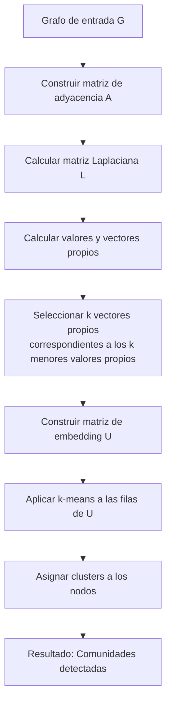

# Computación Distribuida - Temas selectos de redes y algoritmos distribuidos

## 7.2 Análisis de espectro para redes.

---

El análisis espectral de redes es una poderosa herramienta que utiliza conceptos de álgebra lineal y teoría de grafos para estudiar propiedades estructurales de redes complejas mediante el análisis de los valores y vectores propios de matrices asociadas.

### Conceptos Fundamentales

#### Matrices Asociadas a Grafos

Para un grafo no dirigido $G = (V, E)$ con $n$ vértices:

**Matriz de Adyacencia $(A)$:**

$$
A_{ij} =
\begin{cases}
1 & \text{si } (i,j) \in E \\
0 & \text{en caso contrario}
\end{cases}
$$

**Matriz de Grados $(D)$:**

$$
D_{ii} = \deg(i), \quad D_{ij} = 0 \text{ para } i \neq j
$$

**Matriz Laplaciana $(L)$:**

$$
L = D - A
$$

**Matriz Laplaciana Normalizada $(\mathcal{L})$:**

$$
\mathcal{L} = D^{-1/2}LD^{-1/2} = I - D^{-1/2}AD^{-1/2}
$$

#### Espectro de un Grafo

El espectro de un grafo se define como el conjunto de valores propios de una matriz asociada al grafo, típicamente ordenados en forma descendente:

$$
\lambda_1 \geq \lambda_2 \geq \cdots \geq \lambda_n
$$

### Propiedades Espectrales

#### Valores Propios de la Matriz Laplaciana

Para la matriz Laplaciana $L$:

- $\lambda_1 = 0$ siempre ( vector propio: $\mathbf{1} = [1,1,\ldots,1]^T$ )
- Todos los valores propios son reales y no negativos
- La multiplicidad de 0 indica el número de componentes conexas

#### Descomposición Espectral

Cualquier matriz simétrica $M$ puede descomponerse como:

$$
M = \sum_{i=1}^n \lambda_i \mathbf{u}_i \mathbf{u}_i^T
$$

donde $\lambda_i$ son valores propios y $\mathbf{u}_i$ son vectores propios ortonormales.

### Aplicaciones del Análisis Espectral

#### Detección de Comunidades

```python
import numpy as np
from scipy.linalg import eigh

def spectral_clustering(A, k):
    """Algoritmo de clustering espectral"""
    # Calcular matriz Laplaciana
    D = np.diag(np.sum(A, axis=1))
    L = D - A

    # Calcular k menores valores propios y vectores propios
    eigenvalues, eigenvectors = eigh(L)

    # Seleccionar k vectores propios correspondientes a los k menores valores propios
    indices = np.argsort(eigenvalues)[:k]
    U = eigenvectors[:, indices]

    # Aplicar k-means a las filas de U
    from sklearn.cluster import KMeans
    kmeans = KMeans(n_clusters=k)
    clusters = kmeans.fit_predict(U)

    return clusters
```

#### Centralidad de Vector Propio

La centralidad de un nodo $i$ se define como el elemento i-ésimo del vector propio principal de la matriz de adyacencia:

$$
\mathbf{x} = \frac{1}{\lambda_1} A \mathbf{x}
$$

donde $\lambda_1$ es el mayor valor propio de $A$.

### Implementación Distribuida del Cálculo de Valores Propios

#### Algoritmo de Potencias Distribuido

```python
# Algoritmo de potencias para cálculo distribuido del vector propio principal
def distributed_power_iteration(A, num_iterations=100, tolerance=1e-6):
    n = A.shape[0]
    x = np.random.rand(n)
    x = x / np.linalg.norm(x)

    for i in range(num_iterations):
        # Multiplicación matriz-vector distribuida
        Ax = distributed_matrix_vector_multiply(A, x)

        # Normalización
        x_new = Ax / np.linalg.norm(Ax)

        # Verificar convergencia
        if np.linalg.norm(x_new - x) < tolerance:
            break

        x = x_new

    # Calcular valor propio
    eigenvalue = x.T @ A @ x / (x.T @ x)

    return eigenvalue, x

def distributed_matrix_vector_multiply(A, x):
    """Multiplicación matriz-vector distribuida"""
    # Implementación distribuida usando MapReduce
    # Cada nodo calcula su parte del producto
    result = np.zeros_like(x)

    # Simulación de cálculo distribuido
    for i in range(A.shape[0]):
        # En implementación real, esto se haría en nodos separados
        result[i] = np.dot(A[i, :], x)

    return result
```

### Diagrama del Proceso de Clustering Espectral



### Ejemplo Práctico

#### Grafo de Ejemplo

Consideremos un grafo con dos comunidades claras:

```
Nodos: {1,2,3,4,5,6,7,8}
Aristas intra-comunidad:
  Comunidad 1: (1,2), (1,3), (2,3), (2,4), (3,4)
  Comunidad 2: (5,6), (5,7), (5,8), (6,7), (6,8), (7,8)
Aristas inter-comunidad: (4,5)
```

#### Cálculo del Espectro

```python
# Matriz de adyacencia del ejemplo
A = np.array([
    [0,1,1,0,0,0,0,0],
    [1,0,1,1,0,0,0,0],
    [1,1,0,1,0,0,0,0],
    [0,1,1,0,1,0,0,0],
    [0,0,0,1,0,1,1,1],
    [0,0,0,0,1,0,1,1],
    [0,0,0,0,1,1,0,1],
    [0,0,0,0,1,1,1,0]
])

# Calcular matriz Laplaciana
D = np.diag(np.sum(A, axis=1))
L = D - A

# Calcular valores propios
eigenvalues = np.linalg.eigvalsh(L)
print("Valores propios de L:", sorted(eigenvalues))
```

### Ejercicios Propuestos

#### Ejercicio 1: Cálculo del Espectro

Para el grafo completo $K_4$:

1. Calcular la matriz de adyacencia $A$
2. Calcular la matriz Laplaciana $L$
3. Encontrar todos los valores propios de $L$
4. Verificar que $\lambda_1 = 0$ y describir el vector propio correspondiente

#### Ejercicio 2: Clustering Espectral

Implementar el algoritmo de clustering espectral para el grafo de ejemplo y visualizar las comunidades detectadas.

#### Ejercicio 3: Análisis de Conectividad

Demostrar que la multiplicidad del valor propio 0 en la matriz Laplaciana es igual al número de componentes conexas del grafo.

#### Ejercicio 4: Algoritmo Distribuido

Diseñar un algoritmo distribuido para calcular el segundo menor valor propio de la matriz Laplaciana (valor de Fiedler).

#### Ejercicio 5: Aplicación a Redes Reales

Descargar un dataset de red social real (ej: Karate Club) y:

1. Calcular el espectro de la matriz Laplaciana
2. Aplicar clustering espectral
3. Comparar con la estructura comunitaria real

### Teoremas Importantes

#### Teorema de Courant-Fischer

Para una matriz simétrica $M$ de tamaño $n \times n$:

$$
\lambda_k = \min_{\dim(S)=k} \max_{\mathbf{x} \in S, \|\mathbf{x}\|=1} \mathbf{x}^T M \mathbf{x}
$$

#### Desigualdad de Cheeger

Relaciona el segundo valor propio de la matriz Laplaciana con la conductancia del grafo:

$$
\frac{\lambda_2}{2} \leq h(G) \leq \sqrt{2\lambda_2}
$$

donde $h(G)$ es la conductancia del grafo.

### Referencias

#### Bibliografía Básica

1. Easley, D., & Kleinberg, J. (2010). _Networks, Crowds, and Markets: Reasoning about a Highly Connected World_. Capítulo 14: "Link Analysis and Web Search"
2. Attiya, H., & Welch, J. (2004). _Distributed Computing: Fundamentals, Simulations, and Advanced Topics_. Capítulo 16: "Shared-Memory Algorithms"

#### Bibliografía Complementaria

1. Lynch, N. (1996). _Distributed Algorithms_. Capítulo 15: "Matrix Computations"
2. Tel, G. (2001). _Introduction to Distributed Algorithms_ (2nd ed.). Capítulo 12: "Synchronous Networks"

#### Recursos Adicionales

- [Spectra of Graphs](https://www.win.tue.nl/~aeb/2WF02/spectra.pdf)
- [Distributed Spectral Graph Algorithms](https://arxiv.org/abs/1602.03915)
- [NetworkX Library for Graph Analysis](https://networkx.org/documentation/stable/reference/algorithms/spectral.html)

#### Herramientas Prácticas

- Python: NetworkX, SciPy, NumPy
- Plataformas distribuidas: Apache Spark, Hadoop
- Visualización: Gephi, GraphViz
