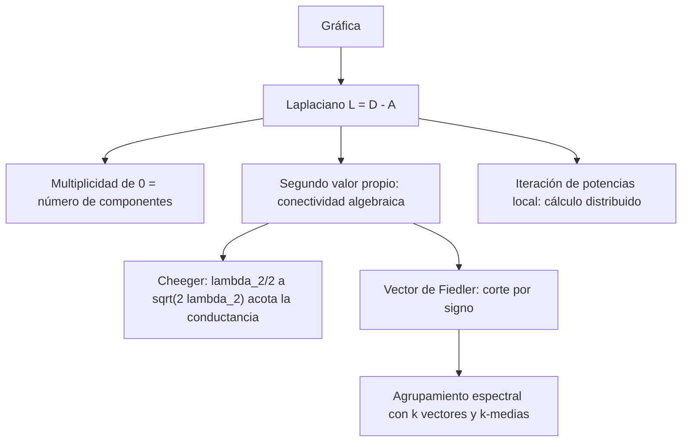

# Computación Distribuida - Temas selectos de redes y algoritmos distribuidos

## 7.2 Análisis de espectro para redes.

---

La **teoría espectral de gráficas** estudia una red a través de los valores y vectores propios de las matrices asociadas a ella. Es sorprendente cuánto revela el **espectro**: el número de componentes conexas, qué tan bien conectada está la red (y por tanto qué tan rápido mezclan las caminatas aleatorias y se propagan los rumores), dónde están sus cortes naturales y qué nodos son centrales. Este tema define la matriz de adyacencia, el laplaciano y el laplaciano normalizado, demuestra sus propiedades básicas, presenta el **agrupamiento espectral** con el vector de Fiedler y la **desigualdad de Cheeger**, y muestra cómo calcular estos vectores de forma distribuida.

### Matrices de una gráfica

Para una gráfica no dirigida $G$ con $n$ vértices:

- **Adyacencia** $A:$ $A_{uv} = 1$ si $uv$ es arista.
- **Grados** $D:$ la matriz diagonal con $D_{vv} = \deg(v).$
- **Laplaciano** $L = D - A.$
- **Laplaciano normalizado** $\mathcal{L} = I - D^{-1/2} A D^{-1/2}.$

**Forma cuadrática.** Para todo vector $x,$

$$x^\top L x = \sum_{uv \in E} (x_u - x_v)^2.$$

Por tanto $L$ es simétrica y **semidefinida positiva**: sus valores propios son reales y no negativos, $0 = \lambda_1 \leq \lambda_2 \leq \cdots \leq \lambda_n.$ El vector de unos cumple $L \mathbf{1} = 0,$ porque cada fila de $L$ suma 0.

### Componentes conexas

**Teorema.** La multiplicidad del valor propio 0 de $L$ es el número de componentes conexas de $G.$

**Demostración.** Si $Lx = 0,$ entonces $x^\top L x = \sum_{uv \in E}(x_u - x_v)^2 = 0,$ así que $x_u = x_v$ en cada arista y $x$ es **constante en cada componente**. Recíprocamente, el indicador $\mathbf{1}_C$ de una componente $C$ cumple $L \mathbf{1}_C = 0.$ El espacio propio de 0 es, entonces, el generado por los $k$ indicadores, que son linealmente independientes porque tienen soportes disjuntos: tiene dimensión $k.$ $\blacksquare$

En particular, $G$ es conexa si y solo si $\lambda_2 > 0.$ Fiedler (1973) llamó a $\lambda_2$ la **conectividad algebraica**, y a su vector propio, el **vector de Fiedler**.

### Valores propios variacionales

Por el **teorema de Courant y Fischer**, para la matriz simétrica $L,$

$$\lambda_2 = \min_{x \perp \mathbf{1}, \, x \neq 0} \frac{x^\top L x}{x^\top x} = \min_{x \perp \mathbf{1}, \, x \neq 0} \frac{\sum_{uv \in E} (x_u - x_v)^2}{\sum_v x_v^2}.$$

$\lambda_2$ es pequeño si hay una asignación de valores a los vértices, de media cero, que cambia poco a lo largo de las aristas: eso ocurre exactamente cuando la gráfica tiene un **cuello de botella**, dos partes grandes unidas por pocas aristas. Con $x = \pm 1$ en los dos lados de un corte $(S, \bar S),$ el cociente es proporcional al número de aristas cortadas.

### Cortes, Cheeger y agrupamiento espectral

La **conductancia** de un corte es $\phi(S) = \frac{|E(S, \bar S)|}{\min(\text{vol}(S), \text{vol}(\bar S))},$ donde $\text{vol}(S) = \sum_{v \in S} \deg(v),$ y la de la gráfica, $h(G) = \min_S \phi(S).$ Encontrarla es NP-duro, pero el espectro la aproxima:

**Desigualdad de Cheeger** (Alon y Milman, 1985; Sinclair y Jerrum, 1989). Con $\lambda_2$ del laplaciano normalizado,

$$\frac{\lambda_2}{2} \leq h(G) \leq \sqrt{2 \lambda_2}.$$

La demostración de la cota superior es constructiva: ordenando los vértices por su valor en el vector de Fiedler, multiplicado por $D^{-1/2},$ alguno de los cortes que separa los primeros vértices del resto tiene conductancia a lo sumo $\sqrt{2\lambda_2}.$

**Agrupamiento espectral** (Shi y Malik, 2000; Ng, Jordan y Weiss, 2002): para $k$ grupos, calcular los $k$ vectores propios de menor valor del laplaciano normalizado, usar las filas de esa matriz de $n \times k$ como coordenadas de los vértices, normalizarlas y agruparlas con el algoritmo de las $k$ medias. Con $k = 2,$ basta el **signo** del vector de Fiedler.

### Otras aplicaciones del espectro

- **Mezcla de caminatas aleatorias.** La distancia de la caminata a su distribución estacionaria decae como $(1 - \lambda_2)^t$ con el laplaciano normalizado, y por eso los expansores, con $\lambda_2$ grande, mezclan rápido.
- **Consenso y chismes.** En el promedio distribuido $x \leftarrow x - \epsilon L x,$ el error decae como $(1 - \epsilon \lambda_2)^t.$
- **Centralidad de vector propio.** Es el vector propio principal de $A;$ PageRank es su versión para caminatas con saltos (tema 7.1).
- **Árboles generadores.** Su número es $\frac{1}{n} \prod_{i \geq 2} \lambda_i$ (tema 4.1 del curso de Análisis de Algoritmos).

### Cálculo distribuido

La **iteración de potencias** solo requiere multiplicar por $L,$ y $(Lx)_v = \deg(v) x_v - \sum_{u \sim v} x_u$ lo calcula cada nodo con los valores de sus vecinos. Para calcular $\lambda_2:$

1. Elegir $c \geq \lambda_n,$ por ejemplo $c = 2\Delta,$ con $\Delta$ el grado máximo, y usar $M = I - L/c,$ cuyos valores propios son $1 - \lambda_i/c \in [0, 1].$
2. Iterar $x \leftarrow Mx$ normalizando, y **restar el promedio** en cada paso para eliminar la componente en la dirección de $\mathbf{1}.$ El promedio y la norma se calculan con un protocolo de consenso o de agregación sobre un árbol (temas 2.2 y 5.3).
3. $x$ converge al vector de Fiedler, y $\lambda_2 = x^\top L x / x^\top x.$

La convergencia depende de la brecha entre $1 - \lambda_2/c$ y $1 - \lambda_3/c.$ Kempe y McSherry (2004) dieron un algoritmo totalmente descentralizado para los primeros $k$ vectores propios.



### Implementación en Python

El programa calcula las matrices y el espectro de $K_4$ (ejercicio 1); el espectro del grafo de ejemplo, formado por dos comunidades unidas por la arista $4\text{-}5,$ y su partición por el signo del vector de Fiedler (ejercicio 2); comprueba que la multiplicidad del 0 es el número de componentes en tres ejemplos y en 200 gráficas aleatorias (ejercicio 3); calcula $\lambda_2$ con una iteración de potencias en la que cada nodo usa solo a sus vecinos (ejercicio 4); verifica la desigualdad de Cheeger con la conductancia mínima por fuerza bruta, y aplica el agrupamiento espectral al club de karate de Zachary (ejercicio 5).

```python
import math, random
from itertools import combinations
import numpy as np
import networkx as nx

random.seed(72); np.random.seed(72)

def laplaciano(G):
    A = nx.to_numpy_array(G, nodelist=sorted(G))
    return np.diag(A.sum(1)) - A, A

# --- Ejercicio 1: K4 ---
L, A = laplaciano(nx.complete_graph(4))
w, V = np.linalg.eigh(L)
print("ejercicio 1: K4")
print("   A =", A.astype(int).tolist())
print("   L =", L.astype(int).tolist())
print("   valores propios de L:", (np.round(w, 6) + 0.0).tolist() , "| de A:", np.round(np.linalg.eigvalsh(A), 6).tolist())
print("   vector propio de 0:", np.round(V[:, 0], 4).tolist(), "= 1/sqrt(4) por el vector de unos")

# --- grafo de ejemplo y Ejercicio 2: agrupamiento espectral ---
E = [(1, 2), (1, 3), (2, 3), (2, 4), (3, 4), (5, 6), (5, 7), (5, 8), (6, 7), (6, 8), (7, 8), (4, 5)]
G = nx.Graph(E)
L, A = laplaciano(G)
w, V = np.linalg.eigh(L)
print("ejemplo: valores propios de L:", (np.round(w, 4) + 0.0).tolist())
fiedler = V[:, 1]
print("   vector de Fiedler:", np.round(fiedler, 3).tolist())
grupos = [[v for v, x in zip(sorted(G), fiedler) if x < 0], [v for v, x in zip(sorted(G), fiedler) if x >= 0]]
print("ejercicio 2: grupos por el signo del vector de Fiedler:", grupos)

def kmeans(X, k, iters=100):
    C = X[np.random.choice(len(X), k, replace=False)]
    for _ in range(iters):
        et = np.argmin(((X[:, None, :] - C[None]) ** 2).sum(-1), axis=1)
        C = np.array([X[et == j].mean(0) if (et == j).any() else C[j] for j in range(k)])
    return et

def espectral(G, k):
    nodos = sorted(G)
    A = nx.to_numpy_array(G, nodelist=nodos)
    dinv = np.diag(1 / np.sqrt(A.sum(1)))
    Ln = np.eye(len(nodos)) - dinv @ A @ dinv          # laplaciano normalizado
    w, V = np.linalg.eigh(Ln)
    X = V[:, :k]; X = X / np.linalg.norm(X, axis=1, keepdims=True)
    et = kmeans(X, k)
    return {v: int(e) for v, e in zip(nodos, et)}, w

# --- Ejercicio 3: multiplicidad del 0 ---
for nombre, H in [("ejemplo", G), ("ejemplo sin la arista 4-5", nx.Graph([e for e in E if e != (4, 5)])),
                  ("3 componentes", nx.disjoint_union_all([nx.path_graph(3), nx.cycle_graph(4), nx.complete_graph(3)]))]:
    w = np.linalg.eigvalsh(laplaciano(H)[0])
    print(f"ejercicio 3: {nombre:26} ceros en el espectro {int((np.abs(w) < 1e-9).sum())},"
          f" componentes {nx.number_connected_components(H)}")
ok = True
for _ in range(200):
    H = nx.gnp_random_graph(12, random.uniform(0.05, 0.3), seed=random.randrange(10**6))
    ok &= int((np.abs(np.linalg.eigvalsh(laplaciano(H)[0])) < 1e-8).sum()) == nx.number_connected_components(H)
print("   coincide en 200 gráficas aleatorias:", ok)

# --- Ejercicio 4: valor de Fiedler distribuido ---
def fiedler_distribuido(G, iters=3000, c=None):
    """Iteración de potencias sobre M = I - L/c, eliminando la componente constante con un promedio.
    Cada nodo solo necesita los valores de sus vecinos (y el promedio, que se obtiene por chismes o con un árbol)."""
    nodos = sorted(G); idx = {v: i for i, v in enumerate(nodos)}
    gmax = max(dict(G.degree()).values())
    c = c or 2 * gmax                                   # cota de lambda_max
    x = np.random.randn(len(nodos))
    for _ in range(iters):
        x = x - x.mean()                                # quitar la dirección del vector de unos
        y = np.array([x[idx[v]] - (G.degree(v) * x[idx[v]] - sum(x[idx[u]] for u in G[v])) / c for v in nodos])
        x = y / np.linalg.norm(y)
    x = x - x.mean(); x /= np.linalg.norm(x)
    Lx = np.array([G.degree(v) * x[idx[v]] - sum(x[idx[u]] for u in G[v]) for v in nodos])
    return float(x @ Lx), x

lam, x = fiedler_distribuido(G)
print(f"ejercicio 4: lambda_2 por iteración local {lam:.6f}, exacto {np.linalg.eigvalsh(laplaciano(G)[0])[1]:.6f}")

# --- Cheeger con el laplaciano normalizado ---
def conductancia_min(G):
    nodos = sorted(G); vol = dict(G.degree()); tot = sum(vol.values()); mejor = math.inf
    for k in range(1, len(nodos)):
        for S in combinations(nodos, k):
            S = set(S); vs = sum(vol[v] for v in S)
            if vs > tot / 2: continue
            corte = sum(1 for u, v in G.edges() if (u in S) != (v in S))
            mejor = min(mejor, corte / vs)
    return mejor
_, wn = espectral(G, 2)
h = conductancia_min(G)
print(f"Cheeger: lambda_2 normalizado {wn[1]:.4f}; lambda_2 / 2 = {wn[1] / 2:.4f} <= h(G) = {h:.4f} <= sqrt(2 lambda_2) = {math.sqrt(2 * wn[1]):.4f}")

# --- Ejercicio 5: club de karate ---
K = nx.karate_club_graph()
real = {v: int(K.nodes[v]["club"] == "Officer") for v in K}
et, wk = espectral(K, 2)
acierto = max(sum(et[v] == real[v] for v in K), sum(et[v] != real[v] for v in K))
Lk = laplaciano(K)[0]
fk = np.linalg.eigh(Lk)[1][:, 1]
signo = {v: int(x >= 0) for v, x in zip(sorted(K), fk)}
acierto_f = max(sum(signo[v] == real[v] for v in K), sum(signo[v] != real[v] for v in K))
print(f"ejercicio 5: karate, primeros valores propios de L: {(np.round(np.linalg.eigvalsh(Lk)[:4], 4) + 0.0).tolist()}")
print(f"   agrupamiento espectral normalizado en 2 grupos: {acierto}/34 nodos en el club real;"
      f" signo del vector de Fiedler: {acierto_f}/34")
mal = [v for v in K if (signo[v] == real[v]) != (acierto_f == sum(signo[u] == real[u] for u in K))]
print("   nodos mal clasificados por el signo de Fiedler:", mal)
```

Salida:

```text
ejercicio 1: K4
   A = [[0, 1, 1, 1], [1, 0, 1, 1], [1, 1, 0, 1], [1, 1, 1, 0]]
   L = [[3, -1, -1, -1], [-1, 3, -1, -1], [-1, -1, 3, -1], [-1, -1, -1, 3]]
   valores propios de L: [0.0, 4.0, 4.0, 4.0] | de A: [-1.0, -1.0, -1.0, 3.0]
   vector propio de 0: [0.5, 0.5, 0.5, 0.5] = 1/sqrt(4) por el vector de unos
ejemplo: valores propios de L: [0.0, 0.3187, 2.3579, 4.0, 4.0, 4.0, 4.0, 5.3234]
   vector de Fiedler: [-0.446, -0.375, -0.375, -0.184, 0.255, 0.375, 0.375, 0.375]
ejercicio 2: grupos por el signo del vector de Fiedler: [[1, 2, 3, 4], [5, 6, 7, 8]]
ejercicio 3: ejemplo                    ceros en el espectro 1, componentes 1
ejercicio 3: ejemplo sin la arista 4-5  ceros en el espectro 2, componentes 2
ejercicio 3: 3 componentes              ceros en el espectro 3, componentes 3
   coincide en 200 gráficas aleatorias: True
ejercicio 4: lambda_2 por iteración local 0.318669, exacto 0.318669
Cheeger: lambda_2 normalizado 0.1117; lambda_2 / 2 = 0.0558 <= h(G) = 0.0909 <= sqrt(2 lambda_2) = 0.4726
ejercicio 5: karate, primeros valores propios de L: [0.0, 1.1871, 2.3943, 2.9318]
   agrupamiento espectral normalizado en 2 grupos: 33/34 nodos en el club real; signo del vector de Fiedler: 33/34
   nodos mal clasificados por el signo de Fiedler: [8]
```

### Ejercicios Propuestos

1. **Espectro de K4.** Para la gráfica completa $K_4,$ calcula la matriz de adyacencia, el laplaciano y todos sus valores propios; verifica que $\lambda_1 = 0$ y describe su vector propio.

2. **Agrupamiento espectral.** Implementa el agrupamiento espectral para el grafo de ejemplo, con las comunidades $\{1, 2, 3, 4\}$ y $\{5, 6, 7, 8\}$ unidas por la arista $4\text{-}5,$ y muestra las comunidades detectadas.

3. **Conectividad.** Demuestra que la multiplicidad del valor propio 0 del laplaciano es el número de componentes conexas.

4. **Algoritmo distribuido.** Diseña un algoritmo distribuido para calcular $\lambda_2,$ el valor de Fiedler.

5. **Red real.** Calcula el espectro del laplaciano del club de karate, aplica agrupamiento espectral y compara con la división real del club.

### Soluciones

**Ejercicio 1.** $A = J - I,$ con $J$ la matriz de unos, y $L = 3I - A = 4I - J.$ Como $J$ tiene el valor propio 4, con vector $\mathbf{1},$ y el 0 con multiplicidad 3, con cualquier vector ortogonal a $\mathbf{1},$ la matriz $L$ tiene valores propios $4 - 4 = 0$ con vector $\frac{1}{2}\mathbf{1}$ y $4$ con multiplicidad 3. En general, $K_n$ tiene espectro laplaciano $\{0, n^{(n-1)}\}$ y $\lambda_2 = n,$ el máximo posible: la gráfica completa es la mejor conectada. Los valores propios de $A$ son $3$ y $-1$ con multiplicidad 3.

**Ejercicio 2.** El espectro empieza con $0, 0.3187, 2.3579, \ldots:$ $\lambda_2$ es pequeño comparado con $\lambda_3,$ la firma de dos grupos unidos por un cuello de botella. El vector de Fiedler es negativo en $\{1, 2, 3, 4\}$ y positivo en $\{5, 6, 7, 8\},$ con los valores más cercanos a 0 en los extremos del puente, los nodos 4 y 5. El signo separa exactamente las dos comunidades y corta solo la arista $4\text{-}5.$

**Ejercicio 3.** Es el teorema de la sección de componentes conexas. El programa lo confirma: quitar la arista $4\text{-}5$ del ejemplo produce dos ceros, y una unión de tres gráficas, tres.

**Ejercicio 4.** Es el algoritmo de la sección de cálculo distribuido, implementado en `fiedler_distribuido`: cada nodo actualiza $x_v \leftarrow x_v - \frac{1}{c}\left(\deg(v) x_v - \sum_{u \sim v} x_u\right),$ y en cada iteración se resta el promedio global y se normaliza. Obtiene $\lambda_2 = 0.318669,$ igual al valor exacto. El costo por iteración es un mensaje por arista más una agregación global; el número de iteraciones es proporcional a $\frac{c}{\lambda_3 - \lambda_2}$ por el logaritmo de la precisión deseada.

**Ejercicio 5.** El club de karate tiene $\lambda_2 \approx 1.19.$ El agrupamiento espectral con el laplaciano normalizado y el signo del vector de Fiedler clasifican correctamente a 33 de los 34 miembros según el club al que se unieron tras la separación real entre el instructor y el administrador (Zachary, 1977). El único mal clasificado, el nodo 8, tiene vínculos parecidos con ambos grupos. Para la desigualdad de Cheeger, el programa la verifica en el grafo de ejemplo: con $\lambda_2 = 0.1117$ del laplaciano normalizado, $0.056 \leq h(G) = 0.091 \leq 0.473.$

### Referencias

1. Chung, F. R. K., _Spectral Graph Theory_. American Mathematical Society, 1997.
2. Spielman, D. A., _Spectral and Algebraic Graph Theory_. Libro en preparación, Yale University, 2019.
3. von Luxburg, U., A tutorial on spectral clustering. _Statistics and Computing_ 17(4), 2007.
4. Kempe, D., and McSherry, F., A decentralized algorithm for spectral analysis. _Proceedings of the 36th ACM Symposium on Theory of Computing_, 2004.
