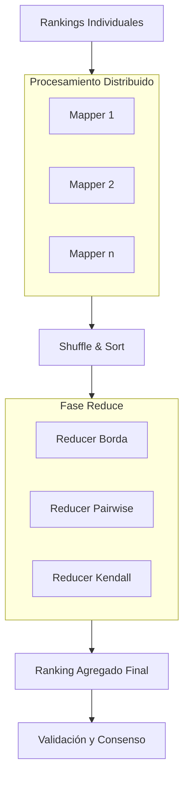

# Computación Distribuida - Temas selectos de redes y algoritmos distribuidos

## 7.3 Agregación de calificación de páginas (ranking).

---

La agregación de calificaciones es un problema fundamental en computación distribuida que consiste en combinar múltiples rankings o preferencias para producir un ranking global coherente. Este problema tiene aplicaciones en sistemas de recomendación, motores de búsqueda y toma de decisiones colectivas.

### Conceptos Fundamentales

#### Problema de Agregación de Rankings

Dado un conjunto de $n$ alternativas y $m$ agentes, cada agente proporciona un ranking completo $\sigma_i$ sobre las alternativas. El objetivo es encontrar un ranking de consenso $\sigma^*$ que minimice la discrepancia total con los rankings individuales.

#### Funciones de Distancia entre Rankings

**Distancia de Kendall-Tau $(\tau)$:**
Número de pares de elementos en los que dos rankings difieren:

$$ K(\sigma, \pi) = \sum_{\{i,j\}} \mathbb{I}[\sigma(i) < \sigma(j) \neq \pi(i) < \pi(j)] $$

**Distancia de Spearman's Footrule $(F)$:**
Suma de las diferencias absolutas en las posiciones:

$$ F(\sigma, \pi) = \sum_{i=1}^n |\sigma(i) - \pi(i)| $$

#### Problemas de Optimización

**Kemeny Optimal Ranking:**

$$ \sigma^* = \arg\min_{\sigma} \sum_{i=1}^m K(\sigma, \sigma_i) $$

**Mediana de Rankings:**

$$ \sigma^* = \arg\min_{\sigma} \sum_{i=1}^m F(\sigma, \sigma_i) $$

### Algoritmos de Agregación

#### Algoritmo de Borda Count

```python
def borda_count(rankings):
    """
    Implementación del método de Borda para agregación de rankings
    """
    n_items = len(rankings[0])
    scores = {item: 0 for item in rankings[0]}

    for ranking in rankings:
        for position, item in enumerate(ranking):
            # Asignar puntos: último lugar recibe 0, primero recibe n-1
            scores[item] += (n_items - position - 1)

    # Ordenar por puntuación descendente
    aggregated_ranking = sorted(scores.keys(), key=lambda x: scores[x], reverse=True)
    return aggregated_ranking, scores
```

#### Algoritmo de Copeland

```python
def copeland_method(rankings):
    """
    Método de Copeland basado en comparaciones por pares
    """
    items = set(rankings[0])
    n_items = len(items)
    pairwise_wins = {item: {other: 0 for other in items if other != item} for item in items}

    # Contar victorias por pares
    for ranking in rankings:
        for i, item_i in enumerate(ranking):
            for j, item_j in enumerate(ranking):
                if i < j:  # item_i está antes que item_j
                    pairwise_wins[item_i][item_j] += 1

    # Calcular puntuaciones de Copeland
    copeland_scores = {}
    for item in items:
        wins = sum(1 for other in items if other != item and pairwise_wins[item][other] > pairwise_wins[other][item])
        ties = sum(1 for other in items if other != item and pairwise_wins[item][other] == pairwise_wins[other][item])
        copeland_scores[item] = wins + 0.5 * ties

    aggregated_ranking = sorted(copeland_scores.keys(), key=lambda x: copeland_scores[x], reverse=True)
    return aggregated_ranking, copeland_scores
```

### Implementación Distribuida

#### Algoritmo MapReduce para Agregación de Rankings

```python
# Mapper: Procesar cada ranking individual
def ranking_mapper(ranking_id, ranking):
    n_items = len(ranking)
    results = []

    # Emitir posiciones para Borda Count
    for position, item in enumerate(ranking):
        results.append(('borda', (item, n_items - position - 1)))

    # Emitir comparaciones por pares para Copeland/Kendall
    for i in range(n_items):
        for j in range(i + 1, n_items):
            results.append(('pairwise', (ranking[i], ranking[j], 1)))

    return results

# Reducer: Agregar resultados
def ranking_reducer(method, values):
    if method == 'borda':
        # Sumar puntuaciones de Borda
        scores = {}
        for item, points in values:
            scores[item] = scores.get(item, 0) + points
        return sorted(scores.items(), key=lambda x: x[1], reverse=True)

    elif method == 'pairwise':
        # Contar victorias por pares
        pairwise_counts = {}
        for winner, loser, count in values:
            key = (winner, loser)
            pairwise_counts[key] = pairwise_counts.get(key, 0) + count

        # Calcular scores de Copeland
        items = set()
        for (i, j) in pairwise_counts.keys():
            items.add(i)
            items.add(j)

        copeland_scores = {item: 0 for item in items}
        for item in items:
            for other in items:
                if item != other:
                    wins = pairwise_counts.get((item, other), 0)
                    losses = pairwise_counts.get((other, item), 0)
                    if wins > losses:
                        copeland_scores[item] += 1
                    elif wins == losses:
                        copeland_scores[item] += 0.5

        return sorted(copeland_scores.items(), key=lambda x: x[1], reverse=True)
```

### Diagrama del Proceso de Agregación Distribuida



### Ejemplo Práctico

#### Ejemplo de Agregación con 3 Rankings

**Rankings de entrada:**

- Agente 1: [A, B, C, D]
- Agente 2: [B, C, A, D]
- Agente 3: [C, A, D, B]

**Cálculo de Borda Count:**

- A: (3+1+2) = 6 puntos
- B: (2+3+0) = 5 puntos
- C: (1+2+3) = 6 puntos
- D: (0+0+1) = 1 punto

**Ranking agregado:** [A, C, B, D] o [C, A, B, D] (empate)

### Teoremas y Propiedades Teóricas

#### Teorema de Arrow (Imposibilidad)

Para 3 o más alternativas, no existe función de agregación que satisfaga simultáneamente:

1. Eficiencia de Pareto
2. No-dictatorialidad
3. Independencia de alternativas irrelevantes
4. Dominio universal

#### Propiedades de Consenso

**Condorcet Winner:** Alternativa que gana en comparaciones por pares contra todas las demás.

**Condorcet Consistency:** Un método es Condorcet-consistent si selecciona al ganador de Condorcet cuando existe.

### Ejercicios Propuestos

#### Ejercicio 1: Implementación de Kemeny-Young

Implementar el algoritmo de Kemeny-Young para encontrar el ranking óptimo que minimiza la distancia de Kendall-Tau.

#### Ejercicio 2: Análisis de Complejidad

Analizar la complejidad computacional de los diferentes métodos de agregación y proponer optimizaciones distribuidas.

#### Ejercicio 3: Agregación Parcial

Extender los algoritmos para manejar rankings parciales (donde algunos agentes no rankean todos los items).

#### Ejercicio 4: Métodos Basados en Markov

Implementar el método de ranking de Markov que modela las transiciones entre alternativas.

#### Ejercicio 5: Evaluación de Calidad

Diseñar métricas para evaluar la calidad del ranking agregado comparado con los rankings individuales.

### Aplicaciones en Sistemas Distribuidos

#### Sistemas de Recomendación

```python
class DistributedRankingSystem:
    def __init__(self, num_workers):
        self.num_workers = num_workers
        self.rankings = []

    def add_ranking(self, ranking):
        """Añadir ranking de un agente"""
        self.rankings.append(ranking)

    def distributed_aggregate(self, method='borda'):
        """Agregación distribuida de rankings"""
        # Distribuir rankings entre workers
        chunks = np.array_split(self.rankings, self.num_workers)
        results = []

        # Procesamiento paralelo
        with concurrent.futures.ProcessPoolExecutor() as executor:
            futures = [executor.submit(process_chunk, chunk, method) for chunk in chunks]
            for future in concurrent.futures.as_completed(futures):
                results.append(future.result())

        # Combinar resultados
        return self.combine_results(results, method)

    def process_chunk(self, chunk, method):
        """Procesar un chunk de rankings"""
        if method == 'borda':
            return self._process_borda_chunk(chunk)
        elif method == 'copeland':
            return self._process_copeland_chunk(chunk)
```

### Referencias

#### Bibliografía Básica

1. Easley, D., & Kleinberg, J. (2010). _Networks, Crowds, and Markets: Reasoning about a Highly Connected World_. Capítulo 23: "Voting"
2. Attiya, H., & Welch, J. (2004). _Distributed Computing: Fundamentals, Simulations, and Advanced Topics_. Capítulo 17: "Shared-Memory Consensus"

#### Bibliografía Complementaria

1. Lynch, N. (1996). _Distributed Algorithms_. Capítulo 18: "Consensus Problems"
2. Tel, G. (2001). _Introduction to Distributed Algorithms_ (2nd ed.). Capítulo 14: "Fault-Tolerant Consensus"

#### Recursos Adicionales

- [Voting Theory Overview](https://arxiv.org/abs/1805.02005)
- [Distributed Ranking Algorithms](https://dl.acm.org/doi/10.1145/1376616.1376626)
- [Rank Aggregation Methods](https://www.nowpublishers.com/article/Details/COM-001)

#### Herramientas Prácticas

- Python: NumPy, Pandas, Scikit-learn
- Frameworks distribuidos: Apache Spark, Dask
- Bibliotecas de ranking: PyVote, Ranky
