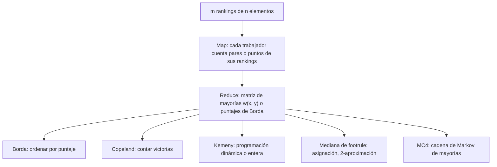

# Computación Distribuida - Temas selectos de redes y algoritmos distribuidos

## 7.3 Agregación de calificación de páginas (ranking).

---

Un **metabuscador** recibe las listas de resultados de varios buscadores y debe combinarlas en una sola; un sistema de recomendación combina las preferencias de muchos usuarios; un comité combina los votos de sus miembros. Es el problema de la **agregación de rankings**: dadas varias ordenaciones de los mismos elementos, encontrar un **ranking de consenso** que las represente lo mejor posible. El problema tiene más de dos siglos (Borda, 1770; Condorcet, 1785) y resultados de imposibilidad (Arrow, 1951) y de complejidad (Kemeny es NP-duro) que obligan a elegir entre propiedades deseables. Este tema define las distancias entre rankings, los métodos de Borda, Copeland, Kemeny, la mediana de footrule y los métodos de cadenas de Markov, su complejidad y su cálculo distribuido.

### Distancias entre rankings

Un ranking de $n$ elementos es una permutación $\sigma,$ con $\sigma(x)$ la posición de $x.$

- **Kendall** $K(\sigma, \pi):$ el número de pares $\{x, y\}$ que los dos rankings ordenan al revés. Es el número mínimo de intercambios de elementos adyacentes que transforma uno en otro; va de 0 a $\binom{n}{2}.$
- **Footrule de Spearman** $F(\sigma, \pi) = \sum_x |\sigma(x) - \pi(x)|.$

**Desigualdad de Diaconis y Graham** (1977): $K(\sigma, \pi) \leq F(\sigma, \pi) \leq 2 K(\sigma, \pi).$

### Métodos de agregación

Se tienen $m$ rankings $\sigma_1, \ldots, \sigma_m.$

- **Borda:** cada ranking da $n - 1$ puntos al primero, $n - 2$ al segundo, y así hasta 0; se ordena por puntaje total. Tiempo $O(mn + n \log n).$
- **Condorcet y Copeland:** $x$ **vence** a $y$ si la mayoría de los rankings pone $x$ antes que $y.$ Un **ganador de Condorcet** vence a todos los demás; puede no existir, porque la mayoría puede formar ciclos, en los que $A$ vence a $B,$ $B$ a $C$ y $C$ a $A;$ es la paradoja de Condorcet. **Copeland** ordena por número de victorias. Tiempo $O(mn^2).$
- **Kemeny** (1959): el ranking que minimiza la suma de distancias de Kendall, $\sigma^* = \arg\min_\sigma \sum_i K(\sigma, \sigma_i).$ Es el único método que es a la vez neutral, consistente y de Condorcet (Young y Levenglick, 1978): si existe un ganador de Condorcet, queda primero. Pero es **NP-duro** incluso con 4 rankings (Dwork y otros, 2001).
- **Mediana de footrule:** el ranking que minimiza $\sum_i F(\sigma, \sigma_i).$ Se resuelve en tiempo polinomial como un **problema de asignación**: el costo de poner $x$ en la posición $k$ es $\sum_i |\sigma_i(x) - k|.$ Por Diaconis y Graham, es una **2-aproximación** de Kemeny.
- **Cadenas de Markov** (Dwork y otros, 2001): los elementos son estados, y desde el estado $x$ se pasa a $y$ si la mayoría prefiere $y$ a $x$ (variante MC4). Se ordena por la distribución estacionaria, como en PageRank. Funciona con rankings parciales y es robusto al ruido.

### Calcular Kemeny exactamente

Probar las $n!$ permutaciones es inviable a partir de $n \approx 10.$ Una **programación dinámica sobre subconjuntos** lo reduce a $O(2^n n^2):$ sea $C(S)$ el costo mínimo de ordenar el conjunto $S$ como prefijo; entonces $C(S) = \min_{x \in S} \left[ C(S \setminus \{x\}) + \sum_{y \in S \setminus \{x\}} w(x, y) \right],$ donde $w(x, y)$ es el número de rankings que ponen $x$ antes que $y,$ los que se contradicen al poner $x$ después de todo $S \setminus \{x\}.$ En la práctica se usan programación entera, ramificación y acotamiento, y heurísticas de búsqueda local a partir de Borda o de la mediana de footrule.

### Teorema de Arrow

Una **función de bienestar social** produce un ranking de consenso a partir de cualquier perfil de rankings. Arrow (1951) demostró que, con 3 o más alternativas, ninguna cumple a la vez:

1. **Dominio universal:** acepta cualquier perfil.
2. **Unanimidad** (eficiencia de Pareto): si todos prefieren $x$ a $y,$ el consenso también.
3. **Independencia de alternativas irrelevantes:** el orden entre $x$ e $y$ en el consenso depende solo de los órdenes entre $x$ e $y$ en los rankings.
4. **No dictadura:** no hay un votante cuyo ranking sea siempre el consenso.

Borda viola la independencia (agregar o quitar un candidato puede invertir el orden de otros dos), Kemeny también, y la regla de mayoría por pares la cumple pero no siempre produce un orden (ciclos). En la práctica, se elige el método por las propiedades que importan en la aplicación.

### Cálculo distribuido

- **Borda:** cada trabajador suma los puntos de sus rankings; la reducción suma los vectores parciales. $O(mn/p)$ por trabajador.
- **Condorcet, Copeland, Kemeny y MC4:** todos dependen solo de la **matriz de mayorías** $w(x, y);$ cada trabajador cuenta los pares de sus rankings y la reducción suma las matrices. Con la matriz agregada, de tamaño $n^2,$ independiente de $m,$ el resto se calcula en un solo nodo.
- **Mediana de footrule:** la matriz de costos de asignación también es una suma sobre los rankings, y se agrega igual.



### Implementación en Python

El programa implementa las distancias de Kendall y footrule, Borda, Copeland, Kemeny por fuerza bruta y por programación dinámica, la mediana de footrule con el algoritmo húngaro de `scipy` y MC4. Analiza el ejemplo del tema (tres rankings con un ciclo de Condorcet), compara los métodos con 50 votantes y hasta 12 elementos (ejercicios 1 y 2), agrega listas parciales (ejercicio 3), muestra un caso en el que Borda no elige al ganador de Condorcet (ejercicio 4), mide la calidad de cada ranking agregado (ejercicio 5) y cuenta los pares de forma distribuida.

```python
import math, random
from itertools import permutations, combinations
from collections import defaultdict
import numpy as np
from scipy.optimize import linear_sum_assignment

random.seed(73)

def kendall(s, p):
    pos = {x: i for i, x in enumerate(p)}
    return sum(1 for i, j in combinations(range(len(s)), 2) if pos[s[i]] > pos[s[j]])

def footrule(s, p):
    pos = {x: i for i, x in enumerate(p)}
    return sum(abs(i - pos[x]) for i, x in enumerate(s))

def borda(R):
    n = len(R[0]); puntos = defaultdict(int)
    for r in R:
        for i, x in enumerate(r): puntos[x] += n - 1 - i
    return sorted(puntos, key=lambda x: (-puntos[x], x)), dict(puntos)

def mayorias(R):
    alt = sorted(R[0]); M = {(a, b): 0 for a in alt for b in alt if a != b}
    for r in R:
        pos = {x: i for i, x in enumerate(r)}
        for a, b in M:
            M[(a, b)] += pos[a] < pos[b]
    return alt, M

def copeland(R):
    alt, M = mayorias(R)
    puntos = {a: sum(1 if M[(a, b)] > M[(b, a)] else 0.5 if M[(a, b)] == M[(b, a)] else 0 for b in alt if b != a) for a in alt}
    return sorted(alt, key=lambda x: (-puntos[x], x)), puntos

def kemeny_bruto(R):
    return min(permutations(sorted(R[0])), key=lambda s: (sum(kendall(s, r) for r in R), s))

def kemeny_dp(R):
    """Programación dinámica sobre subconjuntos: O(2^n n^2) en lugar de O(n!)."""
    alt, M = mayorias(R); n = len(alt)
    costo = {(a, b): M[(b, a)] for a, b in M}           # poner a antes que b contradice a quienes prefieren b
    mejor = {0: (0, ())}
    for mask in range(1, 1 << n):
        cand = []
        for i in range(n):
            if mask >> i & 1:
                prev = mask & ~(1 << i)
                c0, orden = mejor[prev]
                c = c0 + sum(costo[(alt[j], alt[i])] for j in range(n) if prev >> j & 1)
                cand.append((c, orden + (alt[i],)))
        mejor[mask] = min(cand)
    return mejor[(1 << n) - 1]

def footrule_optima(R):
    alt = sorted(R[0]); n = len(alt)
    C = np.array([[sum(abs(r.index(a) - k) for r in R) for k in range(n)] for a in alt])
    filas, cols = linear_sum_assignment(C)
    orden = [None] * n
    for f, c in zip(filas, cols): orden[c] = alt[f]
    return tuple(orden)

def markov_mc4(R, eps=0.15, iters=500):
    """Dwork y otros (MC4): desde a, elegir b al azar; ir a b si la mayoría prefiere b a a."""
    alt, M = mayorias(R); n = len(alt); idx = {a: i for i, a in enumerate(alt)}
    P = np.zeros((n, n))
    for a in alt:
        for b in alt:
            if a != b and M[(b, a)] > M[(a, b)]:
                P[idx[a], idx[b]] = 1 / n
        P[idx[a], idx[a]] = 1 - P[idx[a]].sum()
    P = (1 - eps) * P + eps / n
    x = np.ones(n) / n
    for _ in range(iters): x = x @ P
    return tuple(sorted(alt, key=lambda a: (-x[idx[a]], a))), np.round(x, 3)

# --- ejemplo del tema ---
R = [list("ABCD"), list("BCAD"), list("CADB")]
print("ejemplo: Borda", borda(R)[1], "| Copeland", copeland(R)[1])
alt, M = mayorias(R)
print("   mayorías:", {f"{a}>{b}": M[(a, b)] for a, b in M if M[(a, b)] >= 2})
print("   ciclo de Condorcet A > B > C > A:", M[("A", "B")] >= 2 and M[("B", "C")] >= 2 and M[("C", "A")] >= 2)

# --- Ejercicio 1: Kemeny ---
kb = kemeny_bruto(R); kd = kemeny_dp(R)
print(f"ejercicio 1: Kemeny por fuerza bruta {''.join(kb)} con distancia {sum(kendall(kb, r) for r in R)};"
      f" por programación dinámica {''.join(kd[1])} con {kd[0]}")
todos = [(''.join(s), sum(kendall(s, r) for r in R)) for s in permutations("ABCD")]
print("   rankings con distancia mínima:", [s for s, d in todos if d == kd[0]])

# --- Ejercicio 2: complejidad y tiempos ---
print("ejercicio 2: m = 50 votantes; estados que examina cada método exacto y distancia de Kendall total")
for n in (6, 8, 10, 12):
    alt = list(range(n)); base = alt[:]
    Rn = []
    for _ in range(50):
        r = base[:]
        for _ in range(3 * n): i = random.randrange(n - 1); r[i], r[i + 1] = r[i + 1], r[i]
        Rn.append(r)
    b = borda(Rn)[0]; f = footrule_optima(Rn); kc, ko = kemeny_dp(Rn); co = copeland(Rn)[0]
    if n <= 6:
        assert sum(kendall(kemeny_bruto(Rn), r) for r in Rn) == kc
    db, df, dc = (sum(kendall(s, r) for r in Rn) for s in (b, f, co))
    print(f"   n = {n:2}: fuerza bruta {math.factorial(n):9} permutaciones, programación dinámica {2 ** n * n:6} estados;"
          f" Kemeny {kc}, Borda {db}, Copeland {dc}, footrule {df}")

# --- Ejercicio 3: rankings parciales (listas de los primeros k) ---
parciales = [["A", "B"], ["B", "C", "A"], ["C"], ["A", "C", "D"], ["B", "A"]]
universo = sorted({x for r in parciales for x in r})
def borda_parcial(P, universo):
    """Los no listados empatan en las posiciones restantes (se reparte el puntaje que sobra)."""
    n = len(universo); pts = defaultdict(float)
    for r in P:
        for i, x in enumerate(r): pts[x] += n - 1 - i
        resto = [x for x in universo if x not in r]
        if resto:
            prom = sum(n - 1 - i for i in range(len(r), n)) / len(resto)
            for x in resto: pts[x] += prom
    return sorted(universo, key=lambda x: (-pts[x], x)), dict(pts)
def kendall_parcial(s, r, p=0.5):
    """Penaliza 1 los pares invertidos y p los pares que la lista parcial no decide."""
    pos = {x: i for i, x in enumerate(r)}; d = 0.0
    for a, b in combinations(s, 2):
        if a in pos and b in pos: d += pos[a] > pos[b]
        elif b in pos and a not in pos: d += 1        # r pone a b antes que a, s al revés
        elif a not in pos and b not in pos: d += p
    return d
orden, pts = borda_parcial(parciales, universo)
mejor = min(permutations(universo), key=lambda s: (sum(kendall_parcial(s, r) for r in parciales), s))
print("ejercicio 3: listas parciales", parciales)
print(f"   Borda con empates en lo no listado: {''.join(orden)} {pts}; Kemeny parcial (p = 1/2): {''.join(mejor)}")

# --- Ejercicio 4: cadenas de Markov ---
orden, x = markov_mc4(R)
print("ejercicio 4: MC4 en el ejemplo:", ''.join(orden), x)
Rc = [list("ABC")] * 3 + [list("BCA")] * 2
print("   3 votos ABC y 2 BCA (A es ganador de Condorcet): MC4", ''.join(markov_mc4(Rc)[0]),
      "| Copeland", ''.join(copeland(Rc)[0]), "| Borda", ''.join(borda(Rc)[0]), borda(Rc)[1])

# --- Ejercicio 5: métricas de calidad ---
def calidad(s, R):
    alt, M = mayorias(R)
    respeta = sum(1 for a, b in combinations(s, 2) if M[(a, b)] >= M[(b, a)]) / (len(s) * (len(s) - 1) / 2)
    return {"Kendall medio": round(sum(kendall(s, r) for r in R) / len(R), 2),
            "footrule medio": round(sum(footrule(s, r) for r in R) / len(R), 2),
            "pares de mayoría respetados": round(respeta, 2)}
print("ejercicio 5: calidad en el ejemplo")
for nombre, s in (("Borda", borda(R)[0]), ("Copeland", copeland(R)[0]), ("Kemeny", kd[1]),
                  ("footrule", footrule_optima(R)), ("MC4", markov_mc4(R)[0])):
    print(f"   {nombre:9} {''.join(s)}: {calidad(s, R)}")

# --- agregación distribuida: conteos de mayoría con MapReduce ---
def mapreduce_pares(R, trozos=3):
    parciales = []
    for k in range(trozos):                              # cada trabajador procesa sus votos
        c = defaultdict(int)
        for r in R[k::trozos]:
            for i, j in combinations(range(len(r)), 2): c[(r[i], r[j])] += 1
        parciales.append(c)
    total = defaultdict(int)                             # reducción: sumar por par
    for c in parciales:
        for k, v in c.items(): total[k] += v
    return total
print("   conteos por pares con 3 trabajadores iguales al centralizado:",
      all(mapreduce_pares(Rc)[(a, b)] == mayorias(Rc)[1][(a, b)] for a, b in mayorias(Rc)[1]))
```

Salida:

```text
ejemplo: Borda {'A': 6, 'B': 5, 'C': 6, 'D': 1} | Copeland {'A': 2, 'B': 2, 'C': 2, 'D': 0}
   mayorías: {'A>B': 2, 'A>D': 3, 'B>C': 2, 'B>D': 2, 'C>A': 2, 'C>D': 3}
   ciclo de Condorcet A > B > C > A: True
ejercicio 1: Kemeny por fuerza bruta ABCD con distancia 5; por programación dinámica ABCD con 5
   rankings con distancia mínima: ['ABCD', 'BCAD', 'CABD']
ejercicio 2: m = 50 votantes; estados que examina cada método exacto y distancia de Kendall total
   n =  6: fuerza bruta       720 permutaciones, programación dinámica    384 estados; Kemeny 266, Borda 266, Copeland 266, footrule 266
   n =  8: fuerza bruta     40320 permutaciones, programación dinámica   2048 estados; Kemeny 390, Borda 394, Copeland 390, footrule 398
   n = 10: fuerza bruta   3628800 permutaciones, programación dinámica  10240 estados; Kemeny 468, Borda 468, Copeland 468, footrule 468
   n = 12: fuerza bruta 479001600 permutaciones, programación dinámica  49152 estados; Kemeny 584, Borda 584, Copeland 584, footrule 598
ejercicio 3: listas parciales [['A', 'B'], ['B', 'C', 'A'], ['C'], ['A', 'C', 'D'], ['B', 'A']]
   Borda con empates en lo no listado: ABCD {'A': 10.0, 'B': 9.0, 'C': 8.0, 'D': 3.0}; Kemeny parcial (p = 1/2): ABCD
ejercicio 4: MC4 en el ejemplo: ABCD [0.317 0.317 0.317 0.048]
   3 votos ABC y 2 BCA (A es ganador de Condorcet): MC4 ABC | Copeland ABC | Borda BAC {'A': 6, 'B': 7, 'C': 2}
ejercicio 5: calidad en el ejemplo
   Borda     ACBD: {'Kendall medio': 2.0, 'footrule medio': 3.33, 'pares de mayoría respetados': 0.67}
   Copeland  ABCD: {'Kendall medio': 1.67, 'footrule medio': 3.33, 'pares de mayoría respetados': 0.83}
   Kemeny    ABCD: {'Kendall medio': 1.67, 'footrule medio': 3.33, 'pares de mayoría respetados': 0.83}
   footrule  BACD: {'Kendall medio': 2.0, 'footrule medio': 3.33, 'pares de mayoría respetados': 0.67}
   MC4       ABCD: {'Kendall medio': 1.67, 'footrule medio': 3.33, 'pares de mayoría respetados': 0.83}
   conteos por pares con 3 trabajadores iguales al centralizado: True
```

### Ejercicios Propuestos

1. **Kemeny.** Implementa el método de Kemeny para encontrar el ranking que minimiza la suma de distancias de Kendall.

2. **Complejidad.** Analiza la complejidad de los métodos de agregación y propón optimizaciones distribuidas.

3. **Rankings parciales.** Extiende los métodos para listas parciales, en las que algunos agentes no ordenan todos los elementos.

4. **Cadenas de Markov.** Implementa un método de agregación basado en una cadena de Markov sobre las alternativas.

5. **Calidad.** Diseña métricas para evaluar la calidad de un ranking agregado frente a los rankings individuales.

### Soluciones

**Ejercicio 1.** En el ejemplo, con los rankings ABCD, BCAD y CADB, la mayoría prefiere A a B, B a C y C a A: un **ciclo de Condorcet**, así que ningún ranking satisface todas las mayorías. Kemeny encuentra tres rankings empatados con distancia total 5, ABCD, BCAD y CABD: rotaciones del ciclo con D al final, porque D pierde contra todos. La fuerza bruta y la programación dinámica coinciden. Borda deja empatados a A y C con 6 puntos.

**Ejercicio 2.**

| Método | Tiempo | Notas |
| --- | --- | --- |
| Borda | $O(mn + n \log n)$ | no es de Condorcet |
| Copeland | $O(mn^2)$ | de Condorcet; muchos empates |
| mediana de footrule | $O(mn^2 + n^3)$ | 2-aproximación de Kemeny |
| MC4 | $O(mn^2 + n^2 t)$ con $t$ iteraciones | robusto, admite parciales |
| Kemeny exacto | NP-duro; $O(mn^2 + 2^n n^2)$ con programación dinámica | óptimo |

Con 12 elementos, la fuerza bruta tendría que examinar 479 millones de permutaciones y la programación dinámica unos 49 000 estados. Con votantes que son perturbaciones de un mismo ranking, Borda y Copeland casi siempre coinciden con Kemeny; la mediana de footrule queda un poco por encima. **Optimizaciones distribuidas:** todo método que dependa de la matriz de mayorías se agrega con un MapReduce de una ronda, sumando matrices de $n^2$ por trabajador, y el cómputo restante no depende de $m.$

**Ejercicio 3.** Para **Borda**, los elementos no listados por un votante se reparten por igual los puntos de las posiciones que no usó. Para **Kendall**, se cuenta 1 por par invertido, 1 si la lista pone uno de los elementos y el otro no, y no está en ese orden en el consenso, y una penalización $p \in [0, 1]$ por cada par que la lista no decide (Fagin, Kumar y Sivakumar, 2003). Con $p = 1/2,$ un par no decidido cuenta como un volado. En el ejemplo, ambos métodos dan ABCD. **MC4** admite listas parciales de forma natural: las comparaciones se hacen solo entre los elementos que cada lista contiene.

**Ejercicio 4.** Es `markov_mc4` del programa. Como en PageRank, se agrega un salto aleatorio pequeño para que la cadena sea ergódica. En el ejemplo, la cadena pasa el mismo tiempo en A, B y C, que forman el ciclo, y muy poco en D. Con 3 votos ABC y 2 votos BCA, A es ganador de Condorcet, porque vence a B y a C 3 a 2, y tanto MC4 como Copeland lo ponen primero; **Borda** elige a B, con 7 puntos contra 6, porque premia que B nunca quede último.

**Ejercicio 5.** Métricas posibles para un ranking agregado $\sigma$ frente a los individuales:

- **Distancia media de Kendall** $\frac{1}{m} \sum_i K(\sigma, \sigma_i),$ la que Kemeny minimiza, y **de footrule**.
- **Fracción de mayorías respetadas:** de los pares en los que hay una mayoría, cuántos ordena $\sigma$ igual que la mayoría.
- **Consistencia de Condorcet:** si existe un ganador de Condorcet, ¿queda primero?
- **Satisfacción del peor votante:** $\max_i K(\sigma, \sigma_i),$ para equidad.

En el ejemplo, Copeland, Kemeny y MC4 empatan con la menor distancia media de Kendall (1.67) y respetan 5 de los 6 pares de mayoría, que es lo máximo posible por el ciclo; Borda y la mediana de footrule respetan 4.

### Referencias

1. Dwork, C., Kumar, R., Naor, M., and Sivakumar, D., Rank aggregation methods for the Web. _Proceedings of the 10th International World Wide Web Conference_, 2001.
2. Brandt, F., Conitzer, V., Endriss, U., Lang, J., and Procaccia, A. D., eds., _Handbook of Computational Social Choice_. Cambridge University Press, 2016. Capítulos 2 a 4.
3. Diaconis, P., and Graham, R. L., Spearman's footrule as a measure of disarray. _Journal of the Royal Statistical Society B_ 39(2), 1977.
4. Fagin, R., Kumar, R., and Sivakumar, D., Comparing top k lists. _SIAM Journal on Discrete Mathematics_ 17(1), 2003.
