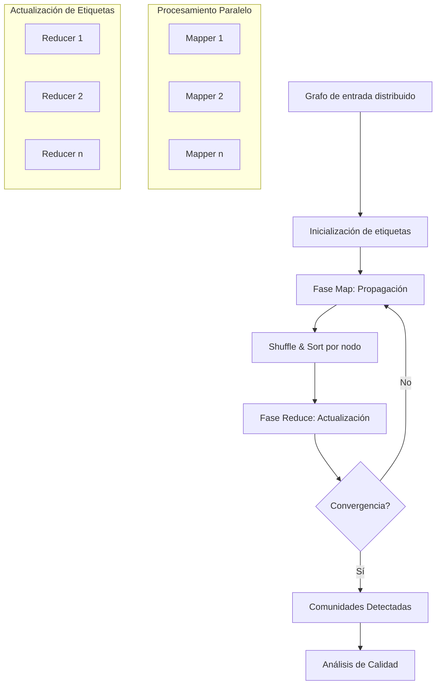

# Computación Distribuida - Temas selectos de redes y algoritmos distribuidos

## 7.4 Comunidades y cúmulos en redes.

---

El estudio de comunidades y cúmulos en redes es fundamental para entender la estructura y organización de sistemas complejos. En computación distribuida, la detección eficiente de comunidades permite optimizar el routing, mejorar la tolerancia a fallos y entender la dinámica de redes a gran escala.

### Conceptos Fundamentales

#### Definición de Comunidad

Una comunidad es un subconjunto de nodos $C \subseteq V$ en un grafo $G = (V, E)$ donde:

- Los nodos dentro de $C$ están más conectados entre sí que con el resto de la red
- Satisfacen: $\text{intra-conexión}(C) \gg \text{inter-conexión}(C, V\setminus C)$

#### Métricas de Calidad de Comunidades

**Modularidad $(Q)$:**

$$
Q = \frac{1}{2m} \sum_{ij} \left[ A_{ij} - \frac{k_i k_j}{2m} \right] \delta(c_i, c_j)
$$

donde:

- $m$: número total de aristas
- $k_i$: grado del nodo $i$
- $A_{ij}$: elemento de la matriz de adyacencia
- $\delta(c_i, c_j)$: 1 si $i$ y $j$ están en la misma comunidad, 0 en otro caso

**Conductancia $(\phi)$:**

$$
\phi(C) = \frac{|\partial C|}{\min(\text{vol}(C), \text{vol}(V\setminus C))}
$$

donde $\partial C$ son las aristas que cruzan la frontera de $C$ y $\text{vol}(C) = \sum_{i \in C} k_i$.

### Algoritmos de Detección de Comunidades

#### Algoritmo de Louvain (Optimización de Modularidad)

```python
import networkx as nx
import community as community_louvain

def louvain_community_detection(G):
    """
    Implementación del algoritmo de Louvain para detección de comunidades
    """
    # Fase 1: Optimización local
    partition = {node: node for node in G.nodes()}
    improvement = True

    while improvement:
        improvement = False
        for node in G.nodes():
            best_community = partition[node]
            best_deltaQ = 0

            # Evaluar movimientos a comunidades vecinas
            for neighbor in G.neighbors(node):
                community = partition[neighbor]
                if community != partition[node]:
                    deltaQ = calculate_deltaQ(G, node, community, partition)
                    if deltaQ > best_deltaQ:
                        best_deltaQ = deltaQ
                        best_community = community

            if best_community != partition[node]:
                partition[node] = best_community
                improvement = True

    # Fase 2: Agregación
    super_graph = create_super_graph(G, partition)

    return partition, super_graph

def calculate_deltaQ(G, node, new_community, partition):
    """
    Calcular cambio en modularidad al mover un nodo a otra comunidad
    """
    # Implementación de la fórmula de deltaQ
    current_community = partition[node]
    # Cálculo basado en la fórmula de modularidad
    deltaQ = (sum_in - sum_tot * k_i / (2*m)) - (sum_in_current - sum_tot_current * k_i / (2*m))
    return deltaQ
```

#### Label Propagation Algorithm (LPA)

```python
def label_propagation(G, max_iterations=100):
    """
    Algoritmo de propagación de etiquetas para detección de comunidades
    """
    # Inicializar etiquetas únicas
    labels = {node: i for i, node in enumerate(G.nodes())}

    for iteration in range(max_iterations):
        changed = False
        nodes = list(G.nodes())
        np.random.shuffle(nodes)  # Orden aleatorio

        for node in nodes:
            # Contar etiquetas de vecinos
            neighbor_labels = {}
            for neighbor in G.neighbors(node):
                label = labels[neighbor]
                neighbor_labels[label] = neighbor_labels.get(label, 0) + 1

            if neighbor_labels:
                # Seleccionar etiqueta más frecuente
                max_label = max(neighbor_labels.items(), key=lambda x: x[1])[0]
                if labels[node] != max_label:
                    labels[node] = max_label
                    changed = True

        if not changed:
            break

    return labels
```

### Implementación Distribuida

#### Algoritmo MapReduce para Detección de Comunidades

```python
# Mapper para Label Propagation
def community_mapper(node, neighbors, current_label):
    """
    Mapper: Propagar etiquetas a vecinos
    """
    results = []

    # Emitir la etiqueta actual para el nodo
    results.append((node, ('current', current_label)))

    # Emitir influencia a vecinos
    for neighbor in neighbors:
        results.append((neighbor, ('influence', current_label)))

    return results

# Reducer para actualizar etiquetas
def community_reducer(node, values):
    """
    Reducer: Decidir nueva etiqueta basada en influencias
    """
    current_label = None
    influence_counts = {}

    for value_type, data in values:
        if value_type == 'current':
            current_label = data
        elif value_type == 'influence':
            influence_counts[data] = influence_counts.get(data, 0) + 1

    if influence_counts:
        # Seleccionar etiqueta más frecuente
        new_label = max(influence_counts.items(), key=lambda x: x[1])[0]
        if new_label != current_label:
            return (node, new_label)

    return (node, current_label)
```

### Diagrama del Proceso de Detección de Comunidades Distribuido



### Ejemplo Práctico

#### Red de Zachary's Karate Club

```python
# Cargar y analizar red de ejemplo
G = nx.karate_club_graph()

# Aplicar Louvain
partition = community_louvain.best_partition(G)

# Calcular modularidad
modularity = community_louvain.modularity(partition, G)
print(f"Modularidad: {modularity:.3f}")

# Visualizar comunidades
pos = nx.spring_layout(G)
nx.draw_networkx_nodes(G, pos, node_color=list(partition.values()), cmap='tab20')
nx.draw_networkx_edges(G, pos)
```

#### Resultados Esperados:

- 3-4 comunidades detectadas
- Modularidad típica: 0.38-0.42
- Comunidades corresponden a divisiones reales del club

### Algoritmos Avanzados

#### Infomap (Basado en Teoría de Información)

```python
def infomap_communities(G):
    """
    Algoritmo Infomap que minimiza la descripción de longitud de ruta
    """
    # Implementación simplificada
    communities = {}
    # Cálculo de flujos de información y optimización
    return communities
```

#### Detección de Comunidades Solapadas

```python
def overlapping_communities(G, alpha=0.5):
    """
    Algoritmo para detectar comunidades con miembros solapados
    """
    # Usar enfoque de pertenencia difusa
    membership = {node: {} for node in G.nodes()}

    # Asignar grados de pertenencia múltiple
    for node in G.nodes():
        neighbors = list(G.neighbors(node))
        # Calcular afinidades con diferentes comunidades
        pass

    return membership
```

### Ejercicios Propuestos

#### Ejercicio 1: Implementación de Modularidad

Implementar la función de cálculo de modularidad para una partición dada y validarla con NetworkX.

#### Ejercicio 2: Análisis de Escalabilidad

Analizar la complejidad computacional del algoritmo de Louvain y proponer una versión distribuida.

#### Ejercicio 3: Detección de Comunidades Dinámicas

Extender los algoritmos para manejar redes que evolucionan en el tiempo.

#### Ejercicio 4: Comparación de Algoritmos

Implementar y comparar 3 algoritmos de detección de comunidades en términos de:

- Calidad (modularidad)
- Tiempo de ejecución
- Escalabilidad

#### Ejercicio 5: Aplicación a Redes de Gran Escala

Diseñar un sistema distribuido para detectar comunidades en redes con millones de nodos usando Spark o Hadoop.

### Teoremas y Propiedades

#### Teorema de Resolution Limit

La modularidad tiene una limitación de resolución: no puede detectar comunidades más pequeñas que $\sqrt{2m}$ en algunas configuraciones.

#### Propiedad de Consistencia Asintótica

Algunos algoritmos son consistentes bajo modelos estocásticos de blocciones (SBM) cuando el tamaño de la red tiende a infinito.

### Referencias

#### Bibliografía Básica

1. Easley, D., & Kleinberg, J. (2010). _Networks, Crowds, and Markets: Reasoning about a Highly Connected World_. Capítulo 3: "Strong and Weak Ties"
2. Attiya, H., & Welch, J. (2004). _Distributed Computing: Fundamentals, Simulations, and Advanced Topics_. Capítulo 15: "Network Algorithms"

#### Bibliografía Complementaria

1. Lynch, N. (1996). _Distributed Algorithms_. Capítulo 16: "Distributed Graph Algorithms"
2. Tel, G. (2001). _Introduction to Distributed Algorithms_ (2nd ed.). Capítulo 11: "Wave and Traversal Algorithms"

#### Recursos Adicionales

- [Community Detection in Graphs](https://arxiv.org/abs/0906.0612)
- [Comparative Analysis of Community Detection Algorithms](https://www.nature.com/articles/s41598-019-41695-z)
- [Distributed Community Detection](https://dl.acm.org/doi/10.1145/2670979.2670997)

#### Herramientas Prácticas

- Python: NetworkX, python-louvain, CDlib
- Frameworks distribuidos: Apache Giraph, GraphX
- Visualización: Gephi, Cytoscape
