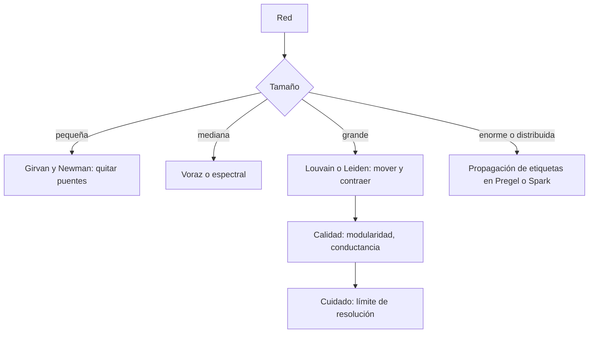

# Computación Distribuida - Temas selectos de redes y algoritmos distribuidos

## 7.4 Comunidades y cúmulos en redes.

---

Casi todas las redes reales tienen **comunidades**: grupos de nodos mucho más conectados entre sí que con el resto. Son grupos de amigos en una red social, temas en la red de citas, módulos funcionales en una red de proteínas, departamentos en una red de correo. Detectarlas sirve para entender la red, para recomendar, para particionar el cómputo distribuido de manera que la comunicación sea local, y para comprimir. Este tema define la calidad de una partición con la **modularidad** y la **conductancia**, presenta los algoritmos de Girvan y Newman, el voraz de Clauset, Newman y Moore, **Louvain** y la **propagación de etiquetas**, sus limitaciones (el **límite de resolución**) y su ejecución distribuida y en redes que cambian.

### Calidad de una partición

**Modularidad** (Newman y Girvan, 2004). Para una partición en comunidades $C_1, \ldots, C_k$ de una gráfica con $m$ aristas,

$$Q = \sum_{c} \left[ \frac{e_c}{m} - \left( \frac{d_c}{2m} \right)^2 \right],$$

donde $e_c$ es el número de aristas dentro de $C_c$ y $d_c$ la suma de los grados de sus nodos. El primer término es la fracción de aristas internas; el segundo, la fracción esperada si las aristas se reconectaran al azar conservando los grados (el **modelo nulo** de configuración). $Q = 0$ para todo en un solo grupo, es negativa para la partición en nodos aislados, y valores de 0.3 a 0.7 indican estructura de comunidades clara.

**Conductancia** de una comunidad $S:$ $\phi(S) = \frac{|E(S, \bar S)|}{\min(\text{vol}(S), \text{vol}(\bar S))},$ la fracción de sus aristas que salen. Es pequeña para una buena comunidad, y se relaciona con el espectro por la desigualdad de Cheeger (tema 7.2).

Maximizar $Q$ es **NP-duro** (Brandes y otros, 2008), así que se usan heurísticas.

### Algoritmos

- **Girvan y Newman** (2002): quitar repetidamente la arista de mayor **intermediación**, la que más caminos cortos usa, porque las aristas entre comunidades son los puentes; las componentes que van quedando forman una jerarquía, y se elige el nivel de mayor $Q.$ $O(m^2 n),$ solo para redes pequeñas.
- **Voraz** (Clauset, Newman y Moore, 2004): empezar con cada nodo solo y fusionar repetidamente el par de comunidades que más aumenta $Q.$ $O(m d \log n)$ con montículos, $d$ la profundidad del dendrograma.
- **Louvain** (Blondel y otros, 2008): (1) cada nodo se mueve a la comunidad vecina que más aumenta $Q,$ hasta que ninguno mejora; (2) cada comunidad se contrae en un supernodo, con aristas pesadas, y se repite. Muy rápido, casi lineal en la práctica, y de buena calidad. **Leiden** (Traag y otros, 2019) lo corrige para garantizar comunidades conexas.
- **Propagación de etiquetas** (Raghavan, Albert y Kumara, 2007): cada nodo empieza con una etiqueta propia y adopta repetidamente la etiqueta más frecuente entre sus vecinos; las comunidades son los grupos de nodos con la misma etiqueta. Lineal por iteración y muy fácil de distribuir, pero no optimiza nada explícitamente y puede colapsar a una sola etiqueta.
- **Espectral** (tema 7.2), **Infomap** (Rosvall y Bergstrom, 2008), que comprime la descripción de una caminata aleatoria, y **modelos de bloques estocásticos**, que ajustan un modelo generativo por máxima verosimilitud.

**Comunidades solapadas:** un nodo puede pertenecer a varias, como una persona a su familia y su trabajo. Métodos como el de percolación de cliques (Palla y otros, 2005) o la partición de aristas en lugar de nodos las detectan.

### Límite de resolución

Fortunato y Barthélemy (2007) demostraron que la modularidad no puede detectar comunidades más pequeñas que aproximadamente $\sqrt{2m}$ aristas: dos comunidades pequeñas unidas por una sola arista aumentan $Q$ al fusionarse si la red es suficientemente grande, porque el término esperado $(d_c/2m)^2$ se vuelve diminuto. En un anillo de 30 cliques de 5 nodos unidas en cadena, fusionar los cliques por parejas tiene más modularidad que separarlos todos, aunque cada clique es claramente una comunidad. Se mitiga con un **parámetro de resolución** $\gamma$ que multiplica el término esperado.

### Cálculo distribuido

- **Propagación de etiquetas** es naturalmente distribuida: en cada ronda, cada nodo recibe las etiquetas de sus vecinos y elige la más frecuente; en el modelo de Pregel o GraphX, una superetapa por iteración.
- **Louvain distribuido:** se particiona la gráfica; cada máquina mueve sus nodos usando la información de las comunidades vecinas, con una sincronización por ronda de los totales $d_c$ de cada comunidad; la contracción es un MapReduce que agrupa aristas por pareja de comunidades.
- **Redes dinámicas:** en lugar de recalcular todo, se parte de la partición anterior (**arranque en caliente**) y se actualizan solo los nodos cercanos a los cambios.



### Implementación en Python

El programa implementa la modularidad y la compara con `networkx` en el club de karate (ejercicio 1); compara Louvain, el voraz, la propagación de etiquetas y Girvan y Newman por su modularidad y por la **información mutua normalizada** (NMI) con la división real del club y con comunidades plantadas en un modelo de bloques estocástico de 1000 nodos (ejercicio 4); muestra el límite de resolución en un anillo de cliques, y compara la propagación de etiquetas desde cero y con arranque en caliente en una red que cambia (ejercicio 3).

```python
import math, random
from collections import Counter, defaultdict
import networkx as nx
from networkx.algorithms import community as nxc

random.seed(74)

# --- Ejercicio 1: modularidad ---
def modularidad(G, particion):
    m = G.number_of_edges(); Q = 0.0
    for C in particion:
        C = set(C)
        dentro = G.subgraph(C).number_of_edges()
        grado = sum(d for _, d in G.degree(C))
        Q += dentro / m - (grado / (2 * m)) ** 2
    return Q

K = nx.karate_club_graph()
for u, v in K.edges():                      # networkx incluye pesos; aquí se usa la red sin pesos
    del K[u][v]["weight"]
real = [{v for v in K if K.nodes[v]["club"] == c} for c in ("Mr. Hi", "Officer")]
print(f"ejercicio 1: modularidad de la división real del club de karate: propia {modularidad(K, real):.4f},"
      f" networkx {nxc.modularity(K, real):.4f}")
print(f"   todo en un grupo {modularidad(K, [set(K)]):.4f}; cada nodo solo {modularidad(K, [{v} for v in K]):.4f}")

# --- propagación de etiquetas (versión propia, asíncrona) ---
def propagacion(G, etiquetas=None, max_iter=100, rng=random):
    et = dict(etiquetas) if etiquetas else {v: v for v in G}
    for it in range(1, max_iter + 1):
        cambio = False
        for v in rng.sample(list(G), len(G)):
            if not G[v]: continue
            c = Counter(et[u] for u in G[v])
            mejor = max(c.values())
            opciones = sorted(l for l, k in c.items() if k == mejor)
            if et[v] not in opciones:
                et[v] = rng.choice(opciones); cambio = True
        if not cambio:
            return et, it
    return et, max_iter

def a_particion(et):
    g = defaultdict(set)
    for v, l in et.items(): g[l].add(v)
    return list(g.values())

def nmi(P1, P2, n):
    a = {v: i for i, C in enumerate(P1) for v in C}; b = {v: i for i, C in enumerate(P2) for v in C}
    ca, cb, cab = Counter(a.values()), Counter(b.values()), Counter((a[v], b[v]) for v in a)
    I = sum(k / n * math.log(k * n / (ca[i] * cb[j])) for (i, j), k in cab.items())
    H = lambda c: -sum(k / n * math.log(k / n) for k in c.values())
    return 2 * I / (H(ca) + H(cb)) if H(ca) + H(cb) else 1.0

# --- Ejercicio 4: comparación ---
def girvan_newman_mejor(G):
    mejor, Qmax = None, -1
    for p in nxc.girvan_newman(G):
        q = modularidad(G, p)
        if q > Qmax: mejor, Qmax = p, q
        if len(p) > 10: break
    return [set(c) for c in mejor]

print("ejercicio 4: club de karate")
algos = {
    "Louvain": lambda G: nxc.louvain_communities(G, seed=1),
    "voraz (Clauset, Newman y Moore)": lambda G: nxc.greedy_modularity_communities(G),
    "propagación de etiquetas": lambda G: a_particion(propagacion(G, rng=random.Random(3))[0]),
    "Girvan y Newman": girvan_newman_mejor,
}
for nombre, f in algos.items():
    P = f(K)
    print(f"   {nombre:33} {len(P):2} grupos, Q = {modularidad(K, P):.4f}, NMI con la división real {nmi(P, real, 34):.3f}")

# red con comunidades plantadas (modelo de bloques)
tam = [100] * 10
for p_dentro, p_fuera in ((0.15, 0.005), (0.10, 0.01), (0.08, 0.02)):
    S = nx.stochastic_block_model(tam, [[p_dentro if i == j else p_fuera for j in range(10)] for i in range(10)], seed=5)
    verdad = [set(range(100 * i, 100 * i + 100)) for i in range(10)]
    fila = []
    for nombre in ("Louvain", "voraz (Clauset, Newman y Moore)", "propagación de etiquetas"):
        P = algos[nombre](S)
        fila.append(f"{nombre.split(' (')[0]} {len(P)} grupos NMI {nmi(P, verdad, 1000):.2f}")
    print(f"   bloques 10 x 100, p dentro {p_dentro}, p fuera {p_fuera}: " + "; ".join(fila))

# --- límite de resolución ---
anillo = nx.ring_of_cliques(30, 5)
cliques = [set(range(5 * i, 5 * i + 5)) for i in range(30)]
L = nxc.louvain_communities(anillo, seed=1)
print(f"límite de resolución: anillo de 30 cliques de 5: Q(cada clique) = {modularidad(anillo, cliques):.4f},"
      f" Q(parejas de cliques) = {modularidad(anillo, [cliques[i] | cliques[i + 1] for i in range(0, 30, 2)]):.4f};"
      f" Louvain encuentra {len(L)} grupos")

# --- Ejercicio 3: redes dinámicas, propagación de etiquetas con arranque en caliente ---
print("ejercicio 3: modelo de bloques que cambia (5% de las aristas se reasignan por paso)")
S = nx.stochastic_block_model([100] * 5, [[0.12 if i == j else 0.005 for j in range(5)] for i in range(5)], seed=9)
verdad = [set(range(100 * i, 100 * i + 100)) for i in range(5)]
et_prev, _ = propagacion(S, rng=random.Random(1))
for paso in range(1, 4):
    aristas = list(S.edges())
    for u, v in random.sample(aristas, len(aristas) // 20):
        S.remove_edge(u, v)
        b = u // 100
        w = random.randrange(100 * b, 100 * b + 100) if random.random() < 0.9 else random.randrange(500)
        if w != u: S.add_edge(u, w)
    frio, it_f = propagacion(S, rng=random.Random(paso))
    caliente, it_c = propagacion(S, et_prev, rng=random.Random(paso))
    et_prev = caliente
    print(f"   paso {paso}: desde cero {it_f:2} barridos NMI {nmi(a_particion(frio), verdad, 500):.2f};"
          f" desde la partición anterior {it_c:2} barridos NMI {nmi(a_particion(caliente), verdad, 500):.2f}")
```

Salida:

```text
ejercicio 1: modularidad de la división real del club de karate: propia 0.3582, networkx 0.3582
   todo en un grupo 0.0000; cada nodo solo -0.0498
ejercicio 4: club de karate
   Louvain                            4 grupos, Q = 0.4188, NMI con la división real 0.490
   voraz (Clauset, Newman y Moore)    3 grupos, Q = 0.3807, NMI con la división real 0.565
   propagación de etiquetas           3 grupos, Q = 0.4020, NMI con la división real 0.568
   Girvan y Newman                    5 grupos, Q = 0.4013, NMI con la división real 0.485
   bloques 10 x 100, p dentro 0.15, p fuera 0.005: Louvain 10 grupos NMI 1.00; voraz 8 grupos NMI 0.86; propagación de etiquetas 10 grupos NMI 1.00
   bloques 10 x 100, p dentro 0.1, p fuera 0.01: Louvain 10 grupos NMI 0.98; voraz 5 grupos NMI 0.55; propagación de etiquetas 1 grupos NMI 0.00
   bloques 10 x 100, p dentro 0.08, p fuera 0.02: Louvain 9 grupos NMI 0.11; voraz 5 grupos NMI 0.05; propagación de etiquetas 1 grupos NMI 0.00
límite de resolución: anillo de 30 cliques de 5: Q(cada clique) = 0.8758, Q(parejas de cliques) = 0.8879; Louvain encuentra 18 grupos
ejercicio 3: modelo de bloques que cambia (5% de las aristas se reasignan por paso)
   paso 1: desde cero  7 barridos NMI 1.00; desde la partición anterior  1 barridos NMI 1.00
   paso 2: desde cero  4 barridos NMI 1.00; desde la partición anterior  1 barridos NMI 1.00
   paso 3: desde cero  4 barridos NMI 1.00; desde la partición anterior  1 barridos NMI 1.00
```

### Ejercicios Propuestos

1. **Modularidad.** Implementa el cálculo de la modularidad de una partición y valídalo con NetworkX.

2. **Escalabilidad.** Analiza la complejidad de Louvain y propón una versión distribuida.

3. **Comunidades dinámicas.** Extiende los algoritmos para redes que cambian con el tiempo.

4. **Comparación.** Implementa y compara 3 algoritmos de detección de comunidades por su calidad, su tiempo y su escalabilidad.

5. **Gran escala.** Diseña un sistema distribuido para detectar comunidades en redes con millones de nodos usando Spark o Hadoop.

### Soluciones

**Ejercicio 1.** Es `modularidad` del programa, que coincide con `networkx` cuando se usa la red sin pesos: la división real del club tiene $Q = 0.358.$ Un detalle práctico: `networkx` incluye pesos en el club de karate y los usa por omisión, lo que da otro valor; hay que especificar si se usan.

**Ejercicio 2.** Cada pasada de la primera fase de Louvain recorre todos los nodos y, para cada uno, sus vecinos y las comunidades de estos: $O(m)$ por pasada. Calcular la ganancia de mover $v$ a la comunidad $c$ es $O(1)$ si se mantienen $d_c$ y el número de aristas de $v$ hacia $c,$ porque $\Delta Q = \frac{k_{v,c}}{m} - \frac{d_c \, k_v}{2m^2}.$ El número de pasadas y de niveles es pequeño en la práctica, y el total observado es casi lineal en $m.$ **Versión distribuida:** ver la sección de cálculo distribuido; el cuidado principal es que dos nodos vecinos que se mueven en la misma ronda pueden reducir $Q,$ lo que se evita moviendo solo un subconjunto independiente de nodos por ronda, por ejemplo por colores.

**Ejercicio 3.** Para redes que cambian se usan tres enfoques: recalcular en cada instante y luego **emparejar** las comunidades de instantes consecutivos por su solapamiento; **arranque en caliente**, partiendo de la partición anterior; o un modelo que suaviza en el tiempo, penalizando los cambios. En el programa, la propagación de etiquetas con arranque en caliente converge en 1 barrido en lugar de 4 a 7, con la misma calidad, porque solo los nodos tocados por los cambios necesitan moverse.

**Ejercicio 4.** Ver la salida. En el club de karate, Louvain obtiene la mayor modularidad, 0.419, con 4 grupos que subdividen los dos clubes reales: maximizar $Q$ no es lo mismo que recuperar la "verdad". En los modelos de bloques, con comunidades claras, de probabilidad 0.15 dentro y 0.005 fuera, Louvain y la propagación de etiquetas recuperan las 10 comunidades exactamente; al debilitarse la estructura, la propagación de etiquetas colapsa a una sola etiqueta y el voraz fusiona comunidades, mientras Louvain resiste más; con 0.08 dentro y 0.02 fuera, la estructura está cerca del umbral de detectabilidad y ninguno de estos algoritmos la recupera, aunque métodos espectrales especializados todavía podrían. En **tiempo**, la propagación de etiquetas y Louvain son casi lineales, el voraz algo mayor y Girvan y Newman cúbico; en **escalabilidad**, la propagación de etiquetas es la más fácil de distribuir.

**Ejercicio 5.** **Diseño con Spark GraphX o Pregel:**

1. **Carga y partición:** las aristas se reparten entre las máquinas por dispersión de vértices, o mejor con un particionador que agrupe vecinos para reducir la comunicación (tema 7.1).
2. **Propagación de etiquetas** como base: en cada superetapa, cada vértice envía su etiqueta a sus vecinos, recibe las suyas y adopta la más frecuente; se detiene cuando menos de una fracción $\epsilon$ cambia. Costo $O(m)$ mensajes por superetapa.
3. **Refinamiento con Louvain distribuido** sobre la gráfica contraída por las etiquetas, que ya es mucho más pequeña y puede caber en una sola máquina.
4. **Evaluación:** modularidad y conductancia de cada comunidad, calculadas con una agregación por comunidad.

Con millones de nodos y miles de millones de aristas, GraphX ejecuta propagación de etiquetas en minutos; las implementaciones paralelas de Leiden en memoria compartida también procesan redes de ese tamaño en una sola máquina grande.

### Referencias

1. Fortunato, S., Community detection in graphs. _Physics Reports_ 486(3), 2010.
2. Blondel, V. D., Guillaume, J.-L., Lambiotte, R., and Lefebvre, E., Fast unfolding of communities in large networks. _Journal of Statistical Mechanics_, P10008, 2008.
3. Newman, M. E. J., _Networks_. Oxford University Press, 2018. Capítulo 14.
4. Raghavan, U. N., Albert, R., and Kumara, S., Near linear time algorithm to detect community structures in large-scale networks. _Physical Review E_ 76(3), 2007.
