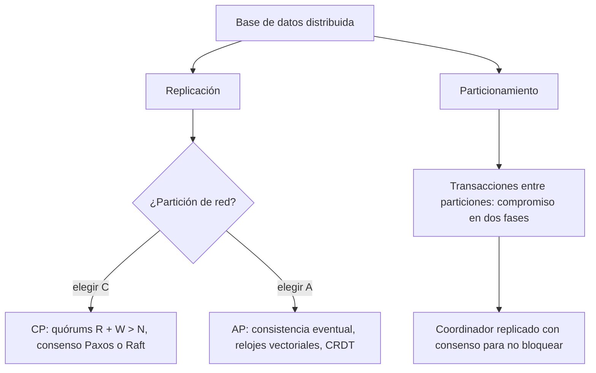

# Computación Distribuida - Temas selectos de redes y algoritmos distribuidos

## 7.5 Problemas en bases de datos distribuidas.

---

Una **base de datos distribuida** guarda sus datos en varias máquinas, para crecer más allá de una sola (**particionamiento**) y para sobrevivir a fallas y atender a usuarios lejanos (**replicación**). A cambio, aparecen problemas que no existen en una sola máquina: mantener las réplicas consistentes cuando la red puede partirse, confirmar transacciones que tocan varias particiones de forma atómica, y ponerse de acuerdo sobre el orden de las operaciones cuando los nodos fallan. Este tema presenta el **teorema CAP** y los modelos de consistencia, la replicación con **quórums**, el **compromiso en dos fases**, el consenso con **Paxos** y Raft, y las técnicas para convergencia eventual: relojes vectoriales y CRDT.

### El teorema CAP

**Teorema** (Brewer, 2000; demostrado por Gilbert y Lynch, 2002). Un sistema de datos replicado no puede garantizar a la vez:

- **Consistencia (C):** toda lectura ve la escritura más reciente, linealizabilidad;
- **Disponibilidad (A):** toda petición a un nodo que no ha fallado recibe respuesta;
- **Tolerancia a particiones (P):** el sistema sigue funcionando aunque la red pierda mensajes entre grupos de nodos.

**Demostración.** Supón dos réplicas separadas por una partición. Un cliente escribe $x = 1$ en la primera y otro lee $x$ de la segunda. Por disponibilidad, ambas deben responder sin poder comunicarse; la segunda no conoce la escritura y responde el valor viejo, lo que viola la consistencia. $\blacksquare$

Como las particiones ocurren, la elección real es **durante una partición**: rechazar peticiones para mantener la consistencia (CP) o responder con datos posiblemente viejos (AP). **PACELC** (Abadi, 2012) completa la idea: si hay partición (P), elegir entre A y C; si no (E), entre latencia (L) y consistencia (C).

### Modelos de consistencia

De más fuerte a más débil:

| Modelo | Garantía |
| --- | --- |
| linealizable | cada operación parece ocurrir en un instante entre su inicio y su fin, en un orden global |
| secuencial | hay un orden global consistente con el orden de cada proceso |
| causal | las operaciones relacionadas causalmente se ven en el mismo orden por todos |
| lectura de lo propio, lecturas monótonas | garantías por sesión de un cliente |
| eventual | si no hay escrituras nuevas, todas las réplicas convergen |

### Replicación con quórums

Con $N$ réplicas, una escritura se considera exitosa al confirmarla $W$ réplicas y una lectura consulta $R$ y toma la versión más reciente. Si

$$R + W > N,$$

todo conjunto de lectura intersecta a todo conjunto de escritura, y la lectura ve la última escritura confirmada. Si además $W > N/2,$ dos escrituras concurrentes no pueden confirmarse en conjuntos disjuntos. Una lectura tolera $N - R$ réplicas caídas y una escritura $N - W.$ Dynamo y Cassandra permiten elegir $N,$ $R$ y $W$ por operación; con $R + W \leq N$ ganan latencia y disponibilidad a costa de lecturas obsoletas.

### Transacciones en varias particiones: compromiso en dos fases

Una transacción que modifica datos en varias particiones debe confirmarse en todas o en ninguna (**atomicidad**). En el **compromiso en dos fases** (2PC), un coordinador:

1. **Preparar:** pide a cada participante que se prepare; cada uno escribe en su bitácora los cambios y su voto, sí o no, y responde.
2. **Decidir:** si todos votaron sí, decide confirmar; si alguno votó no o no respondió, abortar. Escribe la decisión en su bitácora y la comunica.

Es correcto, pero **bloqueante**: si el coordinador cae después de que los participantes votaron sí y antes de comunicar la decisión, estos no pueden ni confirmar ni abortar, porque otro podría haber recibido la decisión contraria, y deben esperar a que el coordinador se recupere mientras mantienen los candados. Se evita replicando al coordinador con consenso (**Paxos commit**, Gray y Lamport, 2006), como hace Spanner, o con el compromiso en tres fases, que no es seguro ante particiones.

### Consenso: Paxos y Raft

El **consenso** pide que procesos que pueden fallar elijan un único valor entre los propuestos. Con fallas por caída y mensajes asíncronos, ningún algoritmo determinista garantiza terminar (Fischer, Lynch y Paterson, 1985), pero se puede garantizar siempre la **seguridad** (nunca se eligen dos valores) y terminar cuando la red se comporta.

**Paxos** (Lamport, 1998) con $2f + 1$ aceptadores tolera $f$ caídas:

1. **Fase 1:** un proponente elige un número $n$ mayor que cualquiera que haya usado y envía `prepara(n)`. Cada aceptador que no haya prometido un número mayor promete ignorar los menores que $n$ y responde con la última propuesta que aceptó, si hay.
2. **Fase 2:** si recibe promesas de una mayoría, el proponente envía `acepta(n, v)`, donde $v$ es el valor de la propuesta de mayor número entre las respuestas, **o su propio valor si ninguna traía uno**. Un aceptador acepta si no ha prometido un número mayor.
3. El valor queda **elegido** cuando una mayoría lo acepta.

**Seguridad:** si $v$ fue elegido con número $n,$ toda propuesta con número mayor lleva $v,$ porque su mayoría de la fase 1 intersecta a la mayoría que aceptó $v,$ y el proponente adopta el valor aceptado de mayor número. **Raft** (Ongaro y Ousterhout, 2014) organiza la misma idea alrededor de un **líder** elegido por mandatos, que replica una bitácora; es más fácil de implementar y lo usan etcd, Consul y CockroachDB.

### Convergencia eventual

- **Relojes vectoriales:** cada réplica mantiene un contador por réplica; una versión $V$ precede a $W$ si $V \leq W$ componente a componente y son distintas; si ninguna precede a la otra, son **concurrentes** y hay un conflicto que resolver (Dynamo, Riak).
- **CRDT** (Shapiro y otros, 2011): tipos de datos cuyas operaciones conmutan o cuyos estados forman un semirretículo, de modo que la mezcla converge sin conflictos: contadores, conjuntos con marcas, registros de último escritor.
- **Antientropía:** las réplicas comparan periódicamente su contenido, con árboles de Merkle, y se intercambian lo que falta (tema 5.3).



### Implementación en Python

El programa implementa Paxos de un solo valor con 5 aceptadores, 3 proponentes que compiten y 20% de mensajes perdidos, y comprueba en 500 corridas que nunca se eligen dos valores, y que sí ocurre si se omite la regla de adoptar el valor ya aceptado (ejercicio 1); simula quórums con $N = 5$ (ejercicio 3); modela el compromiso en dos fases con fallas (ejercicio 4), y la recuperación de una réplica desconectada con relojes vectoriales y antientropía (ejercicio 5).

```python
import random
from itertools import combinations

random.seed(75)

# --- Ejercicio 1: Paxos de un solo valor, con mensajes que se pierden y proponentes que compiten ---
class Aceptador:
    def __init__(self):
        self.prometido = -1          # mayor número de propuesta prometido
        self.aceptado = (-1, None)   # (número, valor) aceptado
    def prepara(self, n):            # fase 1b
        if n > self.prometido:
            self.prometido = n
            return ("promesa", self.aceptado)
        return None
    def acepta(self, n, v):          # fase 2b
        if n >= self.prometido:
            self.prometido = n; self.aceptado = (n, v)
            return True
        return False

def paxos(n_acept=5, n_prop=3, perdida=0.2, rondas=60, semilla=0):
    rng = random.Random(semilla)
    A = [Aceptador() for _ in range(n_acept)]
    mayoria = n_acept // 2 + 1
    elegidos = set()
    numero = {p: p for p in range(n_prop)}                # números distintos por proponente
    for _ in range(rondas):
        p = rng.randrange(n_prop)
        numero[p] += n_prop                               # nuevo número, mayor que los anteriores
        n, propio = numero[p], f"valor-{p}"
        # fase 1: prepara
        promesas = [r for a in A if rng.random() > perdida for r in [a.prepara(n)] if r]
        if len(promesas) < mayoria:
            continue
        previo = max((acc for _, acc in promesas), key=lambda x: x[0])
        v = previo[1] if previo[0] >= 0 else propio      # regla clave: adoptar el valor ya aceptado
        # fase 2: acepta
        votos = sum(1 for a in A if rng.random() > perdida and a.acepta(n, v))
        if votos >= mayoria:
            elegidos.add(v)
    return elegidos

conflictos = sum(len(paxos(semilla=s)) > 1 for s in range(500))
decididos = sum(len(paxos(semilla=s)) == 1 for s in range(500))
print(f"ejercicio 1: Paxos con 5 aceptadores, 3 proponentes y 20% de pérdida, 500 corridas:"
      f" decidieron {decididos}, con dos valores distintos elegidos {conflictos}")

def paxos_sin_regla(semilla):
    """El error típico: el proponente ignora los valores aceptados y propone el suyo."""
    rng = random.Random(semilla); A = [Aceptador() for _ in range(5)]; elegidos = set(); num = 0
    for _ in range(60):
        p = rng.randrange(3); num += 1
        promesas = [r for a in A if rng.random() > 0.2 for r in [a.prepara(num)] if r]
        if len(promesas) < 3: continue
        votos = sum(1 for a in A if rng.random() > 0.2 and a.acepta(num, f"valor-{p}"))
        if votos >= 3: elegidos.add(f"valor-{p}")
    return elegidos
print(f"   sin adoptar el valor previamente aceptado: corridas con dos valores elegidos"
      f" {sum(len(paxos_sin_regla(s)) > 1 for s in range(500))} de 500")

# --- Ejercicio 3: quórums con N = 5 ---
N = 5
print("ejercicio 3: N = 5; R + W > N da lecturas que ven la última escritura")
print("    R  W  R+W>N  W>N/2  fallos que tolera la lectura  fallos que tolera la escritura  lecturas obsoletas (simulación)")
for R, W in [(1, 5), (2, 4), (3, 3), (1, 3), (2, 2)]:
    obsoletas = 0
    for _ in range(5000):
        version = [0] * N
        escritos = random.sample(range(N), W)             # la escritura v1 llega a W réplicas
        for i in escritos: version[i] = 1
        leidos = random.sample(range(N), R)
        obsoletas += max(version[i] for i in leidos) == 0
    print(f"    {R}  {W}  {str(R + W > N):5}  {str(W > N / 2):5}  {N - R:28}  {N - W:30}  {obsoletas / 50:.1f}%")

# --- Ejercicio 4: compromiso en dos fases ---
def dos_fases(votos, cae_coordinador=False, cae_participante=None):
    """Devuelve el estado de cada participante tras el protocolo."""
    estado = ["inicial"] * len(votos)
    for i, v in enumerate(votos):                          # fase 1: preparar
        if cae_participante == i:
            estado[i] = "caído"; continue
        estado[i] = "preparado" if v else "abortado"
    todos_si = all(s == "preparado" for s in estado)
    if cae_coordinador:                                    # cae tras recibir los votos, antes de decidir
        return ["bloqueado (incierto)" if s == "preparado" else s for s in estado], "sin decisión"
    decision = "confirmar" if todos_si else "abortar"
    final = ["confirmado" if (s == "preparado" and decision == "confirmar") else
             "abortado" if s in ("preparado", "abortado") else s for s in estado]
    return final, decision

print("ejercicio 4: transacción en 3 particiones con compromiso en dos fases")
for nombre, args in [("todas votan sí", ([True] * 3,)), ("una vota no", ([True, False, True],)),
                     ("cae una partición antes de votar", ([True] * 3, False, 1)),
                     ("cae el coordinador tras los votos", ([True] * 3, True))]:
    final, d = dos_fases(*args)
    print(f"   {nombre:34} decisión {d:12} estados {final}")

# --- Ejercicio 5: recuperación de un nodo con relojes vectoriales y antientropía ---
class Replica:
    def __init__(self, id_, n):
        self.id, self.datos, self.reloj = id_, {}, [0] * n
    def escribe(self, k, v):
        self.reloj[self.id] += 1
        self.datos[k] = (v, tuple(self.reloj))
    def mezcla(self, otra):
        """Antientropía: para cada clave, gana la versión con reloj mayor; si son concurrentes, conflicto."""
        conflictos = []
        for k, (v, r) in otra.datos.items():
            if k not in self.datos:
                self.datos[k] = (v, r); continue
            v0, r0 = self.datos[k]
            if all(a <= b for a, b in zip(r0, r)) and r0 != r:
                self.datos[k] = (v, r)
            elif not all(a >= b for a, b in zip(r0, r)):
                conflictos.append((k, v0, v))
                self.datos[k] = (max(v0, v), tuple(max(a, b) for a, b in zip(r0, r)))   # resolución determinista
        self.reloj = [max(a, b) for a, b in zip(self.reloj, otra.reloj)]
        return conflictos

a, b, c = Replica(0, 3), Replica(1, 3), Replica(2, 3)
a.escribe("x", "1"); b.mezcla(a); c.mezcla(a)
print("ejercicio 5: las tres réplicas tienen x = 1; c se desconecta")
a.escribe("x", "2"); b.mezcla(a); a.escribe("y", "7"); b.mezcla(a)
c.escribe("z", "9")                                        # escritura local mientras está aislado
print("   antes de reconectar: a", {k: v for k, (v, _) in a.datos.items()}, "c", {k: v for k, (v, _) in c.datos.items()})
conf = c.mezcla(a); a.mezcla(c)
print("   c tras la antientropía con a:", {k: v for k, (v, _) in c.datos.items()}, "reloj", c.reloj, "conflictos", conf)
b.escribe("x", "3"); c.escribe("x", "4")                   # dos escrituras concurrentes
print("   escrituras concurrentes de b y c sobre x: conflictos detectados", c.mezcla(b))
```

Salida:

```text
ejercicio 1: Paxos con 5 aceptadores, 3 proponentes y 20% de pérdida, 500 corridas: decidieron 500, con dos valores distintos elegidos 0
   sin adoptar el valor previamente aceptado: corridas con dos valores elegidos 500 de 500
ejercicio 3: N = 5; R + W > N da lecturas que ven la última escritura
    R  W  R+W>N  W>N/2  fallos que tolera la lectura  fallos que tolera la escritura  lecturas obsoletas (simulación)
    1  5  True   True                              4                               0  0.0%
    2  4  True   True                              3                               1  0.0%
    3  3  True   True                              2                               2  0.0%
    1  3  False  True                              4                               2  41.4%
    2  2  False  False                             3                               3  31.0%
ejercicio 4: transacción en 3 particiones con compromiso en dos fases
   todas votan sí                     decisión confirmar    estados ['confirmado', 'confirmado', 'confirmado']
   una vota no                        decisión abortar      estados ['abortado', 'abortado', 'abortado']
   cae una partición antes de votar   decisión abortar      estados ['abortado', 'caído', 'abortado']
   cae el coordinador tras los votos  decisión sin decisión estados ['bloqueado (incierto)', 'bloqueado (incierto)', 'bloqueado (incierto)']
ejercicio 5: las tres réplicas tienen x = 1; c se desconecta
   antes de reconectar: a {'x': '2', 'y': '7'} c {'x': '1', 'z': '9'}
   c tras la antientropía con a: {'x': '2', 'z': '9', 'y': '7'} reloj [3, 0, 1] conflictos []
   escrituras concurrentes de b y c sobre x: conflictos detectados [('x', '4', '3')]
```

### Ejercicios Propuestos

1. **Paxos.** Implementa una versión simplificada de Paxos.

2. **CAP.** Clasifica Cassandra, MongoDB y Spanner según el teorema CAP.

3. **Quórums.** Diseña un sistema con 5 nodos que optimice el rendimiento de lectura, la consistencia fuerte y la tolerancia a fallas.

4. **Transacciones.** Diseña un protocolo para transacciones que abarcan varias particiones.

5. **Recuperación.** Implementa un mecanismo de recuperación para un nodo que se desconecta y vuelve a conectarse.

### Soluciones

**Ejercicio 1.** Es la clase `Aceptador` y la función `paxos` del programa. En 500 corridas con pérdida de mensajes y proponentes que se interrumpen mutuamente, todas deciden y ninguna elige dos valores. Si el proponente ignora los valores ya aceptados y propone siempre el suyo, todas las corridas terminan con dos valores elegidos: esa regla es la que da la seguridad. Lo que el programa no muestra es la falta de **vivacidad**: dos proponentes que se adelantan alternadamente con números crecientes pueden impedir que nada se elija; en la práctica se elige un líder y se usan esperas aleatorias.

**Ejercicio 2.**

- **Cassandra:** AP por omisión, con consistencia eventual y quórums configurables por operación; con `QUORUM` en lecturas y escrituras se comporta como CP para esas operaciones.
- **MongoDB:** CP en su configuración de conjunto de réplicas: las escrituras van al primario, y si una partición deja al primario sin mayoría, deja de aceptar escrituras hasta que se elige otro.
- **Spanner:** CP. Usa Paxos en cada partición y el reloj TrueTime, con incertidumbre acotada, para dar consistencia externa (linealizabilidad) a las transacciones. Google lo describe como "efectivamente CA" porque su red privada hace las particiones rarísimas, pero ante una partición elige consistencia.

**Ejercicio 3.** Con $N = 5,$ las opciones con consistencia fuerte, que cumplen $R + W > 5,$ son:

- $R = 1,$ $W = 5:$ lecturas lo más rápidas posible y que toleran 4 fallas, pero una sola réplica caída impide escribir.
- $R = 2,$ $W = 4:$ lecturas rápidas que toleran 3 fallas; las escrituras toleran 1. **Buen compromiso** si las lecturas predominan.
- $R = 3,$ $W = 3:$ simétrico, tolera 2 fallas en ambas operaciones; es lo que da `QUORUM`.

La simulación confirma que con $R + W > N$ nunca hay lecturas obsoletas, y con $R = 1,$ $W = 3$ lo son el 41%. Para mejorar aún más las lecturas sin sacrificar consistencia se usa un **líder con arriendo** (_lease_), que responde las lecturas solo, o lecturas que consultan una réplica y verifican la versión con las demás en paralelo.

**Ejercicio 4.** Protocolo: un coordinador ejecuta el compromiso en dos fases entre las particiones. Para que no bloquee, el coordinador es un **grupo de Paxos o Raft**: su decisión se replica antes de comunicarse, y si el líder cae otro la conoce o la toma. Además, cada participante mantiene candados de dos fases sobre sus datos hasta conocer la decisión y registra todo en una bitácora para recuperarse. Es el diseño de Spanner. En el programa se ven los cuatro casos: todas sí, una no, una partición caída antes de votar (se aborta) y el coordinador caído después de los votos (todas quedan **bloqueadas**, con sus candados). Alternativas sin coordinación global, para cuando se acepta menos consistencia: **sagas**, que encadenan transacciones locales con transacciones compensatorias para deshacer.

**Ejercicio 5.** Con **relojes vectoriales y antientropía**: al reconectarse, el nodo intercambia con otra réplica sus versiones; para cada clave, si una versión precede a la otra se toma la más reciente, y si son concurrentes se detecta un conflicto que se resuelve con una regla determinista o se devuelve a la aplicación. En el programa, la réplica $c$ recibe al reconectarse las escrituras que se perdió, $x = 2$ y $y = 7,$ conserva la suya, $z = 9,$ y después dos escrituras concurrentes sobre $x$ se detectan como conflicto. En un sistema con **líder y bitácora** (Raft), la recuperación es más simple: el nodo pide al líder las entradas de la bitácora posteriores a la última que tiene, o una instantánea si se quedó muy atrás.

### Referencias

1. Kleppmann, M., _Designing Data-Intensive Applications_. O'Reilly, 2017. Capítulos 5, 7 y 9.
2. Gilbert, S., and Lynch, N., Brewer's conjecture and the feasibility of consistent, available, partition-tolerant web services. _ACM SIGACT News_ 33(2), 2002.
3. Lamport, L., Paxos made simple. _ACM SIGACT News_ 32(4), 2001.
4. Corbett, J. C., et al., Spanner: Google's globally distributed database. _ACM Transactions on Computer Systems_ 31(3), 2013.
