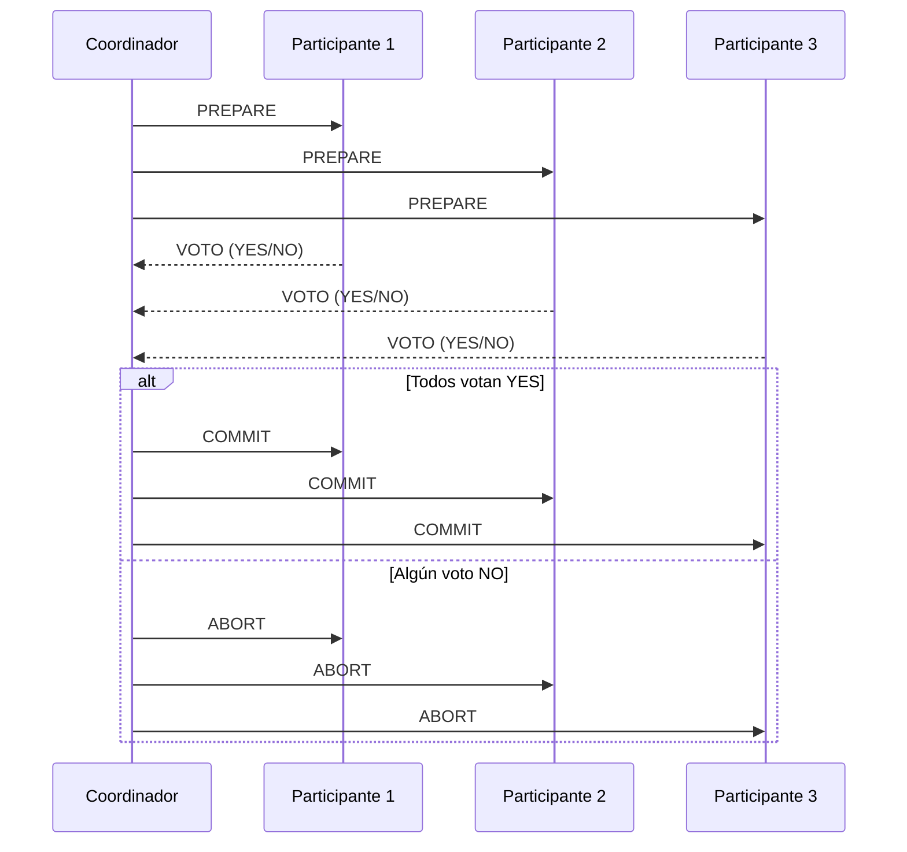

# Computación Distribuida - Temas selectos de redes y algoritmos distribuidos

## 7.5 Problemas en bases de datos distribuidas.

---

Las bases de datos distribuidas enfrentan desafíos únicos derivados de la naturaleza descentralizada de los datos y la necesidad de mantener consistencia, disponibilidad y tolerancia a particiones en entornos distribuidos.

### Conceptos Fundamentales

#### Teorema CAP (Brewer)

En cualquier sistema distribuido, sólo se pueden garantizar dos de las tres propiedades siguientes:

- **Consistencia (C)**: Todas las réplicas tienen los mismos datos
- **Disponibilidad (A)**: El sistema responde siempre
- **Tolerancia a Particiones (P)**: El sistema funciona despite fallos de red

$$
\text{CAP} = \{(C,A), (C,P), (A,P)\}
$$

#### Modelo de Consistencia

**Consistencia Secuencial:**

$$
\forall \text{ ops } o_1, o_2: \text{if } o_1 \rightarrow o_2 \text{ then } o_1 \text{ precede a } o_2 \text{ en todas las réplicas}
$$

**Consistencia de Eventual:**

$$
\text{Si no hay escrituras nuevas, eventualmente todas las réplicas convergen}
$$

### Problemas Centrales

#### Replicación y Consistencia

**Protocolo de Consenso (Paxos):**

```python
class PaxosNode:
    def __init__(self, node_id, nodes):
        self.node_id = node_id
        self.nodes = nodes
        self.accepted_value = None
        self.accepted_proposal = -1

    def prepare(self, proposal_id):
        # Fase 1: Preparación
        promises = []
        for node in self.nodes:
            if node != self:
                response = node.receive_prepare(proposal_id)
                promises.append(response)
        return promises

    def accept(self, proposal_id, value):
        # Fase 2: Aceptación
        accepts = []
        for node in self.nodes:
            if node != self:
                response = node.receive_accept(proposal_id, value)
                accepts.append(response)
        return accepts
```

#### Transacciones Distribuidas

**Two-Phase Commit (2PC):**

```python
class TwoPhaseCommitCoordinator:
    def __init__(self, participants):
        self.participants = participants
        self.state = "INIT"

    def execute_transaction(self, transaction):
        # Fase 1: Prepare
        votes = []
        for participant in self.participants:
            vote = participant.prepare(transaction)
            votes.append(vote)

        if all(vote == "YES" for vote in votes):
            # Fase 2: Commit
            for participant in self.participants:
                participant.commit()
            self.state = "COMMITTED"
        else:
            # Fase 2: Abort
            for participant in self.participants:
                participant.abort()
            self.state = "ABORTED"
```

### Algoritmos de Consenso Distribuido

#### Algoritmo de Raft

```python
class RaftNode:
    def __init__(self, node_id, peers):
        self.node_id = node_id
        self.peers = peers
        self.state = "FOLLOWER"
        self.current_term = 0
        self.voted_for = None
        self.log = []

    def request_votes(self):
        # Líder solicita votos
        votes = 0
        for peer in self.peers:
            if peer.grant_vote(self.current_term, self.node_id):
                votes += 1
        return votes >= (len(self.peers) // 2 + 1)

    def append_entries(self, entries):
        # Replicar entradas
        success_count = 0
        for peer in self.peers:
            if peer.replicate_entries(entries):
                success_count += 1
        return success_count
```

### Modelos de Consistencia

#### Niveles de Consistencia

**Consistencia Linearizable:**

$$
\forall \text{ ops } o: \exists \text{ timestamp } t \text{ tal que } o \text{ es visible en } t \text{ para todos}
$$

**Consistencia Causal:**

$$
\text{Si } o_1 \rightarrow o_2 \text{ causalmente, entonces } o_1 \text{ precede a } o_2 \text{ en todas las réplicas}
$$

### Diagrama de Two-Phase Commit



### Problemas de Particionamiento

#### Quórum de Lectura/Escritura

**Regla de Quórum:**

$$
N = \text{número de réplicas}
$$

$$
R + W > N \quad \text{(para consistencia)}
$$

$$
W > N/2 \quad \text{(para prevenir conflictos)}
$$

**Ejemplo con N=3:**

- Lectura: R=2, Escritura: W=2
- R + W = 4 > 3 ✓
- W = 2 > 1.5 ✓

### Ejemplo Práctico: Sistema de Reservas

```python
class DistributedBookingSystem:
    def __init__(self, nodes):
        self.nodes = nodes
        self.quorum_size = len(nodes) // 2 + 1

    def book_ticket(self, user_id, event_id):
        # Escritura con quórum
        timestamp = time.time()
        write_acks = 0

        for node in self.nodes:
            if node.write(f"booking:{event_id}:{user_id}", timestamp):
                write_acks += 1
                if write_acks >= self.quorum_size:
                    break

        return write_acks >= self.quorum_size

    def get_bookings(self, event_id):
        # Lectura con quórum
        responses = []
        for node in self.nodes:
            bookings = node.read(f"booking:{event_id}:*")
            responses.append(bookings)
            if len(responses) >= self.quorum_size:
                break

        # Resolver potenciales inconsistencias
        return self.resolve_conflicts(responses)
```

### Ejercicios Propuestos

#### Ejercicio 1: Implementación de Paxos

Implementar una versión simplificada del protocolo Paxos para consenso distribuido.

#### Ejercicio 2: Análisis de CAP

Analizar diferentes bases de datos distribuidas (Cassandra, MongoDB, Spanner) y clasificarlas según el teorema CAP.

#### Ejercicio 3: Diseño de Quórum

Diseñar un sistema con 5 nodos que optimice:

- Rendimiento de lectura
- Consistencia fuerte
- Tolerancia a fallos

#### Ejercicio 4: Transacciones Cross-Partition

Diseñar un protocolo para transacciones que span múltiples particiones de datos.

#### Ejercicio 5: Recovery de Fallos

Implementar un mecanismo de recovery para un nodo que se desconecta y luego se reconecta.

### Técnicas de Resolución de Conflictos

#### CRDTs (Conflict-Free Replicated Data Types)

```python
class GSet(CRDT):
    """Conjunto creciente que sólo permite añadir elementos"""
    def __init__(self):
        self.elements = set()

    def add(self, element):
        self.elements.add(element)

    def merge(self, other):
        # Merge es conmutativo, asociativo e idempotente
        self.elements |= other.elements

    def compare(self, other):
        return self.elements.issubset(other.elements)
```

#### Vector Clocks

```python
class VectorClock:
    def __init__(self, node_id, nodes):
        self.clock = {node: 0 for node in nodes}
        self.node_id = node_id

    def increment(self):
        self.clock[self.node_id] += 1

    def update(self, other_clock):
        for node in self.clock:
            self.clock[node] = max(self.clock[node], other_clock.get(node, 0))

    def compare(self, other):
        # Retorna: -1 (antes), 0 (concurrente), 1 (después)
        less = any(self.clock[node] < other.clock[node] for node in self.clock)
        greater = any(self.clock[node] > other.clock[node] for node in self.clock)

        if less and greater:
            return 0  # Concurrente
        elif less:
            return -1  # Antes
        else:
            return 1   # Después
```

### Referencias

#### Bibliografía Básica

1. Attiya, H., & Welch, J. (2004). _Distributed Computing: Fundamentals, Simulations, and Advanced Topics_. Capítulos 12-14: "Consensus", "Atomic Objects", "Transactional Memory"
2. Easley, D., & Kleinberg, J. (2010). _Networks, Crowds, and Markets: Reasoning about a Highly Connected World_. Capítulo 10: "Markets and Information"

#### Bibliografía Complementaria

1. Lynch, N. (1996). _Distributed Algorithms_. Capítulos 17-18: "Shared Memory Consensus", "Message Passing Consensus"
2. Tel, G. (2001). _Introduction to Distributed Algorithms_ (2nd ed.). Capítulos 7-8: "Network Synchrony", "Fault Tolerance"

#### Recursos Adicionales

- [CAP Twelve Years Later](https://www.infoq.com/articles/cap-twelve-years-later-how-the-rules-have-changed/)
- [Google Spanner Paper](https://research.google.com/archive/spanner.html)
- [Amazon Dynamo Paper](https://www.allthingsdistributed.com/files/amazon-dynamo-sosp2007.pdf)

#### Herramientas Prácticas

- Bases de datos: Cassandra, MongoDB, CockroachDB
- Frameworks: Apache ZooKeeper, etcd, Consul
- Simuladores: NS-3, OMNeT++
