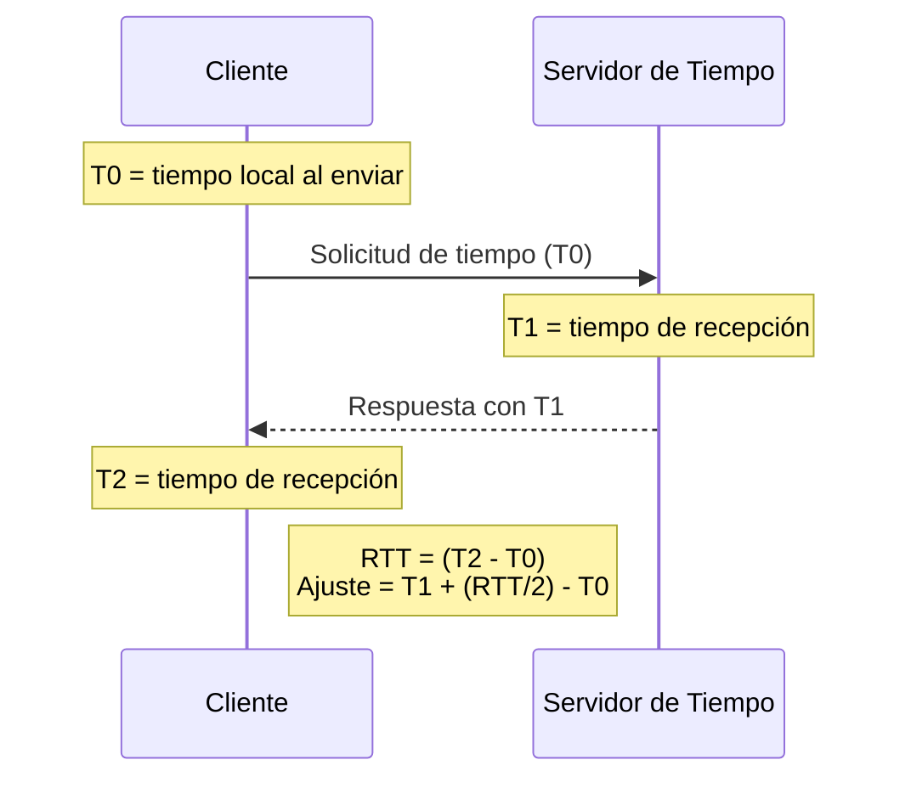

# Computación Distribuida - Temas selectos de redes y algoritmos distribuidos

## 7.6 Problemas en sistemas operativos distribuidos.

---

Los sistemas operativos distribuidos enfrentan desafíos únicos al gestionar recursos compartidos, coordinar procesos y mantener la consistencia en entornos donde no existe memoria compartida y la comunicación sufre retardos y posibles fallos.

### Conceptos Fundamentales

#### Transparencia en Sistemas Distribuidos

Un sistema distribuido ideal debe proporcionar:

- **Transparencia de acceso**: Acceso uniforme a recursos
- **Transparencia de ubicación**: Los usuarios no conocen la localización física
- **Transparencia de concurrencia**: Múltiples usuarios acceden simultáneamente
- **Transparencia de replicación**: Los usuarios no conocen las copias de recursos
- **Transparencia de fallos**: El sistema continúa operando despite fallos parciales

#### Modelos de Comunicación

**Tiempo de Round-Trip (RTT):**

$$
RTT = t_{\text{transmisión}} + t_{\text{propagación}} + t_{\text{procesamiento}} + t_{\text{respuesta}}
$$

**Latencia de red:**

$$
L = \frac{d}{v} + \frac{s}{b}
$$

donde $d$ es distancia, $v$ velocidad de propagación, $s$ tamaño del mensaje, y $b$ ancho de banda.

### Problemas Centrales

#### Relojes y Sincronización

**Algoritmo de Cristian para sincronización de relojes:**

```python
class TimeServer:
    def __init__(self):
        self.clock = time.monotonic()

    def get_time(self):
        return self.clock

    def synchronize_client(self, client_time, rtt):
        """Sincroniza reloj del cliente"""
        current_time = self.get_time()
        estimated_client_time = client_time + (rtt / 2)
        adjustment = current_time - estimated_client_time
        return adjustment

# Cliente
def synchronize_clock(server):
    t0 = time.monotonic()
    server_time = server.get_time()
    t1 = time.monotonic()

    rtt = t1 - t0
    adjustment = server.synchronize_client((t0 + t1) / 2, rtt)
    return adjustment
```

**Algoritmo de Berkeley:**

```python
def berkeley_synchronization(nodes):
    """Algoritmo de Berkeley para sincronización distribuida"""
    # El coordinador obtiene tiempos de todos los nodos
    times = []
    for node in nodes:
        response_time = node.get_time_with_rtt()
        times.append((node, response_time))

    # Calcula el tiempo promedio
    avg_time = sum(t for _, t in times) / len(times)

    # Envía ajustes a todos los nodos
    adjustments = {}
    for node, node_time in times:
        adjustment = avg_time - node_time
        node.adjust_clock(adjustment)
        adjustments[node.id] = adjustment

    return adjustments
```

#### Exclusión Mutua Distribuida

**Algoritmo de Ricart-Agrawala:**

```python
class RicartAgrawalaNode:
    def __init__(self, node_id, all_nodes):
        self.node_id = node_id
        self.all_nodes = all_nodes
        self.clock = 0
        self.deferred = []
        self.requesting = False

    def request_critical_section(self):
        self.clock += 1
        self.requesting = True
        replies_needed = len(self.all_nodes) - 1
        replies_received = 0

        # Enviar request a todos los demás nodos
        for node in self.all_nodes:
            if node != self:
                node.receive_request(self.clock, self.node_id)

        # Esperar por todas las respuestas
        while replies_received < replies_needed:
            time.sleep(0.1)  # Simular espera

        # Entrar a sección crítica
        self.enter_critical_section()

    def receive_request(self, timestamp, requester_id):
        self.clock = max(self.clock, timestamp) + 1

        if not self.requesting or (timestamp, requester_id) < (self.clock, self.node_id):
            # Enviar REPLY inmediatamente
            requester_id.receive_reply()
        else:
            # Deferir la respuesta
            self.deferred.append(requester_id)
```

### Gestión de Recursos Distribuidos

#### Algoritmo del Banquero Distribuido

```python
class DistributedBanker:
    def __init__(self, nodes, total_resources):
        self.nodes = nodes
        self.total_resources = total_resources
        self.available = total_resources.copy()
        self.allocated = {node: [0] * len(total_resources) for node in nodes}
        self.max_demand = {node: [0] * len(total_resources) for node in nodes}

    def request_resources(self, node, request):
        """Manejar solicitud de recursos con prevención de interbloqueo"""
        # Verificar si la solicitud es válida
        if any(request[i] > self.max_demand[node][i] - self.allocated[node][i] for i in range(len(request))):
            return False

        # Verificar si hay suficientes recursos disponibles
        if any(request[i] > self.available[i] for i in range(len(request))):
            return False

        # Simular asignación para verificar estado seguro
        temp_available = self.available.copy()
        temp_allocated = self.allocated[node].copy()

        for i in range(len(request)):
            temp_available[i] -= request[i]
            temp_allocated[i] += request[i]

        if self.is_safe_state(temp_available, temp_allocated):
            # Asignar recursos reales
            for i in range(len(request)):
                self.available[i] -= request[i]
                self.allocated[node][i] += request[i]
            return True

        return False

    def is_safe_state(self, available, allocated):
        """Verificar si el estado es seguro usando el algoritmo del banquero"""
        work = available.copy()
        finish = {node: False for node in self.nodes}

        while True:
            found = False
            for node in self.nodes:
                if not finish[node]:
                    # Verificar si el nodo puede terminar
                    can_finish = all(
                        self.max_demand[node][i] - allocated[i] <= work[i]
                        for i in range(len(work))
                    )

                    if can_finish:
                        # Liberar recursos del nodo
                        for i in range(len(work)):
                            work[i] += allocated[i]
                        finish[node] = True
                        found = True

            if not found:
                break

        return all(finish.values())
```

### Diagrama de Sincronización de Relojes



### Balanceo de Carga Distribuido

#### Algoritmos de Balanceo de Carga

```python
class LoadBalancer:
    def __init__(self, nodes):
        self.nodes = nodes
        self.load_stats = {node: {'cpu': 0, 'memory': 0, 'requests': 0} for node in nodes}

    def round_robin(self, current_index):
        """Balanceo round-robin"""
        next_index = (current_index + 1) % len(self.nodes)
        return self.nodes[next_index], next_index

    def least_connections(self):
        """Balanceo por menor número de conexiones"""
        return min(self.nodes, key=lambda x: self.load_stats[x]['requests'])

    def weighted_round_robin(self, weights):
        """Balanceo round-robin ponderado"""
        total = sum(weights.values())
        point = random.uniform(0, total)
        current = 0

        for node, weight in weights.items():
            current += weight
            if point <= current:
                return node

    def adaptive_balancing(self):
        """Balanceo adaptativo basado en métricas múltiples"""
        scores = {}
        for node in self.nodes:
            # Calcular score basado en CPU, memoria y conexiones
            cpu_score = 1 - self.load_stats[node]['cpu']
            mem_score = 1 - self.load_stats[node]['memory']
            conn_score = 1 / (1 + self.load_stats[node]['requests'])

            total_score = 0.4 * cpu_score + 0.3 * mem_score + 0.3 * conn_score
            scores[node] = total_score

        return max(scores.items(), key=lambda x: x[1])[0]
```

### Ejercicios Propuestos

#### Ejercicio 1: Implementación de Relojes Vectoriales

Implementar un sistema de relojes vectoriales para detección de eventos concurrentes.

#### Ejercicio 2: Algoritmo de Bully para Elección de Líder

Implementar el algoritmo de bully para elección de coordinador en un sistema distribuido.

#### Ejercicio 3: Sistema de Archivos Distribuido

Diseñar un protocolo para un sistema de archivos distribuido con consistencia eventual.

#### Ejercicio 4: Detección de Interbloqueos

Implementar el algoritmo de detección de interbloqueos de Chandy-Misra-Haas.

#### Ejercicio 5: Tolerancia a Fallos Bizantinos

Diseñar un sistema que tolere fallos bizantinos usando el algoritmo PBFT.

### Tolerancia a Fallos

#### Checkpointing y Recovery

```python
class DistributedCheckpoint:
    def __init__(self, nodes):
        self.nodes = nodes
        self.checkpoints = {}

    def coordinated_checkpoint(self):
        """Checkpoint coordinado consistente"""
        # Fase 1: Iniciar checkpoint
        for node in self.nodes:
            node.prepare_checkpoint()

        # Fase 2: Tomar checkpoint
        checkpoint_id = str(uuid.uuid4())
        for node in self.nodes:
            checkpoint_data = node.take_checkpoint()
            self.checkpoints[(checkpoint_id, node.id)] = checkpoint_data

        # Fase 3: Confirmar checkpoint
        for node in self.nodes:
            node.confirm_checkpoint(checkpoint_id)

        return checkpoint_id

    def rollback_recovery(self, checkpoint_id):
        """Recuperación mediante rollback"""
        for node in self.nodes:
            checkpoint_data = self.checkpoints[(checkpoint_id, node.id)]
            node.restore_checkpoint(checkpoint_data)
```

### Referencias

#### Bibliografía Básica

1. Attiya, H., & Welch, J. (2004). _Distributed Computing: Fundamentals, Simulations, and Advanced Topics_. Capítulos 4-6: "Modelos de consistencia", "Sincronización", "Exclusión mutua"
2. Tanenbaum, A. S., & Van Steen, M. (2007). _Sistemas Distribuidos: Principios y Paradigmas_.

#### Bibliografía Complementaria

1. Lynch, N. (1996). _Distributed Algorithms_. Capítulos 10-12: "Sincronización", "Consenso", "Atomicidad"
2. Coulouris, G., Dollimore, J., & Kindberg, T. (2011). _Distributed Systems: Concepts and Design_.

#### Recursos Adicionales

- [Distributed Systems Principles](https://www.distributed-systems.net/)
- [Google Chubby Lock Service](https://research.google.com/archive/chubby.html)
- [Amazon DynamoDB Distributed Locking](https://aws.amazon.com/blogs/database/building-distributed-locks-with-the-dynamodb-lock-client/)

#### Herramientas Prácticas

- Plataformas: Kubernetes, Docker Swarm, Apache Mesos
- Middleware: CORBA, gRPC, Apache Thrift
- Monitoreo: Prometheus, Grafana, ELK Stack
