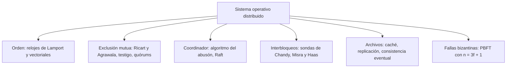

# Computación Distribuida - Temas selectos de redes y algoritmos distribuidos

## 7.6 Problemas en sistemas operativos distribuidos.

---

Un **sistema operativo distribuido** hace que un conjunto de computadoras conectadas por una red se comporte, para sus usuarios, como un solo sistema: archivos, procesos y recursos accesibles sin importar en qué máquina están. Los problemas que en un solo núcleo resuelven la memoria compartida y un reloj común (ordenar eventos, excluir el acceso a un recurso, elegir quién coordina, detectar interbloqueos) requieren aquí algoritmos basados solo en mensajes, que pueden retrasarse, y en procesos que pueden fallar o incluso comportarse maliciosamente. Este tema presenta los relojes lógicos de Lamport y vectoriales, la exclusión mutua distribuida, la elección de líder, la detección de interbloqueos de Chandy, Misra y Haas, los sistemas de archivos distribuidos y la tolerancia a fallas bizantinas con PBFT.

### Tiempo y orden

No hay un reloj global: los relojes físicos derivan, y sincronizarlos con NTP o con el algoritmo de Cristian deja errores de milisegundos. Lamport (1978) observó que muchas veces basta el **orden causal**. La relación **ocurre antes** $\to$ es la menor relación transitiva tal que $a \to b$ si $a$ y $b$ son eventos del mismo proceso y $a$ es anterior, o si $a$ es el envío de un mensaje y $b$ su recepción. Si ni $a \to b$ ni $b \to a,$ los eventos son **concurrentes**, $a \parallel b.$

- **Reloj de Lamport:** un contador por proceso que aumenta en cada evento; al recibir un mensaje con marca $t,$ el receptor toma $\max(\text{propio}, t) + 1.$ Garantiza que $a \to b$ implica $L(a) \lt L(b),$ pero no al revés.
- **Reloj vectorial** (Fidge y Mattern, 1988): cada proceso $i$ mantiene un vector $V$ de $n$ contadores; incrementa $V[i]$ en cada evento y al recibir toma el máximo componente a componente. Ahora $a \to b$ **si y solo si** $V(a) \lt V(b)$ (menor o igual en todas las componentes y distinto), así que detecta exactamente la concurrencia. Cuesta $O(n)$ por mensaje.

### Exclusión mutua

Solo un proceso a la vez puede estar en la **sección crítica**.

| Algoritmo | Mensajes por entrada | Retraso | Idea |
| --- | --- | --- | --- |
| centralizado | 3 | 2 mensajes | un coordinador concede el permiso |
| Ricart y Agrawala (1981) | $2(n - 1)$ | 1 ida y vuelta | pedir permiso a todos con marcas de Lamport; el de marca menor gana |
| Maekawa (1985) | $O(\sqrt{n})$ | 2 rondas | pedir permiso solo a un quórum que intersecta a todos los demás |
| anillo con testigo | de 1 a $\infty$ | hasta $n$ | solo entra quien tiene el testigo, que circula |

### Elección de líder

Muchos protocolos necesitan un **coordinador**. En el **algoritmo del abusón** (_bully_, García-Molina, 1982), los procesos tienen identificadores totalmente ordenados y se supone que se detectan las caídas con tiempos de espera. Un proceso que nota que el coordinador no responde envía ELECCIÓN a todos los de identificador mayor; si alguno responde, este toma el control de la elección; si nadie responde, se proclama coordinador y lo anuncia a todos. Gana siempre el proceso vivo de mayor identificador, con $O(n^2)$ mensajes en el peor caso, cuando inicia el de menor identificador, y $n - 2$ en el mejor. En anillos, el algoritmo de Chang y Roberts usa $O(n \log n)$ en promedio. Con fallas parciales y particiones, la elección se hace con consenso (Raft, tema 7.5).

### Interbloqueos

Hay **interbloqueo** cuando un conjunto de procesos espera cíclicamente recursos que tienen los otros. En el modelo de un solo recurso, equivale a un **ciclo** en la **gráfica de espera**, cuyas aristas $P \to Q$ indican que $P$ espera a $Q.$ Ningún proceso ve la gráfica completa.

**Algoritmo de Chandy, Misra y Haas** (1983), por persecución de aristas: un proceso bloqueado $P_i$ envía una **sonda** $(i, i, j)$ a cada proceso $P_j$ que espera. Al recibir $(i, k, j),$ un proceso bloqueado reenvía $(i, j, m)$ a cada $P_m$ que él espera. Si la sonda vuelve a $P_i,$ hay un ciclo que lo contiene: interbloqueo. Cada arista se recorre a lo sumo una vez por iniciador. El interbloqueo se resuelve abortando una de las transacciones del ciclo.

### Sistemas de archivos distribuidos

Ofrecen **transparencia** de ubicación, acceso y replicación. NFS y AFS mantienen consistencia con un servidor y cachés con invalidación; Coda y los sistemas de sincronización de archivos aceptan **operación desconectada** y consistencia eventual: cada servidor acepta escrituras locales y se sincroniza después, detectando conflictos con vectores de versión o resolviéndolos con "el último escritor gana". GFS y HDFS, para grandes volúmenes, separan los metadatos, en un nodo maestro, de los bloques, replicados tres veces.

### Fallas bizantinas: PBFT

Un proceso **bizantino** puede comportarse arbitrariamente: mentir, enviar mensajes contradictorios. **Lamport, Shostak y Pease** (1982) demostraron que el acuerdo con $f$ procesos bizantinos requiere $n \geq 3f + 1$ procesos. **PBFT** (Castro y Liskov, 1999) lo logra en un sistema asíncrono con un **primario** y tres fases:

1. **Pre-preparación:** el primario asigna un número de secuencia a la petición y lo difunde.
2. **Preparación:** cada réplica difunde que recibió esa asignación; está **preparada** al ver $2f + 1$ mensajes coincidentes, incluido el suyo.
3. **Confirmación:** cada réplica difunde que está preparada; confirma y ejecuta al ver $2f + 1$ confirmaciones.

**Por qué tantas réplicas.** Dos quórums de $2f + 1$ entre $3f + 1$ réplicas se intersectan en al menos $f + 1,$ y por tanto en al menos una honesta, que nunca vota por dos valores distintos con el mismo número: dos valores no pueden confirmarse a la vez. Y $2f + 1$ réplicas honestas bastan para avanzar aunque las $f$ maliciosas callen. Si el primario es malicioso o lento, un **cambio de vista** elige otro. Las cadenas de bloques con permisos, como Tendermint y HotStuff, son descendientes directos.



### Implementación en Python

El programa implementa relojes de Lamport y vectoriales y clasifica pares de eventos en causales o concurrentes (ejercicio 1); simula el algoritmo del abusón y cuenta sus mensajes (ejercicio 2); detecta interbloqueos con sondas de Chandy, Misra y Haas (ejercicio 4); analiza la intersección de quórums de PBFT para distintos números de réplicas maliciosas (ejercicio 5), y sincroniza un sistema de archivos con tres servidores y "el último escritor gana" (ejercicio 3).

```python
import random
from collections import Counter

random.seed(76)

# --- Ejercicio 1: relojes vectoriales ---
class Proceso:
    def __init__(self, i, n):
        self.i, self.v, self.lamport, self.eventos = i, [0] * n, 0, []
    def local(self, nombre):
        self.v[self.i] += 1; self.lamport += 1
        self.eventos.append((nombre, tuple(self.v), self.lamport))
    def envia(self, nombre):
        self.local(nombre)
        return tuple(self.v), self.lamport
    def recibe(self, nombre, msg):
        v, l = msg
        self.v = [max(a, b) for a, b in zip(self.v, v)]; self.lamport = max(self.lamport, l)
        self.local(nombre)

def antes(a, b):
    return all(x <= y for x, y in zip(a, b)) and a != b

P = [Proceso(i, 3) for i in range(3)]
P[0].local("a"); m1 = P[0].envia("b")
P[1].local("c"); P[1].recibe("d", m1); m2 = P[1].envia("e")
P[2].local("f"); P[2].recibe("g", m2)
P[0].local("h")
ev = {n: (v, l) for p in P for n, v, l in p.eventos}
print("ejercicio 1: eventos (reloj vectorial, reloj de Lamport)")
print("   " + "  ".join(f"{n}:{list(v)}/{l}" for n, (v, l) in ev.items()))
for x, y in [("a", "g"), ("c", "b"), ("h", "g"), ("f", "e")]:
    vx, vy = ev[x][0], ev[y][0]
    rel = f"{x} -> {y}" if antes(vx, vy) else f"{y} -> {x}" if antes(vy, vx) else f"{x} || {y} (concurrentes)"
    print(f"   {x}, {y}: {rel}; Lamport {ev[x][1]} y {ev[y][1]}")

# --- Ejercicio 2: algoritmo del abusón (bully) ---
def bully(n, caidos, iniciador):
    vivos = [i for i in range(n) if i not in caidos]
    msgs, ronda = 0, 0
    candidatos = [iniciador]; vistos = set()
    while True:
        ronda += 1; siguientes = []
        for c in candidatos:
            if c in vistos: continue
            vistos.add(c)
            mayores = [j for j in range(c + 1, n)]
            msgs += len(mayores)                                   # ELECCIÓN a todos los mayores
            responden = [j for j in mayores if j in vivos]
            msgs += len(responden)                                 # RESPUESTA de los vivos
            siguientes += responden
        if not siguientes:
            lider = max(vivos)
            msgs += len(vivos) - 1                                 # COORDINADOR a todos
            return lider, msgs, ronda
        candidatos = siguientes

print("ejercicio 2: algoritmo del abusón con 8 procesos")
for caidos, ini in [({7}, 0), ({7}, 6), ({7, 6, 5}, 0), (set(), 3)]:
    l, m, r = bully(8, caidos, ini)
    print(f"   caídos {sorted(caidos) or 'ninguno'}, inicia {ini}: líder {l}, {m} mensajes")

# --- Ejercicio 4: Chandy, Misra y Haas (persecución de aristas) ---
def cmh(espera, iniciador):
    """espera[p] = procesos que p espera. Sondas (iniciador, emisor, receptor)."""
    sondas = [(iniciador, iniciador, q) for q in espera.get(iniciador, [])]
    vistos, msgs = set(), 0
    while sondas:
        i, de, a = sondas.pop(); msgs += 1
        if a == i:
            return True, msgs
        if a in vistos: continue
        vistos.add(a)
        sondas += [(i, a, q) for q in espera.get(a, [])]
    return False, msgs

grafo = {"P1": ["P2"], "P2": ["P3"], "P3": ["P4", "P5"], "P4": [], "P5": ["P1"]}
print("ejercicio 4: grafo de espera", grafo)
for p in ("P1", "P4"):
    print(f"   sonda desde {p}: interbloqueo {cmh(grafo, p)[0]} ({cmh(grafo, p)[1]} sondas)")
grafo["P5"] = []
print("   si P5 deja de esperar a P1: sonda desde P1:", cmh(grafo, "P1")[0])

# --- Ejercicio 5: PBFT, intersección de quórums ---
def pbft_analisis(n, f_diseno, m):
    """Quórum q = 2 f_diseno + 1. Un primario malicioso reparte X a unas réplicas honestas y Y a otras;
    las m réplicas maliciosas votan por ambos valores. ¿Pueden X y Y reunir un quórum cada uno?
    ¿Pueden las honestas solas reunir un quórum si las maliciosas callan?"""
    q, h = 2 * f_diseno + 1, n - m
    inseguro = any(hx + m >= q and (h - hx) + m >= q for hx in range(h + 1))
    vivo = h >= q
    return not inseguro, vivo, q

print("ejercicio 5: PBFT con quórums de 2f + 1; seguridad y progreso según el número de réplicas maliciosas")
for n, f in ((4, 1), (7, 2), (3, 1)):
    for m in range(0, f + 2):
        seguro, vivo, q = pbft_analisis(n, f, m)
        print(f"   n = {n}, diseñado para f = {f} (quórum {q}), {m} maliciosas:"
              f" {'seguro' if seguro else 'INSEGURO: dos valores pueden confirmarse'},"
              f" {'con progreso' if vivo else 'sin progreso si las maliciosas callan'}")

# --- Ejercicio 3: sistema de archivos con consistencia eventual ---
class Servidor:
    def __init__(self, nombre):
        self.nombre, self.archivos = nombre, {}         # ruta -> (contenido, marca (tiempo, servidor))
    def escribe(self, ruta, contenido, t):
        self.archivos[ruta] = (contenido, (t, self.nombre))
    def sincroniza(self, otro):
        for ruta in set(self.archivos) | set(otro.archivos):
            a, b = self.archivos.get(ruta), otro.archivos.get(ruta)
            gana = max((x for x in (a, b) if x), key=lambda x: x[1])   # último escritor gana
            self.archivos[ruta] = otro.archivos[ruta] = gana

S = [Servidor(n) for n in ("mx", "gdl", "mty")]
S[0].escribe("/tareas/t1.txt", "versión de mx", 10)
S[1].escribe("/tareas/t1.txt", "versión de gdl", 12)
S[2].escribe("/notas.txt", "hola", 11)
for _ in range(2):
    for a, b in [(0, 1), (1, 2), (2, 0)]: S[a].sincroniza(S[b])
print("ejercicio 3: tras dos rondas de sincronización, los tres servidores coinciden:",
      all(s.archivos == S[0].archivos for s in S), {r: c for r, (c, _) in S[0].archivos.items()})
```

Salida:

```text
ejercicio 1: eventos (reloj vectorial, reloj de Lamport)
   a:[1, 0, 0]/1  b:[2, 0, 0]/2  h:[3, 0, 0]/3  c:[0, 1, 0]/1  d:[2, 2, 0]/3  e:[2, 3, 0]/4  f:[0, 0, 1]/1  g:[2, 3, 2]/5
   a, g: a -> g; Lamport 1 y 5
   c, b: c || b (concurrentes); Lamport 1 y 2
   h, g: h || g (concurrentes); Lamport 3 y 5
   f, e: f || e (concurrentes); Lamport 1 y 4
ejercicio 2: algoritmo del abusón con 8 procesos
   caídos [7], inicia 0: líder 6, 55 mensajes
   caídos [7], inicia 6: líder 6, 7 mensajes
   caídos [5, 6, 7], inicia 0: líder 4, 39 mensajes
   caídos ninguno, inicia 3: líder 7, 27 mensajes
ejercicio 4: grafo de espera {'P1': ['P2'], 'P2': ['P3'], 'P3': ['P4', 'P5'], 'P4': [], 'P5': ['P1']}
   sonda desde P1: interbloqueo True (4 sondas)
   sonda desde P4: interbloqueo False (0 sondas)
   si P5 deja de esperar a P1: sonda desde P1: False
ejercicio 5: PBFT con quórums de 2f + 1; seguridad y progreso según el número de réplicas maliciosas
   n = 4, diseñado para f = 1 (quórum 3), 0 maliciosas: seguro, con progreso
   n = 4, diseñado para f = 1 (quórum 3), 1 maliciosas: seguro, con progreso
   n = 4, diseñado para f = 1 (quórum 3), 2 maliciosas: INSEGURO: dos valores pueden confirmarse, sin progreso si las maliciosas callan
   n = 7, diseñado para f = 2 (quórum 5), 0 maliciosas: seguro, con progreso
   n = 7, diseñado para f = 2 (quórum 5), 1 maliciosas: seguro, con progreso
   n = 7, diseñado para f = 2 (quórum 5), 2 maliciosas: seguro, con progreso
   n = 7, diseñado para f = 2 (quórum 5), 3 maliciosas: INSEGURO: dos valores pueden confirmarse, sin progreso si las maliciosas callan
   n = 3, diseñado para f = 1 (quórum 3), 0 maliciosas: seguro, con progreso
   n = 3, diseñado para f = 1 (quórum 3), 1 maliciosas: seguro, sin progreso si las maliciosas callan
   n = 3, diseñado para f = 1 (quórum 3), 2 maliciosas: seguro, sin progreso si las maliciosas callan
ejercicio 3: tras dos rondas de sincronización, los tres servidores coinciden: True {'/tareas/t1.txt': 'versión de gdl', '/notas.txt': 'hola'}
```

### Ejercicios Propuestos

1. **Relojes vectoriales.** Implementa relojes vectoriales para detectar eventos concurrentes.

2. **Algoritmo del abusón.** Implementa el algoritmo del abusón para elegir un coordinador.

3. **Sistema de archivos.** Diseña un protocolo para un sistema de archivos distribuido con consistencia eventual.

4. **Interbloqueos.** Implementa el algoritmo de detección de interbloqueos de Chandy, Misra y Haas.

5. **Fallas bizantinas.** Diseña un sistema que tolere fallas bizantinas usando PBFT.

### Soluciones

**Ejercicio 1.** En la ejecución del programa, $P_0$ envía un mensaje en el evento b que $P_1$ recibe en d, y $P_1$ envía en e otro que $P_2$ recibe en g. Así $a \to g$ por la cadena $a \to b \to d \to e \to g,$ y el reloj vectorial lo confirma: $[1, 0, 0] \lt [2, 3, 2].$ En cambio $c \parallel b,$ porque c ocurre en $P_1$ antes de recibir nada de $P_0;$ y $h \parallel g$ aunque el reloj de Lamport de h, 3, sea menor que el de g, 5: Lamport no distingue concurrencia de causalidad, y el vector sí.

**Ejercicio 2.** Es `bully` del programa. Con 8 procesos y el 7 caído, si inicia el 0, la elección recorre todos los mayores y cuesta 55 mensajes; si inicia el 6, que ya es el mayor vivo, solo anuncia su victoria: 7 mensajes. Con los tres mayores caídos gana el 4. En todos los casos gana el mayor vivo.

**Ejercicio 3.** **Protocolo:** cada servidor acepta lecturas y escrituras localmente y guarda para cada archivo su contenido y una marca de versión. Periódicamente, cada par de servidores se sincroniza (antientropía, tema 5.3): para cada ruta, si una versión domina a la otra se copia la más reciente; si son concurrentes, se aplica una regla de resolución. Con marcas $(t, \text{servidor})$ y "el último escritor gana", la resolución es determinista pero puede perder escrituras: en el ejemplo, la versión de Monterrey nunca existió, pero la de la Ciudad de México se pierde frente a la de Guadalajara. Con vectores de versión se detecta el conflicto y se conservan ambas copias para que el usuario elija, como hacen Coda y Dropbox con sus "copias en conflicto". Tras unas rondas, todos los servidores convergen.

**Ejercicio 4.** Es `cmh` del programa. En la gráfica de espera $P_1 \to P_2 \to P_3 \to P_5 \to P_1,$ con $P_3$ esperando también a $P_4,$ la sonda que inicia $P_1$ vuelve a él: interbloqueo. $P_4$ no espera a nadie, así que no inicia sondas y no está interbloqueado. Si $P_5$ deja de esperar a $P_1,$ el ciclo se rompe y la sonda no vuelve. El algoritmo no produce **falsos interbloqueos** si las aristas solo se agregan mientras los procesos están bloqueados; con transacciones que liberan recursos durante la detección, hay que cuidar el orden de los mensajes.

**Ejercicio 5.** **Diseño:** $n = 3f + 1$ réplicas del servicio, una de ellas primario; los clientes envían sus peticiones firmadas al primario y aceptan una respuesta cuando reciben $f + 1$ respuestas iguales, porque al menos una es de una réplica honesta. Las réplicas ejecutan las tres fases de PBFT para ordenar cada petición, guardan puntos de control cada $k$ peticiones y cambian de vista si el primario no avanza. El análisis del programa muestra el porqué de los números: con $n = 4$ y quórums de 3, una réplica maliciosa no puede hacer que se confirmen dos valores, pero con dos sí; con $n = 3$ y quórums de 3, el sistema es seguro pero una sola réplica maliciosa que calle lo detiene. Ningún tamaño de quórum con $n = 3$ y $f = 1$ es a la vez seguro y vivo, que es el resultado de Lamport, Shostak y Pease. El costo es $O(n^2)$ mensajes por petición; HotStuff lo reduce a $O(n)$ con firmas umbral.

### Referencias

1. Tanenbaum, A. S., and van Steen, M., _Distributed Systems_. Maarten van Steen, 2023. Capítulos 5, 6 y 8.
2. Lamport, L., Time, clocks, and the ordering of events in a distributed system. _Communications of the ACM_ 21(7), 1978.
3. Chandy, K. M., Misra, J., and Haas, L. M., Distributed deadlock detection. _ACM Transactions on Computer Systems_ 1(2), 1983.
4. Castro, M., and Liskov, B., Practical Byzantine fault tolerance. _Proceedings of the 3rd Symposium on Operating Systems Design and Implementation_, 1999.
