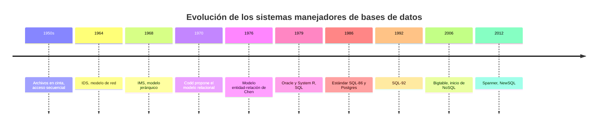

# Fundamentos de Bases de Datos - Introducción

## 1.1 Desarrollo histórico de los sistemas manejadores de bases de datos.

---

Un **sistema manejador de bases de datos** (SMBD, o DBMS por sus siglas en inglés) es el software que almacena, organiza y recupera datos persistentes de forma eficiente, segura y compartida, ocultando a los programas cómo están guardados físicamente. No siempre existió: en los primeros años de la computación, cada programa manejaba sus propios archivos. La historia de los SMBD es la historia de cómo se fue separando la **descripción** de los datos de los **programas** que los usan, hasta llegar al modelo relacional de Codd, que sigue siendo el dominante, y a las alternativas que surgieron para la escala de Internet. Este tema recorre esa evolución y los problemas que cada etapa resolvió.

### Antes de los SMBD: procesamiento de archivos

En los años cincuenta y sesenta, los datos se guardaban en **archivos** en cintas magnéticas, de acceso **secuencial**, y luego en discos. Cada aplicación (nómina, inventario, facturación) definía sus propios archivos y su formato de registro. Los problemas:

- **Redundancia e inconsistencia:** el mismo dato, como la dirección de un cliente, se repetía en varios archivos y podía quedar distinto en cada uno.
- **Dependencia de los programas respecto a los datos:** el formato del archivo estaba escrito dentro del código; cambiarlo obligaba a reescribir todos los programas que lo leían.
- **Consultas rígidas:** cada pregunta nueva requería un programa nuevo.
- **Sin concurrencia ni recuperación:** el acceso simultáneo y la recuperación tras una falla quedaban a cargo de cada aplicación.

### Primera generación: modelos jerárquico y de red (años sesenta)

- **IDS** (_Integrated Data Store_, Charles Bachman, General Electric, 1963 a 1964) fue el primer SMBD de propósito general, con el modelo **de red**: los registros se enlazan con punteros formando conjuntos de propietario y miembros. El comité **CODASYL** lo estandarizó en 1969 a 1971. Bachman recibió el premio Turing en 1973.
- **IMS** (_Information Management System_, IBM y North American Rockwell, 1966 a 1968, para el programa Apollo) usó el modelo **jerárquico**: los registros forman árboles de padres e hijos.

Ambos ofrecían un esquema común y acceso compartido, pero el programador **navegaba** registro por registro siguiendo punteros: las consultas dependían de los caminos de acceso físicos, y una relación de muchos a muchos obligaba a duplicar registros o a usar registros de enlace.

### Segunda generación: el modelo relacional (años setenta y ochenta)

En 1970, **Edgar F. Codd**, de IBM, publicó "A relational model of data for large shared data banks": los datos se representan como **relaciones** (tablas) de valores, sin punteros visibles, y se consultan con un lenguaje **declarativo** basado en la lógica y el álgebra de conjuntos. Era una separación completa entre lo lógico y lo físico: el sistema, no el programador, elige cómo acceder a los datos.

- **System R** (IBM, 1974 a 1979) demostró que era implementable y eficiente; de él salieron el lenguaje **SEQUEL**, luego SQL (Chamberlin y Boyce, 1974), y el optimizador de consultas basado en costos (Selinger y otros, 1979).
- **Ingres** (Universidad de California en Berkeley, Stonebraker y Wong, 1973), con el lenguaje QUEL, del que descienden Postgres y PostgreSQL.
- **Oracle** (Relational Software, 1979) fue el primer SMBD relacional comercial con SQL; siguieron DB2 (1983) y SQL Server.
- **Estándares:** SQL-86 (ANSI e ISO), SQL-89, **SQL-92** (reuniones explícitas, `JOIN`), SQL:1999 (recursión, objetos), SQL:2003 en adelante (XML, ventanas, JSON).
- **Transacciones:** Jim Gray formalizó las transacciones y su recuperación; Härder y Reuter acuñaron las siglas **ACID** en 1983 (tema 9.2). Codd recibió el premio Turing en 1981 y Gray en 1998.
- **Diseño:** Peter Chen propuso el **modelo entidad-relación** en 1976 (tema 3), y la teoría de la normalización (temas 5.1 a 5.4) dio criterios para evitar redundancia.

### Tercera generación: objetos y objeto-relacional (años ochenta y noventa)

Las aplicaciones de diseño asistido, multimedia y programación orientada a objetos necesitaban tipos complejos e identidad de objetos. Surgieron los **SMBD orientados a objetos** (GemStone, ObjectStore, O2; estándar ODMG) y los **objeto-relacionales**, que extienden el modelo relacional con tipos definidos por el usuario, herencia y funciones: Postgres (Stonebraker, 1986), Informix, y luego SQL:1999. Los orientados a objetos quedaron en nichos; las ideas objeto-relacionales se incorporaron a los SMBD comerciales, y el **mapeo objeto-relacional** (ORM) resolvió en la práctica la incompatibilidad entre objetos y tablas (tema 2.1).

### Cuarta generación: almacenes de datos, NoSQL y NewSQL (desde los noventa)

- **Almacenes de datos y OLAP** (años noventa): bases separadas para análisis, con esquemas en estrella y almacenamiento por columnas.
- **NoSQL** (desde mediados de los 2000): la escala de Google, Amazon y Facebook llevó a sistemas distribuidos que relajan el esquema fijo o la consistencia para escalar horizontalmente y estar siempre disponibles: Bigtable (2006), Dynamo (2007), Cassandra, MongoDB, Redis, Neo4j. Usan modelos de clave y valor, de documentos (tema 2.3), de columnas anchas y de grafos. El teorema CAP explica sus compromisos.
- **NewSQL** (desde 2011): sistemas como Spanner (2012), CockroachDB y VoltDB recuperan SQL y las transacciones ACID con escalabilidad distribuida.
- **En la nube:** servicios administrados (Amazon RDS y Aurora, BigQuery, Snowflake) y bases de datos sin servidor.



### Implementación en Python

El programa contrasta un archivo plano de formato fijo, que el programa debe saber leer, con una base de datos relacional en SQLite. Convierte la jerarquía del ejercicio 2 a tablas con claves foráneas y la consulta con reuniones, muestra que el SMBD rechaza datos que violan la integridad, y compara una reunión escrita al estilo de SQL-86 con la sintaxis de SQL-92, que además permite reuniones externas (ejercicio 4).

```python
import sqlite3

# --- Antes de los DBMS: archivos planos con formato fijo ---
archivo_empleados = """\
0001JUAN PEREZ          VENTAS    012000
0002ANA LOPEZ           SISTEMAS  018500
0003LUIS GOMEZ          VENTAS    011000"""
def lee_registro(linea):               # el programa conoce el formato exacto del archivo
    return {"num": linea[0:4], "nombre": linea[4:24].strip(), "depto": linea[24:34].strip(), "sueldo": int(linea[34:40])}
regs = [lee_registro(l) for l in archivo_empleados.splitlines()]
print("archivo plano: sueldo total de VENTAS =", sum(r["sueldo"] for r in regs if r["depto"] == "VENTAS"))
print("   si se agrega un campo en medio del registro, todos los programas que lo leen deben cambiar")

# --- Ejercicio 2: de un esquema jerárquico al relacional ---
db = sqlite3.connect(":memory:")
db.executescript("""
PRAGMA foreign_keys = ON;
CREATE TABLE departamento (id_depto INTEGER PRIMARY KEY, nombre TEXT NOT NULL);
CREATE TABLE presupuesto  (id_depto INTEGER NOT NULL REFERENCES departamento, anio INTEGER NOT NULL,
                           monto NUMERIC NOT NULL, PRIMARY KEY (id_depto, anio));
CREATE TABLE empleado     (id_emp INTEGER PRIMARY KEY, nombre TEXT NOT NULL,
                           id_depto INTEGER NOT NULL REFERENCES departamento);
CREATE TABLE salario      (id_emp INTEGER NOT NULL REFERENCES empleado, desde TEXT NOT NULL,
                           monto NUMERIC NOT NULL, PRIMARY KEY (id_emp, desde));
CREATE TABLE proyecto     (id_proy INTEGER PRIMARY KEY, nombre TEXT NOT NULL);
CREATE TABLE asignacion   (id_emp INTEGER REFERENCES empleado, id_proy INTEGER REFERENCES proyecto,
                           PRIMARY KEY (id_emp, id_proy));
INSERT INTO departamento VALUES (1, 'Ventas'), (2, 'Sistemas');
INSERT INTO presupuesto VALUES (1, 2026, 500000), (2, 2026, 800000);
INSERT INTO empleado VALUES (1, 'Juan Pérez', 1), (2, 'Ana López', 2), (3, 'Luis Gómez', 1);
INSERT INTO salario VALUES (1, '2025-01-01', 11000), (1, '2026-01-01', 12000), (2, '2026-01-01', 18500), (3, '2026-01-01', 11000);
INSERT INTO proyecto VALUES (10, 'Portal web'), (11, 'Campaña 2026');
INSERT INTO asignacion VALUES (1, 11), (2, 10), (3, 11), (2, 11);
""")
print("ejercicio 2: proyectos con sus empleados y departamentos")
for fila in db.execute("""
    SELECT p.nombre, e.nombre, d.nombre
    FROM proyecto p JOIN asignacion a USING (id_proy) JOIN empleado e USING (id_emp)
         JOIN departamento d USING (id_depto)
    ORDER BY p.nombre, e.nombre"""):
    print("  ", fila)
print("   Ana trabaja en dos proyectos: en el árbol jerárquico habría que duplicar su registro o usar punteros")
try:
    db.execute("INSERT INTO empleado VALUES (4, 'Sin depto', 99)")
except sqlite3.IntegrityError as e:
    print("   integridad referencial:", e)

# --- Ejercicio 4: el join de los primeros SQL frente a la sintaxis moderna ---
antigua = """SELECT e.nombre, d.nombre, s.monto
             FROM empleado e, departamento d, salario s
             WHERE e.id_depto = d.id_depto AND s.id_emp = e.id_emp AND s.desde = '2026-01-01'
             ORDER BY e.nombre"""
moderna = """SELECT e.nombre, d.nombre, s.monto
             FROM empleado e
             JOIN departamento d ON d.id_depto = e.id_depto
             JOIN salario s ON s.id_emp = e.id_emp AND s.desde = '2026-01-01'
             ORDER BY e.nombre"""
r1, r2 = db.execute(antigua).fetchall(), db.execute(moderna).fetchall()
print("ejercicio 4: mismo resultado con la sintaxis de SQL-86 y la de SQL-92:", r1 == r2)
for f in r1: print("  ", f)
db.execute("INSERT INTO departamento VALUES (3, 'Legal')")
izq = db.execute("""SELECT d.nombre, COUNT(e.id_emp) FROM departamento d LEFT JOIN empleado e ON e.id_depto = d.id_depto
                    GROUP BY d.nombre ORDER BY d.nombre""").fetchall()
print("   reunión externa izquierda, que SQL-86 no podía expresar sin UNION:", izq)
```

Salida:

```text
archivo plano: sueldo total de VENTAS = 23000
   si se agrega un campo en medio del registro, todos los programas que lo leen deben cambiar
ejercicio 2: proyectos con sus empleados y departamentos
   ('Campaña 2026', 'Ana López', 'Sistemas')
   ('Campaña 2026', 'Juan Pérez', 'Ventas')
   ('Campaña 2026', 'Luis Gómez', 'Ventas')
   ('Portal web', 'Ana López', 'Sistemas')
   Ana trabaja en dos proyectos: en el árbol jerárquico habría que duplicar su registro o usar punteros
   integridad referencial: FOREIGN KEY constraint failed
ejercicio 4: mismo resultado con la sintaxis de SQL-86 y la de SQL-92: True
   ('Ana López', 'Sistemas', 18500)
   ('Juan Pérez', 'Ventas', 12000)
   ('Luis Gómez', 'Ventas', 11000)
   reunión externa izquierda, que SQL-86 no podía expresar sin UNION: [('Legal', 0), ('Sistemas', 1), ('Ventas', 2)]
```

### Ejercicios Propuestos

1. **Comparación.** Completa una tabla que compare el procesamiento de archivos, el modelo jerárquico, el relacional y NoSQL en independencia de datos, flexibilidad de consultas, escalabilidad y consistencia.

2. **Transformación de modelos.** Convierte al modelo relacional la jerarquía en la que un departamento tiene empleados y un presupuesto, y cada empleado tiene proyectos y salario.

3. **Evolución tecnológica.** Describe cómo los cambios en el hardware influyeron en la evolución de los SMBD, desde las cintas magnéticas hasta la nube.

4. **SQL histórico.** Escribe una reunión como se escribía en los primeros SQL y compárala con la sintaxis moderna.

### Soluciones

**Ejercicio 1.**

| Característica | Archivos | Jerárquico | Relacional | NoSQL |
| --- | --- | --- | --- | --- |
| independencia de datos | ninguna: el formato está en cada programa | física parcial; los programas navegan caminos | física y lógica | variable; esquema flexible o inexistente |
| flexibilidad de consultas | un programa por consulta | solo por los caminos del árbol | cualquier consulta declarativa en SQL | limitada al modelo: por clave, documento o grafo |
| escalabilidad | la de un disco | vertical, en un servidor grande | vertical; horizontal con dificultad | horizontal, diseñada para muchos nodos |
| consistencia | a cargo del programa | transacciones en el servidor | ACID | a menudo eventual, configurable |

**Ejercicio 2.** Cada tipo de registro del árbol se vuelve una tabla, y cada arista padre-hijo una **clave foránea** del hijo al padre: `empleado(id_depto)` y `presupuesto(id_depto)`. El salario, que cambia con el tiempo, se vuelve una tabla con clave $(\text{id\_emp}, \text{desde}).$ La relación entre empleados y proyectos es en realidad de **muchos a muchos** (un empleado puede estar en varios proyectos y un proyecto tiene varios empleados), algo que el árbol no podía representar sin duplicar registros; en el modelo relacional se usa una tabla intermedia, `asignacion(id_emp, id_proy)`. El programa lo implementa y muestra que Ana aparece en dos proyectos sin duplicar sus datos.

**Ejercicio 3.**

- **Cintas magnéticas** (años cincuenta): acceso secuencial; el procesamiento era por lotes, ordenando y mezclando archivos.
- **Discos** (IBM 350, 1956; generalizados en los sesenta): acceso directo, que hizo posibles los punteros de los modelos de red y jerárquico y, después, los **índices** como el árbol B (Bayer y McCreight, 1972).
- **Memoria más barata y procesadores más rápidos** (setenta y ochenta): hicieron viable el costo del modelo relacional, con su optimizador y sus reuniones.
- **Redes y cliente-servidor** (ochenta y noventa): bases compartidas por muchas estaciones de trabajo.
- **Clústeres de máquinas baratas** (dos mil): escala horizontal, que motivó NoSQL y el procesamiento distribuido.
- **Memoria flash y RAM abundante:** bases de datos en memoria y estructuras como los árboles LSM; **la nube:** almacenamiento y cómputo separados y elásticos.

**Ejercicio 4.** En SQL-86 la reunión se escribía listando las tablas en `FROM` y las condiciones en `WHERE`; SQL-92 introdujo `JOIN ... ON`, que separa la condición de reunión de los filtros y permite **reuniones externas** (`LEFT JOIN`), que antes requerían una unión con una subconsulta. El programa comprueba que ambas formas dan el mismo resultado, y usa la externa para contar empleados por departamento incluyendo los departamentos sin empleados.

```sql
-- SQL-86
SELECT e.nombre, d.nombre FROM empleado e, departamento d WHERE e.id_depto = d.id_depto;
-- SQL-92
SELECT e.nombre, d.nombre FROM empleado e JOIN departamento d ON d.id_depto = e.id_depto;
```

### Referencias

1. Codd, E. F., A relational model of data for large shared data banks. _Communications of the ACM_ 13(6), 1970.
2. Silberschatz, A., Korth, H. F., and Sudarshan, S., _Database System Concepts_. McGraw-Hill, 2019. Capítulo 1.
3. Elmasri, R., and Navathe, S. B., _Fundamentals of Database Systems_. Pearson, 2016. Capítulos 1 y 2.
4. Stonebraker, M., and Hellerstein, J. M., What goes around comes around. En _Readings in Database Systems_, MIT Press, 2005.
