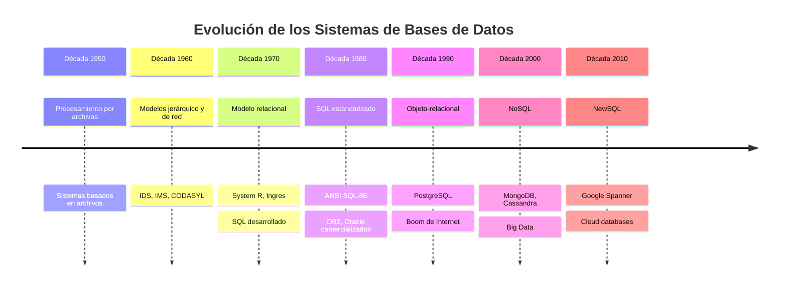

# Fundamentos de Bases de Datos - Introducción

## 1.1 Desarrollo histórico de los sistemas manejadores de bases de datos.

---

El estudio del desarrollo histórico de los Sistemas Manejadores de Bases de Datos (DBMS) es fundamental para comprender la evolución tecnológica que ha permitido organizar, almacenar y recuperar información de manera eficiente. Esta guía presenta los hitos más relevantes en esta evolución.

### Conceptos fundamentales

**Base de Datos (BD)**: Colección de datos interrelacionados que representan información sobre un dominio específico.

**Sistema Manejador de Bases de Datos (DBMS)**: Software que permite crear, mantener y controlar el acceso a las bases de datos mediante interfaces bien definidas.

**Independencia de datos**: Capacidad de modificar el esquema de la base de datos sin afectar los programas de aplicación.

### Evolución histórica de los sistemas de gestión de datos

#### 1. Era pre-bases de datos (década de 1950)

**Sistemas basados en procesamiento de archivos**:

- Datos almacenados en archivos independientes
- Alto nivel de redundancia e inconsistencia
- Dificultad para acceder a los datos
- Problemas de integridad y seguridad

```python
# Ejemplo de procesamiento con archivos planos
def buscar_empleado_por_id(archivo_empleados, id_buscado):
    with open(archivo_empleados, 'r') as archivo:
        for linea in archivo:
            campos = linea.strip().split(',')
            if campos[0] == str(id_buscado):
                return campos
    return None
```

#### 2. Primera generación: Sistemas de bases de datos jerárquicos y de red (década de 1960)

**Modelo jerárquico**:

- Estructura en árbol con relaciones padre-hijo
- IDS (Integrated Data Store) de IBM
- IMS (Information Management System)

**Modelo de red**:

- Estructura de grafos que permite relaciones más complejas
- Propuesto por CODASYL (Conference on Data Systems Languages)
- Implementado en sistemas como IDMS

**Limitaciones**:

- Complejidad en el diseño
- Falta de independencia física y lógica
- Dificultad para realizar cambios

#### 3. Segunda generación: Modelo relacional (década de 1970)

**Revolución del modelo relacional**:

- Propuesto por E.F. Codd en 1970 en el artículo "A Relational Model of Data for Large Shared Data Banks"
- Datos organizados en tablas (relaciones) con filas y columnas
- Operaciones basadas en álgebra relacional

**Álgebra relacional - operaciones fundamentales**:

Selección: $ \sigma\_{\text{condición}}(R) $
Proyección: $\pi_{atributos}(R)$
Producto cartesiano: $R × S$
Unión: $R ∪ S$
Diferencia: $R - S$

**Sistemas pioneros**:

- System R (IBM)
- Ingres (Universidad de California)

**Lenguaje SQL**:

- Desarrollado inicialmente como SEQUEL
- Se convierte en estándar ANSI en 1986

```sql
-- Ejemplo de consulta SQL temprana
SELECT nombre, departamento
FROM empleados
WHERE salario > 50000;
```

#### 4. Tercera generación: Modelo orientado a objetos y objeto-relacional (década de 1980-1990)

**Bases de datos orientadas a objetos**:

- Soporte para tipos complejos de datos
- Herencia y encapsulación
- Sistemas como ObjectStore y Versant

**Bases de datos objeto-relacionales**:

- Extensión del modelo relacional con características OO
- PostgreSQL como ejemplo destacado

#### 5. Cuarta generación: Bases de datos NoSQL y NewSQL (década de 2000-actualidad)

**Bases de datos NoSQL**:

- Diseñadas para big data y aplicaciones web escalables
- Tipos principales:
  - Documentales (MongoDB)
  - Clave-valor (Redis)
  - Columnares (Cassandra)
  - Grafos (Neo4j)

**Bases de datos NewSQL**:

- Combinan escalabilidad NoSQL con ACID del modelo relacional
- Ejemplos: Google Spanner, CockroachDB

### Diagrama de evolución histórica



### Arquitectura de tres esquemas

La arquitectura ANSI/SPARC propuesta en 1975 estableció tres niveles de abstracción:

**Esquema interno**: Describe la estructura física de almacenamiento
**Esquema conceptual**: Describe la estructura lógica de toda la base de datos
**Esquema externo**: Describe la vista de los datos para usuarios específicos

La independencia de datos se expresa como:

- Independencia física: $\Delta\text{Esquema}$ interno ≠ $\Delta\text{Esquema}$ conceptual
- Independencia lógica: $\Delta\text{Esquema}$ conceptual ≠ $\Delta\text{Esquema}$ externo

### Ejercicios propuestos

1. **Análisis comparativo**: Complete la siguiente tabla comparativa:

```markdown
| Característica         | Procesamiento archivos | Modelo jerárquico | Modelo relacional | NoSQL |
| ---------------------- | ---------------------- | ----------------- | ----------------- | ----- |
| Independencia datos    |                        |                   |                   |       |
| Flexibilidad consultas |                        |                   |                   |       |
| Escalabilidad          |                        |                   |                   |       |
| Consistencia           |                        |                   |                   |       |
```


2. **Transformación de modelos**: Dado el siguiente fragmento de un sistema jerárquico, conviértalo al modelo relacional:

```
Departamento
│
├── Empleado
│   ├── Proyecto
│   └── Salario
└── Presupuesto
```

3. **Evolución tecnológica**: Investigue y describa cómo los cambios en el hardware influyeron en la evolución de los DBMS, desde las cintas magnéticas hasta el almacenamiento en la nube.

4. **SQL histórico**: Escriba una consulta SQL que muestre cómo se habría implementado una consulta join en los primeros sistemas relacionales, comparándola con la sintaxis moderna.

### Caso de estudio: Migración de sistema legacy

Analice el caso de una empresa que migra desde un sistema de archivos COBOL hacia un DBMS relacional moderno. Identifique al menos 5 desafíos técnicos y 3 organizacionales que podrían presentarse en esta migración.

### Referencias

#### Bibliografía básica

1. Elmasri and Navathe. Fundamentals of Database Systems. Addison-Wesley. Cuarta Edición. 2006. (Capítulo 1, 2)
2. Silberschatz A., Kort H. y Sudarshan S. Fundamentos de BD. McGraw Hill. Quinta edición. 2006. (Capítulo 1)
3. Ullman J.D. and Widom J. A First Course in Data Base System. Prentice Hall. Tercera edición. 2008. (Capítulo 1)

#### Bibliografía complementaria

1. Harrington J. Relational Database Design and Implementation. Tercera edición. Morgan Kaufmann. 2009. (Capítulo 1)
2. Documentación histórica de IBM sobre System R y IMS

#### Recursos adicionales

- Artículo original de E.F. Codd: "A Relational Model of Data for Large Shared Data Banks" (1970)
- Documentación del Museo de Historia de la Computación sobre bases de datos
- Papers técnicos sobre la evolución de PostgreSQL

### Evaluación de conocimientos

1. ¿Cuál fue la contribución fundamental de E.F. Codd al campo de las bases de datos?
2. Describa las principales limitaciones de los sistemas de procesamiento de archivos.
3. Explique la diferencia entre independencia física e independencia lógica de datos.
4. ¿Qué factores impulsaron el desarrollo de las bases de datos NoSQL?
5. Compare ventajas y desventajas del modelo jerárquico vs. modelo relacional.
