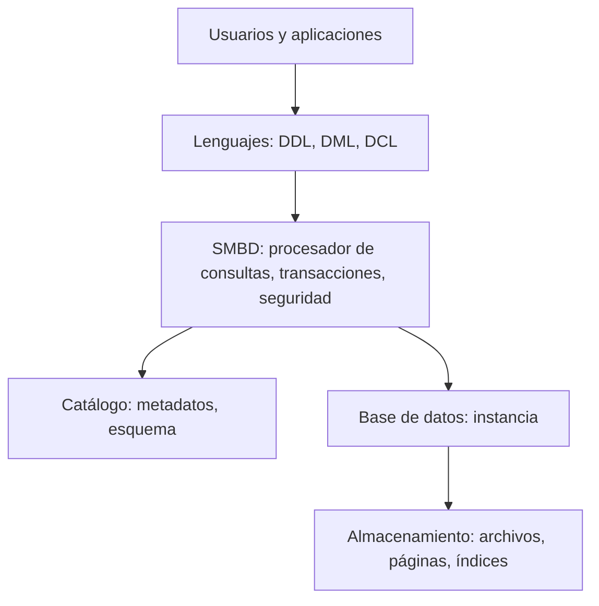

# Fundamentos de Bases de Datos - Introducción

## 1.2 Conceptos básicos de las bases de datos.

---

Antes de diseñar o consultar una base de datos hace falta un vocabulario preciso: qué es una base de datos y qué es el sistema que la maneja, qué diferencia hay entre el **esquema** y la **instancia**, entre **datos**, **información** y **metadatos**, qué significa **independencia de datos**, qué lenguajes ofrece un SMBD y quiénes lo usan. Este tema define esos conceptos y los ilustra con un sistema de reservas de hotel implementado en SQLite.

### Definiciones

- **Base de datos:** colección de datos **relacionados**, **persistentes** y **compartidos**, que representa algún aspecto del mundo real (el minimundo), diseñada para un propósito y un grupo de usuarios.
- **Sistema manejador de bases de datos** (SMBD): el software que permite definir, construir, manipular, compartir y proteger bases de datos: PostgreSQL, MySQL, Oracle, SQL Server, SQLite.
- **Sistema de base de datos:** la base de datos, el SMBD y las aplicaciones que los usan.
- **Datos:** hechos registrados sin interpretación, como "102", "doble", "1300".
- **Información:** datos procesados en un contexto que permiten tomar decisiones: "hay 2 habitaciones dobles libres en Navidad".
- **Metadatos:** datos sobre los datos: nombres de tablas y columnas, tipos, restricciones, índices, permisos. El SMBD los guarda en su **catálogo** o **diccionario de datos**, que es a su vez una base de datos que se puede consultar.

### Esquema e instancia

El **esquema** es la descripción de la estructura de la base de datos: qué tablas hay, con qué columnas, tipos y restricciones. Cambia poco, y se define con el lenguaje de definición de datos. La **instancia** o **estado** es el contenido en un momento dado, que cambia con cada inserción o actualización. Una instancia es **válida** si cumple todas las restricciones del esquema; el SMBD rechaza las operaciones que la harían inválida.

### Niveles y modelos de datos

Un **modelo de datos** es el conjunto de conceptos con que se describe la estructura de una base de datos, sus operaciones y sus restricciones:

- **Conceptuales** o de alto nivel, cercanos a como los usuarios ven el dominio: entidad-relación (tema 3).
- **Lógicos** o de implementación: relacional (temas 2.2 y 4), de documentos, de objetos.
- **Físicos:** cómo se guardan los datos en disco: archivos, páginas, índices.

La **arquitectura de tres niveles** ANSI/SPARC (tema 1.3) separa el nivel **interno** (almacenamiento), el **conceptual** (todo el esquema lógico) y el **externo** (vistas de cada grupo de usuarios). De ella se siguen dos propiedades:

- **Independencia física:** cambiar el nivel interno, por ejemplo crear un índice, comprimir o particionar una tabla, sin cambiar el esquema conceptual ni los programas.
- **Independencia lógica:** cambiar el esquema conceptual, por ejemplo agregar una columna o dividir una tabla, sin cambiar las vistas externas ni los programas que las usan. Es más difícil de lograr.

### Lenguajes

- **Definición de datos** (DDL): `CREATE`, `ALTER`, `DROP` de tablas, vistas e índices.
- **Manipulación de datos** (DML): `SELECT`, `INSERT`, `UPDATE`, `DELETE`. Es **declarativo**: se dice qué datos se quieren, no cómo obtenerlos.
- **Control de datos** (DCL): `GRANT` y `REVOKE` de permisos.
- **Control de transacciones:** `BEGIN`, `COMMIT`, `ROLLBACK` (tema 9.4).

En SQL todos forman un solo lenguaje.

### Funciones de un SMBD

Abstracción e independencia de datos; control de la **redundancia**; cumplimiento de **restricciones de integridad** (temas 8.1 a 8.4); **control de concurrencia** para que muchos usuarios trabajen a la vez sin interferir (tema 9.3); **recuperación** tras fallas mediante bitácoras; **seguridad** y control de acceso; **optimización** de consultas (tema 6.6).

### Usuarios

- **Administrador de la base de datos** (DBA): autoriza accesos, monitorea el rendimiento, respalda y recupera.
- **Diseñadores:** identifican los datos y definen el esquema.
- **Programadores de aplicaciones:** escriben los programas que usan la base.
- **Usuarios finales:** casuales, que hacen consultas ocasionales; paramétricos, que usan transacciones predefinidas como un sistema de reservas, y sofisticados, como los analistas.



### Implementación en Python

El programa crea en SQLite el esquema del hotel con sus restricciones, inserta datos, consulta las habitaciones disponibles para un intervalo de fechas, actualiza una reserva y muestra cómo el SMBD rechaza datos inválidos (ejercicios 2 y 5); consulta los metadatos en el catálogo (ejercicio 1); define dos esquemas externos como vistas sobre el esquema escolar (ejercicio 3), y crea un índice para mostrar la independencia física: el plan de ejecución cambia, el resultado no (ejercicio 4).

```python
import sqlite3

db = sqlite3.connect(":memory:")
db.execute("PRAGMA foreign_keys = ON")

# --- Ejercicios 2 y 5: hotel ---
db.executescript("""
CREATE TABLE huesped (
    id_huesped INTEGER PRIMARY KEY,
    nombre     TEXT NOT NULL,
    correo     TEXT UNIQUE,
    telefono   TEXT
);
CREATE TABLE habitacion (
    numero  INTEGER PRIMARY KEY,
    tipo    TEXT NOT NULL CHECK (tipo IN ('sencilla', 'doble', 'suite')),
    tarifa  NUMERIC NOT NULL CHECK (tarifa > 0)
);
CREATE TABLE reserva (
    id_reserva  INTEGER PRIMARY KEY,
    id_huesped  INTEGER NOT NULL REFERENCES huesped,
    numero      INTEGER NOT NULL REFERENCES habitacion,
    llegada     TEXT NOT NULL,
    salida      TEXT NOT NULL,
    estado      TEXT NOT NULL DEFAULT 'confirmada'
                CHECK (estado IN ('confirmada', 'en curso', 'concluida', 'cancelada')),
    CHECK (salida > llegada)
);
CREATE TABLE factura (
    id_factura  INTEGER PRIMARY KEY,
    id_reserva  INTEGER NOT NULL UNIQUE REFERENCES reserva,
    total       NUMERIC NOT NULL,
    emitida     TEXT NOT NULL
);
INSERT INTO habitacion VALUES (101, 'sencilla', 900), (102, 'doble', 1300), (201, 'doble', 1300), (301, 'suite', 2500);
INSERT INTO huesped (nombre, correo) VALUES ('Carmen Ruiz', 'carmen@ejemplo.mx'), ('Raúl Díaz', 'raul@ejemplo.mx');
INSERT INTO reserva (id_huesped, numero, llegada, salida) VALUES
    (1, 102, '2026-12-20', '2026-12-24'), (2, 301, '2026-12-22', '2026-12-26'), (2, 101, '2026-12-01', '2026-12-03');
""")
print("ejercicio 5: insertar un huésped")
db.execute("INSERT INTO huesped (nombre, correo, telefono) VALUES (?, ?, ?)", ("Lucía Mora", "lucia@ejemplo.mx", "555-0101"))
print("  ", db.execute("SELECT * FROM huesped WHERE nombre = 'Lucía Mora'").fetchone())

disponibles = """
    SELECT h.numero, h.tipo, h.tarifa FROM habitacion h
    WHERE NOT EXISTS (
        SELECT 1 FROM reserva r
        WHERE r.numero = h.numero AND r.estado <> 'cancelada'
          AND r.llegada < :salida AND :llegada < r.salida)      -- los intervalos se traslapan
    ORDER BY h.numero"""
for llegada, salida in (("2026-12-21", "2026-12-23"), ("2026-12-24", "2026-12-26")):
    print(f"   habitaciones libres del {llegada} al {salida}:",
          db.execute(disponibles, {"llegada": llegada, "salida": salida}).fetchall())
db.execute("UPDATE reserva SET estado = 'cancelada' WHERE id_reserva = 1")
print("   tras cancelar la reserva 1, libres del 2026-12-21 al 2026-12-23:",
      db.execute(disponibles, {"llegada": "2026-12-21", "salida": "2026-12-23"}).fetchall())
for sql in ("INSERT INTO reserva (id_huesped, numero, llegada, salida) VALUES (1, 101, '2026-12-05', '2026-12-04')",
            "INSERT INTO reserva (id_huesped, numero, llegada, salida) VALUES (9, 101, '2026-12-05', '2026-12-06')",
            "UPDATE reserva SET estado = 'perdida' WHERE id_reserva = 2"):
    try:
        db.execute(sql)
    except sqlite3.IntegrityError as e:
        print("   rechazado por el SMBD:", e)

# --- Ejercicio 1: los metadatos viven en el catálogo ---
print("ejercicio 1: metadatos de la tabla habitacion en el catálogo")
for col in db.execute("PRAGMA table_info(habitacion)"):
    print("  ", col[1:4])

# --- Ejercicio 3: esquemas externos e interno para el esquema escolar ---
db.executescript("""
CREATE TABLE estudiante (matricula TEXT PRIMARY KEY, nombre TEXT NOT NULL, fecha_nacimiento TEXT, carrera TEXT);
CREATE TABLE curso (codigo TEXT PRIMARY KEY, nombre TEXT NOT NULL, creditos INTEGER);
CREATE TABLE inscripcion (matricula TEXT REFERENCES estudiante, codigo_curso TEXT REFERENCES curso,
                          calificacion NUMERIC, PRIMARY KEY (matricula, codigo_curso));
INSERT INTO estudiante VALUES ('A01', 'Elena Paz', '2004-03-10', 'Computación'), ('A02', 'Marco Gil', '2003-11-02', 'Matemáticas');
INSERT INTO curso VALUES ('BD1', 'Bases de datos', 8), ('AL1', 'Álgebra lineal', 10);
INSERT INTO inscripcion VALUES ('A01', 'BD1', 9.5), ('A01', 'AL1', 8.0), ('A02', 'AL1', 9.0);
-- esquema externo de un profesor: lista de su curso, sin fecha de nacimiento
CREATE VIEW lista_curso AS
    SELECT i.codigo_curso, e.matricula, e.nombre, i.calificacion
    FROM inscripcion i JOIN estudiante e USING (matricula);
-- esquema externo de servicios escolares: promedio y créditos por estudiante
CREATE VIEW kardex AS
    SELECT e.matricula, e.nombre, e.carrera, ROUND(AVG(i.calificacion), 2) AS promedio, SUM(c.creditos) AS creditos
    FROM estudiante e LEFT JOIN inscripcion i USING (matricula) LEFT JOIN curso c ON c.codigo = i.codigo_curso
    GROUP BY e.matricula;
""")
print("ejercicio 3: vista del profesor de BD1:", db.execute("SELECT * FROM lista_curso WHERE codigo_curso = 'BD1'").fetchall())
print("   vista de servicios escolares:", db.execute("SELECT * FROM kardex").fetchall())

# --- Ejercicio 4: independencia física ---
consulta = "SELECT nombre FROM estudiante WHERE carrera = 'Computación'"
plan = lambda: [r[3] for r in db.execute("EXPLAIN QUERY PLAN " + consulta)]
antes, res1 = plan(), db.execute(consulta).fetchall()
db.execute("CREATE INDEX idx_carrera ON estudiante(carrera)")        # cambio solo en el nivel interno
despues, res2 = plan(), db.execute(consulta).fetchall()
print("ejercicio 4: plan antes", antes, "| después", despues, "| mismo resultado:", res1 == res2)
```

Salida:

```text
ejercicio 5: insertar un huésped
   (3, 'Lucía Mora', 'lucia@ejemplo.mx', '555-0101')
   habitaciones libres del 2026-12-21 al 2026-12-23: [(101, 'sencilla', 900), (201, 'doble', 1300)]
   habitaciones libres del 2026-12-24 al 2026-12-26: [(101, 'sencilla', 900), (102, 'doble', 1300), (201, 'doble', 1300)]
   tras cancelar la reserva 1, libres del 2026-12-21 al 2026-12-23: [(101, 'sencilla', 900), (102, 'doble', 1300), (201, 'doble', 1300)]
   rechazado por el SMBD: CHECK constraint failed: salida > llegada
   rechazado por el SMBD: FOREIGN KEY constraint failed
   rechazado por el SMBD: CHECK constraint failed: estado IN ('confirmada', 'en curso', 'concluida', 'cancelada')
ejercicio 1: metadatos de la tabla habitacion en el catálogo
   ('numero', 'INTEGER', 0)
   ('tipo', 'TEXT', 1)
   ('tarifa', 'NUMERIC', 1)
ejercicio 3: vista del profesor de BD1: [('BD1', 'A01', 'Elena Paz', 9.5)]
   vista de servicios escolares: [('A01', 'Elena Paz', 'Computación', 8.75, 18), ('A02', 'Marco Gil', 'Matemáticas', 9.0, 10)]
ejercicio 4: plan antes ['SCAN estudiante'] | después ['SEARCH estudiante USING INDEX idx_carrera (carrera=?)'] | mismo resultado: True
```

### Ejercicios Propuestos

1. **Datos, información y metadatos.** Un sistema de biblioteca guarda de cada libro el ISBN, el título, el autor, el año y las copias disponibles, y un bibliotecario consulta cuántos libros de Gabriel García Márquez están disponibles. Identifica los datos, la información y los metadatos.

2. **Esquema conceptual.** Diseña un esquema conceptual para un sistema de reservas de hotel con huéspedes, habitaciones, reservas y facturas.

3. **Niveles.** Para el esquema conceptual con `Estudiante(matrícula, nombre, fecha_nacimiento, carrera)`, `Curso(código, nombre, créditos)` e `Inscripción(matrícula, código_curso, calificación)`, propón un esquema interno y dos esquemas externos para distintos usuarios.

4. **Independencia física.** Explica cómo se mantiene la independencia física si una tabla pasa de un archivo simple a un almacenamiento particionado.

5. **SQL.** Escribe el DDL del ejercicio 2 y sentencias DML para insertar un huésped, consultar las habitaciones disponibles en ciertas fechas y actualizar el estado de una reserva.

### Soluciones

**Ejercicio 1.**

- **Datos:** cada valor almacenado: "978-0-307-47472-8", "Cien años de soledad", "Gabriel García Márquez", "1967", "3".
- **Información:** la respuesta a la consulta, por ejemplo "hay 5 ejemplares disponibles de García Márquez entre 3 títulos", que sirve para decidir un préstamo.
- **Metadatos:** que existe una tabla `libro` con las columnas ISBN (cadena de 13 caracteres, clave primaria), título, autor, año (entero) y copias (entero no negativo). El programa muestra cómo SQLite los guarda en su catálogo y se consultan con `PRAGMA table_info`.

**Ejercicio 2.** Entidades: **Huésped** (identificador, nombre, correo, teléfono), **Habitación** (número, tipo, tarifa), **Reserva** (identificador, llegada, salida, estado) y **Factura** (identificador, total, fecha). Relaciones: un huésped hace muchas reservas; una reserva es de una habitación, y una habitación tiene muchas reservas a lo largo del tiempo; cada reserva genera a lo sumo una factura. Restricciones: la salida es posterior a la llegada, la tarifa es positiva, el estado toma valores de un conjunto fijo, y dos reservas activas de la misma habitación no se traslapan. Esta última no se puede expresar con un `CHECK` de una fila; se verifica en la consulta de disponibilidad o con un disparador (tema 8.4).

**Ejercicio 3.** **Interno:** `estudiante` organizada por su clave primaria `matricula` (en SQLite, un árbol B); índice secundario sobre `carrera` para las consultas por carrera; `inscripcion` con clave compuesta $(\text{matrícula}, \text{código\_curso}),$ que sirve también como índice para las búsquedas por estudiante, y un índice sobre `codigo_curso` para las listas de grupo. **Externo del profesor:** la vista `lista_curso`, con matrícula, nombre y calificación de su curso, sin datos personales como la fecha de nacimiento. **Externo de servicios escolares:** la vista `kardex`, con el promedio y los créditos de cada estudiante, calculados a partir de las tres tablas.

**Ejercicio 4.** El particionamiento, por ejemplo de `reserva` por año, es un cambio del nivel **interno**: el SMBD guarda cada partición en un archivo distinto y mantiene en el catálogo la regla de partición. El **mapeo** entre los niveles conceptual e interno se actualiza para que una consulta sobre `reserva` se traduzca en lecturas de las particiones necesarias (y solo de ellas, si el filtro es por fecha). Como el esquema conceptual no cambia, los programas siguen funcionando sin modificarse; solo cambia su rendimiento. El programa lo ilustra con un índice: el plan pasa de recorrer toda la tabla a buscar en el índice, y el resultado es idéntico.

**Ejercicio 5.** Es el DDL del programa. La consulta de disponibilidad usa la condición de traslape de intervalos: dos estancias $[a_1, b_1)$ y $[a_2, b_2)$ se traslapan si y solo si $a_1 \lt b_2$ y $a_2 \lt b_1;$ una habitación está libre si no tiene ninguna reserva no cancelada que se traslape. Cancelar la reserva 1 libera la habitación 102 para esas fechas. El SMBD rechaza una reserva con salida anterior a la llegada, una de un huésped inexistente y un estado no permitido.

### Referencias

1. Elmasri, R., and Navathe, S. B., _Fundamentals of Database Systems_. Pearson, 2016. Capítulos 1 y 2.
2. Silberschatz, A., Korth, H. F., and Sudarshan, S., _Database System Concepts_. McGraw-Hill, 2019. Capítulo 1.
3. Date, C. J., _An Introduction to Database Systems_. Addison-Wesley, 2003. Capítulos 1 y 2.
4. SQLite, _SQL As Understood By SQLite_. Documentación en línea, sqlite.org.
